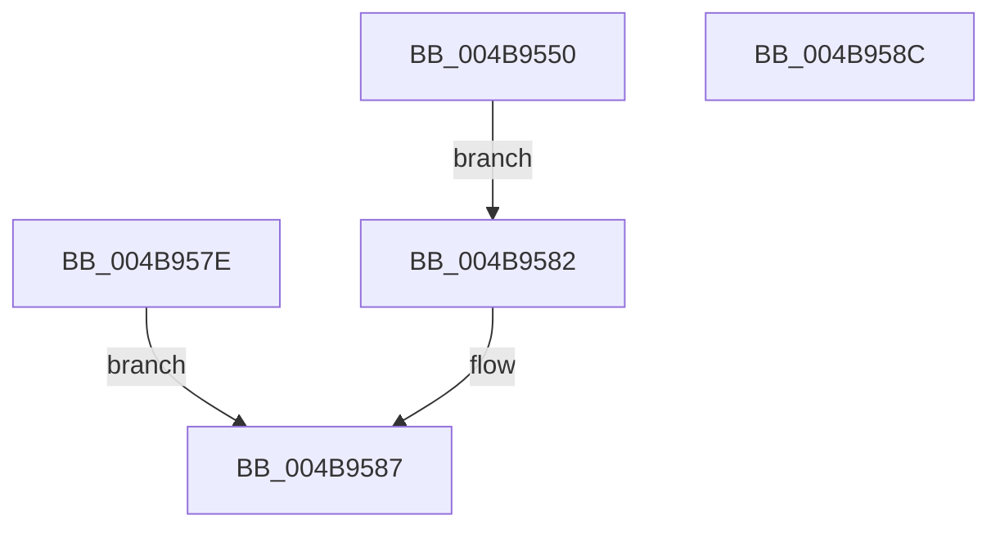

# CfgAddressToBitState

- RVA: `0x004B9550`–`0x004B958D` (길이 `61` bytes)
- VA: `0x00000001404B9550`
- 실행 섹션: `.text`
- PDB 이름 있음: `예`; PDB Function 태그: `아니요`
- unwind 정보 RVA: `0x000BB224`
- 디코드: `20`개 명령, `61/61` bytes 표시
- 미해석 바이트: `0` (있으면 어셈블리에 `.byte`로 보존)

> 이 문서는 커널 이미지의 기계어와 PDB 기호를 분석해 생성했습니다. 4번과 5번은 함수 원형과 자료형을 바이너리 사용 방식에서 추정한 C 해석이며 원본 소스 복구 결과는 아닙니다.

## 1. Dependencies

- 직접 호출 지점: **0**; 고유 호출 대상: **0**
- 직접 호출자로 확인된 함수: **3**
- RIP 상대 이미지 참조: **0**

### Outgoing calls
- 직접 디코드된 call 명령이 없습니다.

### Direct callers
- [MiCheckVerifierFunctionsCfgState](../../page/80/MiCheckVerifierFunctionsCfgState_function_0080C918.md) at `0x0080C993`
- [MiCfgMarkValidEntries](../../page/9F/MiCfgMarkValidEntries_function_009F4FE8.md) at `0x009F520C`
- [MiValidateUserCallTarget](../../page/AC/MiValidateUserCallTarget_function_00AC09A0.md) at `0x00AC09CF`

### Static image references
- 디코드된 RIP-relative 메모리 참조가 없습니다.

## 2. Other-region calls and transfers

- 다른 실행 섹션으로 향하는 call: **0**
- 별도 외부 분기/꼬리 이동을 확인하지 못했습니다.

## 3. Assembly (complete function range)

```asm
004B9550  48 83 EC 18                     sub rsp, 0x18
004B9554  48 C1 E9 04                     shr rcx, 4
004B9558  48 03 C9                        add rcx, rcx
004B955B  48 0F A3 0A                     bt qword ptr [rdx], rcx
004B955F  0F 92 C0                        setb al
004B9562  44 0F B6 C0                     movzx r8d, al
004B9566  44 89 04 24                     mov dword ptr [rsp], r8d
004B956A  48 8D 41 01                     lea rax, [rcx + 1]
004B956E  48 0F A3 02                     bt qword ptr [rdx], rax
004B9572  0F 92 C0                        setb al
004B9575  0F B6 C0                        movzx eax, al
004B9578  89 44 24 04                     mov dword ptr [rsp + 4], eax
004B957C  EB 04                           jmp 0x1404b9582
004B957E  33 C0                           xor eax, eax
004B9580  EB 05                           jmp 0x1404b9587
004B9582  03 C0                           add eax, eax
004B9584  41 0B C0                        or eax, r8d
004B9587  48 83 C4 18                     add rsp, 0x18
004B958B  C3                              ret
004B958C  CC                              int3
```

## 4. C-style interpretation (structured pseudocode)

```c
__int64 __fastcall CfgAddressToBitState(__int64 a1, __int64 a2)
{
    __int64 result;
    __int64 v_rsp;
    unsigned int v_stack_m14;
    unsigned int v_stack_m18;

    v_rsp = (v_rsp) - (24);
    a1 = (a1) >> (4);
    a1 = (a1) + (a1);
    result = (condition_is_below) ? 1 : 0;
    v_stack_m18 = (unsigned int)((unsigned __int8)(result));
    result = (condition_is_below) ? 1 : 0;
    v_stack_m14 = (unsigned int)((unsigned __int8)(result));
    goto loc_004B9582;
loc_004B9582:
    result = (unsigned int)(((unsigned __int8)(result)) + ((unsigned int)((unsigned __int8)(result))));
    result = (unsigned int)((result) | ((unsigned int)((unsigned __int8)(result))));
loc_004B9587:
    v_rsp = (v_rsp) + (24);
    return result;
}
```

## 5. (Beta) C Style

```c
int64_t CfgAddressToBitState(int64_t Arg1, void *Arg2)
{
    uint8_t *arg2 = (uint8_t *)Arg2;

    int64_t result;
    int64_t local_rsp;
    uint32_t v_stack_m14;
    uint32_t v_stack_m18;

    local_rsp = (local_rsp) - (24);
    Arg1 = (Arg1) >> (4);
    Arg1 = (Arg1) + (Arg1);
    result = (condition_is_below) ? 1 : 0;
    v_stack_m18 = (uint32_t)((uint8_t)(result));
    result = (condition_is_below) ? 1 : 0;
    v_stack_m14 = (uint32_t)((uint8_t)(result));
    goto loc_004B9582;
loc_004B9582:
    result = (uint32_t)(((uint8_t)(result)) + ((uint32_t)((uint8_t)(result))));
    result = (uint32_t)((result) | ((uint32_t)((uint8_t)(result))));
loc_004B9587:
    local_rsp = (local_rsp) + (24);
    return result;
}
```

### 관측된 메모리 오프셋

구조체 형식이 확인되지 않은 접근은 인자 기준의 오프셋으로만 기록했습니다.

| 기준 인자 | 오프셋 표현 | 폭 (bit) | 접근 |
|---|---:|---:|---|
| `Arg2` | `+ 0x0` | `64` | `R` |

## 6. Execution-region graph

[열기: 2D/3D 그래프와 함수 탐색 컨트롤 패널](../../../control-panel.html?section=text&rva=0x004B9550&view=graph)

- 2D 그래프는 위에서 아래로 흐르고, 3D 그래프는 빈 공간을 드래그해 회전합니다. Shift+드래그는 이동, 휠은 확대·축소, 함수 노드 선택은 대상 보고서 이동입니다.

### Static fallback


