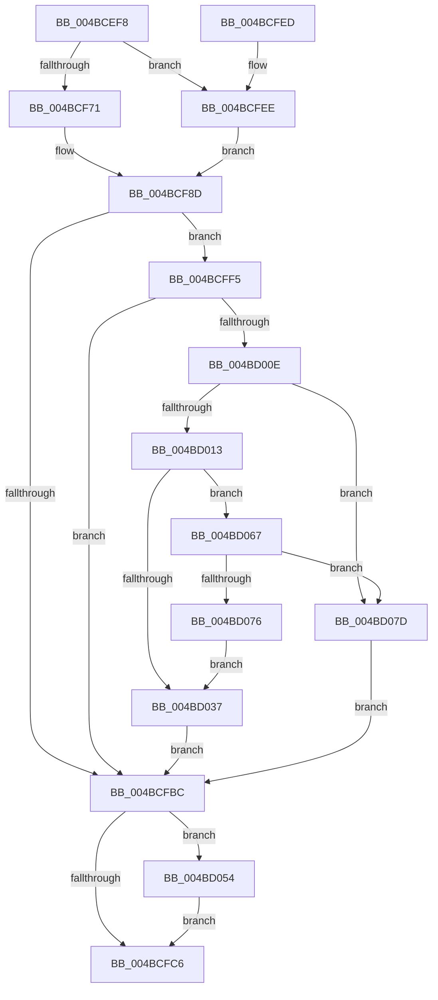

# CmpAdjustFileCFSafety

- RVA: `0x004BCEF8`–`0x004BD085` (길이 `397` bytes)
- VA: `0x00000001404BCEF8`
- 실행 섹션: `.text`
- PDB 이름 있음: `예`; PDB Function 태그: `아니요`
- unwind 정보 RVA: `0x000BBCD4`
- 디코드: `102`개 명령, `397/397` bytes 표시
- 미해석 바이트: `0` (있으면 어셈블리에 `.byte`로 보존)

> 이 문서는 커널 이미지의 기계어와 PDB 기호를 분석해 생성했습니다. 4번과 5번은 함수 원형과 자료형을 바이너리 사용 방식에서 추정한 C 해석이며 원본 소스 복구 결과는 아닙니다.

## 1. Dependencies

- 직접 호출 지점: **7**; 고유 호출 대상: **6**
- 직접 호출자로 확인된 함수: **3**
- RIP 상대 이미지 참조: **8**

### Outgoing calls
- `0x004BCFB1` → [ObReferenceObjectByHandle](../../page/86/ObReferenceObjectByHandle_function_00868DB0.md) (function, `0x00868DB0`)
- `0x004BCFCF` → [_security_check_cookie](../6A/_security_check_cookie_function_006AC640.md) (function, `0x006AC640`)
- `0x004BD003` → [FsRtlSetKernelEaFile](../../page/A0/FsRtlSetKernelEaFile_function_00A0C8B0.md) (function, `0x00A0C8B0`)
- `0x004BD02C` → [ZwQueryInformationFile](../6A/ZwQueryInformationFile_function_006AD2F0.md) (function, `0x006AD2F0`)
- `0x004BD04A` → [FsRtlSetKernelEaFile](../../page/A0/FsRtlSetKernelEaFile_function_00A0C8B0.md) (function, `0x00A0C8B0`)
- `0x004BD05D` → [ObfDereferenceObjectWithTag](../2F/ObfDereferenceObjectWithTag_function_002F78E0.md) (function, `0x002F78E0`)
- `0x004BD06D` → [RtlIsCloudFilesPlaceholder](../49/RtlIsCloudFilesPlaceholder_function_0049D4A0.md) (function, `0x0049D4A0`)

### Direct callers
- [sub_006F34C4](../6F/Unknown_function_006F34C4.md) at `0x006F34F0`
- [CmpCmdHiveClose](../../page/9B/CmpCmdHiveClose_function_009B3948.md) at `0x009B3AB7`
- [sub_00B1802A](../../page/B1/Unknown_function_00B1802A.md) at `0x00B18149`

### Static image references
- `0x004BCF11` → RVA `0x00E0A740` (`.data`; read)
- `0x004BCF1F` → RVA `0x006D0980` (`.text`; read)
- `0x004BCF2E` → RVA `0x006D0984` (`.text`; read)
- `0x004BCF3F` → RVA `0x006D0986` (`.text`; read)
- `0x004BCF62` → RVA `0x006D0970` (` ?? ::FNODOBFM::`string'`; read)
- `0x004BCF79` → RVA `0x006D0990` (` ?? ::FNODOBFM::`string'`; read)
- `0x004BCF84` → RVA `0x006D0992` (`.text`; read)
- `0x004BCF8D` → RVA `0x00EF7C68` (`.data`; read)

## 2. Other-region calls and transfers

- 다른 실행 섹션으로 향하는 call: **3**
  - `0x004BCFB1` → [ObReferenceObjectByHandle](../../page/86/ObReferenceObjectByHandle_function_00868DB0.md) (`.text` → `PAGE`)
  - `0x004BD003` → [FsRtlSetKernelEaFile](../../page/A0/FsRtlSetKernelEaFile_function_00A0C8B0.md) (`.text` → `PAGE`)
  - `0x004BD04A` → [FsRtlSetKernelEaFile](../../page/A0/FsRtlSetKernelEaFile_function_00A0C8B0.md) (`.text` → `PAGE`)
- 별도 외부 분기/꼬리 이동을 확인하지 못했습니다.

## 3. Assembly (complete function range)

```asm
004BCEF8  48 89 5C 24 10                  mov qword ptr [rsp + 0x10], rbx
004BCEFD  48 89 74 24 18                  mov qword ptr [rsp + 0x18], rsi
004BCF02  55                              push rbp
004BCF03  41 56                           push r14
004BCF05  41 57                           push r15
004BCF07  48 8B EC                        mov rbp, rsp
004BCF0A  48 81 EC 80 00 00 00            sub rsp, 0x80
004BCF11  48 8B 05 28 D8 94 00            mov rax, qword ptr [rip + 0x94d828]
004BCF18  48 33 C4                        xor rax, rsp
004BCF1B  48 89 45 F8                     mov qword ptr [rbp - 8], rax
004BCF1F  8B 05 5B 3A 21 00               mov eax, dword ptr [rip + 0x213a5b]
004BCF25  45 33 FF                        xor r15d, r15d
004BCF28  89 45 E8                        mov dword ptr [rbp - 0x18], eax
004BCF2B  0F 57 C0                        xorps xmm0, xmm0
004BCF2E  0F B7 05 4F 3A 21 00            movzx eax, word ptr [rip + 0x213a4f]
004BCF35  40 8A F2                        mov sil, dl
004BCF38  66 89 45 EC                     mov word ptr [rbp - 0x14], ax
004BCF3C  4C 8B F1                        mov r14, rcx
004BCF3F  8A 05 41 3A 21 00               mov al, byte ptr [rip + 0x213a41]
004BCF45  88 45 EE                        mov byte ptr [rbp - 0x12], al
004BCF48  4C 89 7D B8                     mov qword ptr [rbp - 0x48], r15
004BCF4C  4C 89 7D EF                     mov qword ptr [rbp - 0x11], r15
004BCF50  44 88 7D F7                     mov byte ptr [rbp - 9], r15b
004BCF54  44 89 7D D0                     mov dword ptr [rbp - 0x30], r15d
004BCF58  66 C7 45 D4 00 16               mov word ptr [rbp - 0x2c], 0x1600
004BCF5E  0F 11 45 C0                     movups xmmword ptr [rbp - 0x40], xmm0
004BCF62  0F 10 05 07 3A 21 00            movups xmm0, xmmword ptr [rip + 0x213a07]
004BCF69  0F 11 45 D8                     movups xmmword ptr [rbp - 0x28], xmm0
004BCF6D  84 D2                           test dl, dl
004BCF6F  74 7D                           je 0x1404bcfee
004BCF71  41 8D 47 03                     lea eax, [r15 + 3]
004BCF75  66 89 45 D6                     mov word ptr [rbp - 0x2a], ax
004BCF79  0F B7 05 10 3A 21 00            movzx eax, word ptr [rip + 0x213a10]
004BCF80  66 89 45 EF                     mov word ptr [rbp - 0x11], ax
004BCF84  8A 05 08 3A 21 00               mov al, byte ptr [rip + 0x213a08]
004BCF8A  88 45 F1                        mov byte ptr [rbp - 0xf], al
004BCF8D  48 8B 05 D4 AC A3 00            mov rax, qword ptr [rip + 0xa3acd4]
004BCF94  45 33 C9                        xor r9d, r9d
004BCF97  4C 89 7C 24 28                  mov qword ptr [rsp + 0x28], r15
004BCF9C  BA 02 01 00 00                  mov edx, 0x102
004BCFA1  4C 89 7D B0                     mov qword ptr [rbp - 0x50], r15
004BCFA5  4C 8B 00                        mov r8, qword ptr [rax]
004BCFA8  48 8D 45 B0                     lea rax, [rbp - 0x50]
004BCFAC  48 89 44 24 20                  mov qword ptr [rsp + 0x20], rax
004BCFB1  E8 FA BD 3A 00                  call 0x140868db0
004BCFB6  8B D8                           mov ebx, eax
004BCFB8  85 C0                           test eax, eax
004BCFBA  79 39                           jns 0x1404bcff5
004BCFBC  4C 39 7D B0                     cmp qword ptr [rbp - 0x50], r15
004BCFC0  0F 85 8E 00 00 00               jne 0x1404bd054
004BCFC6  8B C3                           mov eax, ebx
004BCFC8  48 8B 4D F8                     mov rcx, qword ptr [rbp - 8]
004BCFCC  48 33 CC                        xor rcx, rsp
004BCFCF  E8 6C F6 1E 00                  call 0x1406ac640
004BCFD4  4C 8D 9C 24 80 00 00 00         lea r11, [rsp + 0x80]
004BCFDC  49 8B 5B 28                     mov rbx, qword ptr [r11 + 0x28]
004BCFE0  49 8B 73 30                     mov rsi, qword ptr [r11 + 0x30]
004BCFE4  49 8B E3                        mov rsp, r11
004BCFE7  41 5F                           pop r15
004BCFE9  41 5E                           pop r14
004BCFEB  5D                              pop rbp
004BCFEC  C3                              ret
004BCFED  CC                              int3
004BCFEE  66 44 89 7D D6                  mov word ptr [rbp - 0x2a], r15w
004BCFF3  EB 98                           jmp 0x1404bcf8d
004BCFF5  48 8B 4D B0                     mov rcx, qword ptr [rbp - 0x50]
004BCFF9  48 8D 55 D0                     lea rdx, [rbp - 0x30]
004BCFFD  41 B8 28 00 00 00               mov r8d, 0x28
004BD003  E8 A8 F8 54 00                  call 0x140a0c8b0
004BD008  8B D8                           mov ebx, eax
004BD00A  85 C0                           test eax, eax
004BD00C  78 AE                           js 0x1404bcfbc
004BD00E  40 84 F6                        test sil, sil
004BD011  74 6A                           je 0x1404bd07d
004BD013  41 B9 08 00 00 00               mov r9d, 8
004BD019  C7 44 24 20 23 00 00 00         mov dword ptr [rsp + 0x20], 0x23
004BD021  4C 8D 45 B8                     lea r8, [rbp - 0x48]
004BD025  49 8B CE                        mov rcx, r14
004BD028  48 8D 55 C0                     lea rdx, [rbp - 0x40]
004BD02C  E8 BF 02 1F 00                  call 0x1406ad2f0
004BD031  8B D8                           mov ebx, eax
004BD033  85 C0                           test eax, eax
004BD035  79 30                           jns 0x1404bd067
004BD037  48 8B 4D B0                     mov rcx, qword ptr [rbp - 0x50]
004BD03B  48 8D 55 D0                     lea rdx, [rbp - 0x30]
004BD03F  41 B8 28 00 00 00               mov r8d, 0x28
004BD045  66 44 89 7D D6                  mov word ptr [rbp - 0x2a], r15w
004BD04A  E8 61 F8 54 00                  call 0x140a0c8b0
004BD04F  E9 68 FF FF FF                  jmp 0x1404bcfbc
004BD054  48 8B 4D B0                     mov rcx, qword ptr [rbp - 0x50]
004BD058  BA 44 66 6C 74                  mov edx, 0x746c6644
004BD05D  E8 7E A8 E3 FF                  call 0x1402f78e0
004BD062  E9 5F FF FF FF                  jmp 0x1404bcfc6
004BD067  8B 55 BC                        mov edx, dword ptr [rbp - 0x44]
004BD06A  8B 4D B8                        mov ecx, dword ptr [rbp - 0x48]
004BD06D  E8 2E 04 FE FF                  call 0x14049d4a0
004BD072  84 C0                           test al, al
004BD074  74 07                           je 0x1404bd07d
004BD076  BB 84 01 00 C0                  mov ebx, 0xc0000184
004BD07B  EB BA                           jmp 0x1404bd037
004BD07D  41 8B DF                        mov ebx, r15d
004BD080  E9 37 FF FF FF                  jmp 0x1404bcfbc
```

## 4. C-style interpretation (structured pseudocode)

```c
__int64 __fastcall CmpAdjustFileCFSafety(__int64 a1, unsigned __int8 a2, __int64 a3, int a4)
{
    __int64 result;
    __int64 v_r15;
    __int64 v_rsp;
    unsigned __int64 v_stack_m18;
    unsigned __int64 v_stack_m20;
    unsigned __int8 v_stack_m21;
    unsigned __int8 v_stack_m27;
    unsigned __int64 v_stack_m29;
    unsigned __int8 v_stack_m2A;
    unsigned __int16 v_stack_m2C;
    unsigned int v_stack_m30;
    unsigned __int64 v_stack_m40;
    unsigned __int16 v_stack_m42;
    unsigned __int16 v_stack_m44;
    unsigned int v_stack_m48;
    unsigned __int64 v_stack_m58;
    unsigned int v_stack_m5C;
    unsigned __int64 v_stack_m60;
    unsigned __int64 v_stack_m68;
    unsigned __int64 v_stack_m70;
    unsigned __int64 v_stack_m78;
    unsigned __int64 v_stack_p10;
    unsigned __int64 v_stack_p18;

    v_stack_p10 = v_rbx;
    v_stack_p18 = v_rsi;
    v_rsp = (v_rsp) - (128);
    result = (*(unsigned __int64 *)(v_rip + 9754664)) ^ (v_rsp);
    v_stack_m20 = result;
    v_r15 = 0;
    v_stack_m30 = (unsigned int)((unsigned int)(*(unsigned int *)(v_rip + 2177627)));
    v_stack_m2C = (unsigned __int16)(*(unsigned __int16 *)(v_rip + 2177615));
    v_stack_m2A = (unsigned __int8)(*(unsigned __int8 *)(v_rip + 2177601));
    v_stack_m60 = 0;
    v_stack_m29 = 0;
    v_stack_m21 = 0;
    v_stack_m48 = 0;
    v_stack_m44 = 0x1600ULL;
    v_stack_m58 = v_xmm0;
    v_stack_m40 = v_xmm0;
    if (a2 == 0) goto loc_004BCFEE;
    v_stack_m42 = (unsigned __int16)(v_r15 + 3);
    v_stack_m29 = (unsigned __int16)(*(unsigned __int16 *)(v_rip + 2177552));
    v_stack_m27 = (unsigned __int8)(*(unsigned __int8 *)(v_rip + 2177544));
loc_004BCF8D:
    a4 = 0;
    v_stack_m70 = 0;
    v_stack_m68 = 0;
    v_stack_m78 = v_stack_m68;
    result = ObReferenceObjectByHandle(a1, 258, *(unsigned __int64 *)(*(unsigned __int64 *)(v_rip + 10726612)), a4);
    if (!sign_flag) goto loc_004BCFF5;
loc_004BCFBC:
    if (v_stack_m68 != 0) goto loc_004BD054;
loc_004BCFC6:
    a1 = (v_stack_m20) ^ (v_rsp);
    result = _security_check_cookie(a1, 258, *(unsigned __int64 *)(*(unsigned __int64 *)(v_rip + 10726612)), a4);
    return result;
loc_004BCFEE:
    v_stack_m42 = 0;
    goto loc_004BCF8D;
loc_004BCFF5:
    result = FsRtlSetKernelEaFile(v_stack_m68, v_stack_m48, 40, a4);
    if (sign_flag) goto loc_004BCFBC;
    if ((unsigned __int8)(*(unsigned __int64 *)(v_stack_m18 + 48)) == 0) goto loc_004BD07D;
    v_stack_m60 = 35;
    result = ZwQueryInformationFile(a1, v_stack_m58, v_stack_m60, 8);
    if (!sign_flag) goto loc_004BD067;
loc_004BD037:
    v_stack_m42 = 0;
    result = FsRtlSetKernelEaFile(v_stack_m68, v_stack_m48, 40, 8);
    goto loc_004BCFBC;
loc_004BD054:
    result = ObfDereferenceObjectWithTag(v_stack_m68, (unsigned int)(0x746C6644ULL), 40, 8);
    goto loc_004BCFC6;
loc_004BD067:
    result = RtlIsCloudFilesPlaceholder((unsigned int)(v_stack_m60), (unsigned int)(v_stack_m5C), 40, 8);
    if ((unsigned __int8)(result) == 0) goto loc_004BD07D;
    goto loc_004BD037;
loc_004BD07D:
    goto loc_004BCFBC;
}
```

## 5. (Beta) C Style

```c
int64_t CmpAdjustFileCFSafety(int64_t Arg1, uint8_t Arg2, int64_t Arg3, int32_t Arg4)
{
    int64_t result;
    int64_t local_r15;
    int64_t local_rsp;
    uint64_t v_stack_m18;
    uint64_t v_stack_m20;
    uint8_t v_stack_m21;
    uint8_t v_stack_m27;
    uint64_t v_stack_m29;
    uint8_t v_stack_m2A;
    uint16_t v_stack_m2C;
    uint32_t v_stack_m30;
    uint64_t v_stack_m40;
    uint16_t v_stack_m42;
    uint16_t v_stack_m44;
    uint32_t v_stack_m48;
    uint64_t v_stack_m58;
    uint32_t v_stack_m5C;
    uint64_t v_stack_m60;
    uint64_t v_stack_m68;
    uint64_t v_stack_m70;
    uint64_t v_stack_m78;
    uint64_t v_stack_p10;
    uint64_t v_stack_p18;

    v_stack_p10 = local_rbx;
    v_stack_p18 = local_rsi;
    local_rsp = (local_rsp) - (128);
    result = (*(uint64_t *)(v_rip + 0x94D828)) ^ (local_rsp);
    v_stack_m20 = result;
    local_r15 = 0;
    v_stack_m30 = (uint32_t)((uint32_t)(*(uint32_t *)(v_rip + 0x213A5B)));
    v_stack_m2C = (uint16_t)(*(uint16_t *)(v_rip + 0x213A4F));
    v_stack_m2A = (uint8_t)(*(uint8_t *)(v_rip + 0x213A41));
    v_stack_m60 = 0;
    v_stack_m29 = 0;
    v_stack_m21 = 0;
    v_stack_m48 = 0;
    v_stack_m44 = 0x1600ULL;
    v_stack_m58 = v_xmm0;
    v_stack_m40 = v_xmm0;
    if (Arg2 == 0) goto loc_004BCFEE;
    v_stack_m42 = (uint16_t)(local_r15 + 3);
    v_stack_m29 = (uint16_t)(*(uint16_t *)(v_rip + 0x213A10));
    v_stack_m27 = (uint8_t)(*(uint8_t *)(v_rip + 0x213A08));
loc_004BCF8D:
    Arg4 = 0;
    v_stack_m70 = 0;
    v_stack_m68 = 0;
    v_stack_m78 = v_stack_m68;
    result = ObReferenceObjectByHandle(Arg1, 258, *(uint64_t *)(*(uint64_t *)(v_rip + 0xA3ACD4)), Arg4);
    if (!sign_flag) goto loc_004BCFF5;
loc_004BCFBC:
    if (v_stack_m68 != 0) goto loc_004BD054;
loc_004BCFC6:
    Arg1 = (v_stack_m20) ^ (local_rsp);
    result = _security_check_cookie(Arg1, 258, *(uint64_t *)(*(uint64_t *)(v_rip + 0xA3ACD4)), Arg4);
    return result;
loc_004BCFEE:
    v_stack_m42 = 0;
    goto loc_004BCF8D;
loc_004BCFF5:
    result = FsRtlSetKernelEaFile(v_stack_m68, v_stack_m48, 40, Arg4);
    if (sign_flag) goto loc_004BCFBC;
    if ((uint8_t)(*(uint64_t *)(v_stack_m18 + 0x30)) == 0) goto loc_004BD07D;
    v_stack_m60 = 35;
    result = ZwQueryInformationFile(Arg1, v_stack_m58, v_stack_m60, 8);
    if (!sign_flag) goto loc_004BD067;
loc_004BD037:
    v_stack_m42 = 0;
    result = FsRtlSetKernelEaFile(v_stack_m68, v_stack_m48, 40, 8);
    goto loc_004BCFBC;
loc_004BD054:
    result = ObfDereferenceObjectWithTag(v_stack_m68, (uint32_t)(0x746C6644ULL), 40, 8);
    goto loc_004BCFC6;
loc_004BD067:
    result = RtlIsCloudFilesPlaceholder((uint32_t)(v_stack_m60), (uint32_t)(v_stack_m5C), 40, 8);
    if ((uint8_t)(result) == 0) goto loc_004BD07D;
    goto loc_004BD037;
loc_004BD07D:
    goto loc_004BCFBC;
}
```

## 6. Execution-region graph

[열기: 2D/3D 그래프와 함수 탐색 컨트롤 패널](../../../control-panel.html?section=text&rva=0x004BCEF8&view=graph)

- 2D 그래프는 위에서 아래로 흐르고, 3D 그래프는 빈 공간을 드래그해 회전합니다. Shift+드래그는 이동, 휠은 확대·축소, 함수 노드 선택은 대상 보고서 이동입니다.

### Static fallback


