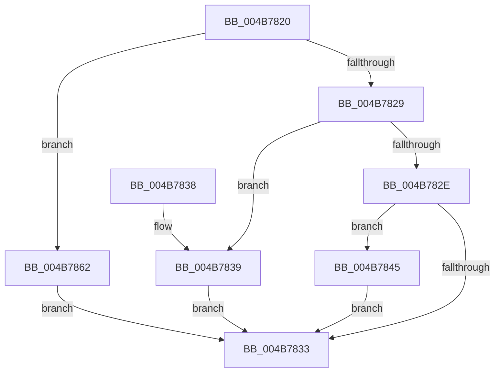

# CmpCoalescingCallback

- RVA: `0x004B7820`–`0x004B786C` (길이 `76` bytes)
- VA: `0x00000001404B7820`
- 실행 섹션: `.text`
- PDB 이름 있음: `예`; PDB Function 태그: `아니요`
- unwind 정보 RVA: `0x0006D4A0`
- 디코드: `21`개 명령, `76/76` bytes 표시
- 미해석 바이트: `0` (있으면 어셈블리에 `.byte`로 보존)

> 이 문서는 커널 이미지의 기계어와 PDB 기호를 분석해 생성했습니다. 4번과 5번은 함수 원형과 자료형을 바이너리 사용 방식에서 추정한 C 해석이며 원본 소스 복구 결과는 아닙니다.

## 1. Dependencies

- 직접 호출 지점: **3**; 고유 호출 대상: **3**
- 직접 호출자로 확인된 함수: **0**
- RIP 상대 이미지 참조: **1**

### Outgoing calls
- `0x004B783E` → [CmpEnableLazyFlush](CmpEnableLazyFlush_function_004B7874.md) (function, `0x004B7874`)
- `0x004B7856` → [CmpForceFlushForCoalescing](../../page/A6/CmpForceFlushForCoalescing_function_00A636F0.md) (function, `0x00A636F0`)
- `0x004B785B` → [KeLeaveCriticalRegion](../25/KeLeaveCriticalRegion_function_0025D8B0.md) (function, `0x0025D8B0`)

### Direct callers
- 이 함수 시작 RVA로 연결되는 직접 call은 확인되지 않았습니다. 간접 호출은 완전히 역산할 수 없습니다.

### Static image references
- `0x004B7862` → RVA `0x00E0ECC0` (`.data`; read/write)

## 2. Other-region calls and transfers

- 다른 실행 섹션으로 향하는 call: **1**
  - `0x004B7856` → [CmpForceFlushForCoalescing](../../page/A6/CmpForceFlushForCoalescing_function_00A636F0.md) (`.text` → `PAGE`)
- 별도 외부 분기/꼬리 이동을 확인하지 못했습니다.

## 3. Assembly (complete function range)

```asm
004B7820  48 83 EC 28                     sub rsp, 0x28
004B7824  83 E9 01                        sub ecx, 1
004B7827  74 39                           je 0x1404b7862
004B7829  83 E9 01                        sub ecx, 1
004B782C  74 0B                           je 0x1404b7839
004B782E  83 F9 01                        cmp ecx, 1
004B7831  74 12                           je 0x1404b7845
004B7833  48 83 C4 28                     add rsp, 0x28
004B7837  C3                              ret
004B7838  CC                              int3
004B7839  B9 08 00 00 00                  mov ecx, 8
004B783E  E8 31 00 00 00                  call 0x1404b7874
004B7843  EB EE                           jmp 0x1404b7833
004B7845  65 48 8B 04 25 88 01 00 00      mov rax, qword ptr gs:[0x188]
004B784E  66 FF 88 E4 01 00 00            dec word ptr [rax + 0x1e4]
004B7855  90                              nop
004B7856  E8 95 BE 5A 00                  call 0x140a636f0
004B785B  E8 50 60 DA FF                  call 0x14025d8b0
004B7860  EB D1                           jmp 0x1404b7833
004B7862  F0 83 0D 56 74 95 00 08         lock or dword ptr [rip + 0x957456], 8
004B786A  EB C7                           jmp 0x1404b7833
```

## 4. C-style interpretation (structured pseudocode)

```c
__int64 __fastcall CmpCoalescingCallback(int a1)
{
    __int64 result;
    __int64 v_rsp;

    v_rsp = (v_rsp) - (40);
    a1 = (unsigned int)((a1) - (1));
    if (condition_is_equal) goto loc_004B7862;
    a1 = (unsigned int)((a1) - (1));
    if (condition_is_equal) goto loc_004B7839;
    if (a1 == 1) goto loc_004B7845;
loc_004B7833:
    v_rsp = (v_rsp) + (40);
    return result;
loc_004B7839:
    result = CmpEnableLazyFlush(8, a2, a3, a4);
    goto loc_004B7833;
loc_004B7845:
    result = CmpForceFlushForCoalescing(8, a2, a3, a4);
    result = KeLeaveCriticalRegion(8, a2, a3, a4);
    goto loc_004B7833;
loc_004B7862:
    goto loc_004B7833;
}
```

## 5. (Beta) C Style

```c
int64_t CmpCoalescingCallback(int32_t Arg1)
{
    int64_t result;
    int64_t local_rsp;

    local_rsp = (local_rsp) - (40);
    Arg1 = (uint32_t)((Arg1) - (1));
    if (condition_is_equal) goto loc_004B7862;
    Arg1 = (uint32_t)((Arg1) - (1));
    if (condition_is_equal) goto loc_004B7839;
    if (Arg1 == 1) goto loc_004B7845;
loc_004B7833:
    local_rsp = (local_rsp) + (40);
    return result;
loc_004B7839:
    result = CmpEnableLazyFlush(8, a2, a3, a4);
    goto loc_004B7833;
loc_004B7845:
    result = CmpForceFlushForCoalescing(8, a2, a3, a4);
    result = KeLeaveCriticalRegion(8, a2, a3, a4);
    goto loc_004B7833;
loc_004B7862:
    goto loc_004B7833;
}
```

## 6. Execution-region graph

[열기: 2D/3D 그래프와 함수 탐색 컨트롤 패널](../../../control-panel.html?section=text&rva=0x004B7820&view=graph)

- 2D 그래프는 위에서 아래로 흐르고, 3D 그래프는 빈 공간을 드래그해 회전합니다. Shift+드래그는 이동, 휠은 확대·축소, 함수 노드 선택은 대상 보고서 이동입니다.

### Static fallback


