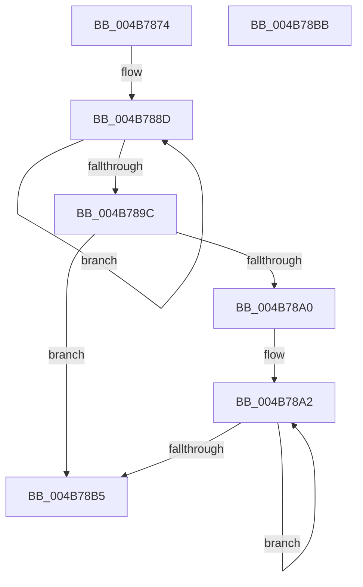

# CmpEnableLazyFlush

- RVA: `0x004B7874`–`0x004B78BC` (길이 `72` bytes)
- VA: `0x00000001404B7874`
- 실행 섹션: `.text`
- PDB 이름 있음: `예`; PDB Function 태그: `아니요`
- unwind 정보 RVA: `0x0005CF00`
- 디코드: `24`개 명령, `72/72` bytes 표시
- 미해석 바이트: `0` (있으면 어셈블리에 `.byte`로 보존)

> 이 문서는 커널 이미지의 기계어와 PDB 기호를 분석해 생성했습니다. 4번과 5번은 함수 원형과 자료형을 바이너리 사용 방식에서 추정한 C 해석이며 원본 소스 복구 결과는 아닙니다.

## 1. Dependencies

- 직접 호출 지점: **1**; 고유 호출 대상: **1**
- 직접 호출자로 확인된 함수: **5**
- RIP 상대 이미지 참조: **1**

### Outgoing calls
- `0x004B78A9` → [CmpArmLazyWriter](../20/CmpArmLazyWriter_function_00204770.md) (function, `0x00204770`)

### Direct callers
- [CmpCoalescingCallback](CmpCoalescingCallback_function_004B7820.md) at `0x004B783E`
- [CmpEnableLazyFlushDpcRoutine](../66/CmpEnableLazyFlushDpcRoutine_function_0066A990.md) at `0x0066AA30`
- [CmThawRegistry](../../page/7E/CmThawRegistry_function_007E8510.md) at `0x007E8648`
- [CmSetLazyFlushState](../../page/AB/CmSetLazyFlushState_function_00AB7824.md) at `0x00AB7877`
- [sub_00B4AA92](../../page/B4/Unknown_function_00B4AA92.md) at `0x00B4AA97`

### Static image references
- `0x004B7880` → RVA `0x00E0ECC0` (`.data`; read)

## 2. Other-region calls and transfers

- 다른 실행 섹션으로 향하는 call: **0**
- 별도 외부 분기/꼬리 이동을 확인하지 못했습니다.

## 3. Assembly (complete function range)

```asm
004B7874  40 53                           push rbx
004B7876  48 83 EC 20                     sub rsp, 0x20
004B787A  44 8B C1                        mov r8d, ecx
004B787D  41 F7 D0                        not r8d
004B7880  0F 0D 0D 39 74 95 00            prefetchw byte ptr [rip + 0x957439]
004B7887  8B 05 33 74 95 00               mov eax, dword ptr [rip + 0x957433]
004B788D  8B D0                           mov edx, eax
004B788F  41 23 D0                        and edx, r8d
004B7892  F0 0F B1 15 26 74 95 00         lock cmpxchg dword ptr [rip + 0x957426], edx
004B789A  75 F1                           jne 0x1404b788d
004B789C  3B C1                           cmp eax, ecx
004B789E  75 15                           jne 0x1404b78b5
004B78A0  33 DB                           xor ebx, ebx
004B78A2  41 B0 01                        mov r8b, 1
004B78A5  33 D2                           xor edx, edx
004B78A7  8B CB                           mov ecx, ebx
004B78A9  E8 C2 CE D4 FF                  call 0x140204770
004B78AE  FF C3                           inc ebx
004B78B0  83 FB 03                        cmp ebx, 3
004B78B3  72 ED                           jb 0x1404b78a2
004B78B5  48 83 C4 20                     add rsp, 0x20
004B78B9  5B                              pop rbx
004B78BA  C3                              ret
004B78BB  CC                              int3
```

## 4. C-style interpretation (structured pseudocode)

```c
__int64 __fastcall CmpEnableLazyFlush(int a1)
{
    __int64 result;
    __int64 v_rbx;
    __int64 v_rsp;

    v_rsp = (v_rsp) - (32);
    a3 = (unsigned int)(~((unsigned int)(a1)));
loc_004B788D:
    a2 = (unsigned int)(((unsigned int)((unsigned int)((unsigned int)(*(unsigned int *)(v_rip + 9794611))))) & ((unsigned int)(a3)));
    if (condition_is_not_equal) goto loc_004B788D;
    if (((unsigned int)((unsigned int)(*(unsigned int *)(v_rip + 9794611)))) != a1) goto loc_004B78B5;
    v_rbx = 0;
loc_004B78A2:
    a2 = 0;
    result = CmpArmLazyWriter(0, a2, 1, a4);
    v_rbx = (unsigned int)((v_rbx) + 1);
    if (((unsigned int)(v_rbx)) < 3) goto loc_004B78A2;
loc_004B78B5:
    v_rsp = (v_rsp) + (32);
    return result;
}
```

## 5. (Beta) C Style

```c
int64_t CmpEnableLazyFlush(int32_t Arg1)
{
    int64_t result;
    int64_t local_rbx;
    int64_t local_rsp;

    local_rsp = (local_rsp) - (32);
    a3 = (uint32_t)(~((uint32_t)(Arg1)));
loc_004B788D:
    a2 = (uint32_t)(((uint32_t)((uint32_t)((uint32_t)(*(uint32_t *)(v_rip + 0x957433))))) & ((uint32_t)(a3)));
    if (condition_is_not_equal) goto loc_004B788D;
    if (((uint32_t)((uint32_t)(*(uint32_t *)(v_rip + 0x957433)))) != Arg1) goto loc_004B78B5;
    local_rbx = 0;
loc_004B78A2:
    a2 = 0;
    result = CmpArmLazyWriter(0, a2, 1, a4);
    local_rbx = (uint32_t)((local_rbx) + 1);
    if (((uint32_t)(local_rbx)) < 3) goto loc_004B78A2;
loc_004B78B5:
    local_rsp = (local_rsp) + (32);
    return result;
}
```

## 6. Execution-region graph

[열기: 2D/3D 그래프와 함수 탐색 컨트롤 패널](../../../control-panel.html?section=text&rva=0x004B7874&view=graph)

- 2D 그래프는 위에서 아래로 흐르고, 3D 그래프는 빈 공간을 드래그해 회전합니다. Shift+드래그는 이동, 휠은 확대·축소, 함수 노드 선택은 대상 보고서 이동입니다.

### Static fallback


