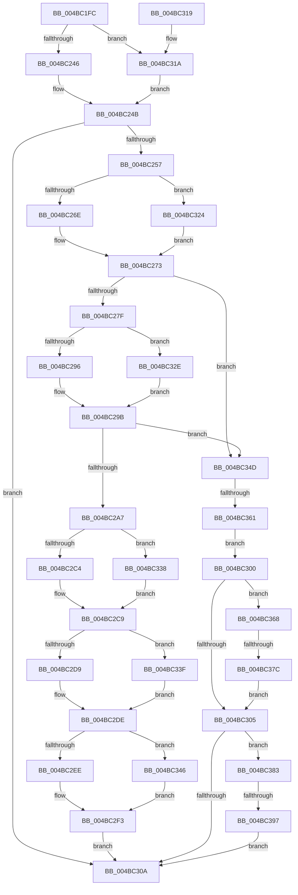

# CmpRemoveSecurityCellList

- RVA: `0x004BC1FC`–`0x004BC3A1` (길이 `421` bytes)
- VA: `0x00000001404BC1FC`
- 실행 섹션: `.text`
- PDB 이름 있음: `예`; PDB Function 태그: `예`
- unwind 정보 RVA: `0x000BB8D4`
- 디코드: `113`개 명령, `421/421` bytes 표시
- 미해석 바이트: `0` (있으면 어셈블리에 `.byte`로 보존)

> 이 문서는 커널 이미지의 기계어와 PDB 기호를 분석해 생성했습니다. 4번과 5번은 함수 원형과 자료형을 바이너리 사용 방식에서 추정한 C 해석이며 원본 소스 복구 결과는 아닙니다.

## 1. Dependencies

- 직접 호출 지점: **16**; 고유 호출 대상: **5**
- 직접 호출자로 확인된 함수: **4**
- RIP 상대 이미지 참조: **0**

### Outgoing calls
- `0x004BC246` → [HvpGetCellFlat](../../page/85/HvpGetCellFlat_function_00854C60.md) (function, `0x00854C60`)
- `0x004BC26E` → [HvpGetCellFlat](../../page/85/HvpGetCellFlat_function_00854C60.md) (function, `0x00854C60`)
- `0x004BC296` → [HvpGetCellFlat](../../page/85/HvpGetCellFlat_function_00854C60.md) (function, `0x00854C60`)
- `0x004BC2C4` → [HvpReleaseCellPaged](../../page/85/HvpReleaseCellPaged_function_00855F40.md) (function, `0x00855F40`)
- `0x004BC2D9` → [HvpReleaseCellPaged](../../page/85/HvpReleaseCellPaged_function_00855F40.md) (function, `0x00855F40`)
- `0x004BC2EE` → [HvpReleaseCellPaged](../../page/85/HvpReleaseCellPaged_function_00855F40.md) (function, `0x00855F40`)
- `0x004BC2F9` → [CmpRemoveFromSecurityCache](../../page/A8/CmpRemoveFromSecurityCache_function_00A80794.md) (function, `0x00A80794`)
- `0x004BC31A` → [HvpGetCellPaged](../../page/85/HvpGetCellPaged_function_00854CB0.md) (function, `0x00854CB0`)
- `0x004BC324` → [HvpGetCellPaged](../../page/85/HvpGetCellPaged_function_00854CB0.md) (function, `0x00854CB0`)
- `0x004BC32E` → [HvpGetCellPaged](../../page/85/HvpGetCellPaged_function_00854CB0.md) (function, `0x00854CB0`)
- `0x004BC338` → [HvpReleaseCellFlat](../../page/85/HvpReleaseCellFlat_function_0085CC20.md) (function, `0x0085CC20`)
- `0x004BC33F` → [HvpReleaseCellFlat](../../page/85/HvpReleaseCellFlat_function_0085CC20.md) (function, `0x0085CC20`)
- `0x004BC346` → [HvpReleaseCellFlat](../../page/85/HvpReleaseCellFlat_function_0085CC20.md) (function, `0x0085CC20`)
- `0x004BC361` → [HvpReleaseCellFlat](../../page/85/HvpReleaseCellFlat_function_0085CC20.md) (function, `0x0085CC20`)
- `0x004BC37C` → [HvpReleaseCellFlat](../../page/85/HvpReleaseCellFlat_function_0085CC20.md) (function, `0x0085CC20`)
- `0x004BC397` → [HvpReleaseCellFlat](../../page/85/HvpReleaseCellFlat_function_0085CC20.md) (function, `0x0085CC20`)

### Direct callers
- [sub_006F98D4](../6F/Unknown_function_006F98D4.md) at `0x006F98DE`
- [CmpSetSecurityDescriptorInfo](../../page/94/CmpSetSecurityDescriptorInfo_function_00949688.md) at `0x00949C50`
- [CmpSetSecurityDescriptorInfo](../../page/94/CmpSetSecurityDescriptorInfo_function_00949688.md) at `0x00949D57`
- [sub_00B25C42](../../page/B2/Unknown_function_00B25C42.md) at `0x00B25CF5`
- [sub_00B28CCC](../../page/B2/Unknown_function_00B28CCC.md) at `0x00B28CD9`

### Static image references
- 디코드된 RIP-relative 메모리 참조가 없습니다.

## 2. Other-region calls and transfers

- 다른 실행 섹션으로 향하는 call: **16**
  - `0x004BC246` → [HvpGetCellFlat](../../page/85/HvpGetCellFlat_function_00854C60.md) (`.text` → `PAGE`)
  - `0x004BC26E` → [HvpGetCellFlat](../../page/85/HvpGetCellFlat_function_00854C60.md) (`.text` → `PAGE`)
  - `0x004BC296` → [HvpGetCellFlat](../../page/85/HvpGetCellFlat_function_00854C60.md) (`.text` → `PAGE`)
  - `0x004BC2C4` → [HvpReleaseCellPaged](../../page/85/HvpReleaseCellPaged_function_00855F40.md) (`.text` → `PAGE`)
  - `0x004BC2D9` → [HvpReleaseCellPaged](../../page/85/HvpReleaseCellPaged_function_00855F40.md) (`.text` → `PAGE`)
  - `0x004BC2EE` → [HvpReleaseCellPaged](../../page/85/HvpReleaseCellPaged_function_00855F40.md) (`.text` → `PAGE`)
  - `0x004BC2F9` → [CmpRemoveFromSecurityCache](../../page/A8/CmpRemoveFromSecurityCache_function_00A80794.md) (`.text` → `PAGE`)
  - `0x004BC31A` → [HvpGetCellPaged](../../page/85/HvpGetCellPaged_function_00854CB0.md) (`.text` → `PAGE`)
  - `0x004BC324` → [HvpGetCellPaged](../../page/85/HvpGetCellPaged_function_00854CB0.md) (`.text` → `PAGE`)
  - `0x004BC32E` → [HvpGetCellPaged](../../page/85/HvpGetCellPaged_function_00854CB0.md) (`.text` → `PAGE`)
  - `0x004BC338` → [HvpReleaseCellFlat](../../page/85/HvpReleaseCellFlat_function_0085CC20.md) (`.text` → `PAGE`)
  - `0x004BC33F` → [HvpReleaseCellFlat](../../page/85/HvpReleaseCellFlat_function_0085CC20.md) (`.text` → `PAGE`)
  - `0x004BC346` → [HvpReleaseCellFlat](../../page/85/HvpReleaseCellFlat_function_0085CC20.md) (`.text` → `PAGE`)
  - `0x004BC361` → [HvpReleaseCellFlat](../../page/85/HvpReleaseCellFlat_function_0085CC20.md) (`.text` → `PAGE`)
  - `0x004BC37C` → [HvpReleaseCellFlat](../../page/85/HvpReleaseCellFlat_function_0085CC20.md) (`.text` → `PAGE`)
  - `0x004BC397` → [HvpReleaseCellFlat](../../page/85/HvpReleaseCellFlat_function_0085CC20.md) (`.text` → `PAGE`)
- call이 아닌 외부 분기/꼬리 이동: **3**
  - `0x004BC35B` → [sub_006FC686](../6F/Unknown_function_006FC686.md) (`tail-transfer`)
  - `0x004BC376` → [sub_006FC686 + 0xB](../6F/Unknown_function_006FC686.md) (`tail-transfer`)
  - `0x004BC391` → [sub_006FC686 + 0x16](../6F/Unknown_function_006FC686.md) (`tail-transfer`)

## 3. Assembly (complete function range)

```asm
004BC1FC  40 55                           push rbp
004BC1FE  53                              push rbx
004BC1FF  56                              push rsi
004BC200  57                              push rdi
004BC201  41 55                           push r13
004BC203  41 56                           push r14
004BC205  41 57                           push r15
004BC207  48 8B EC                        mov rbp, rsp
004BC20A  48 83 EC 20                     sub rsp, 0x20
004BC20E  45 33 ED                        xor r13d, r13d
004BC211  4C 8D 45 40                     lea r8, [rbp + 0x40]
004BC215  48 8B D9                        mov rbx, rcx
004BC218  44 89 6D 54                     mov dword ptr [rbp + 0x54], r13d
004BC21C  83 C9 FF                        or ecx, 0xffffffff
004BC21F  44 89 6D 5C                     mov dword ptr [rbp + 0x5c], r13d
004BC223  89 4D 50                        mov dword ptr [rbp + 0x50], ecx
004BC226  44 8B FA                        mov r15d, edx
004BC229  89 4D 58                        mov dword ptr [rbp + 0x58], ecx
004BC22C  45 8B F5                        mov r14d, r13d
004BC22F  F6 83 8C 00 00 00 01            test byte ptr [rbx + 0x8c], 1
004BC236  89 4D 40                        mov dword ptr [rbp + 0x40], ecx
004BC239  48 8B CB                        mov rcx, rbx
004BC23C  44 89 6D 44                     mov dword ptr [rbp + 0x44], r13d
004BC240  0F 84 D4 00 00 00               je 0x1404bc31a
004BC246  E8 15 8A 39 00                  call 0x140854c60
004BC24B  48 8B F8                        mov rdi, rax
004BC24E  48 85 C0                        test rax, rax
004BC251  0F 84 B3 00 00 00               je 0x1404bc30a
004BC257  F6 83 8C 00 00 00 01            test byte ptr [rbx + 0x8c], 1
004BC25E  4C 8D 45 50                     lea r8, [rbp + 0x50]
004BC262  8B 50 04                        mov edx, dword ptr [rax + 4]
004BC265  48 8B CB                        mov rcx, rbx
004BC268  0F 84 B6 00 00 00               je 0x1404bc324
004BC26E  E8 ED 89 39 00                  call 0x140854c60
004BC273  48 8B F0                        mov rsi, rax
004BC276  48 85 C0                        test rax, rax
004BC279  0F 84 CE 00 00 00               je 0x1404bc34d
004BC27F  F6 83 8C 00 00 00 01            test byte ptr [rbx + 0x8c], 1
004BC286  4C 8D 45 58                     lea r8, [rbp + 0x58]
004BC28A  8B 57 08                        mov edx, dword ptr [rdi + 8]
004BC28D  48 8B CB                        mov rcx, rbx
004BC290  0F 84 98 00 00 00               je 0x1404bc32e
004BC296  E8 C5 89 39 00                  call 0x140854c60
004BC29B  4C 8B F0                        mov r14, rax
004BC29E  48 85 C0                        test rax, rax
004BC2A1  0F 84 A6 00 00 00               je 0x1404bc34d
004BC2A7  8B 47 08                        mov eax, dword ptr [rdi + 8]
004BC2AA  48 8D 55 50                     lea rdx, [rbp + 0x50]
004BC2AE  89 46 08                        mov dword ptr [rsi + 8], eax
004BC2B1  48 8B CB                        mov rcx, rbx
004BC2B4  8B 47 04                        mov eax, dword ptr [rdi + 4]
004BC2B7  41 89 46 04                     mov dword ptr [r14 + 4], eax
004BC2BB  F6 83 8C 00 00 00 01            test byte ptr [rbx + 0x8c], 1
004BC2C2  75 74                           jne 0x1404bc338
004BC2C4  E8 77 9C 39 00                  call 0x140855f40
004BC2C9  F6 83 8C 00 00 00 01            test byte ptr [rbx + 0x8c], 1
004BC2D0  48 8D 55 58                     lea rdx, [rbp + 0x58]
004BC2D4  48 8B CB                        mov rcx, rbx
004BC2D7  75 66                           jne 0x1404bc33f
004BC2D9  E8 62 9C 39 00                  call 0x140855f40
004BC2DE  F6 83 8C 00 00 00 01            test byte ptr [rbx + 0x8c], 1
004BC2E5  48 8D 55 40                     lea rdx, [rbp + 0x40]
004BC2E9  48 8B CB                        mov rcx, rbx
004BC2EC  75 58                           jne 0x1404bc346
004BC2EE  E8 4D 9C 39 00                  call 0x140855f40
004BC2F3  41 8B D7                        mov edx, r15d
004BC2F6  48 8B CB                        mov rcx, rbx
004BC2F9  E8 96 44 5C 00                  call 0x140a80794
004BC2FE  EB 0A                           jmp 0x1404bc30a
004BC300  48 85 F6                        test rsi, rsi
004BC303  75 63                           jne 0x1404bc368
004BC305  4D 85 F6                        test r14, r14
004BC308  75 79                           jne 0x1404bc383
004BC30A  48 83 C4 20                     add rsp, 0x20
004BC30E  41 5F                           pop r15
004BC310  41 5E                           pop r14
004BC312  41 5D                           pop r13
004BC314  5F                              pop rdi
004BC315  5E                              pop rsi
004BC316  5B                              pop rbx
004BC317  5D                              pop rbp
004BC318  C3                              ret
004BC319  CC                              int3
004BC31A  E8 91 89 39 00                  call 0x140854cb0
004BC31F  E9 27 FF FF FF                  jmp 0x1404bc24b
004BC324  E8 87 89 39 00                  call 0x140854cb0
004BC329  E9 45 FF FF FF                  jmp 0x1404bc273
004BC32E  E8 7D 89 39 00                  call 0x140854cb0
004BC333  E9 63 FF FF FF                  jmp 0x1404bc29b
004BC338  E8 E3 08 3A 00                  call 0x14085cc20
004BC33D  EB 8A                           jmp 0x1404bc2c9
004BC33F  E8 DC 08 3A 00                  call 0x14085cc20
004BC344  EB 98                           jmp 0x1404bc2de
004BC346  E8 D5 08 3A 00                  call 0x14085cc20
004BC34B  EB A6                           jmp 0x1404bc2f3
004BC34D  F6 83 8C 00 00 00 01            test byte ptr [rbx + 0x8c], 1
004BC354  48 8D 55 40                     lea rdx, [rbp + 0x40]
004BC358  48 8B CB                        mov rcx, rbx
004BC35B  0F 84 25 03 24 00               je 0x1406fc686
004BC361  E8 BA 08 3A 00                  call 0x14085cc20
004BC366  EB 98                           jmp 0x1404bc300
004BC368  F6 83 8C 00 00 00 01            test byte ptr [rbx + 0x8c], 1
004BC36F  48 8D 55 50                     lea rdx, [rbp + 0x50]
004BC373  48 8B CB                        mov rcx, rbx
004BC376  0F 84 15 03 24 00               je 0x1406fc691
004BC37C  E8 9F 08 3A 00                  call 0x14085cc20
004BC381  EB 82                           jmp 0x1404bc305
004BC383  F6 83 8C 00 00 00 01            test byte ptr [rbx + 0x8c], 1
004BC38A  48 8D 55 58                     lea rdx, [rbp + 0x58]
004BC38E  48 8B CB                        mov rcx, rbx
004BC391  0F 84 05 03 24 00               je 0x1406fc69c
004BC397  E8 84 08 3A 00                  call 0x14085cc20
004BC39C  E9 69 FF FF FF                  jmp 0x1404bc30a
```

## 4. C-style interpretation (structured pseudocode)

```c
__int64 __fastcall CmpRemoveSecurityCellList(__int64 a1, int a2)
{
    __int64 result;
    __int64 v_r13;
    __int64 v_rsp;
    unsigned int v_stack_p18;
    unsigned int v_stack_p1C;
    unsigned int v_stack_p20;
    unsigned int v_stack_p24;
    unsigned __int64 v_stack_p8;
    unsigned int v_stack_pC;

    v_rsp = (v_rsp) - (32);
    v_r13 = 0;
    v_stack_p1C = 0;
    a1 = (unsigned int)((a1) | (0xFFFFFFFFULL));
    v_stack_p24 = 0;
    v_stack_p18 = (unsigned int)(a1);
    v_stack_p20 = (unsigned int)(a1);
    v_stack_p8 = (unsigned int)(a1);
    v_stack_pC = 0;
    if (((*(unsigned __int8 *)(a1 + 140)) & (1)) == 0) goto loc_004BC31A;
    result = HvpGetCellFlat(a1, a2, v_stack_p8, a4);
loc_004BC24B:
    if (result == 0) goto loc_004BC30A;
    if (((*(unsigned __int8 *)(a1 + 140)) & (1)) == 0) goto loc_004BC324;
    result = HvpGetCellFlat(a1, (unsigned int)(*(unsigned int *)(result + 4)), v_stack_p18, a4);
loc_004BC273:
    if (result == 0) goto loc_004BC34D;
    if (((*(unsigned __int8 *)(a1 + 140)) & (1)) == 0) goto loc_004BC32E;
    result = HvpGetCellFlat(a1, (unsigned int)(*(unsigned int *)(result + 8)), v_stack_p20, a4);
loc_004BC29B:
    if (result == 0) goto loc_004BC34D;
    *(unsigned int *)(result + 8) = (unsigned int)((unsigned int)(*(unsigned int *)(result + 8)));
    *(unsigned int *)(result + 4) = (unsigned int)((unsigned int)(*(unsigned int *)(result + 4)));
    if (((*(unsigned __int8 *)(a1 + 140)) & (1)) != 0) goto loc_004BC338;
    result = HvpReleaseCellPaged(a1, v_stack_p18, v_stack_p20, a4);
loc_004BC2C9:
    if (((*(unsigned __int8 *)(a1 + 140)) & (1)) != 0) goto loc_004BC33F;
    result = HvpReleaseCellPaged(a1, v_stack_p20, v_stack_p20, a4);
loc_004BC2DE:
    if (((*(unsigned __int8 *)(a1 + 140)) & (1)) != 0) goto loc_004BC346;
    result = HvpReleaseCellPaged(a1, v_stack_p8, v_stack_p20, a4);
loc_004BC2F3:
    result = CmpRemoveFromSecurityCache(a1, (unsigned int)((unsigned int)((unsigned int)(a2))), v_stack_p20, a4);
    goto loc_004BC30A;
loc_004BC300:
    if (result != 0) goto loc_004BC368;
loc_004BC305:
    if (result != 0) goto loc_004BC383;
loc_004BC30A:
    v_rsp = (v_rsp) + (32);
    return result;
loc_004BC31A:
    result = HvpGetCellPaged(a1, (unsigned int)((unsigned int)((unsigned int)(a2))), v_stack_p20, a4);
    goto loc_004BC24B;
loc_004BC324:
    result = HvpGetCellPaged(a1, (unsigned int)((unsigned int)((unsigned int)(a2))), v_stack_p20, a4);
    goto loc_004BC273;
loc_004BC32E:
    result = HvpGetCellPaged(a1, (unsigned int)((unsigned int)((unsigned int)(a2))), v_stack_p20, a4);
    goto loc_004BC29B;
loc_004BC338:
    result = HvpReleaseCellFlat(a1, (unsigned int)((unsigned int)((unsigned int)(a2))), v_stack_p20, a4);
    goto loc_004BC2C9;
loc_004BC33F:
    result = HvpReleaseCellFlat(a1, (unsigned int)((unsigned int)((unsigned int)(a2))), v_stack_p20, a4);
    goto loc_004BC2DE;
loc_004BC346:
    result = HvpReleaseCellFlat(a1, (unsigned int)((unsigned int)((unsigned int)(a2))), v_stack_p20, a4);
    goto loc_004BC2F3;
loc_004BC34D:
    result = HvpReleaseCellFlat(a1, v_stack_p8, v_stack_p20, a4);
    goto loc_004BC300;
loc_004BC368:
    result = HvpReleaseCellFlat(a1, v_stack_p18, v_stack_p20, a4);
    goto loc_004BC305;
loc_004BC383:
    result = HvpReleaseCellFlat(a1, v_stack_p20, v_stack_p20, a4);
    goto loc_004BC30A;
}
```

## 5. (Beta) C Style

```c
int64_t CmpRemoveSecurityCellList(void *Arg1, int32_t Arg2)
{
    uint8_t *arg1 = (uint8_t *)Arg1;

    int64_t result;
    int64_t local_r13;
    int64_t local_rsp;
    uint32_t v_stack_p18;
    uint32_t v_stack_p1C;
    uint32_t v_stack_p20;
    uint32_t v_stack_p24;
    uint64_t v_stack_p8;
    uint32_t v_stack_pC;

    local_rsp = (local_rsp) - (32);
    local_r13 = 0;
    v_stack_p1C = 0;
    Arg1 = (uint32_t)((Arg1) | (0xFFFFFFFFULL));
    v_stack_p24 = 0;
    v_stack_p18 = (uint32_t)(Arg1);
    v_stack_p20 = (uint32_t)(Arg1);
    v_stack_p8 = (uint32_t)(Arg1);
    v_stack_pC = 0;
    if (((*(uint8_t *)(arg1 + 0x8C)) & (1)) == 0) goto loc_004BC31A;
    result = HvpGetCellFlat(Arg1, Arg2, v_stack_p8, a4);
loc_004BC24B:
    if (result == 0) goto loc_004BC30A;
    if (((*(uint8_t *)(arg1 + 0x8C)) & (1)) == 0) goto loc_004BC324;
    result = HvpGetCellFlat(Arg1, (uint32_t)(*(uint32_t *)(result + 0x4)), v_stack_p18, a4);
loc_004BC273:
    if (result == 0) goto loc_004BC34D;
    if (((*(uint8_t *)(arg1 + 0x8C)) & (1)) == 0) goto loc_004BC32E;
    result = HvpGetCellFlat(Arg1, (uint32_t)(*(uint32_t *)(result + 0x8)), v_stack_p20, a4);
loc_004BC29B:
    if (result == 0) goto loc_004BC34D;
    *(uint32_t *)(result + 0x8) = (uint32_t)((uint32_t)(*(uint32_t *)(result + 0x8)));
    *(uint32_t *)(result + 0x4) = (uint32_t)((uint32_t)(*(uint32_t *)(result + 0x4)));
    if (((*(uint8_t *)(arg1 + 0x8C)) & (1)) != 0) goto loc_004BC338;
    result = HvpReleaseCellPaged(Arg1, v_stack_p18, v_stack_p20, a4);
loc_004BC2C9:
    if (((*(uint8_t *)(arg1 + 0x8C)) & (1)) != 0) goto loc_004BC33F;
    result = HvpReleaseCellPaged(Arg1, v_stack_p20, v_stack_p20, a4);
loc_004BC2DE:
    if (((*(uint8_t *)(arg1 + 0x8C)) & (1)) != 0) goto loc_004BC346;
    result = HvpReleaseCellPaged(Arg1, v_stack_p8, v_stack_p20, a4);
loc_004BC2F3:
    result = CmpRemoveFromSecurityCache(Arg1, (uint32_t)((uint32_t)((uint32_t)(Arg2))), v_stack_p20, a4);
    goto loc_004BC30A;
loc_004BC300:
    if (result != 0) goto loc_004BC368;
loc_004BC305:
    if (result != 0) goto loc_004BC383;
loc_004BC30A:
    local_rsp = (local_rsp) + (32);
    return result;
loc_004BC31A:
    result = HvpGetCellPaged(Arg1, (uint32_t)((uint32_t)((uint32_t)(Arg2))), v_stack_p20, a4);
    goto loc_004BC24B;
loc_004BC324:
    result = HvpGetCellPaged(Arg1, (uint32_t)((uint32_t)((uint32_t)(Arg2))), v_stack_p20, a4);
    goto loc_004BC273;
loc_004BC32E:
    result = HvpGetCellPaged(Arg1, (uint32_t)((uint32_t)((uint32_t)(Arg2))), v_stack_p20, a4);
    goto loc_004BC29B;
loc_004BC338:
    result = HvpReleaseCellFlat(Arg1, (uint32_t)((uint32_t)((uint32_t)(Arg2))), v_stack_p20, a4);
    goto loc_004BC2C9;
loc_004BC33F:
    result = HvpReleaseCellFlat(Arg1, (uint32_t)((uint32_t)((uint32_t)(Arg2))), v_stack_p20, a4);
    goto loc_004BC2DE;
loc_004BC346:
    result = HvpReleaseCellFlat(Arg1, (uint32_t)((uint32_t)((uint32_t)(Arg2))), v_stack_p20, a4);
    goto loc_004BC2F3;
loc_004BC34D:
    result = HvpReleaseCellFlat(Arg1, v_stack_p8, v_stack_p20, a4);
    goto loc_004BC300;
loc_004BC368:
    result = HvpReleaseCellFlat(Arg1, v_stack_p18, v_stack_p20, a4);
    goto loc_004BC305;
loc_004BC383:
    result = HvpReleaseCellFlat(Arg1, v_stack_p20, v_stack_p20, a4);
    goto loc_004BC30A;
}
```

### 관측된 메모리 오프셋

구조체 형식이 확인되지 않은 접근은 인자 기준의 오프셋으로만 기록했습니다.

| 기준 인자 | 오프셋 표현 | 폭 (bit) | 접근 |
|---|---:|---:|---|
| `Arg1` | `+ 0x8C` | `8` | `R` |

## 6. Execution-region graph

[열기: 2D/3D 그래프와 함수 탐색 컨트롤 패널](../../../control-panel.html?section=text&rva=0x004BC1FC&view=graph)

- 2D 그래프는 위에서 아래로 흐르고, 3D 그래프는 빈 공간을 드래그해 회전합니다. Shift+드래그는 이동, 휠은 확대·축소, 함수 노드 선택은 대상 보고서 이동입니다.

### Static fallback


