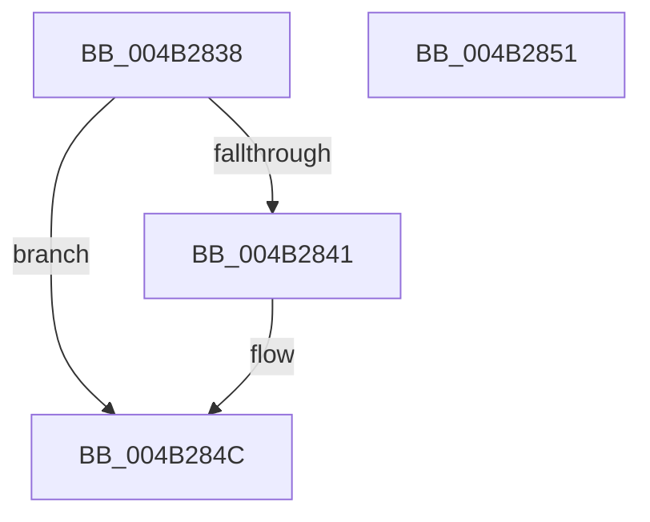

# DestroyEventEntry

- RVA: `0x004B2838`–`0x004B2852` (길이 `26` bytes)
- VA: `0x00000001404B2838`
- 실행 섹션: `.text`
- PDB 이름 있음: `예`; PDB Function 태그: `예`
- unwind 정보 RVA: `0x0005C788`
- 디코드: `9`개 명령, `26/26` bytes 표시
- 미해석 바이트: `0` (있으면 어셈블리에 `.byte`로 보존)

> 이 문서는 커널 이미지의 기계어와 PDB 기호를 분석해 생성했습니다. 4번과 5번은 함수 원형과 자료형을 바이너리 사용 방식에서 추정한 C 해석이며 원본 소스 복구 결과는 아닙니다.

## 1. Dependencies

- 직접 호출 지점: **1**; 고유 호출 대상: **1**
- 직접 호출자로 확인된 함수: **2**
- RIP 상대 이미지 참조: **0**

### Outgoing calls
- `0x004B2847` → [ExFreePoolWithTag](../../poolcode/B8/ExFreePoolWithTag_function_00B82870.md) (function, `0x00B82870`)

### Direct callers
- [InsertEventEntryInLookUpTable](../2F/InsertEventEntryInLookUpTable_function_002F1424.md) at `0x002F17A3`
- [FlushEventEntryList](../../page/A6/FlushEventEntryList_function_00A601A4.md) at `0x00A60217`

### Static image references
- 디코드된 RIP-relative 메모리 참조가 없습니다.

## 2. Other-region calls and transfers

- 다른 실행 섹션으로 향하는 call: **1**
  - `0x004B2847` → [ExFreePoolWithTag](../../poolcode/B8/ExFreePoolWithTag_function_00B82870.md) (`.text` → `POOLCODE`)
- 별도 외부 분기/꼬리 이동을 확인하지 못했습니다.

## 3. Assembly (complete function range)

```asm
004B2838  48 83 EC 28                     sub rsp, 0x28
004B283C  48 85 C9                        test rcx, rcx
004B283F  74 0B                           je 0x1404b284c
004B2841  48 8B 49 10                     mov rcx, qword ptr [rcx + 0x10]
004B2845  33 D2                           xor edx, edx
004B2847  E8 24 00 6D 00                  call 0x140b82870
004B284C  48 83 C4 28                     add rsp, 0x28
004B2850  C3                              ret
004B2851  CC                              int3
```

## 4. C-style interpretation (structured pseudocode)

```c
__int64 __fastcall DestroyEventEntry(__int64 a1, int a2)
{
    __int64 result;
    __int64 v_rsp;

    v_rsp = (v_rsp) - (40);
    if (a1 != 0) {
        a1 = *(unsigned __int64 *)(a1 + 16);
        a2 = 0;
        result = ExFreePoolWithTag(a1, a2, a3, a4);
    }
    v_rsp = (v_rsp) + (40);
    return result;
}
```

## 5. (Beta) C Style

```c
int64_t DestroyEventEntry(int64_t Arg1, int32_t Arg2)
{
    int64_t result;
    int64_t local_rsp;

    local_rsp = (local_rsp) - (40);
    if (Arg1 != 0) {
        Arg1 = *(uint64_t *)(Arg1 + 0x10);
        Arg2 = 0;
        result = ExFreePoolWithTag(Arg1, Arg2, a3, a4);
    }
    local_rsp = (local_rsp) + (40);
    return result;
}
```

## 6. Execution-region graph

[열기: 2D/3D 그래프와 함수 탐색 컨트롤 패널](../../../control-panel.html?section=text&rva=0x004B2838&view=graph)

- 2D 그래프는 위에서 아래로 흐르고, 3D 그래프는 빈 공간을 드래그해 회전합니다. Shift+드래그는 이동, 휠은 확대·축소, 함수 노드 선택은 대상 보고서 이동입니다.

### Static fallback


