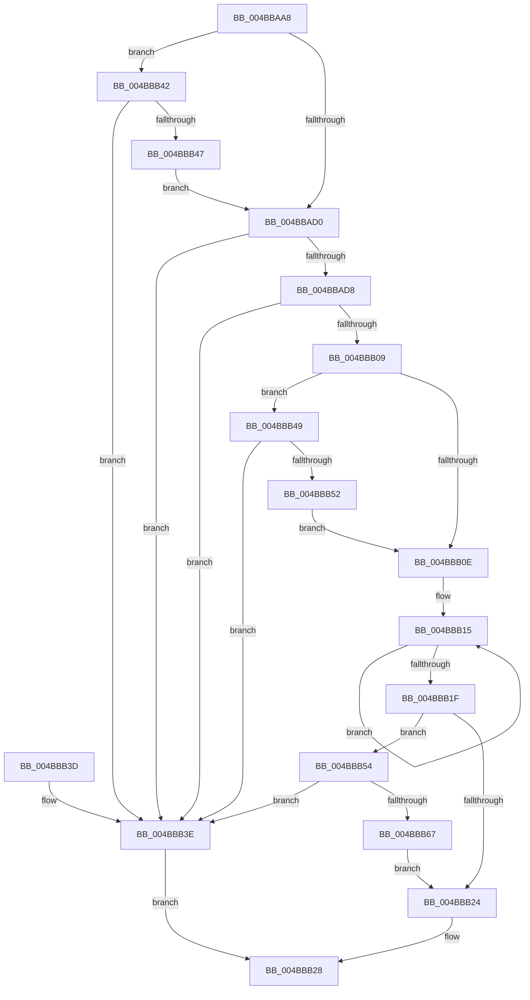

# DownLevelLangIDToLanguageName

- RVA: `0x004BBAA8`–`0x004BBB69` (길이 `193` bytes)
- VA: `0x00000001404BBAA8`
- 실행 섹션: `.text`
- PDB 이름 있음: `예`; PDB Function 태그: `아니요`
- unwind 정보 RVA: `0x000BB794`
- 디코드: `58`개 명령, `193/193` bytes 표시
- 미해석 바이트: `0` (있으면 어셈블리에 `.byte`로 보존)

> 이 문서는 커널 이미지의 기계어와 PDB 기호를 분석해 생성했습니다. 4번과 5번은 함수 원형과 자료형을 바이너리 사용 방식에서 추정한 C 해석이며 원본 소스 복구 결과는 아닙니다.

## 1. Dependencies

- 직접 호출 지점: **3**; 고유 호출 대상: **3**
- 직접 호출자로 확인된 함수: **8**
- RIP 상대 이미지 참조: **2**

### Outgoing calls
- `0x004BBAFC` → [bsearch](../50/bsearch_function_00500430.md) (function, `0x00500430`)
- `0x004BBB49` → [IsNeutralLanguageItem](../4C/IsNeutralLanguageItem_function_004CCF90.md) (function, `0x004CCF90`)
- `0x004BBB5E` → [StringCchCopyNW](../4D/StringCchCopyNW_function_004D0F68.md) (function, `0x004D0F68`)

### Direct callers
- [sub_006F1854](../6F/Unknown_function_006F1854.md) at `0x006F18B8`
- [sub_006F1946](../6F/Unknown_function_006F1946.md) at `0x006F197E`
- [LdrResSearchResource](../../page/98/LdrResSearchResource_function_0098F7A0.md) at `0x0098FA18`
- [ExpSetPendingUILanguage](../../page/A8/ExpSetPendingUILanguage_function_00A87E70.md) at `0x00A8825F`
- [PnpGetDeviceInstancePropertyData](../../page/AC/PnpGetDeviceInstancePropertyData_function_00AC9730.md) at `0x00AC97D7`
- [RtlLCIDToCultureName](../../page/AD/RtlLCIDToCultureName_function_00AD3010.md) at `0x00AD3055`
- [sub_00B1EF9C](../../page/B1/Unknown_function_00B1EF9C.md) at `0x00B1EFD3`
- [CmSelectQualifiedInstallLanguage](../../init/C5/CmSelectQualifiedInstallLanguage_function_00C58F58.md) at `0x00C59055`

### Static image references
- `0x004BBAD8` → RVA `0x004BA310` (`CompareLangIDs`; read)
- `0x004BBAF0` → RVA `0x00003A90` (`.rdata`; read)

## 2. Other-region calls and transfers

- 다른 실행 섹션으로 향하는 call: **0**
- 별도 외부 분기/꼬리 이동을 확인하지 못했습니다.

## 3. Assembly (complete function range)

```asm
004BBAA8  48 8B C4                        mov rax, rsp
004BBAAB  48 89 58 10                     mov qword ptr [rax + 0x10], rbx
004BBAAF  48 89 68 18                     mov qword ptr [rax + 0x18], rbp
004BBAB3  48 89 70 20                     mov qword ptr [rax + 0x20], rsi
004BBAB7  66 89 48 08                     mov word ptr [rax + 8], cx
004BBABB  57                              push rdi
004BBABC  48 83 EC 30                     sub rsp, 0x30
004BBAC0  33 ED                           xor ebp, ebp
004BBAC2  49 63 F0                        movsxd rsi, r8d
004BBAC5  41 8B D9                        mov ebx, r9d
004BBAC8  48 8B FA                        mov rdi, rdx
004BBACB  48 85 D2                        test rdx, rdx
004BBACE  74 72                           je 0x1404bbb42
004BBAD0  F7 C3 FD FF FF FF               test ebx, 0xfffffffd
004BBAD6  75 66                           jne 0x1404bbb3e
004BBAD8  48 8D 05 31 E8 FF FF            lea rax, [rip - 0x17cf]
004BBADF  41 B9 10 00 00 00               mov r9d, 0x10
004BBAE5  41 B8 B4 01 00 00               mov r8d, 0x1b4
004BBAEB  48 89 44 24 20                  mov qword ptr [rsp + 0x20], rax
004BBAF0  48 8D 15 99 7F B4 FF            lea rdx, [rip - 0x4b8067]
004BBAF7  48 8D 4C 24 40                  lea rcx, [rsp + 0x40]
004BBAFC  E8 2F 49 04 00                  call 0x140500430
004BBB01  48 8B C8                        mov rcx, rax
004BBB04  48 85 C0                        test rax, rax
004BBB07  74 35                           je 0x1404bbb3e
004BBB09  F6 C3 02                        test bl, 2
004BBB0C  74 3B                           je 0x1404bbb49
004BBB0E  4C 8B 01                        mov r8, qword ptr [rcx]
004BBB11  49 83 CB FF                     or r11, 0xffffffffffffffff
004BBB15  49 FF C3                        inc r11
004BBB18  66 43 39 2C 58                  cmp word ptr [r8 + r11*2], bp
004BBB1D  75 F6                           jne 0x1404bbb15
004BBB1F  48 85 FF                        test rdi, rdi
004BBB22  75 30                           jne 0x1404bbb54
004BBB24  41 8D 43 01                     lea eax, [r11 + 1]
004BBB28  48 8B 5C 24 48                  mov rbx, qword ptr [rsp + 0x48]
004BBB2D  48 8B 6C 24 50                  mov rbp, qword ptr [rsp + 0x50]
004BBB32  48 8B 74 24 58                  mov rsi, qword ptr [rsp + 0x58]
004BBB37  48 83 C4 30                     add rsp, 0x30
004BBB3B  5F                              pop rdi
004BBB3C  C3                              ret
004BBB3D  CC                              int3
004BBB3E  33 C0                           xor eax, eax
004BBB40  EB E6                           jmp 0x1404bbb28
004BBB42  45 85 C0                        test r8d, r8d
004BBB45  75 F7                           jne 0x1404bbb3e
004BBB47  EB 87                           jmp 0x1404bbad0
004BBB49  E8 42 14 01 00                  call 0x1404ccf90
004BBB4E  85 C0                           test eax, eax
004BBB50  75 EC                           jne 0x1404bbb3e
004BBB52  EB BA                           jmp 0x1404bbb0e
004BBB54  48 8B D6                        mov rdx, rsi
004BBB57  4D 8D 4B 01                     lea r9, [r11 + 1]
004BBB5B  48 8B CF                        mov rcx, rdi
004BBB5E  E8 05 54 01 00                  call 0x1404d0f68
004BBB63  85 C0                           test eax, eax
004BBB65  78 D7                           js 0x1404bbb3e
004BBB67  EB BB                           jmp 0x1404bbb24
```

## 4. C-style interpretation (structured pseudocode)

```c
__int64 __fastcall DownLevelLangIDToLanguageName(unsigned __int16 a1, __int64 a2, int a3, int a4)
{
    __int64 result;
    __int64 v_r11;
    __int64 v_rbp;
    __int64 v_rsp;
    unsigned __int64 v_stack_m18;
    unsigned __int64 v_stack_p10;
    unsigned __int64 v_stack_p18;
    unsigned __int64 v_stack_p20;
    unsigned __int64 v_stack_p8;

    *(unsigned __int64 *)(v_rsp + 16) = v_rbx;
    *(unsigned __int64 *)(v_rsp + 24) = v_rbp;
    *(unsigned __int64 *)(v_rsp + 32) = v_rsi;
    *(unsigned __int16 *)(v_rsp + 8) = a1;
    v_rsp = (v_rsp) - (48);
    v_rbp = 0;
    if (a2 == 0) goto loc_004BBB42;
loc_004BBAD0:
    if ((((unsigned int)((unsigned int)(a4))) & (0xFFFFFFFDULL)) != 0) goto loc_004BBB3E;
    v_stack_m18 = v_rip - 6095;
    result = bsearch(v_stack_p8, v_rip - 4948071, 436, 16);
    if (result == 0) goto loc_004BBB3E;
    if ((((unsigned __int8)((unsigned int)(a4))) & (2)) == 0) goto loc_004BBB49;
loc_004BBB0E:
    v_r11 = (v_r11) | (-1);
loc_004BBB15:
    v_r11 = (v_r11) + 1;
    if ((*(unsigned __int16 *)(*(unsigned __int64 *)(result) + v_r11 * 2)) != 0) goto loc_004BBB15;
    if (a2 != 0) goto loc_004BBB54;
loc_004BBB24:
loc_004BBB28:
    v_rsp = (v_rsp) + (48);
    return v_r11 + 1;
loc_004BBB3E:
    result = 0;
    goto loc_004BBB28;
loc_004BBB42:
    if ((unsigned int)(*(unsigned __int64 *)(result)) != 0) goto loc_004BBB3E;
    goto loc_004BBAD0;
loc_004BBB49:
    result = IsNeutralLanguageItem(result, v_rip - 4948071, *(unsigned __int64 *)(result), 16);
    if ((unsigned int)(result) != 0) goto loc_004BBB3E;
    goto loc_004BBB0E;
loc_004BBB54:
    result = StringCchCopyNW(a2, v_stack_p20, *(unsigned __int64 *)(result), v_r11 + 1);
    if (sign_flag) goto loc_004BBB3E;
    goto loc_004BBB24;
}
```

## 5. (Beta) C Style

```c
int64_t DownLevelLangIDToLanguageName(uint16_t Arg1, int64_t Arg2, int32_t Arg3, int32_t Arg4)
{
    int64_t result;
    int64_t local_r11;
    int64_t local_rbp;
    int64_t local_rsp;
    uint64_t v_stack_m18;
    uint64_t v_stack_p10;
    uint64_t v_stack_p18;
    uint64_t v_stack_p20;
    uint64_t v_stack_p8;

    *(uint64_t *)(local_rsp + 0x10) = local_rbx;
    *(uint64_t *)(local_rsp + 0x18) = local_rbp;
    *(uint64_t *)(local_rsp + 0x20) = local_rsi;
    *(uint16_t *)(local_rsp + 0x8) = Arg1;
    local_rsp = (local_rsp) - (48);
    local_rbp = 0;
    if (Arg2 == 0) goto loc_004BBB42;
loc_004BBAD0:
    if ((((uint32_t)((uint32_t)(Arg4))) & (0xFFFFFFFDULL)) != 0) goto loc_004BBB3E;
    v_stack_m18 = v_rip - 6095;
    result = bsearch(v_stack_p8, v_rip - 4948071, 436, 16);
    if (result == 0) goto loc_004BBB3E;
    if ((((uint8_t)((uint32_t)(Arg4))) & (2)) == 0) goto loc_004BBB49;
loc_004BBB0E:
    local_r11 = (local_r11) | (-1);
loc_004BBB15:
    local_r11 = (local_r11) + 1;
    if ((*(uint16_t *)(*(uint64_t *)(result) + local_r11 * 2)) != 0) goto loc_004BBB15;
    if (Arg2 != 0) goto loc_004BBB54;
loc_004BBB24:
loc_004BBB28:
    local_rsp = (local_rsp) + (48);
    return local_r11 + 1;
loc_004BBB3E:
    result = 0;
    goto loc_004BBB28;
loc_004BBB42:
    if ((uint32_t)(*(uint64_t *)(result)) != 0) goto loc_004BBB3E;
    goto loc_004BBAD0;
loc_004BBB49:
    result = IsNeutralLanguageItem(result, v_rip - 4948071, *(uint64_t *)(result), 16);
    if ((uint32_t)(result) != 0) goto loc_004BBB3E;
    goto loc_004BBB0E;
loc_004BBB54:
    result = StringCchCopyNW(Arg2, v_stack_p20, *(uint64_t *)(result), local_r11 + 1);
    if (sign_flag) goto loc_004BBB3E;
    goto loc_004BBB24;
}
```

## 6. Execution-region graph

[열기: 2D/3D 그래프와 함수 탐색 컨트롤 패널](../../../control-panel.html?section=text&rva=0x004BBAA8&view=graph)

- 2D 그래프는 위에서 아래로 흐르고, 3D 그래프는 빈 공간을 드래그해 회전합니다. Shift+드래그는 이동, 휠은 확대·축소, 함수 노드 선택은 대상 보고서 이동입니다.

### Static fallback


