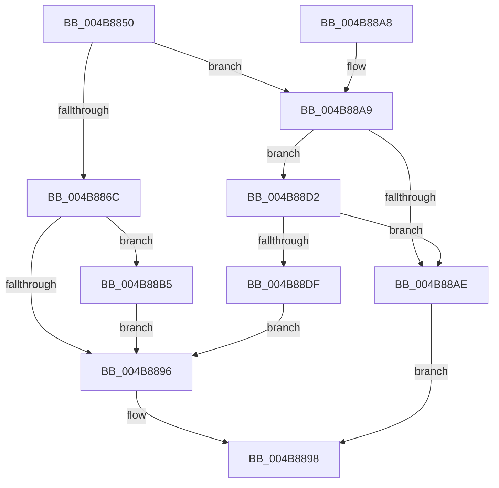

# EtwGetProviderIdFromHandle

- RVA: `0x004B8850`–`0x004B88F6` (길이 `166` bytes)
- VA: `0x00000001404B8850`
- 실행 섹션: `.text`
- PDB 이름 있음: `예`; PDB Function 태그: `아니요`
- unwind 정보 RVA: `0x000BAE80`
- 디코드: `49`개 명령, `166/166` bytes 표시
- 미해석 바이트: `0` (있으면 어셈블리에 `.byte`로 보존)

> 이 문서는 커널 이미지의 기계어와 PDB 기호를 분석해 생성했습니다. 4번과 5번은 함수 원형과 자료형을 바이너리 사용 방식에서 추정한 C 해석이며 원본 소스 복구 결과는 아닙니다.

## 1. Dependencies

- 직접 호출 지점: **4**; 고유 호출 대상: **4**
- 직접 호출자로 확인된 함수: **3**
- RIP 상대 이미지 참조: **1**

### Outgoing calls
- `0x004B888B` → [ObReferenceObjectByHandle](../../page/86/ObReferenceObjectByHandle_function_00868DB0.md) (function, `0x00868DB0`)
- `0x004B88CB` → [ObfDereferenceObjectWithTag](../2F/ObfDereferenceObjectWithTag_function_002F78E0.md) (function, `0x002F78E0`)
- `0x004B88D6` → [EtwpReferenceGuidEntry](../../page/8C/EtwpReferenceGuidEntry_function_008C1ED0.md) (function, `0x008C1ED0`)
- `0x004B88EF` → [EtwpUnreferenceGuidEntry](../../page/8C/EtwpUnreferenceGuidEntry_function_008C3320.md) (function, `0x008C3320`)

### Direct callers
- [EtwWriteEndScenario](../../page/A5/EtwWriteEndScenario_function_00A5B7F0.md) at `0x00A5B848`
- [WdiDispatchControl](../../page/A5/WdiDispatchControl_function_00A5C308.md) at `0x00A5C336`
- [EtwWriteStartScenario](../../page/AB/EtwWriteStartScenario_function_00AB75B0.md) at `0x00AB7623`

### Static image references
- `0x004B8874` → RVA `0x00FC6D30` (`ALMOSTRO`; read)

## 2. Other-region calls and transfers

- 다른 실행 섹션으로 향하는 call: **3**
  - `0x004B888B` → [ObReferenceObjectByHandle](../../page/86/ObReferenceObjectByHandle_function_00868DB0.md) (`.text` → `PAGE`)
  - `0x004B88D6` → [EtwpReferenceGuidEntry](../../page/8C/EtwpReferenceGuidEntry_function_008C1ED0.md) (`.text` → `PAGE`)
  - `0x004B88EF` → [EtwpUnreferenceGuidEntry](../../page/8C/EtwpUnreferenceGuidEntry_function_008C3320.md) (`.text` → `PAGE`)
- 별도 외부 분기/꼬리 이동을 확인하지 못했습니다.

## 3. Assembly (complete function range)

```asm
004B8850  4C 8B DC                        mov r11, rsp
004B8853  49 89 5B 08                     mov qword ptr [r11 + 8], rbx
004B8857  49 89 73 10                     mov qword ptr [r11 + 0x10], rsi
004B885B  57                              push rdi
004B885C  48 83 EC 30                     sub rsp, 0x30
004B8860  33 FF                           xor edi, edi
004B8862  49 8B F0                        mov rsi, r8
004B8865  48 8B D9                        mov rbx, rcx
004B8868  84 D2                           test dl, dl
004B886A  74 3D                           je 0x1404b88a9
004B886C  49 21 7B F0                     and qword ptr [r11 - 0x10], rdi
004B8870  49 8D 43 20                     lea rax, [r11 + 0x20]
004B8874  4C 8B 05 B5 E4 B0 00            mov r8, qword ptr [rip + 0xb0e4b5]
004B887B  41 B1 01                        mov r9b, 1
004B887E  49 21 7B 20                     and qword ptr [r11 + 0x20], rdi
004B8882  BA 00 08 00 00                  mov edx, 0x800
004B8887  49 89 43 E8                     mov qword ptr [r11 - 0x18], rax
004B888B  E8 20 05 3B 00                  call 0x140868db0
004B8890  8B F8                           mov edi, eax
004B8892  85 C0                           test eax, eax
004B8894  79 1F                           jns 0x1404b88b5
004B8896  8B C7                           mov eax, edi
004B8898  48 8B 5C 24 40                  mov rbx, qword ptr [rsp + 0x40]
004B889D  48 8B 74 24 48                  mov rsi, qword ptr [rsp + 0x48]
004B88A2  48 83 C4 30                     add rsp, 0x30
004B88A6  5F                              pop rdi
004B88A7  C3                              ret
004B88A8  CC                              int3
004B88A9  48 85 DB                        test rbx, rbx
004B88AC  75 24                           jne 0x1404b88d2
004B88AE  B8 08 00 00 C0                  mov eax, 0xc0000008
004B88B3  EB E3                           jmp 0x1404b8898
004B88B5  48 8B 4C 24 58                  mov rcx, qword ptr [rsp + 0x58]
004B88BA  BA 44 66 6C 74                  mov edx, 0x746c6644
004B88BF  48 8B 41 20                     mov rax, qword ptr [rcx + 0x20]
004B88C3  0F 10 40 28                     movups xmm0, xmmword ptr [rax + 0x28]
004B88C7  F3 0F 7F 06                     movdqu xmmword ptr [rsi], xmm0
004B88CB  E8 10 F0 E3 FF                  call 0x1402f78e0
004B88D0  EB C4                           jmp 0x1404b8896
004B88D2  48 8B 49 20                     mov rcx, qword ptr [rcx + 0x20]
004B88D6  E8 F5 95 40 00                  call 0x1408c1ed0
004B88DB  84 C0                           test al, al
004B88DD  74 CF                           je 0x1404b88ae
004B88DF  48 8B 4B 20                     mov rcx, qword ptr [rbx + 0x20]
004B88E3  0F 10 41 28                     movups xmm0, xmmword ptr [rcx + 0x28]
004B88E7  F3 0F 7F 06                     movdqu xmmword ptr [rsi], xmm0
004B88EB  48 8B 4B 20                     mov rcx, qword ptr [rbx + 0x20]
004B88EF  E8 2C AA 40 00                  call 0x1408c3320
004B88F4  EB A0                           jmp 0x1404b8896
```

## 4. C-style interpretation (structured pseudocode)

```c
__int64 __fastcall EtwGetProviderIdFromHandle(__int64 a1, unsigned __int8 a2, __int64 a3)
{
    __int64 result;
    __int64 v_rdi;
    __int64 v_rsp;
    unsigned __int64 v_stack_p10;
    unsigned __int64 v_stack_p58;
    unsigned __int64 v_stack_p8;

    *(unsigned __int64 *)(v_rsp + 8) = v_rbx;
    *(unsigned __int64 *)(v_rsp + 16) = v_rsi;
    v_rsp = (v_rsp) - (48);
    v_rdi = 0;
    if (a2 == 0) goto loc_004B88A9;
    *(unsigned __int64 *)(v_rsp - 24) = v_rsp + 32;
    result = ObReferenceObjectByHandle(a1, (unsigned int)(0x800ULL), *(unsigned __int64 *)(v_rip + 11592885), 1);
    if (!sign_flag) goto loc_004B88B5;
loc_004B8896:
loc_004B8898:
    v_rsp = (v_rsp) + (48);
    return (unsigned int)((unsigned int)((unsigned int)((unsigned int)(result))));
loc_004B88A9:
    if (v_stack_p8 != 0) goto loc_004B88D2;
loc_004B88AE:
    goto loc_004B8898;
loc_004B88B5:
    *(unsigned __int64 *)(v_stack_p10) = v_xmm0;
    result = ObfDereferenceObjectWithTag(v_stack_p58, (unsigned int)(0x746C6644ULL), *(unsigned __int64 *)(v_rip + 11592885), 1);
    goto loc_004B8896;
loc_004B88D2:
    result = EtwpReferenceGuidEntry(*(unsigned __int64 *)(v_stack_p58 + 32), (unsigned int)(0x746C6644ULL), *(unsigned __int64 *)(v_rip + 11592885), 1);
    if ((unsigned __int8)(result) == 0) goto loc_004B88AE;
    *(unsigned __int64 *)(v_stack_p10) = v_xmm0;
    result = EtwpUnreferenceGuidEntry(*(unsigned __int64 *)(v_stack_p8 + 32), (unsigned int)(0x746C6644ULL), *(unsigned __int64 *)(v_rip + 11592885), 1);
    goto loc_004B8896;
}
```

## 5. (Beta) C Style

```c
int64_t EtwGetProviderIdFromHandle(void *Arg1, uint8_t Arg2, void *Arg3)
{
    uint8_t *arg1 = (uint8_t *)Arg1;
    uint8_t *arg3 = (uint8_t *)Arg3;

    int64_t result;
    int64_t local_rdi;
    int64_t local_rsp;
    uint64_t v_stack_p10;
    uint64_t v_stack_p58;
    uint64_t v_stack_p8;

    *(uint64_t *)(local_rsp + 0x8) = local_rbx;
    *(uint64_t *)(local_rsp + 0x10) = local_rsi;
    local_rsp = (local_rsp) - (48);
    local_rdi = 0;
    if (Arg2 == 0) goto loc_004B88A9;
    *(uint64_t *)(local_rsp - 0x18) = local_rsp + 32;
    result = ObReferenceObjectByHandle(Arg1, (uint32_t)(0x800ULL), *(uint64_t *)(v_rip + 0xB0E4B5), 1);
    if (!sign_flag) goto loc_004B88B5;
loc_004B8896:
loc_004B8898:
    local_rsp = (local_rsp) + (48);
    return (uint32_t)((uint32_t)((uint32_t)((uint32_t)(result))));
loc_004B88A9:
    if (v_stack_p8 != 0) goto loc_004B88D2;
loc_004B88AE:
    goto loc_004B8898;
loc_004B88B5:
    *(uint64_t *)(v_stack_p10) = v_xmm0;
    result = ObfDereferenceObjectWithTag(v_stack_p58, (uint32_t)(0x746C6644ULL), *(uint64_t *)(v_rip + 0xB0E4B5), 1);
    goto loc_004B8896;
loc_004B88D2:
    result = EtwpReferenceGuidEntry(*(uint64_t *)(v_stack_p58 + 0x20), (uint32_t)(0x746C6644ULL), *(uint64_t *)(v_rip + 0xB0E4B5), 1);
    if ((uint8_t)(result) == 0) goto loc_004B88AE;
    *(uint64_t *)(v_stack_p10) = v_xmm0;
    result = EtwpUnreferenceGuidEntry(*(uint64_t *)(v_stack_p8 + 0x20), (uint32_t)(0x746C6644ULL), *(uint64_t *)(v_rip + 0xB0E4B5), 1);
    goto loc_004B8896;
}
```

### 관측된 메모리 오프셋

구조체 형식이 확인되지 않은 접근은 인자 기준의 오프셋으로만 기록했습니다.

| 기준 인자 | 오프셋 표현 | 폭 (bit) | 접근 |
|---|---:|---:|---|
| `Arg1` | `+ 0x20` | `64` | `R` |
| `Arg3` | `+ 0x0` | `128` | `W` |

## 6. Execution-region graph

[열기: 2D/3D 그래프와 함수 탐색 컨트롤 패널](../../../control-panel.html?section=text&rva=0x004B8850&view=graph)

- 2D 그래프는 위에서 아래로 흐르고, 3D 그래프는 빈 공간을 드래그해 회전합니다. Shift+드래그는 이동, 휠은 확대·축소, 함수 노드 선택은 대상 보고서 이동입니다.

### Static fallback


