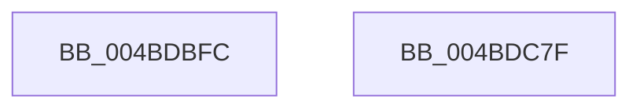

# EtwTraceDequeueWork

- RVA: `0x004BDBFC`–`0x004BDC80` (길이 `132` bytes)
- VA: `0x00000001404BDBFC`
- 실행 섹션: `.text`
- PDB 이름 있음: `예`; PDB Function 태그: `아니요`
- unwind 정보 RVA: `0x000AF370`
- 디코드: `29`개 명령, `132/132` bytes 표시
- 미해석 바이트: `0` (있으면 어셈블리에 `.byte`로 보존)

> 이 문서는 커널 이미지의 기계어와 PDB 기호를 분석해 생성했습니다. 4번과 5번은 함수 원형과 자료형을 바이너리 사용 방식에서 추정한 C 해석이며 원본 소스 복구 결과는 아닙니다.

## 1. Dependencies

- 직접 호출 지점: **2**; 고유 호출 대상: **2**
- 직접 호출자로 확인된 함수: **3**
- RIP 상대 이미지 참조: **1**

### Outgoing calls
- `0x004BDC68` → [EtwTraceKernelEvent](../23/EtwTraceKernelEvent_function_00235350.md) (function, `0x00235350`)
- `0x004BDC75` → [_security_check_cookie](../6A/_security_check_cookie_function_006AC640.md) (function, `0x006AC640`)

### Direct callers
- [sub_0020BDAA](../20/Unknown_function_0020BDAA.md) at `0x0020C16C`
- [sub_0020C222](../20/Unknown_function_0020C222.md) at `0x0020C2B3`
- [sub_0020C2D4](../20/Unknown_function_0020C2D4.md) at `0x0020C844`

### Static image references
- `0x004BDC03` → RVA `0x00E0A740` (`.data`; read)

## 2. Other-region calls and transfers

- 다른 실행 섹션으로 향하는 call: **0**
- 별도 외부 분기/꼬리 이동을 확인하지 못했습니다.

## 3. Assembly (complete function range)

```asm
004BDBFC  4C 8B DC                        mov r11, rsp
004BDBFF  48 83 EC 78                     sub rsp, 0x78
004BDC03  48 8B 05 36 CB 94 00            mov rax, qword ptr [rip + 0x94cb36]
004BDC0A  48 33 C4                        xor rax, rsp
004BDC0D  48 89 44 24 60                  mov qword ptr [rsp + 0x60], rax
004BDC12  8B 81 10 05 00 00               mov eax, dword ptr [rcx + 0x510]
004BDC18  45 33 C9                        xor r9d, r9d
004BDC1B  4D 89 4B C0                     mov qword ptr [r11 - 0x40], r9
004BDC1F  49 8D 4B C8                     lea rcx, [r11 - 0x38]
004BDC23  89 44 24 30                     mov dword ptr [rsp + 0x30], eax
004BDC27  49 8D 43 B8                     lea rax, [r11 - 0x48]
004BDC2B  49 89 43 C8                     mov qword ptr [r11 - 0x38], rax
004BDC2F  42 8D 04 C5 00 00 00 00         lea eax, [r8*8]
004BDC37  49 89 53 D8                     mov qword ptr [r11 - 0x28], rdx
004BDC3B  BA 02 00 00 00                  mov edx, 2
004BDC40  49 C7 43 D0 08 00 00 00         mov qword ptr [r11 - 0x30], 8
004BDC48  89 44 24 58                     mov dword ptr [rsp + 0x58], eax
004BDC4C  45 89 4B E4                     mov dword ptr [r11 - 0x1c], r9d
004BDC50  41 B9 3F 05 00 00               mov r9d, 0x53f
004BDC56  45 89 43 BC                     mov dword ptr [r11 - 0x44], r8d
004BDC5A  41 B8 00 00 00 21               mov r8d, 0x21000000
004BDC60  C7 44 24 20 02 1E 60 01         mov dword ptr [rsp + 0x20], 0x1601e02
004BDC68  E8 E3 76 D7 FF                  call 0x140235350
004BDC6D  48 8B 4C 24 60                  mov rcx, qword ptr [rsp + 0x60]
004BDC72  48 33 CC                        xor rcx, rsp
004BDC75  E8 C6 E9 1E 00                  call 0x1406ac640
004BDC7A  48 83 C4 78                     add rsp, 0x78
004BDC7E  C3                              ret
004BDC7F  CC                              int3
```

## 4. C-style interpretation (structured pseudocode)

```c
__int64 __fastcall EtwTraceDequeueWork(__int64 a1, __int64 a2, __int64 a3, int a4)
{
    __int64 result;
    __int64 v_rsp;
    unsigned __int64 v_stack_m18;
    unsigned int v_stack_m20;
    unsigned int v_stack_m48;
    unsigned int v_stack_m58;

    v_rsp = (v_rsp) - (120);
    result = (*(unsigned __int64 *)(v_rip + 9751350)) ^ (v_rsp);
    v_stack_m18 = result;
    a4 = 0;
    *(unsigned __int64 *)(v_rsp - 64) = 0;
    v_stack_m48 = (unsigned int)((unsigned int)(*(unsigned int *)(a1 + 1296)));
    *(unsigned __int64 *)(v_rsp - 56) = v_rsp - 72;
    *(unsigned __int64 *)(v_rsp - 40) = a2;
    *(unsigned __int64 *)(v_rsp - 48) = 8;
    v_stack_m20 = (unsigned int)(a3 * 8);
    *(unsigned int *)(v_rsp - 28) = 0;
    *(unsigned int *)(v_rsp - 68) = (unsigned int)(a3);
    v_stack_m58 = 0x1601E02ULL;
    result = EtwTraceKernelEvent(v_rsp - 56, 2, (unsigned int)(0x21000000ULL), (unsigned int)(0x53FULL));
    a1 = (v_stack_m18) ^ (v_rsp);
    result = _security_check_cookie(a1, 2, (unsigned int)(0x21000000ULL), (unsigned int)(0x53FULL));
    v_rsp = (v_rsp) + (120);
    return result;
}
```

## 5. (Beta) C Style

```c
int64_t EtwTraceDequeueWork(void *Arg1, int64_t Arg2, int64_t Arg3, int32_t Arg4)
{
    uint8_t *arg1 = (uint8_t *)Arg1;

    int64_t result;
    int64_t local_rsp;
    uint64_t v_stack_m18;
    uint32_t v_stack_m20;
    uint32_t v_stack_m48;
    uint32_t v_stack_m58;

    local_rsp = (local_rsp) - (120);
    result = (*(uint64_t *)(v_rip + 0x94CB36)) ^ (local_rsp);
    v_stack_m18 = result;
    Arg4 = 0;
    *(uint64_t *)(local_rsp - 0x40) = 0;
    v_stack_m48 = (uint32_t)((uint32_t)(*(uint32_t *)(arg1 + 0x510)));
    *(uint64_t *)(local_rsp - 0x38) = local_rsp - 72;
    *(uint64_t *)(local_rsp - 0x28) = Arg2;
    *(uint64_t *)(local_rsp - 0x30) = 8;
    v_stack_m20 = (uint32_t)(Arg3 * 8);
    *(uint32_t *)(local_rsp - 0x1C) = 0;
    *(uint32_t *)(local_rsp - 0x44) = (uint32_t)(Arg3);
    v_stack_m58 = 0x1601E02ULL;
    result = EtwTraceKernelEvent(local_rsp - 56, 2, (uint32_t)(0x21000000ULL), (uint32_t)(0x53FULL));
    Arg1 = (v_stack_m18) ^ (local_rsp);
    result = _security_check_cookie(Arg1, 2, (uint32_t)(0x21000000ULL), (uint32_t)(0x53FULL));
    local_rsp = (local_rsp) + (120);
    return result;
}
```

### 관측된 메모리 오프셋

구조체 형식이 확인되지 않은 접근은 인자 기준의 오프셋으로만 기록했습니다.

| 기준 인자 | 오프셋 표현 | 폭 (bit) | 접근 |
|---|---:|---:|---|
| `Arg1` | `+ 0x510` | `32` | `R` |

## 6. Execution-region graph

[열기: 2D/3D 그래프와 함수 탐색 컨트롤 패널](../../../control-panel.html?section=text&rva=0x004BDBFC&view=graph)

- 2D 그래프는 위에서 아래로 흐르고, 3D 그래프는 빈 공간을 드래그해 회전합니다. Shift+드래그는 이동, 휠은 확대·축소, 함수 노드 선택은 대상 보고서 이동입니다.

### Static fallback


