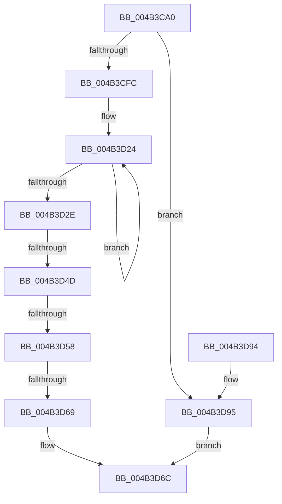

# EtwWriteString

- RVA: `0x004B3CA0`–`0x004B3D9C` (길이 `252` bytes)
- VA: `0x00000001404B3CA0`
- 실행 섹션: `.text`
- PDB 이름 있음: `예`; PDB Function 태그: `예`
- unwind 정보 RVA: `0x000B9B94`
- 디코드: `68`개 명령, `252/252` bytes 표시
- 미해석 바이트: `0` (있으면 어셈블리에 `.byte`로 보존)

> 이 문서는 커널 이미지의 기계어와 PDB 기호를 분석해 생성했습니다. 4번과 5번은 함수 원형과 자료형을 바이너리 사용 방식에서 추정한 C 해석이며 원본 소스 복구 결과는 아닙니다.

## 1. Dependencies

- 직접 호출 지점: **1**; 고유 호출 대상: **1**
- 직접 호출자로 확인된 함수: **0**
- RIP 상대 이미지 참조: **1**

### Outgoing calls
- `0x004B3D73` → [_security_check_cookie](../6A/_security_check_cookie_function_006AC640.md) (function, `0x006AC640`)

### Direct callers
- 이 함수 시작 RVA로 연결되는 직접 call은 확인되지 않았습니다. 간접 호출은 완전히 역산할 수 없습니다.

### Static image references
- `0x004B3CBE` → RVA `0x00E0A740` (`.data`; read)

## 2. Other-region calls and transfers

- 다른 실행 섹션으로 향하는 call: **0**
- call이 아닌 외부 분기/꼬리 이동: **3**
  - `0x004B3D47` → [sub_006FB552](../6F/Unknown_function_006FB552.md) (`tail-transfer`)
  - `0x004B3D52` → [sub_006FB552 + 0x90](../6F/Unknown_function_006FB552.md) (`tail-transfer`)
  - `0x004B3D63` → [sub_006FB552 + 0x127](../6F/Unknown_function_006FB552.md) (`tail-transfer`)

## 3. Assembly (complete function range)

```asm
004B3CA0  48 89 5C 24 10                  mov qword ptr [rsp + 0x10], rbx
004B3CA5  48 89 74 24 18                  mov qword ptr [rsp + 0x18], rsi
004B3CAA  55                              push rbp
004B3CAB  57                              push rdi
004B3CAC  41 54                           push r12
004B3CAE  41 56                           push r14
004B3CB0  41 57                           push r15
004B3CB2  48 8D 6C 24 D1                  lea rbp, [rsp - 0x2f]
004B3CB7  48 81 EC E0 00 00 00            sub rsp, 0xe0
004B3CBE  48 8B 05 7B 6A 95 00            mov rax, qword ptr [rip + 0x956a7b]
004B3CC5  48 33 C4                        xor rax, rsp
004B3CC8  48 89 45 27                     mov qword ptr [rbp + 0x27], rax
004B3CCC  45 33 E4                        xor r12d, r12d
004B3CCF  0F 57 C0                        xorps xmm0, xmm0
004B3CD2  48 8B C1                        mov rax, rcx
004B3CD5  4C 89 65 DF                     mov qword ptr [rbp - 0x21], r12
004B3CD9  48 F7 D8                        neg rax
004B3CDC  4D 8B F9                        mov r15, r9
004B3CDF  49 8B F8                        mov rdi, r8
004B3CE2  40 8A F2                        mov sil, dl
004B3CE5  48 1B DB                        sbb rbx, rbx
004B3CE8  45 8B CC                        mov r9d, r12d
004B3CEB  0F 11 45 07                     movups xmmword ptr [rbp + 7], xmm0
004B3CEF  0F 11 45 17                     movups xmmword ptr [rbp + 0x17], xmm0
004B3CF3  48 23 D9                        and rbx, rcx
004B3CF6  0F 84 99 00 00 00               je 0x1404b3d95
004B3CFC  48 8B 43 70                     mov rax, qword ptr [rbx + 0x70]
004B3D00  0F 11 45 F7                     movups xmmword ptr [rbp - 9], xmm0
004B3D04  88 55 FB                        mov byte ptr [rbp - 5], dl
004B3D07  4C 89 45 FF                     mov qword ptr [rbp - 1], r8
004B3D0B  48 8D 48 1C                     lea rcx, [rax + 0x1c]
004B3D0F  48 F7 D8                        neg rax
004B3D12  4D 1B F6                        sbb r14, r14
004B3D15  4C 23 F1                        and r14, rcx
004B3D18  48 8B 4D 7F                     mov rcx, qword ptr [rbp + 0x7f]
004B3D1C  48 89 4D E7                     mov qword ptr [rbp - 0x19], rcx
004B3D20  48 83 C8 FF                     or rax, 0xffffffffffffffff
004B3D24  48 FF C0                        inc rax
004B3D27  66 44 39 24 41                  cmp word ptr [rcx + rax*2], r12w
004B3D2C  75 F6                           jne 0x1404b3d24
004B3D2E  8D 04 45 02 00 00 00            lea eax, [rax*2 + 2]
004B3D35  44 89 65 F3                     mov dword ptr [rbp - 0xd], r12d
004B3D39  41 BA 04 00 00 00               mov r10d, 4
004B3D3F  89 45 EF                        mov dword ptr [rbp - 0x11], eax
004B3D42  66 44 39 63 64                  cmp word ptr [rbx + 0x64], r12w
004B3D47  0F 85 05 78 24 00               jne 0x1406fb552
004B3D4D  66 44 39 63 66                  cmp word ptr [rbx + 0x66], r12w
004B3D52  0F 85 8A 78 24 00               jne 0x1406fb5e2
004B3D58  48 8B 4B 20                     mov rcx, qword ptr [rbx + 0x20]
004B3D5C  4C 39 A1 90 02 00 00            cmp qword ptr [rcx + 0x290], r12
004B3D63  0F 85 10 79 24 00               jne 0x1406fb679
004B3D69  41 8B C1                        mov eax, r9d
004B3D6C  48 8B 4D 27                     mov rcx, qword ptr [rbp + 0x27]
004B3D70  48 33 CC                        xor rcx, rsp
004B3D73  E8 C8 88 1F 00                  call 0x1406ac640
004B3D78  4C 8D 9C 24 E0 00 00 00         lea r11, [rsp + 0xe0]
004B3D80  49 8B 5B 38                     mov rbx, qword ptr [r11 + 0x38]
004B3D84  49 8B 73 40                     mov rsi, qword ptr [r11 + 0x40]
004B3D88  49 8B E3                        mov rsp, r11
004B3D8B  41 5F                           pop r15
004B3D8D  41 5E                           pop r14
004B3D8F  41 5C                           pop r12
004B3D91  5F                              pop rdi
004B3D92  5D                              pop rbp
004B3D93  C3                              ret
004B3D94  CC                              int3
004B3D95  B8 08 00 00 C0                  mov eax, 0xc0000008
004B3D9A  EB D0                           jmp 0x1404b3d6c
```

## 4. C-style interpretation (structured pseudocode)

```c
__int64 __fastcall EtwWriteString(__int64 a1, unsigned __int8 a2, __int64 a3, __int64 a4, __int64 a5)
{
    __int64 result;
    __int64 v_r12;
    __int64 v_r14;
    __int64 v_rbx;
    __int64 v_rsp;
    unsigned __int64 v_stack_m28;
    unsigned __int64 v_stack_m30;
    unsigned __int64 v_stack_m40;
    unsigned __int64 v_stack_m50;
    unsigned __int64 v_stack_m57;
    unsigned __int64 v_stack_m58;
    unsigned __int8 v_stack_m5C;
    unsigned __int64 v_stack_m60;
    unsigned int v_stack_m64;
    unsigned int v_stack_m68;
    unsigned __int64 v_stack_m70;
    unsigned __int64 v_stack_m78;
    unsigned __int64 v_stack_p10;
    unsigned __int64 v_stack_p18;

    v_stack_p10 = v_rbx;
    v_stack_p18 = v_rsi;
    v_rsp = (v_rsp) - (224);
    result = (*(unsigned __int64 *)(v_rip + 9792123)) ^ (v_rsp);
    v_stack_m30 = result;
    v_r12 = 0;
    v_stack_m78 = 0;
    result = -(a1);
    v_stack_m50 = v_xmm0;
    v_stack_m40 = v_xmm0;
    v_rbx = (v_rbx) & (a1);
    if (condition_is_equal) goto loc_004B3D95;
    v_stack_m60 = v_xmm0;
    v_stack_m5C = a2;
    v_stack_m58 = a3;
    result = -(*(unsigned __int64 *)(v_rbx + 112));
    v_r14 = (v_r14) & (*(unsigned __int64 *)(v_rbx + 112) + 28);
    v_stack_m70 = a5;
    result = (result) | (-1);
loc_004B3D24:
    result = (result) + 1;
    if ((*(unsigned __int16 *)(a5 + result * 2)) != 0) goto loc_004B3D24;
    v_stack_m64 = 0;
    v_stack_m68 = (unsigned int)(result * 2 + 2);
loc_004B3D6C:
    a1 = (v_stack_m30) ^ (v_rsp);
    result = _security_check_cookie(a1, a2, a3, 0);
    return result;
loc_004B3D95:
    goto loc_004B3D6C;
}
```

## 5. (Beta) C Style

```c
int64_t EtwWriteString(int64_t Arg1, uint8_t Arg2, int64_t Arg3, int64_t Arg4, void *Arg5)
{
    uint8_t *arg5 = (uint8_t *)Arg5;

    int64_t result;
    int64_t local_r12;
    int64_t local_r14;
    int64_t local_rbx;
    int64_t local_rsp;
    uint64_t v_stack_m28;
    uint64_t v_stack_m30;
    uint64_t v_stack_m40;
    uint64_t v_stack_m50;
    uint64_t v_stack_m57;
    uint64_t v_stack_m58;
    uint8_t v_stack_m5C;
    uint64_t v_stack_m60;
    uint32_t v_stack_m64;
    uint32_t v_stack_m68;
    uint64_t v_stack_m70;
    uint64_t v_stack_m78;
    uint64_t v_stack_p10;
    uint64_t v_stack_p18;

    v_stack_p10 = local_rbx;
    v_stack_p18 = local_rsi;
    local_rsp = (local_rsp) - (224);
    result = (*(uint64_t *)(v_rip + 0x956A7B)) ^ (local_rsp);
    v_stack_m30 = result;
    local_r12 = 0;
    v_stack_m78 = 0;
    result = -(Arg1);
    v_stack_m50 = v_xmm0;
    v_stack_m40 = v_xmm0;
    local_rbx = (local_rbx) & (Arg1);
    if (condition_is_equal) goto loc_004B3D95;
    v_stack_m60 = v_xmm0;
    v_stack_m5C = Arg2;
    v_stack_m58 = Arg3;
    result = -(*(uint64_t *)(local_rbx + 0x70));
    local_r14 = (local_r14) & (*(uint64_t *)(local_rbx + 0x70) + 28);
    v_stack_m70 = Arg5;
    result = (result) | (-1);
loc_004B3D24:
    result = (result) + 1;
    if ((*(uint16_t *)(arg5 + result * 2)) != 0) goto loc_004B3D24;
    v_stack_m64 = 0;
    v_stack_m68 = (uint32_t)(result * 2 + 2);
loc_004B3D6C:
    Arg1 = (v_stack_m30) ^ (local_rsp);
    result = _security_check_cookie(Arg1, Arg2, Arg3, 0);
    return result;
loc_004B3D95:
    goto loc_004B3D6C;
}
```

### 관측된 메모리 오프셋

구조체 형식이 확인되지 않은 접근은 인자 기준의 오프셋으로만 기록했습니다.

| 기준 인자 | 오프셋 표현 | 폭 (bit) | 접근 |
|---|---:|---:|---|
| `Arg5` | `+ 0x0 + rax*2` | `16` | `R` |

## 6. Execution-region graph

[열기: 2D/3D 그래프와 함수 탐색 컨트롤 패널](../../../control-panel.html?section=text&rva=0x004B3CA0&view=graph)

- 2D 그래프는 위에서 아래로 흐르고, 3D 그래프는 빈 공간을 드래그해 회전합니다. Shift+드래그는 이동, 휠은 확대·축소, 함수 노드 선택은 대상 보고서 이동입니다.

### Static fallback


