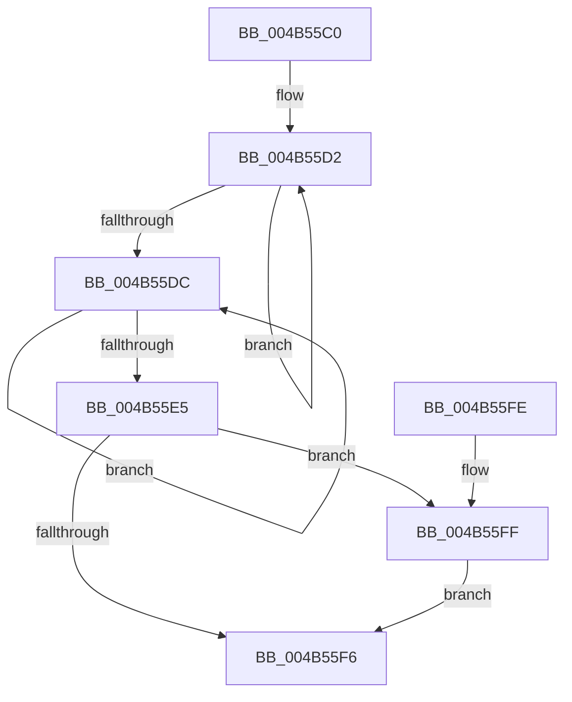

# EtwpAvlCompareKeyNames

- RVA: `0x004B55C0`–`0x004B5606` (길이 `70` bytes)
- VA: `0x00000001404B55C0`
- 실행 섹션: `.text`
- PDB 이름 있음: `예`; PDB Function 태그: `아니요`
- unwind 정보 RVA: `0x0008474C`
- 디코드: `25`개 명령, `70/70` bytes 표시
- 미해석 바이트: `0` (있으면 어셈블리에 `.byte`로 보존)

> 이 문서는 커널 이미지의 기계어와 PDB 기호를 분석해 생성했습니다. 4번과 5번은 함수 원형과 자료형을 바이너리 사용 방식에서 추정한 C 해석이며 원본 소스 복구 결과는 아닙니다.

## 1. Dependencies

- 직접 호출 지점: **1**; 고유 호출 대상: **1**
- 직접 호출자로 확인된 함수: **0**
- RIP 상대 이미지 참조: **0**

### Outgoing calls
- `0x004B55ED` → [RtlCompareUnicodeStrings](../../page/97/RtlCompareUnicodeStrings_function_009727E0.md) (function, `0x009727E0`)

### Direct callers
- 이 함수 시작 RVA로 연결되는 직접 call은 확인되지 않았습니다. 간접 호출은 완전히 역산할 수 없습니다.

### Static image references
- 디코드된 RIP-relative 메모리 참조가 없습니다.

## 2. Other-region calls and transfers

- 다른 실행 섹션으로 향하는 call: **1**
  - `0x004B55ED` → [RtlCompareUnicodeStrings](../../page/97/RtlCompareUnicodeStrings_function_009727E0.md) (`.text` → `PAGE`)
- 별도 외부 분기/꼬리 이동을 확인하지 못했습니다.

## 3. Assembly (complete function range)

```asm
004B55C0  40 53                           push rbx
004B55C2  48 83 EC 30                     sub rsp, 0x30
004B55C6  48 8B C2                        mov rax, rdx
004B55C9  48 83 CA FF                     or rdx, 0xffffffffffffffff
004B55CD  4C 8B CA                        mov r9, rdx
004B55D0  33 DB                           xor ebx, ebx
004B55D2  49 FF C1                        inc r9
004B55D5  66 43 39 1C 48                  cmp word ptr [r8 + r9*2], bx
004B55DA  75 F6                           jne 0x1404b55d2
004B55DC  48 FF C2                        inc rdx
004B55DF  66 39 1C 50                     cmp word ptr [rax + rdx*2], bx
004B55E3  75 F7                           jne 0x1404b55dc
004B55E5  48 8B C8                        mov rcx, rax
004B55E8  C6 44 24 20 01                  mov byte ptr [rsp + 0x20], 1
004B55ED  E8 EE D1 4B 00                  call 0x1409727e0
004B55F2  85 C0                           test eax, eax
004B55F4  79 09                           jns 0x1404b55ff
004B55F6  8B C3                           mov eax, ebx
004B55F8  48 83 C4 30                     add rsp, 0x30
004B55FC  5B                              pop rbx
004B55FD  C3                              ret
004B55FE  CC                              int3
004B55FF  0F 9E C3                        setle bl
004B5602  FF C3                           inc ebx
004B5604  EB F0                           jmp 0x1404b55f6
```

## 4. C-style interpretation (structured pseudocode)

```c
__int64 __fastcall EtwpAvlCompareKeyNames(__int64 a1, __int64 a2, __int64 a3)
{
    __int64 result;
    __int64 v_rbx;
    __int64 v_rsp;
    unsigned __int8 v_stack_m18;

    v_rsp = (v_rsp) - (48);
    a2 = (a2) | (-1);
    v_rbx = 0;
loc_004B55D2:
    a4 = (a2) + 1;
    if ((*(unsigned __int16 *)(a3 + a4 * 2)) != 0) goto loc_004B55D2;
loc_004B55DC:
    a2 = (a2) + 1;
    if ((*(unsigned __int16 *)(a2 + a2 * 2)) != 0) goto loc_004B55DC;
    v_stack_m18 = 1;
    result = RtlCompareUnicodeStrings(a2, a2, a3, a4);
    if (!sign_flag) goto loc_004B55FF;
loc_004B55F6:
    v_rsp = (v_rsp) + (48);
    return 0;
loc_004B55FF:
    v_rbx = (condition_is_less_or_equal) ? 1 : 0;
    v_rbx = (unsigned int)((v_rbx) + 1);
    goto loc_004B55F6;
}
```

## 5. (Beta) C Style

```c
int64_t EtwpAvlCompareKeyNames(int64_t Arg1, void *Arg2, void *Arg3)
{
    uint8_t *arg2 = (uint8_t *)Arg2;
    uint8_t *arg3 = (uint8_t *)Arg3;

    int64_t result;
    int64_t local_rbx;
    int64_t local_rsp;
    uint8_t v_stack_m18;

    local_rsp = (local_rsp) - (48);
    Arg2 = (Arg2) | (-1);
    local_rbx = 0;
loc_004B55D2:
    a4 = (Arg2) + 1;
    if ((*(uint16_t *)(arg3 + a4 * 2)) != 0) goto loc_004B55D2;
loc_004B55DC:
    Arg2 = (Arg2) + 1;
    if ((*(uint16_t *)(arg2 + arg2 * 2)) != 0) goto loc_004B55DC;
    v_stack_m18 = 1;
    result = RtlCompareUnicodeStrings(Arg2, Arg2, Arg3, a4);
    if (!sign_flag) goto loc_004B55FF;
loc_004B55F6:
    local_rsp = (local_rsp) + (48);
    return 0;
loc_004B55FF:
    local_rbx = (condition_is_less_or_equal) ? 1 : 0;
    local_rbx = (uint32_t)((local_rbx) + 1);
    goto loc_004B55F6;
}
```

### 관측된 메모리 오프셋

구조체 형식이 확인되지 않은 접근은 인자 기준의 오프셋으로만 기록했습니다.

| 기준 인자 | 오프셋 표현 | 폭 (bit) | 접근 |
|---|---:|---:|---|
| `Arg2` | `+ 0x0 + rdx*2` | `16` | `R` |
| `Arg3` | `+ 0x0 + r9*2` | `16` | `R` |

## 6. Execution-region graph

[열기: 2D/3D 그래프와 함수 탐색 컨트롤 패널](../../../control-panel.html?section=text&rva=0x004B55C0&view=graph)

- 2D 그래프는 위에서 아래로 흐르고, 3D 그래프는 빈 공간을 드래그해 회전합니다. Shift+드래그는 이동, 휠은 확대·축소, 함수 노드 선택은 대상 보고서 이동입니다.

### Static fallback


