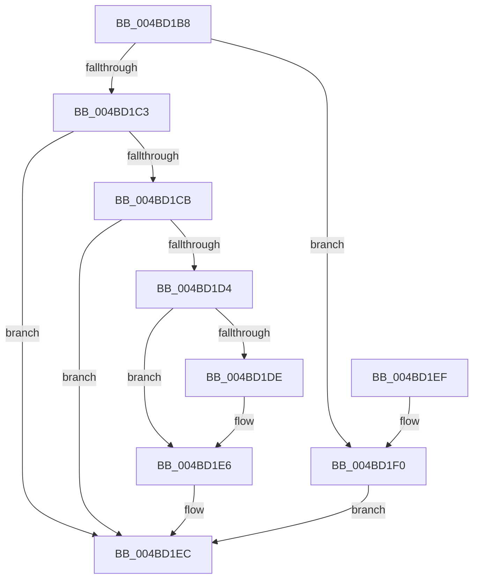

# EtwpCheckDebugInfoEqual

- RVA: `0x004BD1B8`–`0x004BD1FC` (길이 `68` bytes)
- VA: `0x00000001404BD1B8`
- 실행 섹션: `.text`
- PDB 이름 있음: `예`; PDB Function 태그: `아니요`
- unwind 정보 RVA: `0x000DB714`
- 디코드: `24`개 명령, `68/68` bytes 표시
- 미해석 바이트: `0` (있으면 어셈블리에 `.byte`로 보존)

> 이 문서는 커널 이미지의 기계어와 PDB 기호를 분석해 생성했습니다. 4번과 5번은 함수 원형과 자료형을 바이너리 사용 방식에서 추정한 C 해석이며 원본 소스 복구 결과는 아닙니다.

## 1. Dependencies

- 직접 호출 지점: **0**; 고유 호출 대상: **0**
- 직접 호출자로 확인된 함수: **1**
- RIP 상대 이미지 참조: **0**

### Outgoing calls
- 직접 디코드된 call 명령이 없습니다.

### Direct callers
- [EtwpCovSampContextGetModule](../../page/8D/EtwpCovSampContextGetModule_function_008D7FEC.md) at `0x008D8D1B`

### Static image references
- 디코드된 RIP-relative 메모리 참조가 없습니다.

## 2. Other-region calls and transfers

- 다른 실행 섹션으로 향하는 call: **0**
- 별도 외부 분기/꼬리 이동을 확인하지 못했습니다.

## 3. Assembly (complete function range)

```asm
004BD1B8  45 33 C0                        xor r8d, r8d
004BD1BB  4C 8B D1                        mov r10, rcx
004BD1BE  48 85 C9                        test rcx, rcx
004BD1C1  74 2D                           je 0x1404bd1f0
004BD1C3  41 8B C8                        mov ecx, r8d
004BD1C6  48 85 D2                        test rdx, rdx
004BD1C9  74 21                           je 0x1404bd1ec
004BD1CB  8B 42 14                        mov eax, dword ptr [rdx + 0x14]
004BD1CE  41 39 42 14                     cmp dword ptr [r10 + 0x14], eax
004BD1D2  75 18                           jne 0x1404bd1ec
004BD1D4  4D 8B 4A 04                     mov r9, qword ptr [r10 + 4]
004BD1D8  4C 2B 4A 04                     sub r9, qword ptr [rdx + 4]
004BD1DC  75 08                           jne 0x1404bd1e6
004BD1DE  4D 8B 4A 0C                     mov r9, qword ptr [r10 + 0xc]
004BD1E2  4C 2B 4A 0C                     sub r9, qword ptr [rdx + 0xc]
004BD1E6  4D 85 C9                        test r9, r9
004BD1E9  0F 94 C1                        sete cl
004BD1EC  8B C1                           mov eax, ecx
004BD1EE  C3                              ret
004BD1EF  CC                              int3
004BD1F0  48 85 D2                        test rdx, rdx
004BD1F3  41 0F 94 C0                     sete r8b
004BD1F7  41 8B C8                        mov ecx, r8d
004BD1FA  EB F0                           jmp 0x1404bd1ec
```

## 4. C-style interpretation (structured pseudocode)

```c
__int64 __fastcall EtwpCheckDebugInfoEqual(__int64 a1, __int64 a2, int a3)
{
    a3 = 0;
    if (a1 == 0) goto loc_004BD1F0;
    if (a2 == 0) goto loc_004BD1EC;
    if ((*(unsigned int *)(a1 + 20)) != ((unsigned int)((unsigned int)(*(unsigned int *)(a2 + 20))))) goto loc_004BD1EC;
    a4 = (*(unsigned __int64 *)(a1 + 4)) - (*(unsigned __int64 *)(a2 + 4));
    if (!(condition_is_not_equal)) {
        a4 = *(unsigned __int64 *)(a1 + 12);
        a4 = (a4) - (*(unsigned __int64 *)(a2 + 12));
    }
    a1 = (a4 == 0) ? 1 : 0;
loc_004BD1EC:
    return (unsigned int)((unsigned int)(a1));
loc_004BD1F0:
    a3 = (a2 == 0) ? 1 : 0;
    goto loc_004BD1EC;
}
```

## 5. (Beta) C Style

```c
int64_t EtwpCheckDebugInfoEqual(void *Arg1, int64_t Arg2, int32_t Arg3)
{
    uint8_t *arg1 = (uint8_t *)Arg1;

    Arg3 = 0;
    if (Arg1 == NULL) goto loc_004BD1F0;
    if (Arg2 == 0) goto loc_004BD1EC;
    if ((*(uint32_t *)(arg1 + 0x14)) != ((uint32_t)((uint32_t)(*(uint32_t *)(Arg2 + 0x14))))) goto loc_004BD1EC;
    a4 = (*(uint64_t *)(arg1 + 0x4)) - (*(uint64_t *)(Arg2 + 0x4));
    if (!(condition_is_not_equal)) {
        a4 = *(uint64_t *)(arg1 + 0xC);
        a4 = (a4) - (*(uint64_t *)(Arg2 + 0xC));
    }
    Arg1 = (a4 == 0) ? 1 : 0;
loc_004BD1EC:
    return (uint32_t)((uint32_t)(Arg1));
loc_004BD1F0:
    Arg3 = (Arg2 == 0) ? 1 : 0;
    goto loc_004BD1EC;
}
```

### 관측된 메모리 오프셋

구조체 형식이 확인되지 않은 접근은 인자 기준의 오프셋으로만 기록했습니다.

| 기준 인자 | 오프셋 표현 | 폭 (bit) | 접근 |
|---|---:|---:|---|
| `Arg1` | `+ 0x4` | `64` | `R` |
| `Arg1` | `+ 0xC` | `64` | `R` |
| `Arg1` | `+ 0x14` | `32` | `R` |

## 6. Execution-region graph

[열기: 2D/3D 그래프와 함수 탐색 컨트롤 패널](../../../control-panel.html?section=text&rva=0x004BD1B8&view=graph)

- 2D 그래프는 위에서 아래로 흐르고, 3D 그래프는 빈 공간을 드래그해 회전합니다. Shift+드래그는 이동, 휠은 확대·축소, 함수 노드 선택은 대상 보고서 이동입니다.

### Static fallback


