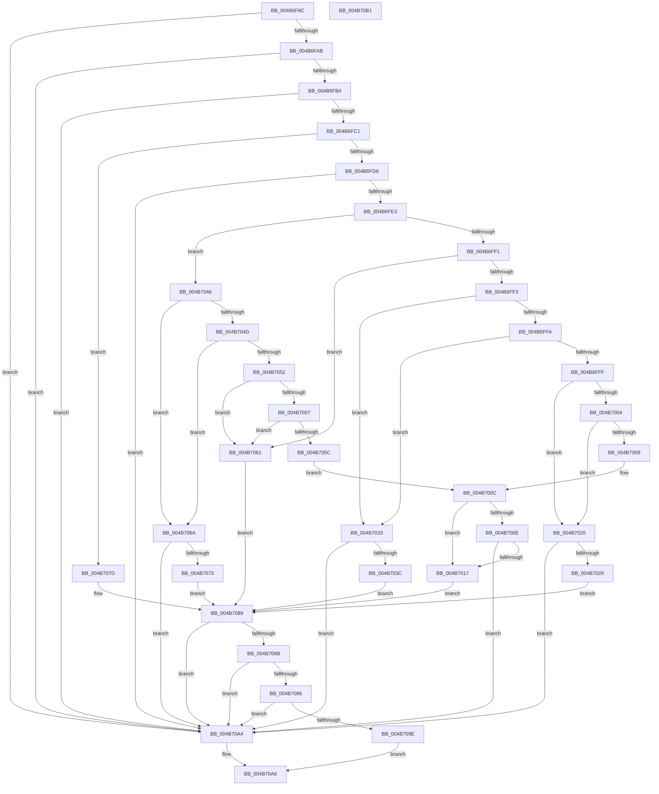

# EtwpGetNextEventOffsetType

- RVA: `0x004B6F8C`–`0x004B70B2` (길이 `294` bytes)
- VA: `0x00000001404B6F8C`
- 실행 섹션: `.text`
- PDB 이름 있음: `예`; PDB Function 태그: `아니요`
- unwind 정보 RVA: `0x000950EC`
- 디코드: `93`개 명령, `294/294` bytes 표시
- 미해석 바이트: `0` (있으면 어셈블리에 `.byte`로 보존)

> 이 문서는 커널 이미지의 기계어와 PDB 기호를 분석해 생성했습니다. 4번과 5번은 함수 원형과 자료형을 바이너리 사용 방식에서 추정한 C 해석이며 원본 소스 복구 결과는 아닙니다.

## 1. Dependencies

- 직접 호출 지점: **0**; 고유 호출 대상: **0**
- 직접 호출자로 확인된 함수: **5**
- RIP 상대 이미지 참조: **0**

### Outgoing calls
- 직접 디코드된 call 명령이 없습니다.

### Direct callers
- [EtwpLogKernelEvent](../25/EtwpLogKernelEvent_function_0025CC00.md) at `0x0025D44C`
- [EtwpSendTraceEvent](EtwpSendTraceEvent_function_004B6E10.md) at `0x004B6E6E`
- [EtwpInvokeEventCallback](EtwpInvokeEventCallback_function_004B6F0C.md) at `0x004B6F37`
- [EtwpCompressBuffer](../65/EtwpCompressBuffer_function_00652DBC.md) at `0x00652ED6`
- [EtwpCompressBuffer](../65/EtwpCompressBuffer_function_00652DBC.md) at `0x00652F04`
- [EtwpSendBufferToDebugger](../../page/7B/EtwpSendBufferToDebugger_function_007BC0AC.md) at `0x007BC154`

### Static image references
- 디코드된 RIP-relative 메모리 참조가 없습니다.

## 2. Other-region calls and transfers

- 다른 실행 섹션으로 향하는 call: **0**
- 별도 외부 분기/꼬리 이동을 확인하지 못했습니다.

## 3. Assembly (complete function range)

```asm
004B6F8C  48 89 5C 24 08                  mov qword ptr [rsp + 8], rbx
004B6F91  48 89 7C 24 10                  mov qword ptr [rsp + 0x10], rdi
004B6F96  41 83 20 00                     and dword ptr [r8], 0
004B6F9A  49 8B F8                        mov rdi, r8
004B6F9D  44 8B 19                        mov r11d, dword ptr [rcx]
004B6FA0  8B DA                           mov ebx, edx
004B6FA2  45 85 DB                        test r11d, r11d
004B6FA5  0F 84 F9 00 00 00               je 0x1404b70a4
004B6FAB  83 FB 48                        cmp ebx, 0x48
004B6FAE  0F 82 F0 00 00 00               jb 0x1404b70a4
004B6FB4  49 8D 43 FC                     lea rax, [r11 - 4]
004B6FB8  48 3B D8                        cmp rbx, rax
004B6FBB  0F 83 E3 00 00 00               jae 0x1404b70a4
004B6FC1  44 8B 04 0B                     mov r8d, dword ptr [rbx + rcx]
004B6FC5  41 8B C0                        mov eax, r8d
004B6FC8  25 00 00 00 FF                  and eax, 0xff000000
004B6FCD  3D 00 00 00 90                  cmp eax, 0x90000000
004B6FD2  0F 84 A5 00 00 00               je 0x1404b707d
004B6FD8  3D 00 00 00 C0                  cmp eax, 0xc0000000
004B6FDD  0F 85 C1 00 00 00               jne 0x1404b70a4
004B6FE3  41 8B C0                        mov eax, r8d
004B6FE6  C1 E8 10                        shr eax, 0x10
004B6FE9  0F B6 D0                        movzx edx, al
004B6FEC  83 FA 0D                        cmp edx, 0xd
004B6FEF  77 55                           ja 0x1404b7046
004B6FF1  74 6E                           je 0x1404b7061
004B6FF3  8B C2                           mov eax, edx
004B6FF5  83 E8 01                        sub eax, 1
004B6FF8  74 39                           je 0x1404b7033
004B6FFA  83 E8 01                        sub eax, 1
004B6FFD  74 34                           je 0x1404b7033
004B6FFF  83 E8 01                        sub eax, 1
004B7002  74 1C                           je 0x1404b7020
004B7004  83 E8 01                        sub eax, 1
004B7007  74 17                           je 0x1404b7020
004B7009  83 E8 06                        sub eax, 6
004B700C  74 09                           je 0x1404b7017
004B700E  83 F8 01                        cmp eax, 1
004B7011  0F 85 8D 00 00 00               jne 0x1404b70a4
004B7017  41 0F B7 C0                     movzx eax, r8w
004B701B  83 F8 30                        cmp eax, 0x30
004B701E  EB 69                           jmp 0x1404b7089
004B7020  49 8D 43 F8                     lea rax, [r11 - 8]
004B7024  48 3B D8                        cmp rbx, rax
004B7027  73 7B                           jae 0x1404b70a4
004B7029  0F B7 44 0B 04                  movzx eax, word ptr [rbx + rcx + 4]
004B702E  83 F8 18                        cmp eax, 0x18
004B7031  EB 56                           jmp 0x1404b7089
004B7033  49 8D 43 F8                     lea rax, [r11 - 8]
004B7037  48 3B D8                        cmp rbx, rax
004B703A  73 68                           jae 0x1404b70a4
004B703C  0F B7 44 0B 04                  movzx eax, word ptr [rbx + rcx + 4]
004B7041  83 F8 20                        cmp eax, 0x20
004B7044  EB 43                           jmp 0x1404b7089
004B7046  8B C2                           mov eax, edx
004B7048  83 E8 10                        sub eax, 0x10
004B704B  74 1D                           je 0x1404b706a
004B704D  83 E8 01                        sub eax, 1
004B7050  74 18                           je 0x1404b706a
004B7052  83 E8 01                        sub eax, 1
004B7055  74 0A                           je 0x1404b7061
004B7057  83 E8 01                        sub eax, 1
004B705A  74 05                           je 0x1404b7061
004B705C  83 E8 01                        sub eax, 1
004B705F  EB AB                           jmp 0x1404b700c
004B7061  41 0F B7 C0                     movzx eax, r8w
004B7065  83 F8 50                        cmp eax, 0x50
004B7068  EB 1F                           jmp 0x1404b7089
004B706A  49 8D 43 F8                     lea rax, [r11 - 8]
004B706E  48 3B D8                        cmp rbx, rax
004B7071  73 31                           jae 0x1404b70a4
004B7073  0F B7 44 0B 04                  movzx eax, word ptr [rbx + rcx + 4]
004B7078  83 F8 10                        cmp eax, 0x10
004B707B  EB 0C                           jmp 0x1404b7089
004B707D  41 0F B7 C0                     movzx eax, r8w
004B7081  BA 0F 00 00 00                  mov edx, 0xf
004B7086  83 F8 08                        cmp eax, 8
004B7089  72 19                           jb 0x1404b70a4
004B708B  83 C0 07                        add eax, 7
004B708E  83 E0 F8                        and eax, 0xfffffff8
004B7091  41 3B C3                        cmp eax, r11d
004B7094  73 0E                           jae 0x1404b70a4
004B7096  8D 0C 18                        lea ecx, [rax + rbx]
004B7099  41 3B CB                        cmp ecx, r11d
004B709C  77 06                           ja 0x1404b70a4
004B709E  89 07                           mov dword ptr [rdi], eax
004B70A0  8B C2                           mov eax, edx
004B70A2  EB 02                           jmp 0x1404b70a6
004B70A4  33 C0                           xor eax, eax
004B70A6  48 8B 5C 24 08                  mov rbx, qword ptr [rsp + 8]
004B70AB  48 8B 7C 24 10                  mov rdi, qword ptr [rsp + 0x10]
004B70B0  C3                              ret
004B70B1  CC                              int3
```

## 4. C-style interpretation (structured pseudocode)

```c
__int64 __fastcall EtwpGetNextEventOffsetType(__int64 a1, int a2, __int64 a3)
{
    __int64 result;
    unsigned __int64 v_stack_p10;
    unsigned __int64 v_stack_p8;

    v_stack_p8 = v_rbx;
    v_stack_p10 = v_rdi;
    if ((unsigned int)((unsigned int)(*(unsigned int *)(a1))) == 0) goto loc_004B70A4;
    if (((unsigned int)((unsigned int)(a2))) < 72) goto loc_004B70A4;
    if (((unsigned int)(a2)) >= ((unsigned int)(*(unsigned int *)(a1)) - 4)) goto loc_004B70A4;
    result = (unsigned int)(((unsigned int)((unsigned int)((unsigned int)(*(unsigned int *)((unsigned int)(a2) + a1 * 1))))) & (0xFF000000ULL));
    if (((unsigned int)(result)) == 0x90000000ULL) goto loc_004B707D;
    if (((unsigned int)(result)) != 0xC0000000ULL) goto loc_004B70A4;
    result = (unsigned int)(((unsigned int)((unsigned int)((unsigned int)(*(unsigned int *)((unsigned int)(a2) + a1 * 1))))) >> (16));
    if (((unsigned int)((unsigned __int8)(result))) > 13) goto loc_004B7046;
    if (((unsigned int)((unsigned __int8)(result))) == 13) goto loc_004B7061;
    result = (unsigned int)(((unsigned int)((unsigned int)((unsigned __int8)(result)))) - (1));
    if (condition_is_equal) goto loc_004B7033;
    result = (unsigned int)((result) - (1));
    if (condition_is_equal) goto loc_004B7033;
    result = (unsigned int)((result) - (1));
    if (condition_is_equal) goto loc_004B7020;
    result = (unsigned int)((result) - (1));
    if (condition_is_equal) goto loc_004B7020;
    result = (unsigned int)((result) - (6));
loc_004B700C:
    if (condition_is_equal) goto loc_004B7017;
    if (((unsigned int)(result)) != 1) goto loc_004B70A4;
loc_004B7017:
    goto loc_004B7089;
loc_004B7020:
    if (((unsigned int)(a2)) >= ((unsigned int)(*(unsigned int *)(a1)) - 8)) goto loc_004B70A4;
    goto loc_004B7089;
loc_004B7033:
    if (((unsigned int)(a2)) >= ((unsigned int)(*(unsigned int *)(a1)) - 8)) goto loc_004B70A4;
    goto loc_004B7089;
loc_004B7046:
    result = (unsigned int)(((unsigned int)((unsigned int)((unsigned __int8)(result)))) - (16));
    if (condition_is_equal) goto loc_004B706A;
    result = (unsigned int)((result) - (1));
    if (condition_is_equal) goto loc_004B706A;
    result = (unsigned int)((result) - (1));
    if (condition_is_equal) goto loc_004B7061;
    result = (unsigned int)((result) - (1));
    if (condition_is_equal) goto loc_004B7061;
    result = (unsigned int)((result) - (1));
    goto loc_004B700C;
loc_004B7061:
    goto loc_004B7089;
loc_004B706A:
    if (((unsigned int)(a2)) >= ((unsigned int)(*(unsigned int *)(a1)) - 8)) goto loc_004B70A4;
    goto loc_004B7089;
loc_004B707D:
loc_004B7089:
    if (((unsigned int)((unsigned __int16)((unsigned int)(*(unsigned int *)((unsigned int)(a2) + a1 * 1))))) < 8) goto loc_004B70A4;
    result = (unsigned int)(((unsigned __int16)((unsigned int)(*(unsigned int *)((unsigned int)(a2) + a1 * 1)))) + (7));
    result = (unsigned int)((result) & (0xFFFFFFF8ULL));
    if (((unsigned int)(result)) >= ((unsigned int)((unsigned int)(*(unsigned int *)(a1))))) goto loc_004B70A4;
    if (((unsigned int)(result + (unsigned int)(a2) * 1)) > ((unsigned int)((unsigned int)(*(unsigned int *)(a1))))) goto loc_004B70A4;
    *(unsigned int *)(a3) = (unsigned int)(result);
    goto loc_004B70A6;
loc_004B70A4:
    result = 0;
loc_004B70A6:
    return result;
}
```

## 5. (Beta) C Style

```c
int64_t EtwpGetNextEventOffsetType(void *Arg1, int32_t Arg2, void *Arg3)
{
    uint8_t *arg1 = (uint8_t *)Arg1;
    uint8_t *arg3 = (uint8_t *)Arg3;

    int64_t result;
    uint64_t v_stack_p10;
    uint64_t v_stack_p8;

    v_stack_p8 = local_rbx;
    v_stack_p10 = local_rdi;
    if ((uint32_t)((uint32_t)(*(uint32_t *)(arg1))) == 0) goto loc_004B70A4;
    if (((uint32_t)((uint32_t)(Arg2))) < 72) goto loc_004B70A4;
    if (((uint32_t)(Arg2)) >= ((uint32_t)(*(uint32_t *)(arg1)) - 4)) goto loc_004B70A4;
    result = (uint32_t)(((uint32_t)((uint32_t)((uint32_t)(*(uint32_t *)((uint32_t)(Arg2) + arg1 * 1))))) & (0xFF000000ULL));
    if (((uint32_t)(result)) == 0x90000000ULL) goto loc_004B707D;
    if (((uint32_t)(result)) != 0xC0000000ULL) goto loc_004B70A4;
    result = (uint32_t)(((uint32_t)((uint32_t)((uint32_t)(*(uint32_t *)((uint32_t)(Arg2) + arg1 * 1))))) >> (16));
    if (((uint32_t)((uint8_t)(result))) > 13) goto loc_004B7046;
    if (((uint32_t)((uint8_t)(result))) == 13) goto loc_004B7061;
    result = (uint32_t)(((uint32_t)((uint32_t)((uint8_t)(result)))) - (1));
    if (condition_is_equal) goto loc_004B7033;
    result = (uint32_t)((result) - (1));
    if (condition_is_equal) goto loc_004B7033;
    result = (uint32_t)((result) - (1));
    if (condition_is_equal) goto loc_004B7020;
    result = (uint32_t)((result) - (1));
    if (condition_is_equal) goto loc_004B7020;
    result = (uint32_t)((result) - (6));
loc_004B700C:
    if (condition_is_equal) goto loc_004B7017;
    if (((uint32_t)(result)) != 1) goto loc_004B70A4;
loc_004B7017:
    goto loc_004B7089;
loc_004B7020:
    if (((uint32_t)(Arg2)) >= ((uint32_t)(*(uint32_t *)(arg1)) - 8)) goto loc_004B70A4;
    goto loc_004B7089;
loc_004B7033:
    if (((uint32_t)(Arg2)) >= ((uint32_t)(*(uint32_t *)(arg1)) - 8)) goto loc_004B70A4;
    goto loc_004B7089;
loc_004B7046:
    result = (uint32_t)(((uint32_t)((uint32_t)((uint8_t)(result)))) - (16));
    if (condition_is_equal) goto loc_004B706A;
    result = (uint32_t)((result) - (1));
    if (condition_is_equal) goto loc_004B706A;
    result = (uint32_t)((result) - (1));
    if (condition_is_equal) goto loc_004B7061;
    result = (uint32_t)((result) - (1));
    if (condition_is_equal) goto loc_004B7061;
    result = (uint32_t)((result) - (1));
    goto loc_004B700C;
loc_004B7061:
    goto loc_004B7089;
loc_004B706A:
    if (((uint32_t)(Arg2)) >= ((uint32_t)(*(uint32_t *)(arg1)) - 8)) goto loc_004B70A4;
    goto loc_004B7089;
loc_004B707D:
loc_004B7089:
    if (((uint32_t)((uint16_t)((uint32_t)(*(uint32_t *)((uint32_t)(Arg2) + arg1 * 1))))) < 8) goto loc_004B70A4;
    result = (uint32_t)(((uint16_t)((uint32_t)(*(uint32_t *)((uint32_t)(Arg2) + arg1 * 1)))) + (7));
    result = (uint32_t)((result) & (0xFFFFFFF8ULL));
    if (((uint32_t)(result)) >= ((uint32_t)((uint32_t)(*(uint32_t *)(arg1))))) goto loc_004B70A4;
    if (((uint32_t)(result + (uint32_t)(Arg2) * 1)) > ((uint32_t)((uint32_t)(*(uint32_t *)(arg1))))) goto loc_004B70A4;
    *(uint32_t *)(arg3) = (uint32_t)(result);
    goto loc_004B70A6;
loc_004B70A4:
    result = 0;
loc_004B70A6:
    return result;
}
```

### 관측된 메모리 오프셋

구조체 형식이 확인되지 않은 접근은 인자 기준의 오프셋으로만 기록했습니다.

| 기준 인자 | 오프셋 표현 | 폭 (bit) | 접근 |
|---|---:|---:|---|
| `Arg1` | `+ 0x0` | `32` | `R` |
| `Arg3` | `+ 0x0` | `32` | `R/W` |
| `Arg3` | `+ 0x0` | `32` | `W` |

## 6. Execution-region graph

[열기: 2D/3D 그래프와 함수 탐색 컨트롤 패널](../../../control-panel.html?section=text&rva=0x004B6F8C&view=graph)

- 2D 그래프는 위에서 아래로 흐르고, 3D 그래프는 빈 공간을 드래그해 회전합니다. Shift+드래그는 이동, 휠은 확대·축소, 함수 노드 선택은 대상 보고서 이동입니다.

### Static fallback


