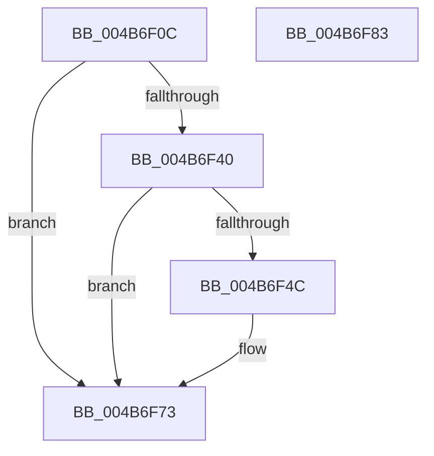

# EtwpInvokeEventCallback

- RVA: `0x004B6F0C`–`0x004B6F84` (길이 `120` bytes)
- VA: `0x00000001404B6F0C`
- 실행 섹션: `.text`
- PDB 이름 있음: `예`; PDB Function 태그: `아니요`
- unwind 정보 RVA: `0x0009E61C`
- 디코드: `34`개 명령, `120/120` bytes 표시
- 미해석 바이트: `0` (있으면 어셈블리에 `.byte`로 보존)

> 이 문서는 커널 이미지의 기계어와 PDB 기호를 분석해 생성했습니다. 4번과 5번은 함수 원형과 자료형을 바이너리 사용 방식에서 추정한 C 해석이며 원본 소스 복구 결과는 아닙니다.

## 1. Dependencies

- 직접 호출 지점: **3**; 고유 호출 대상: **3**
- 직접 호출자로 확인된 함수: **4**
- RIP 상대 이미지 참조: **1**

### Outgoing calls
- `0x004B6F37` → [EtwpGetNextEventOffsetType](EtwpGetNextEventOffsetType_function_004B6F8C.md) (function, `0x004B6F8C`)
- `0x004B6F43` → [KeIsTraceCallbackAllowed](../2F/KeIsTraceCallbackAllowed_function_002FCE6C.md) (function, `0x002FCE6C`)
- `0x004B6F6E` → [guard_dispatch_icall](../6B/guard_dispatch_icall_function_006BAAD0.md) (function, `0x006BAAD0`)

### Direct callers
- [EtwpEventWriteFull](../22/EtwpEventWriteFull_function_00225C10.md) at `0x00227660`
- [EtwTraceEvent](../2F/EtwTraceEvent_function_002FD290.md) at `0x002FD8B3`
- [EtwTraceRaw](../65/EtwTraceRaw_function_006516CC.md) at `0x00651897`
- [EtwpWriteUserEvent](../../page/AF/EtwpWriteUserEvent_function_00AF2FEC.md) at `0x00AF45F6`

### Static image references
- `0x004B6F57` → RVA `0x00FC7408` (`ALMOSTRO`; read)

## 2. Other-region calls and transfers

- 다른 실행 섹션으로 향하는 call: **0**
- 별도 외부 분기/꼬리 이동을 확인하지 못했습니다.

## 3. Assembly (complete function range)

```asm
004B6F0C  48 8B C4                        mov rax, rsp
004B6F0F  48 89 58 10                     mov qword ptr [rax + 0x10], rbx
004B6F13  48 89 70 18                     mov qword ptr [rax + 0x18], rsi
004B6F17  57                              push rdi
004B6F18  48 83 EC 30                     sub rsp, 0x30
004B6F1C  48 8B 1A                        mov rbx, qword ptr [rdx]
004B6F1F  49 8B F8                        mov rdi, r8
004B6F22  44 8B 52 10                     mov r10d, dword ptr [rdx + 0x10]
004B6F26  4C 8D 40 08                     lea r8, [rax + 8]
004B6F2A  83 60 08 00                     and dword ptr [rax + 8], 0
004B6F2E  48 8B F1                        mov rsi, rcx
004B6F31  41 8B D2                        mov edx, r10d
004B6F34  48 8B CB                        mov rcx, rbx
004B6F37  E8 50 00 00 00                  call 0x1404b6f8c
004B6F3C  85 C0                           test eax, eax
004B6F3E  74 33                           je 0x1404b6f73
004B6F40  41 8A C9                        mov cl, r9b
004B6F43  E8 24 5F E4 FF                  call 0x1402fce6c
004B6F48  85 C0                           test eax, eax
004B6F4A  74 27                           je 0x1404b6f73
004B6F4C  48 8B 96 20 06 00 00            mov rdx, qword ptr [rsi + 0x620]
004B6F53  4A 8D 0C 13                     lea rcx, [rbx + r10]
004B6F57  48 8B 05 AA 04 B1 00            mov rax, qword ptr [rip + 0xb104aa]
004B6F5E  4C 8B C7                        mov r8, rdi
004B6F61  48 8B 52 08                     mov rdx, qword ptr [rdx + 8]
004B6F65  48 89 54 24 20                  mov qword ptr [rsp + 0x20], rdx
004B6F6A  8B 54 24 40                     mov edx, dword ptr [rsp + 0x40]
004B6F6E  E8 5D 3B 20 00                  call 0x1406baad0
004B6F73  48 8B 5C 24 48                  mov rbx, qword ptr [rsp + 0x48]
004B6F78  48 8B 74 24 50                  mov rsi, qword ptr [rsp + 0x50]
004B6F7D  48 83 C4 30                     add rsp, 0x30
004B6F81  5F                              pop rdi
004B6F82  C3                              ret
004B6F83  CC                              int3
```

## 4. C-style interpretation (structured pseudocode)

```c
__int64 __fastcall EtwpInvokeEventCallback(__int64 a1, __int64 a2, __int64 a3, unsigned __int8 a4)
{
    __int64 result;
    __int64 v_rsp;
    unsigned __int64 v_stack_m18;
    unsigned __int64 v_stack_p10;
    unsigned __int64 v_stack_p18;
    unsigned int v_stack_p8;

    *(unsigned __int64 *)(v_rsp + 16) = v_rbx;
    *(unsigned __int64 *)(v_rsp + 24) = v_rsi;
    v_rsp = (v_rsp) - (48);
    result = EtwpGetNextEventOffsetType(*(unsigned __int64 *)(a2), (unsigned int)((unsigned int)((unsigned int)(*(unsigned int *)(a2 + 16)))), v_rsp + 8, a4);
    if ((unsigned int)(result) == 0) goto loc_004B6F73;
    result = KeIsTraceCallbackAllowed(a4, (unsigned int)((unsigned int)((unsigned int)(*(unsigned int *)(a2 + 16)))), v_rsp + 8, a4);
    if ((unsigned int)(result) != 0) {
        a2 = *(unsigned __int64 *)(a1 + 1568);
        a1 = *(unsigned __int64 *)(a2) + (unsigned int)(*(unsigned int *)(a2 + 16)) * 1;
        result = *(unsigned __int64 *)(v_rip + 11601066);
        a3 = a3;
        a2 = *(unsigned __int64 *)(a2 + 8);
        v_stack_m18 = a2;
        a2 = v_stack_p8;
        result = guard_dispatch_icall(a1, a2, a3, a4);
    }
    v_rsp = (v_rsp) + (48);
    return result;
}
```

## 5. (Beta) C Style

```c
int64_t EtwpInvokeEventCallback(void *Arg1, void *Arg2, int64_t Arg3, uint8_t Arg4)
{
    uint8_t *arg1 = (uint8_t *)Arg1;
    uint8_t *arg2 = (uint8_t *)Arg2;

    int64_t result;
    int64_t local_rsp;
    uint64_t v_stack_m18;
    uint64_t v_stack_p10;
    uint64_t v_stack_p18;
    uint32_t v_stack_p8;

    *(uint64_t *)(local_rsp + 0x10) = local_rbx;
    *(uint64_t *)(local_rsp + 0x18) = local_rsi;
    local_rsp = (local_rsp) - (48);
    result = EtwpGetNextEventOffsetType(*(uint64_t *)(arg2), (uint32_t)((uint32_t)((uint32_t)(*(uint32_t *)(arg2 + 0x10)))), local_rsp + 8, Arg4);
    if ((uint32_t)(result) == 0) goto loc_004B6F73;
    result = KeIsTraceCallbackAllowed(Arg4, (uint32_t)((uint32_t)((uint32_t)(*(uint32_t *)(arg2 + 0x10)))), local_rsp + 8, Arg4);
    if ((uint32_t)(result) != 0) {
        Arg2 = *(uint64_t *)(arg1 + 0x620);
        Arg1 = *(uint64_t *)(arg2) + (uint32_t)(*(uint32_t *)(arg2 + 0x10)) * 1;
        result = *(uint64_t *)(v_rip + 0xB104AA);
        Arg3 = Arg3;
        Arg2 = *(uint64_t *)(arg2 + 0x8);
        v_stack_m18 = Arg2;
        Arg2 = v_stack_p8;
        result = guard_dispatch_icall(Arg1, Arg2, Arg3, Arg4);
    }
    local_rsp = (local_rsp) + (48);
    return result;
}
```

### 관측된 메모리 오프셋

구조체 형식이 확인되지 않은 접근은 인자 기준의 오프셋으로만 기록했습니다.

| 기준 인자 | 오프셋 표현 | 폭 (bit) | 접근 |
|---|---:|---:|---|
| `Arg1` | `+ 0x620` | `64` | `R` |
| `Arg2` | `+ 0x0` | `64` | `R` |
| `Arg2` | `+ 0x10` | `32` | `R` |

## 6. Execution-region graph

[열기: 2D/3D 그래프와 함수 탐색 컨트롤 패널](../../../control-panel.html?section=text&rva=0x004B6F0C&view=graph)

- 2D 그래프는 위에서 아래로 흐르고, 3D 그래프는 빈 공간을 드래그해 회전합니다. Shift+드래그는 이동, 휠은 확대·축소, 함수 노드 선택은 대상 보고서 이동입니다.

### Static fallback


