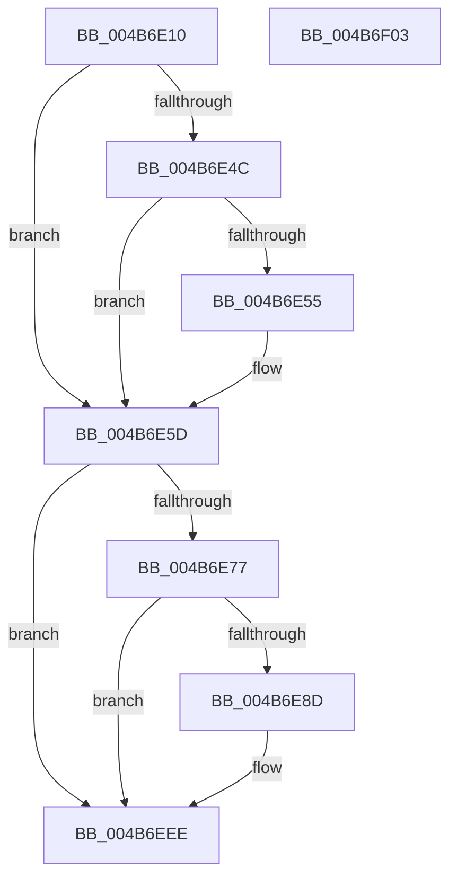

# EtwpSendTraceEvent

- RVA: `0x004B6E10`–`0x004B6F04` (길이 `244` bytes)
- VA: `0x00000001404B6E10`
- 실행 섹션: `.text`
- PDB 이름 있음: `예`; PDB Function 태그: `아니요`
- unwind 정보 RVA: `0x000BA7E8`
- 디코드: `63`개 명령, `244/244` bytes 표시
- 미해석 바이트: `0` (있으면 어셈블리에 `.byte`로 보존)

> 이 문서는 커널 이미지의 기계어와 PDB 기호를 분석해 생성했습니다. 4번과 5번은 함수 원형과 자료형을 바이너리 사용 방식에서 추정한 C 해석이며 원본 소스 복구 결과는 아닙니다.

## 1. Dependencies

- 직접 호출 지점: **5**; 고유 호출 대상: **5**
- 직접 호출자로 확인된 함수: **7**
- RIP 상대 이미지 참조: **1**

### Outgoing calls
- `0x004B6E37` → [memset](../6C/memset_function_006C6C40.md) (function, `0x006C6C40`)
- `0x004B6E4C` → [KeGetEffectiveIrql](../2F/KeGetEffectiveIrql_function_002F8030.md) (function, `0x002F8030`)
- `0x004B6E58` → [EtwpSendDbgId](../../page/7B/EtwpSendDbgId_function_007BC1C0.md) (function, `0x007BC1C0`)
- `0x004B6E6E` → [EtwpGetNextEventOffsetType](EtwpGetNextEventOffsetType_function_004B6F8C.md) (function, `0x004B6F8C`)
- `0x004B6EE9` → [KdSendTraceData](../../pagekd/B8/KdSendTraceData_function_00B86F48.md) (function, `0x00B86F48`)

### Direct callers
- [EtwpEventWriteFull](../22/EtwpEventWriteFull_function_00225C10.md) at `0x00227638`
- [EtwpLogKernelEvent](../25/EtwpLogKernelEvent_function_0025CC00.md) at `0x0025D686`
- [EtwpTraceMessageVa](../2F/EtwpTraceMessageVa_function_002FB2B0.md) at `0x002FBEB6`
- [EtwpLogSystemEventUnsafe](../2F/EtwpLogSystemEventUnsafe_function_002FBF10.md) at `0x002FC681`
- [EtwTraceRaw](../65/EtwTraceRaw_function_006516CC.md) at `0x0065187A`
- [sub_006DFD3C](../6D/Unknown_function_006DFD3C.md) at `0x006DFD54`
- [EtwpWriteUserEvent](../../page/AF/EtwpWriteUserEvent_function_00AF2FEC.md) at `0x00AF45A8`

### Static image references
- `0x004B6E77` → RVA `0x00E0AA48` (`.data`; read)

## 2. Other-region calls and transfers

- 다른 실행 섹션으로 향하는 call: **2**
  - `0x004B6E58` → [EtwpSendDbgId](../../page/7B/EtwpSendDbgId_function_007BC1C0.md) (`.text` → `PAGE`)
  - `0x004B6EE9` → [KdSendTraceData](../../pagekd/B8/KdSendTraceData_function_00B86F48.md) (`.text` → `PAGEKD`)
- 별도 외부 분기/꼬리 이동을 확인하지 못했습니다.

## 3. Assembly (complete function range)

```asm
004B6E10  48 89 5C 24 10                  mov qword ptr [rsp + 0x10], rbx
004B6E15  48 89 7C 24 18                  mov qword ptr [rsp + 0x18], rdi
004B6E1A  55                              push rbp
004B6E1B  48 8D 6C 24 A9                  lea rbp, [rsp - 0x57]
004B6E20  48 81 EC 90 00 00 00            sub rsp, 0x90
004B6E27  48 8B FA                        mov rdi, rdx
004B6E2A  48 8B D9                        mov rbx, rcx
004B6E2D  33 D2                           xor edx, edx
004B6E2F  48 8D 4D 07                     lea rcx, [rbp + 7]
004B6E33  44 8D 42 48                     lea r8d, [rdx + 0x48]
004B6E37  E8 04 FE 20 00                  call 0x1406c6c40
004B6E3C  83 65 67 00                     and dword ptr [rbp + 0x67], 0
004B6E40  8B 83 38 03 00 00               mov eax, dword ptr [rbx + 0x338]
004B6E46  0F BA E0 0B                     bt eax, 0xb
004B6E4A  73 11                           jae 0x1404b6e5d
004B6E4C  E8 DF 11 E4 FF                  call 0x1402f8030
004B6E51  3C 02                           cmp al, 2
004B6E53  73 08                           jae 0x1404b6e5d
004B6E55  48 8B CB                        mov rcx, rbx
004B6E58  E8 63 53 30 00                  call 0x1407bc1c0
004B6E5D  44 8B 57 10                     mov r10d, dword ptr [rdi + 0x10]
004B6E61  4C 8D 45 67                     lea r8, [rbp + 0x67]
004B6E65  4C 8B 0F                        mov r9, qword ptr [rdi]
004B6E68  41 8B D2                        mov edx, r10d
004B6E6B  49 8B C9                        mov rcx, r9
004B6E6E  E8 19 01 00 00                  call 0x1404b6f8c
004B6E73  85 C0                           test eax, eax
004B6E75  74 77                           je 0x1404b6eee
004B6E77  8B 0D CB 3B 95 00               mov ecx, dword ptr [rip + 0x953bcb]
004B6E7D  44 8B 45 67                     mov r8d, dword ptr [rbp + 0x67]
004B6E81  83 C1 C0                        add ecx, -0x40
004B6E84  49 8D 40 48                     lea rax, [r8 + 0x48]
004B6E88  48 3B C1                        cmp rax, rcx
004B6E8B  77 61                           ja 0x1404b6eee
004B6E8D  41 0F 10 01                     movups xmm0, xmmword ptr [r9]
004B6E91  41 8D 40 48                     lea eax, [r8 + 0x48]
004B6E95  C7 45 EF 48 00 00 00            mov dword ptr [rbp - 0x11], 0x48
004B6E9C  BA 02 00 00 00                  mov edx, 2
004B6EA1  44 89 45 FF                     mov dword ptr [rbp - 1], r8d
004B6EA5  0F 29 45 07                     movaps xmmword ptr [rbp + 7], xmm0
004B6EA9  48 8D 4D E7                     lea rcx, [rbp - 0x19]
004B6EAD  41 0F 10 49 10                  movups xmm1, xmmword ptr [r9 + 0x10]
004B6EB2  0F 29 4D 17                     movaps xmmword ptr [rbp + 0x17], xmm1
004B6EB6  41 0F 10 41 20                  movups xmm0, xmmword ptr [r9 + 0x20]
004B6EBB  0F 29 45 27                     movaps xmmword ptr [rbp + 0x27], xmm0
004B6EBF  41 0F 10 49 30                  movups xmm1, xmmword ptr [r9 + 0x30]
004B6EC4  0F 29 4D 37                     movaps xmmword ptr [rbp + 0x37], xmm1
004B6EC8  F2 41 0F 10 41 40               movsd xmm0, qword ptr [r9 + 0x40]
004B6ECE  89 45 07                        mov dword ptr [rbp + 7], eax
004B6ED1  89 45 37                        mov dword ptr [rbp + 0x37], eax
004B6ED4  48 8D 45 07                     lea rax, [rbp + 7]
004B6ED8  48 89 45 E7                     mov qword ptr [rbp - 0x19], rax
004B6EDC  4B 8D 04 11                     lea rax, [r9 + r10]
004B6EE0  48 89 45 F7                     mov qword ptr [rbp - 9], rax
004B6EE4  F2 0F 11 45 47                  movsd qword ptr [rbp + 0x47], xmm0
004B6EE9  E8 5A 00 6D 00                  call 0x140b86f48
004B6EEE  4C 8D 9C 24 90 00 00 00         lea r11, [rsp + 0x90]
004B6EF6  49 8B 5B 18                     mov rbx, qword ptr [r11 + 0x18]
004B6EFA  49 8B 7B 20                     mov rdi, qword ptr [r11 + 0x20]
004B6EFE  49 8B E3                        mov rsp, r11
004B6F01  5D                              pop rbp
004B6F02  C3                              ret
004B6F03  CC                              int3
```

## 4. C-style interpretation (structured pseudocode)

```c
__int64 __fastcall EtwpSendTraceEvent(__int64 a1, __int64 a2)
{
    __int64 result;
    __int64 v_rsp;
    unsigned __int64 v_stack_m18;
    unsigned __int64 v_stack_m28;
    unsigned __int64 v_stack_m38;
    unsigned __int64 v_stack_m48;
    unsigned __int64 v_stack_m58;
    unsigned __int64 v_stack_m5F;
    unsigned int v_stack_m60;
    unsigned __int64 v_stack_m68;
    unsigned int v_stack_m70;
    unsigned __int64 v_stack_m78;
    unsigned __int64 v_stack_m8;
    unsigned __int64 v_stack_p10;
    unsigned __int64 v_stack_p18;
    unsigned int v_stack_p8;

    v_stack_p10 = v_rbx;
    v_stack_p18 = v_rdi;
    v_rsp = (v_rsp) - (144);
    a2 = 0;
    result = memset(v_stack_m58, a2, a2 + 72, a4);
    if (condition_is_above_or_equal) goto loc_004B6E5D;
    result = KeGetEffectiveIrql(v_stack_m58, a2, a2 + 72, a4);
    if (((unsigned __int8)(result)) < 2) {
        a1 = a1;
        result = EtwpSendDbgId(a1, a2, a2 + 72, a4);
    }
    result = EtwpGetNextEventOffsetType(*(unsigned __int64 *)(a2), (unsigned int)((unsigned int)((unsigned int)(*(unsigned int *)(a2 + 16)))), v_stack_p8, *(unsigned __int64 *)(a2));
    if ((unsigned int)(result) == 0) goto loc_004B6EEE;
    a1 = (unsigned int)(((unsigned int)(*(unsigned int *)(v_rip + 9780171))) + (-64));
    result = (unsigned int)(v_stack_p8) + 72;
    if (((unsigned int)(v_stack_p8) + 72) <= a1) {
        result = (unsigned int)(v_stack_p8) + 72;
        v_stack_m70 = 72;
        a2 = 2;
        v_stack_m60 = (unsigned int)((unsigned int)(v_stack_p8));
        v_stack_m58 = v_xmm0;
        a1 = v_stack_m78;
        v_stack_m48 = v_xmm1;
        v_stack_m38 = v_xmm0;
        v_stack_m28 = v_xmm1;
        v_stack_m58 = (unsigned int)(result);
        v_stack_m28 = (unsigned int)(result);
        result = v_stack_m58;
        v_stack_m78 = result;
        result = *(unsigned __int64 *)(a2) + (unsigned int)(*(unsigned int *)(a2 + 16)) * 1;
        v_stack_m68 = result;
        v_stack_m18 = v_xmm0;
        result = KdSendTraceData(a1, a2, (unsigned int)(v_stack_p8), *(unsigned __int64 *)(a2));
    }
    return result;
}
```

## 5. (Beta) C Style

```c
int64_t EtwpSendTraceEvent(void *Arg1, void *Arg2)
{
    uint8_t *arg1 = (uint8_t *)Arg1;
    uint8_t *arg2 = (uint8_t *)Arg2;

    int64_t result;
    int64_t local_rsp;
    uint64_t v_stack_m18;
    uint64_t v_stack_m28;
    uint64_t v_stack_m38;
    uint64_t v_stack_m48;
    uint64_t v_stack_m58;
    uint64_t v_stack_m5F;
    uint32_t v_stack_m60;
    uint64_t v_stack_m68;
    uint32_t v_stack_m70;
    uint64_t v_stack_m78;
    uint64_t v_stack_m8;
    uint64_t v_stack_p10;
    uint64_t v_stack_p18;
    uint32_t v_stack_p8;

    v_stack_p10 = local_rbx;
    v_stack_p18 = local_rdi;
    local_rsp = (local_rsp) - (144);
    Arg2 = 0;
    result = memset(v_stack_m58, Arg2, Arg2 + 72, a4);
    if (condition_is_above_or_equal) goto loc_004B6E5D;
    result = KeGetEffectiveIrql(v_stack_m58, Arg2, Arg2 + 72, a4);
    if (((uint8_t)(result)) < 2) {
        Arg1 = Arg1;
        result = EtwpSendDbgId(Arg1, Arg2, Arg2 + 72, a4);
    }
    result = EtwpGetNextEventOffsetType(*(uint64_t *)(arg2), (uint32_t)((uint32_t)((uint32_t)(*(uint32_t *)(arg2 + 0x10)))), v_stack_p8, *(uint64_t *)(arg2));
    if ((uint32_t)(result) == 0) goto loc_004B6EEE;
    Arg1 = (uint32_t)(((uint32_t)(*(uint32_t *)(v_rip + 0x953BCB))) + (-64));
    result = (uint32_t)(v_stack_p8) + 72;
    if (((uint32_t)(v_stack_p8) + 72) <= Arg1) {
        result = (uint32_t)(v_stack_p8) + 72;
        v_stack_m70 = 72;
        Arg2 = 2;
        v_stack_m60 = (uint32_t)((uint32_t)(v_stack_p8));
        v_stack_m58 = v_xmm0;
        Arg1 = v_stack_m78;
        v_stack_m48 = v_xmm1;
        v_stack_m38 = v_xmm0;
        v_stack_m28 = v_xmm1;
        v_stack_m58 = (uint32_t)(result);
        v_stack_m28 = (uint32_t)(result);
        result = v_stack_m58;
        v_stack_m78 = result;
        result = *(uint64_t *)(arg2) + (uint32_t)(*(uint32_t *)(arg2 + 0x10)) * 1;
        v_stack_m68 = result;
        v_stack_m18 = v_xmm0;
        result = KdSendTraceData(Arg1, Arg2, (uint32_t)(v_stack_p8), *(uint64_t *)(arg2));
    }
    return result;
}
```

### 관측된 메모리 오프셋

구조체 형식이 확인되지 않은 접근은 인자 기준의 오프셋으로만 기록했습니다.

| 기준 인자 | 오프셋 표현 | 폭 (bit) | 접근 |
|---|---:|---:|---|
| `Arg1` | `+ 0x338` | `32` | `R` |
| `Arg2` | `+ 0x0` | `64` | `R` |
| `Arg2` | `+ 0x10` | `32` | `R` |

## 6. Execution-region graph

[열기: 2D/3D 그래프와 함수 탐색 컨트롤 패널](../../../control-panel.html?section=text&rva=0x004B6E10&view=graph)

- 2D 그래프는 위에서 아래로 흐르고, 3D 그래프는 빈 공간을 드래그해 회전합니다. Shift+드래그는 이동, 휠은 확대·축소, 함수 노드 선택은 대상 보고서 이동입니다.

### Static fallback


