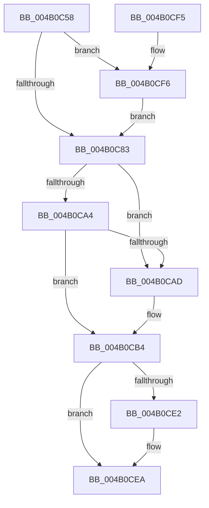

# ExCleanTimerResolutionRequest

- RVA: `0x004B0C58`–`0x004B0D0D` (길이 `181` bytes)
- VA: `0x00000001404B0C58`
- 실행 섹션: `.text`
- PDB 이름 있음: `예`; PDB Function 태그: `아니요`
- unwind 정보 RVA: `0x000B8B78`
- 디코드: `42`개 명령, `181/181` bytes 표시
- 미해석 바이트: `0` (있으면 어셈블리에 `.byte`로 보존)

> 이 문서는 커널 이미지의 기계어와 PDB 기호를 분석해 생성했습니다. 4번과 5번은 함수 원형과 자료형을 바이너리 사용 방식에서 추정한 C 해석이며 원본 소스 복구 결과는 아닙니다.

## 1. Dependencies

- 직접 호출 지점: **6**; 고유 호출 대상: **6**
- 직접 호출자로 확인된 함수: **1**
- RIP 상대 이미지 참조: **2**

### Outgoing calls
- `0x004B0C83` → [ExAcquireTimeRefreshLockExclusive](../../page/9C/ExAcquireTimeRefreshLockExclusive_function_009C5810.md) (function, `0x009C5810`)
- `0x004B0C8F` → [KeAcquireSpinLockRaiseToDpc](../20/KeAcquireSpinLockRaiseToDpc_function_00208470.md) (function, `0x00208470`)
- `0x004B0CC4` → [KeReleaseSpinLock](../39/KeReleaseSpinLock_function_00392BA0.md) (function, `0x00392BA0`)
- `0x004B0CD8` → [ExReleaseTimeRefreshLockExclusive](../../page/9C/ExReleaseTimeRefreshLockExclusive_function_009C5874.md) (function, `0x009C5874`)
- `0x004B0CE5` → [PoDiagFreeUsermodeStack](../../page/AA/PoDiagFreeUsermodeStack_function_00AACA28.md) (function, `0x00AACA28`)
- `0x004B0D03` → [ZwSetTimerResolution](../6B/ZwSetTimerResolution_function_006B0930.md) (function, `0x006B0930`)

### Direct callers
- [PspExitProcess](../../page/90/PspExitProcess_function_00904830.md) at `0x009048ED`

### Static image references
- `0x004B0C88` → RVA `0x00EFEE50` (`.data`; read)
- `0x004B0CF6` → RVA `0x00FC6AA0` (`ALMOSTRO`; read)

## 2. Other-region calls and transfers

- 다른 실행 섹션으로 향하는 call: **3**
  - `0x004B0C83` → [ExAcquireTimeRefreshLockExclusive](../../page/9C/ExAcquireTimeRefreshLockExclusive_function_009C5810.md) (`.text` → `PAGE`)
  - `0x004B0CD8` → [ExReleaseTimeRefreshLockExclusive](../../page/9C/ExReleaseTimeRefreshLockExclusive_function_009C5874.md) (`.text` → `PAGE`)
  - `0x004B0CE5` → [PoDiagFreeUsermodeStack](../../page/AA/PoDiagFreeUsermodeStack_function_00AACA28.md) (`.text` → `PAGE`)
- 별도 외부 분기/꼬리 이동을 확인하지 못했습니다.

## 3. Assembly (complete function range)

```asm
004B0C58  48 89 5C 24 10                  mov qword ptr [rsp + 0x10], rbx
004B0C5D  57                              push rdi
004B0C5E  48 83 EC 20                     sub rsp, 0x20
004B0C62  83 64 24 30 00                  and dword ptr [rsp + 0x30], 0
004B0C67  65 48 8B 04 25 88 01 00 00      mov rax, qword ptr gs:[0x188]
004B0C70  48 8B 98 B8 00 00 00            mov rbx, qword ptr [rax + 0xb8]
004B0C77  F7 83 F4 01 00 00 00 10 00 00   test dword ptr [rbx + 0x1f4], 0x1000
004B0C81  75 73                           jne 0x1404b0cf6
004B0C83  E8 88 4B 51 00                  call 0x1409c5810
004B0C88  48 8D 0D C1 E1 A4 00            lea rcx, [rip + 0xa4e1c1]
004B0C8F  E8 DC 77 D5 FF                  call 0x140208470
004B0C94  48 8D 93 A0 05 00 00            lea rdx, [rbx + 0x5a0]
004B0C9B  4C 8B 0A                        mov r9, qword ptr [rdx]
004B0C9E  49 39 51 08                     cmp qword ptr [r9 + 8], rdx
004B0CA2  75 09                           jne 0x1404b0cad
004B0CA4  4C 8B 42 08                     mov r8, qword ptr [rdx + 8]
004B0CA8  49 39 10                        cmp qword ptr [r8], rdx
004B0CAB  74 07                           je 0x1404b0cb4
004B0CAD  B9 03 00 00 00                  mov ecx, 3
004B0CB2  CD 29                           int 0x29
004B0CB4  4D 89 08                        mov qword ptr [r8], r9
004B0CB7  48 8D 0D 92 E1 A4 00            lea rcx, [rip + 0xa4e192]
004B0CBE  8A D0                           mov dl, al
004B0CC0  4D 89 41 08                     mov qword ptr [r9 + 8], r8
004B0CC4  E8 D7 1E EE FF                  call 0x140392ba0
004B0CC9  48 8B BB B0 05 00 00            mov rdi, qword ptr [rbx + 0x5b0]
004B0CD0  48 83 A3 B0 05 00 00 00         and qword ptr [rbx + 0x5b0], 0
004B0CD8  E8 97 4B 51 00                  call 0x1409c5874
004B0CDD  48 85 FF                        test rdi, rdi
004B0CE0  74 08                           je 0x1404b0cea
004B0CE2  48 8B CF                        mov rcx, rdi
004B0CE5  E8 3E BD 5F 00                  call 0x140aaca28
004B0CEA  48 8B 5C 24 38                  mov rbx, qword ptr [rsp + 0x38]
004B0CEF  48 83 C4 20                     add rsp, 0x20
004B0CF3  5F                              pop rdi
004B0CF4  C3                              ret
004B0CF5  CC                              int3
004B0CF6  8B 0D A4 5D B1 00               mov ecx, dword ptr [rip + 0xb15da4]
004B0CFC  4C 8D 44 24 30                  lea r8, [rsp + 0x30]
004B0D01  33 D2                           xor edx, edx
004B0D03  E8 28 FC 1F 00                  call 0x1406b0930
004B0D08  E9 76 FF FF FF                  jmp 0x1404b0c83
```

## 4. C-style interpretation (structured pseudocode)

```c
__int64 __fastcall ExCleanTimerResolutionRequest(void)
{
    __int64 result;
    __int64 v_rsp;
    unsigned __int64 v_stack_p10;
    unsigned __int64 v_stack_p30;
    unsigned int v_stack_p8;

    v_stack_p10 = v_rbx;
    v_rsp = (v_rsp) - (32);
    if (((*(unsigned int *)(*(unsigned __int64 *)(*(unsigned __int64 *)(gs_base + (0 + 392)) + 184) + 500)) & (0x1000ULL)) != 0) goto loc_004B0CF6;
loc_004B0C83:
    result = ExAcquireTimeRefreshLockExclusive(a1, a2, a3, a4);
    result = KeAcquireSpinLockRaiseToDpc(v_rip + 10805697, a2, a3, a4);
    if ((*(unsigned __int64 *)(*(unsigned __int64 *)(*(unsigned __int64 *)(*(unsigned __int64 *)(gs_base + (0 + 392)) + 184) + 1440) + 8)) != (*(unsigned __int64 *)(*(unsigned __int64 *)(gs_base + (0 + 392)) + 184) + 1440)) goto loc_004B0CAD;
    if ((*(unsigned __int64 *)(*(unsigned __int64 *)(*(unsigned __int64 *)(*(unsigned __int64 *)(gs_base + (0 + 392)) + 184) + 1440 + 8))) != (*(unsigned __int64 *)(*(unsigned __int64 *)(gs_base + (0 + 392)) + 184) + 1440)) {
        a1 = 3;
    }
    *(unsigned __int64 *)(*(unsigned __int64 *)(*(unsigned __int64 *)(*(unsigned __int64 *)(gs_base + (0 + 392)) + 184) + 1440 + 8)) = *(unsigned __int64 *)(*(unsigned __int64 *)(*(unsigned __int64 *)(gs_base + (0 + 392)) + 184) + 1440);
    *(unsigned __int64 *)(*(unsigned __int64 *)(*(unsigned __int64 *)(*(unsigned __int64 *)(gs_base + (0 + 392)) + 184) + 1440) + 8) = *(unsigned __int64 *)(*(unsigned __int64 *)(*(unsigned __int64 *)(gs_base + (0 + 392)) + 184) + 1440 + 8);
    result = KeReleaseSpinLock(v_rip + 10805650, (unsigned __int8)(result), *(unsigned __int64 *)(*(unsigned __int64 *)(*(unsigned __int64 *)(gs_base + (0 + 392)) + 184) + 1440 + 8), *(unsigned __int64 *)(*(unsigned __int64 *)(*(unsigned __int64 *)(gs_base + (0 + 392)) + 184) + 1440));
    result = ExReleaseTimeRefreshLockExclusive(v_rip + 10805650, (unsigned __int8)(result), *(unsigned __int64 *)(*(unsigned __int64 *)(*(unsigned __int64 *)(gs_base + (0 + 392)) + 184) + 1440 + 8), *(unsigned __int64 *)(*(unsigned __int64 *)(*(unsigned __int64 *)(gs_base + (0 + 392)) + 184) + 1440));
    if (*(unsigned __int64 *)(*(unsigned __int64 *)(*(unsigned __int64 *)(gs_base + (0 + 392)) + 184) + 1456) != 0) {
        a1 = *(unsigned __int64 *)(*(unsigned __int64 *)(*(unsigned __int64 *)(gs_base + (0 + 392)) + 184) + 1456);
        result = PoDiagFreeUsermodeStack(a1, (unsigned __int8)(result), *(unsigned __int64 *)(*(unsigned __int64 *)(*(unsigned __int64 *)(gs_base + (0 + 392)) + 184) + 1440 + 8), *(unsigned __int64 *)(*(unsigned __int64 *)(*(unsigned __int64 *)(gs_base + (0 + 392)) + 184) + 1440));
    }
    v_rsp = (v_rsp) + (32);
    return result;
loc_004B0CF6:
    a2 = 0;
    result = ZwSetTimerResolution((unsigned int)(*(unsigned int *)(v_rip + 11623844)), a2, v_stack_p30, *(unsigned __int64 *)(*(unsigned __int64 *)(*(unsigned __int64 *)(gs_base + (0 + 392)) + 184) + 1440));
    goto loc_004B0C83;
}
```

## 5. (Beta) C Style

```c
void ExCleanTimerResolutionRequest(void)
{
    int64_t result;
    int64_t local_rsp;
    uint64_t v_stack_p10;
    uint64_t v_stack_p30;
    uint32_t v_stack_p8;

    v_stack_p10 = local_rbx;
    local_rsp = (local_rsp) - (32);
    if (((*(uint32_t *)(*(uint64_t *)(*(uint64_t *)(gs_base + (0 + 0x188)) + 0xB8) + 0x1F4)) & (0x1000ULL)) != 0) goto loc_004B0CF6;
loc_004B0C83:
    result = ExAcquireTimeRefreshLockExclusive(a1, a2, a3, a4);
    result = KeAcquireSpinLockRaiseToDpc(v_rip + 10805697, a2, a3, a4);
    if ((*(uint64_t *)(*(uint64_t *)(*(uint64_t *)(*(uint64_t *)(gs_base + (0 + 0x188)) + 0xB8) + 0x5A0) + 0x8)) != (*(uint64_t *)(*(uint64_t *)(gs_base + (0 + 0x188)) + 0xB8) + 1440)) goto loc_004B0CAD;
    if ((*(uint64_t *)(*(uint64_t *)(*(uint64_t *)(*(uint64_t *)(gs_base + (0 + 0x188)) + 0xB8) + 0x5A0 + 0x8))) != (*(uint64_t *)(*(uint64_t *)(gs_base + (0 + 0x188)) + 0xB8) + 1440)) {
        a1 = 3;
    }
    *(uint64_t *)(*(uint64_t *)(*(uint64_t *)(*(uint64_t *)(gs_base + (0 + 0x188)) + 0xB8) + 0x5A0 + 0x8)) = *(uint64_t *)(*(uint64_t *)(*(uint64_t *)(gs_base + (0 + 0x188)) + 0xB8) + 0x5A0);
    *(uint64_t *)(*(uint64_t *)(*(uint64_t *)(*(uint64_t *)(gs_base + (0 + 0x188)) + 0xB8) + 0x5A0) + 0x8) = *(uint64_t *)(*(uint64_t *)(*(uint64_t *)(gs_base + (0 + 0x188)) + 0xB8) + 0x5A0 + 0x8);
    result = KeReleaseSpinLock(v_rip + 10805650, (uint8_t)(result), *(uint64_t *)(*(uint64_t *)(*(uint64_t *)(gs_base + (0 + 0x188)) + 0xB8) + 0x5A0 + 0x8), *(uint64_t *)(*(uint64_t *)(*(uint64_t *)(gs_base + (0 + 0x188)) + 0xB8) + 0x5A0));
    result = ExReleaseTimeRefreshLockExclusive(v_rip + 10805650, (uint8_t)(result), *(uint64_t *)(*(uint64_t *)(*(uint64_t *)(gs_base + (0 + 0x188)) + 0xB8) + 0x5A0 + 0x8), *(uint64_t *)(*(uint64_t *)(*(uint64_t *)(gs_base + (0 + 0x188)) + 0xB8) + 0x5A0));
    if (*(uint64_t *)(*(uint64_t *)(*(uint64_t *)(gs_base + (0 + 0x188)) + 0xB8) + 0x5B0) != 0) {
        a1 = *(uint64_t *)(*(uint64_t *)(*(uint64_t *)(gs_base + (0 + 0x188)) + 0xB8) + 0x5B0);
        result = PoDiagFreeUsermodeStack(a1, (uint8_t)(result), *(uint64_t *)(*(uint64_t *)(*(uint64_t *)(gs_base + (0 + 0x188)) + 0xB8) + 0x5A0 + 0x8), *(uint64_t *)(*(uint64_t *)(*(uint64_t *)(gs_base + (0 + 0x188)) + 0xB8) + 0x5A0));
    }
    local_rsp = (local_rsp) + (32);
    return result;
loc_004B0CF6:
    a2 = 0;
    result = ZwSetTimerResolution((uint32_t)(*(uint32_t *)(v_rip + 0xB15DA4)), a2, v_stack_p30, *(uint64_t *)(*(uint64_t *)(*(uint64_t *)(gs_base + (0 + 0x188)) + 0xB8) + 0x5A0));
    goto loc_004B0C83;
}
```

## 6. Execution-region graph

[열기: 2D/3D 그래프와 함수 탐색 컨트롤 패널](../../../control-panel.html?section=text&rva=0x004B0C58&view=graph)

- 2D 그래프는 위에서 아래로 흐르고, 3D 그래프는 빈 공간을 드래그해 회전합니다. Shift+드래그는 이동, 휠은 확대·축소, 함수 노드 선택은 대상 보고서 이동입니다.

### Static fallback


