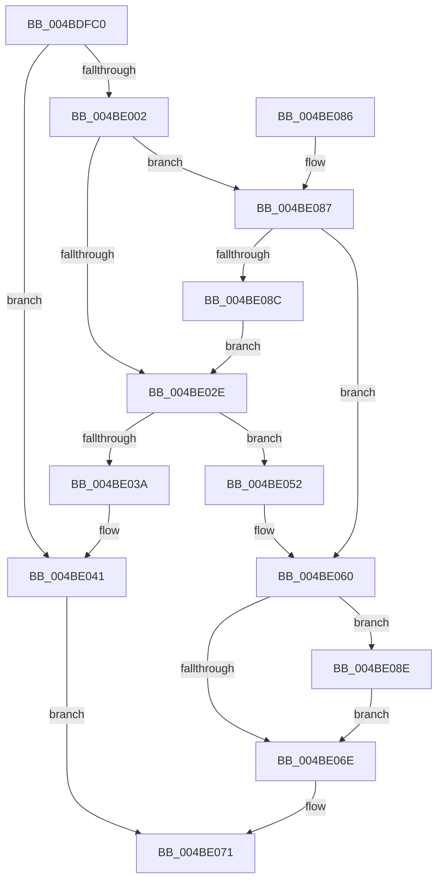

# ExRegisterCallback

- RVA: `0x004BDFC0`–`0x004BE0A9` (길이 `233` bytes)
- VA: `0x00000001404BDFC0`
- 실행 섹션: `.text`
- PDB 이름 있음: `예`; PDB Function 태그: `아니요`
- unwind 정보 RVA: `0x0007BF90`
- 디코드: `67`개 명령, `233/233` bytes 표시
- 미해석 바이트: `0` (있으면 어셈블리에 `.byte`로 보존)

> 이 문서는 커널 이미지의 기계어와 PDB 기호를 분석해 생성했습니다. 4번과 5번은 함수 원형과 자료형을 바이너리 사용 방식에서 추정한 C 해석이며 원본 소스 복구 결과는 아닙니다.

## 1. Dependencies

- 직접 호출 지점: **7**; 고유 호출 대상: **6**
- 직접 호출자로 확인된 함수: **16**
- RIP 상대 이미지 참조: **0**

### Outgoing calls
- `0x004BDFE2` → [ObfReferenceObjectWithTag](../21/ObfReferenceObjectWithTag_function_00210710.md) (function, `0x00210710`)
- `0x004BDFF5` → [ExAllocatePool2](../../poolcode/B8/ExAllocatePool2_function_00B820F0.md) (function, `0x00B820F0`)
- `0x004BE01D` → [KeAcquireSpinLockRaiseToDpc](../20/KeAcquireSpinLockRaiseToDpc_function_00208470.md) (function, `0x00208470`)
- `0x004BE049` → [ObfDereferenceObjectWithTag](../2F/ObfDereferenceObjectWithTag_function_002F78E0.md) (function, `0x002F78E0`)
- `0x004BE064` → [KeReleaseSpinLock](../39/KeReleaseSpinLock_function_00392BA0.md) (function, `0x00392BA0`)
- `0x004BE093` → [ExFreePoolWithTag](../../poolcode/B8/ExFreePoolWithTag_function_00B82870.md) (function, `0x00B82870`)
- `0x004BE0A0` → [ObfDereferenceObjectWithTag](../2F/ObfDereferenceObjectWithTag_function_002F78E0.md) (function, `0x002F78E0`)

### Direct callers
- [HvlPhase2Initialize](../58/HvlPhase2Initialize_function_00583EA0.md) at `0x00584106`
- [DifExRegisterCallbackWrapper](../62/DifExRegisterCallbackWrapper_function_00621D10.md) at `0x00621DF5`
- [HaliInitPowerManagement](../../page/70/HaliInitPowerManagement_function_0070BAE0.md) at `0x0070BBAC`
- [HalpMiscInitializeKsr](../../page/70/HalpMiscInitializeKsr_function_0070C618.md) at `0x0070C6A9`
- [IoRegisterContainerNotification](../../page/71/IoRegisterContainerNotification_function_0071E700.md) at `0x0071E80F`
- [IoRegisterBootDriverCallback](../../page/72/IoRegisterBootDriverCallback_function_00729980.md) at `0x00729A15`
- [KeRegisterProcessorChangeCallback](../../page/74/KeRegisterProcessorChangeCallback_function_00746520.md) at `0x007465DB`
- [SeRegisterImageVerificationCallback](../../page/79/SeRegisterImageVerificationCallback_function_0079B960.md) at `0x0079B9AB`
- [PiCslInitialize](../../init/C3/PiCslInitialize_function_00C362B8.md) at `0x00C3633F`
- [PiKsrNotifyInitialize](../../init/C3/PiKsrNotifyInitialize_function_00C36540.md) at `0x00C36615`
- [PopSetupKsrCallbacks](../../init/C3/PopSetupKsrCallbacks_function_00C3F21C.md) at `0x00C3F2AD`
- [PopUmpoInitializeChannel](../../init/C4/PopUmpoInitializeChannel_function_00C428F0.md) at `0x00C42AE0`
- [PopUmpoInitializeMonitorChannel](../../init/C4/PopUmpoInitializeMonitorChannel_function_00C42B6C.md) at `0x00C42C77`
- [SshpAlpcInitialize](../../init/C4/SshpAlpcInitialize_function_00C448B4.md) at `0x00C44B0F`
- [EtwpInitialize](../../init/C4/EtwpInitialize_function_00C4DBCC.md) at `0x00C4DE26`
- [EtwpInitializeKsrSupport](../../init/C4/EtwpInitializeKsrSupport_function_00C4F458.md) at `0x00C4F4EA`

### Static image references
- 디코드된 RIP-relative 메모리 참조가 없습니다.

## 2. Other-region calls and transfers

- 다른 실행 섹션으로 향하는 call: **2**
  - `0x004BDFF5` → [ExAllocatePool2](../../poolcode/B8/ExAllocatePool2_function_00B820F0.md) (`.text` → `POOLCODE`)
  - `0x004BE093` → [ExFreePoolWithTag](../../poolcode/B8/ExFreePoolWithTag_function_00B82870.md) (`.text` → `POOLCODE`)
- 별도 외부 분기/꼬리 이동을 확인하지 못했습니다.

## 3. Assembly (complete function range)

```asm
004BDFC0  48 89 5C 24 08                  mov qword ptr [rsp + 8], rbx
004BDFC5  48 89 6C 24 10                  mov qword ptr [rsp + 0x10], rbp
004BDFCA  48 89 74 24 18                  mov qword ptr [rsp + 0x18], rsi
004BDFCF  57                              push rdi
004BDFD0  48 83 EC 20                     sub rsp, 0x20
004BDFD4  48 8B EA                        mov rbp, rdx
004BDFD7  49 8B F0                        mov rsi, r8
004BDFDA  BA 44 66 6C 74                  mov edx, 0x746c6644
004BDFDF  48 8B F9                        mov rdi, rcx
004BDFE2  E8 29 27 D5 FF                  call 0x140210710
004BDFE7  BA 30 00 00 00                  mov edx, 0x30
004BDFEC  41 B8 43 42 52 65               mov r8d, 0x65524243
004BDFF2  8D 4A 10                        lea ecx, [rdx + 0x10]
004BDFF5  E8 F6 40 6C 00                  call 0x140b820f0
004BDFFA  48 8B D8                        mov rbx, rax
004BDFFD  48 85 C0                        test rax, rax
004BE000  74 3F                           je 0x1404be041
004BE002  83 60 28 00                     and dword ptr [rax + 0x28], 0
004BE006  48 8D 4F 08                     lea rcx, [rdi + 8]
004BE00A  48 89 70 20                     mov qword ptr [rax + 0x20], rsi
004BE00E  40 32 F6                        xor sil, sil
004BE011  48 89 78 10                     mov qword ptr [rax + 0x10], rdi
004BE015  48 89 68 18                     mov qword ptr [rax + 0x18], rbp
004BE019  C6 40 2C 00                     mov byte ptr [rax + 0x2c], 0
004BE01D  E8 4E A4 D4 FF                  call 0x140208470
004BE022  48 8D 4F 10                     lea rcx, [rdi + 0x10]
004BE026  8A D0                           mov dl, al
004BE028  40 38 77 20                     cmp byte ptr [rdi + 0x20], sil
004BE02C  74 59                           je 0x1404be087
004BE02E  48 8B 41 08                     mov rax, qword ptr [rcx + 8]
004BE032  40 B6 01                        mov sil, 1
004BE035  48 39 08                        cmp qword ptr [rax], rcx
004BE038  74 18                           je 0x1404be052
004BE03A  B9 03 00 00 00                  mov ecx, 3
004BE03F  CD 29                           int 0x29
004BE041  BA 44 66 6C 74                  mov edx, 0x746c6644
004BE046  48 8B CF                        mov rcx, rdi
004BE049  E8 92 98 E3 FF                  call 0x1402f78e0
004BE04E  33 C0                           xor eax, eax
004BE050  EB 1F                           jmp 0x1404be071
004BE052  48 89 0B                        mov qword ptr [rbx], rcx
004BE055  48 89 43 08                     mov qword ptr [rbx + 8], rax
004BE059  48 89 18                        mov qword ptr [rax], rbx
004BE05C  48 89 59 08                     mov qword ptr [rcx + 8], rbx
004BE060  48 8D 4F 08                     lea rcx, [rdi + 8]
004BE064  E8 37 4B ED FF                  call 0x140392ba0
004BE069  40 84 F6                        test sil, sil
004BE06C  74 20                           je 0x1404be08e
004BE06E  48 8B C3                        mov rax, rbx
004BE071  48 8B 5C 24 30                  mov rbx, qword ptr [rsp + 0x30]
004BE076  48 8B 6C 24 38                  mov rbp, qword ptr [rsp + 0x38]
004BE07B  48 8B 74 24 40                  mov rsi, qword ptr [rsp + 0x40]
004BE080  48 83 C4 20                     add rsp, 0x20
004BE084  5F                              pop rdi
004BE085  C3                              ret
004BE086  CC                              int3
004BE087  48 39 09                        cmp qword ptr [rcx], rcx
004BE08A  75 D4                           jne 0x1404be060
004BE08C  EB A0                           jmp 0x1404be02e
004BE08E  33 D2                           xor edx, edx
004BE090  48 8B CB                        mov rcx, rbx
004BE093  E8 D8 47 6C 00                  call 0x140b82870
004BE098  BA 44 66 6C 74                  mov edx, 0x746c6644
004BE09D  48 8B CF                        mov rcx, rdi
004BE0A0  E8 3B 98 E3 FF                  call 0x1402f78e0
004BE0A5  33 DB                           xor ebx, ebx
004BE0A7  EB C5                           jmp 0x1404be06e
```

## 4. C-style interpretation (structured pseudocode)

```c
__int64 __fastcall ExRegisterCallback(__int64 a1, __int64 a2, __int64 a3)
{
    __int64 result;
    __int64 v_rbx;
    __int64 v_rsi;
    __int64 v_rsp;
    unsigned __int64 v_stack_p10;
    unsigned __int64 v_stack_p18;
    unsigned __int64 v_stack_p8;

    v_stack_p8 = v_rbx;
    v_stack_p10 = v_rbp;
    v_stack_p18 = v_rsi;
    v_rsp = (v_rsp) - (32);
    result = ObfReferenceObjectWithTag(a1, (unsigned int)(0x746C6644ULL), a3, a4);
    result = ExAllocatePool2(48 + 16, 48, (unsigned int)(0x65524243ULL), a4);
    if (result == 0) goto loc_004BE041;
    *(unsigned __int64 *)(result + 32) = a3;
    v_rsi = 0;
    *(unsigned __int64 *)(result + 16) = a1;
    *(unsigned __int64 *)(result + 24) = a2;
    *(unsigned __int8 *)(result + 44) = 0;
    result = KeAcquireSpinLockRaiseToDpc(a1 + 8, 48, (unsigned int)(0x65524243ULL), a4);
    if ((*(unsigned __int8 *)(a1 + 32)) == 0) goto loc_004BE087;
loc_004BE02E:
    if ((*(unsigned __int64 *)(*(unsigned __int64 *)(a1 + 16 + 8))) == (a1 + 16)) goto loc_004BE052;
loc_004BE041:
    result = ObfDereferenceObjectWithTag(a1, (unsigned int)(0x746C6644ULL), (unsigned int)(0x65524243ULL), a4);
    result = 0;
    goto loc_004BE071;
loc_004BE052:
    *(unsigned __int64 *)(result) = a1;
    *(unsigned __int64 *)(result + 8) = 0;
    *(unsigned __int64 *)(result) = 0;
    *(unsigned __int64 *)(a1 + 8) = 0;
loc_004BE060:
    result = KeReleaseSpinLock(a1 + 8, (unsigned int)(0x746C6644ULL), (unsigned int)(0x65524243ULL), a4);
    if (1 == 0) goto loc_004BE08E;
loc_004BE06E:
loc_004BE071:
    v_rsp = (v_rsp) + (32);
    return result;
loc_004BE087:
    if ((*(unsigned __int64 *)(a1 + 8)) != (a1 + 8)) goto loc_004BE060;
    goto loc_004BE02E;
loc_004BE08E:
    a2 = 0;
    result = ExFreePoolWithTag(v_stack_p8, a2, (unsigned int)(0x65524243ULL), a4);
    result = ObfDereferenceObjectWithTag(a1, (unsigned int)(0x746C6644ULL), (unsigned int)(0x65524243ULL), a4);
    v_rbx = 0;
    goto loc_004BE06E;
}
```

## 5. (Beta) C Style

```c
int64_t ExRegisterCallback(void *Arg1, int64_t Arg2, int64_t Arg3)
{
    uint8_t *arg1 = (uint8_t *)Arg1;

    int64_t result;
    int64_t local_rbx;
    int64_t local_rsi;
    int64_t local_rsp;
    uint64_t v_stack_p10;
    uint64_t v_stack_p18;
    uint64_t v_stack_p8;

    v_stack_p8 = local_rbx;
    v_stack_p10 = local_rbp;
    v_stack_p18 = local_rsi;
    local_rsp = (local_rsp) - (32);
    result = ObfReferenceObjectWithTag(Arg1, (uint32_t)(0x746C6644ULL), Arg3, a4);
    result = ExAllocatePool2(48 + 16, 48, (uint32_t)(0x65524243ULL), a4);
    if (result == 0) goto loc_004BE041;
    *(uint64_t *)(result + 0x20) = Arg3;
    local_rsi = 0;
    *(void **)(result + 0x10) = Arg1;
    *(uint64_t *)(result + 0x18) = Arg2;
    *(uint8_t *)(result + 0x2C) = 0;
    result = KeAcquireSpinLockRaiseToDpc(Arg1 + 8, 48, (uint32_t)(0x65524243ULL), a4);
    if ((*(uint8_t *)(arg1 + 0x20)) == 0) goto loc_004BE087;
loc_004BE02E:
    if ((*(uint64_t *)(*(uint64_t *)(arg1 + 0x10 + 0x8))) == (Arg1 + 16)) goto loc_004BE052;
loc_004BE041:
    result = ObfDereferenceObjectWithTag(Arg1, (uint32_t)(0x746C6644ULL), (uint32_t)(0x65524243ULL), a4);
    result = 0;
    goto loc_004BE071;
loc_004BE052:
    *(void **)(result) = Arg1;
    *(uint64_t *)(result + 0x8) = 0;
    *(uint64_t *)(result) = 0;
    *(uint64_t *)(arg1 + 0x8) = 0;
loc_004BE060:
    result = KeReleaseSpinLock(Arg1 + 8, (uint32_t)(0x746C6644ULL), (uint32_t)(0x65524243ULL), a4);
    if (1 == 0) goto loc_004BE08E;
loc_004BE06E:
loc_004BE071:
    local_rsp = (local_rsp) + (32);
    return result;
loc_004BE087:
    if ((*(uint64_t *)(arg1 + 0x8)) != (Arg1 + 8)) goto loc_004BE060;
    goto loc_004BE02E;
loc_004BE08E:
    Arg2 = 0;
    result = ExFreePoolWithTag(v_stack_p8, Arg2, (uint32_t)(0x65524243ULL), a4);
    result = ObfDereferenceObjectWithTag(Arg1, (uint32_t)(0x746C6644ULL), (uint32_t)(0x65524243ULL), a4);
    local_rbx = 0;
    goto loc_004BE06E;
}
```

### 관측된 메모리 오프셋

구조체 형식이 확인되지 않은 접근은 인자 기준의 오프셋으로만 기록했습니다.

| 기준 인자 | 오프셋 표현 | 폭 (bit) | 접근 |
|---|---:|---:|---|
| `Arg1` | `+ 0x0` | `64` | `R` |
| `Arg1` | `+ 0x8` | `64` | `R` |
| `Arg1` | `+ 0x8` | `64` | `W` |
| `Arg1` | `+ 0x10` | `64` | `R` |
| `Arg1` | `+ 0x20` | `8` | `R` |

## 6. Execution-region graph

[열기: 2D/3D 그래프와 함수 탐색 컨트롤 패널](../../../control-panel.html?section=text&rva=0x004BDFC0&view=graph)

- 2D 그래프는 위에서 아래로 흐르고, 3D 그래프는 빈 공간을 드래그해 회전합니다. Shift+드래그는 이동, 휠은 확대·축소, 함수 노드 선택은 대상 보고서 이동입니다.

### Static fallback


