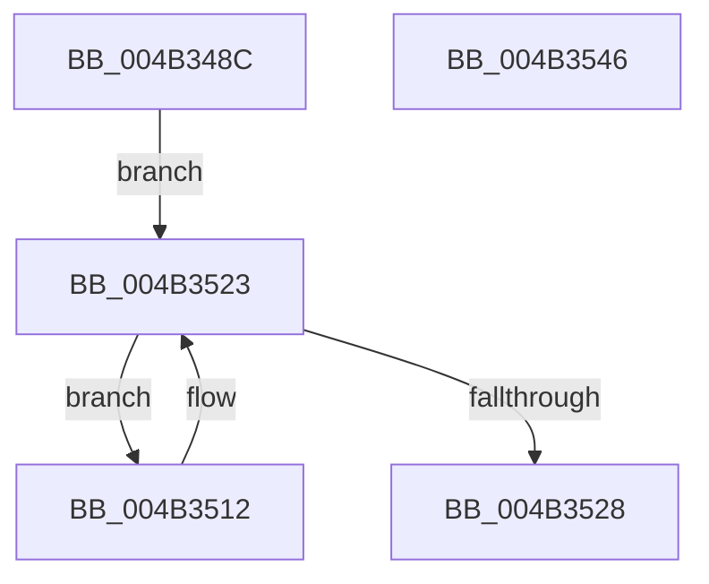

# ExTraceTimerResolution

- RVA: `0x004B348C`–`0x004B3547` (길이 `187` bytes)
- VA: `0x00000001404B348C`
- 실행 섹션: `.text`
- PDB 이름 있음: `예`; PDB Function 태그: `아니요`
- unwind 정보 RVA: `0x00084C9C`
- 디코드: `45`개 명령, `187/187` bytes 표시
- 미해석 바이트: `0` (있으면 어셈블리에 `.byte`로 보존)

> 이 문서는 커널 이미지의 기계어와 PDB 기호를 분석해 생성했습니다. 4번과 5번은 함수 원형과 자료형을 바이너리 사용 방식에서 추정한 C 해석이며 원본 소스 복구 결과는 아닙니다.

## 1. Dependencies

- 직접 호출 지점: **6**; 고유 호출 대상: **6**
- 직접 호출자로 확인된 함수: **1**
- RIP 상대 이미지 참조: **8**

### Outgoing calls
- `0x004B34A4` → [ExAcquireTimeRefreshLockShared](../../page/A2/ExAcquireTimeRefreshLockShared_function_00A201D0.md) (function, `0x00A201D0`)
- `0x004B34B0` → [KeAcquireSpinLockRaiseToDpc](../20/KeAcquireSpinLockRaiseToDpc_function_00208470.md) (function, `0x00208470`)
- `0x004B34E4` → [KeReleaseSpinLock](../39/KeReleaseSpinLock_function_00392BA0.md) (function, `0x00392BA0`)
- `0x004B34FD` → [PoRundownSystemTimer](../../page/AA/PoRundownSystemTimer_function_00AACB3C.md) (function, `0x00AACB3C`)
- `0x004B351B` → [PoTraceSystemTimerResolution](../../page/9C/PoTraceSystemTimerResolution_function_009C5480.md) (function, `0x009C5480`)
- `0x004B3528` → [ExReleaseTimeRefreshLockShared](../../page/A2/ExReleaseTimeRefreshLockShared_function_00A2023C.md) (function, `0x00A2023C`)

### Direct callers
- [PopDiagTraceControlCallback](../../page/A3/PopDiagTraceControlCallback_function_00A38CB0.md) at `0x00A38CFB`

### Static image references
- `0x004B34A9` → RVA `0x00EFEE50` (`.data`; read)
- `0x004B34B5` → RVA `0x00FC6BEC` (`ALMOSTRO`; read)
- `0x004B34C3` → RVA `0x00FC6B3C` (`ALMOSTRO`; read)
- `0x004B34CC` → RVA `0x00FC6AA0` (`ALMOSTRO`; read)
- `0x004B34D2` → RVA `0x00EFEE64` (`.data`; read)
- `0x004B34D8` → RVA `0x00EFEE60` (`.data`; read)
- `0x004B34DE` → RVA `0x00FC6B7C` (`ALMOSTRO`; read)
- `0x004B3502` → RVA `0x00EFEE40` (`.data`; read)

## 2. Other-region calls and transfers

- 다른 실행 섹션으로 향하는 call: **4**
  - `0x004B34A4` → [ExAcquireTimeRefreshLockShared](../../page/A2/ExAcquireTimeRefreshLockShared_function_00A201D0.md) (`.text` → `PAGE`)
  - `0x004B34FD` → [PoRundownSystemTimer](../../page/AA/PoRundownSystemTimer_function_00AACB3C.md) (`.text` → `PAGE`)
  - `0x004B351B` → [PoTraceSystemTimerResolution](../../page/9C/PoTraceSystemTimerResolution_function_009C5480.md) (`.text` → `PAGE`)
  - `0x004B3528` → [ExReleaseTimeRefreshLockShared](../../page/A2/ExReleaseTimeRefreshLockShared_function_00A2023C.md) (`.text` → `PAGE`)
- 별도 외부 분기/꼬리 이동을 확인하지 못했습니다.

## 3. Assembly (complete function range)

```asm
004B348C  48 89 5C 24 08                  mov qword ptr [rsp + 8], rbx
004B3491  48 89 6C 24 10                  mov qword ptr [rsp + 0x10], rbp
004B3496  48 89 74 24 18                  mov qword ptr [rsp + 0x18], rsi
004B349B  57                              push rdi
004B349C  41 56                           push r14
004B349E  41 57                           push r15
004B34A0  48 83 EC 30                     sub rsp, 0x30
004B34A4  E8 27 CD 56 00                  call 0x140a201d0
004B34A9  48 8D 0D A0 B9 A4 00            lea rcx, [rip + 0xa4b9a0]
004B34B0  E8 BB 4F D5 FF                  call 0x140208470
004B34B5  44 8B 3D 30 37 B1 00            mov r15d, dword ptr [rip + 0xb13730]
004B34BC  48 8D 0D 8D B9 A4 00            lea rcx, [rip + 0xa4b98d]
004B34C3  44 8B 35 72 36 B1 00            mov r14d, dword ptr [rip + 0xb13672]
004B34CA  8A D0                           mov dl, al
004B34CC  8B 2D CE 35 B1 00               mov ebp, dword ptr [rip + 0xb135ce]
004B34D2  8B 35 8C B9 A4 00               mov esi, dword ptr [rip + 0xa4b98c]
004B34D8  8B 3D 82 B9 A4 00               mov edi, dword ptr [rip + 0xa4b982]
004B34DE  8B 1D 98 36 B1 00               mov ebx, dword ptr [rip + 0xb13698]
004B34E4  E8 B7 F6 ED FF                  call 0x140392ba0
004B34E9  44 8B CE                        mov r9d, esi
004B34EC  89 5C 24 28                     mov dword ptr [rsp + 0x28], ebx
004B34F0  44 8B C5                        mov r8d, ebp
004B34F3  89 7C 24 20                     mov dword ptr [rsp + 0x20], edi
004B34F7  41 8B D6                        mov edx, r14d
004B34FA  41 8B CF                        mov ecx, r15d
004B34FD  E8 3A 96 5F 00                  call 0x140aacb3c
004B3502  48 8B 1D 37 B9 A4 00            mov rbx, qword ptr [rip + 0xa4b937]
004B3509  48 8D 3D 30 B9 A4 00            lea rdi, [rip + 0xa4b930]
004B3510  EB 11                           jmp 0x1404b3523
004B3512  48 8D 93 60 FA FF FF            lea rdx, [rbx - 0x5a0]
004B3519  B1 01                           mov cl, 1
004B351B  E8 60 1F 51 00                  call 0x1409c5480
004B3520  48 8B 1B                        mov rbx, qword ptr [rbx]
004B3523  48 3B DF                        cmp rbx, rdi
004B3526  75 EA                           jne 0x1404b3512
004B3528  E8 0F CD 56 00                  call 0x140a2023c
004B352D  48 8B 5C 24 50                  mov rbx, qword ptr [rsp + 0x50]
004B3532  48 8B 6C 24 58                  mov rbp, qword ptr [rsp + 0x58]
004B3537  48 8B 74 24 60                  mov rsi, qword ptr [rsp + 0x60]
004B353C  48 83 C4 30                     add rsp, 0x30
004B3540  41 5F                           pop r15
004B3542  41 5E                           pop r14
004B3544  5F                              pop rdi
004B3545  C3                              ret
004B3546  CC                              int3
```

## 4. C-style interpretation (structured pseudocode)

```c
__int64 __fastcall ExTraceTimerResolution(void)
{
    __int64 result;
    __int64 v_rsp;
    unsigned int v_stack_m20;
    unsigned int v_stack_m28;
    unsigned __int64 v_stack_p10;
    unsigned __int64 v_stack_p18;
    unsigned __int64 v_stack_p8;

    v_stack_p8 = v_rbx;
    v_stack_p10 = v_rbp;
    v_stack_p18 = v_rsi;
    v_rsp = (v_rsp) - (48);
    result = ExAcquireTimeRefreshLockShared(a1, a2, a3, a4);
    result = KeAcquireSpinLockRaiseToDpc(v_rip + 10795424, a2, a3, a4);
    result = KeReleaseSpinLock(v_rip + 10795405, (unsigned __int8)(result), a3, a4);
    v_stack_m20 = (unsigned int)((unsigned int)(*(unsigned int *)(v_rip + 11613848)));
    v_stack_m28 = (unsigned int)((unsigned int)(*(unsigned int *)(v_rip + 10795394)));
    result = PoRundownSystemTimer((unsigned int)((unsigned int)((unsigned int)(*(unsigned int *)(v_rip + 11614000)))), (unsigned int)((unsigned int)((unsigned int)(*(unsigned int *)(v_rip + 11613810)))), (unsigned int)((unsigned int)((unsigned int)(*(unsigned int *)(v_rip + 11613646)))), (unsigned int)((unsigned int)((unsigned int)(*(unsigned int *)(v_rip + 10795404)))));
    goto loc_004B3523;
loc_004B3512:
    result = PoTraceSystemTimerResolution(1, *(unsigned __int64 *)(v_rip + 10795319) - 1440, (unsigned int)((unsigned int)((unsigned int)(*(unsigned int *)(v_rip + 11613646)))), (unsigned int)((unsigned int)((unsigned int)(*(unsigned int *)(v_rip + 10795404)))));
loc_004B3523:
    if ((*(unsigned __int64 *)(*(unsigned __int64 *)(v_rip + 10795319))) != (v_rip + 10795312)) goto loc_004B3512;
    result = ExReleaseTimeRefreshLockShared(1, *(unsigned __int64 *)(v_rip + 10795319) - 1440, (unsigned int)((unsigned int)((unsigned int)(*(unsigned int *)(v_rip + 11613646)))), (unsigned int)((unsigned int)((unsigned int)(*(unsigned int *)(v_rip + 10795404)))));
    v_rsp = (v_rsp) + (48);
    return result;
}
```

## 5. (Beta) C Style

```c
void ExTraceTimerResolution(void)
{
    int64_t result;
    int64_t local_rsp;
    uint32_t v_stack_m20;
    uint32_t v_stack_m28;
    uint64_t v_stack_p10;
    uint64_t v_stack_p18;
    uint64_t v_stack_p8;

    v_stack_p8 = local_rbx;
    v_stack_p10 = local_rbp;
    v_stack_p18 = local_rsi;
    local_rsp = (local_rsp) - (48);
    result = ExAcquireTimeRefreshLockShared(a1, a2, a3, a4);
    result = KeAcquireSpinLockRaiseToDpc(v_rip + 10795424, a2, a3, a4);
    result = KeReleaseSpinLock(v_rip + 10795405, (uint8_t)(result), a3, a4);
    v_stack_m20 = (uint32_t)((uint32_t)(*(uint32_t *)(v_rip + 0xB13698)));
    v_stack_m28 = (uint32_t)((uint32_t)(*(uint32_t *)(v_rip + 0xA4B982)));
    result = PoRundownSystemTimer((uint32_t)((uint32_t)((uint32_t)(*(uint32_t *)(v_rip + 0xB13730)))), (uint32_t)((uint32_t)((uint32_t)(*(uint32_t *)(v_rip + 0xB13672)))), (uint32_t)((uint32_t)((uint32_t)(*(uint32_t *)(v_rip + 0xB135CE)))), (uint32_t)((uint32_t)((uint32_t)(*(uint32_t *)(v_rip + 0xA4B98C)))));
    goto loc_004B3523;
loc_004B3512:
    result = PoTraceSystemTimerResolution(1, *(uint64_t *)(v_rip + 0xA4B937) - 1440, (uint32_t)((uint32_t)((uint32_t)(*(uint32_t *)(v_rip + 0xB135CE)))), (uint32_t)((uint32_t)((uint32_t)(*(uint32_t *)(v_rip + 0xA4B98C)))));
loc_004B3523:
    if ((*(uint64_t *)(*(uint64_t *)(v_rip + 0xA4B937))) != (v_rip + 10795312)) goto loc_004B3512;
    result = ExReleaseTimeRefreshLockShared(1, *(uint64_t *)(v_rip + 0xA4B937) - 1440, (uint32_t)((uint32_t)((uint32_t)(*(uint32_t *)(v_rip + 0xB135CE)))), (uint32_t)((uint32_t)((uint32_t)(*(uint32_t *)(v_rip + 0xA4B98C)))));
    local_rsp = (local_rsp) + (48);
    return result;
}
```

## 6. Execution-region graph

[열기: 2D/3D 그래프와 함수 탐색 컨트롤 패널](../../../control-panel.html?section=text&rva=0x004B348C&view=graph)

- 2D 그래프는 위에서 아래로 흐르고, 3D 그래프는 빈 공간을 드래그해 회전합니다. Shift+드래그는 이동, 휠은 확대·축소, 함수 노드 선택은 대상 보고서 이동입니다.

### Static fallback


