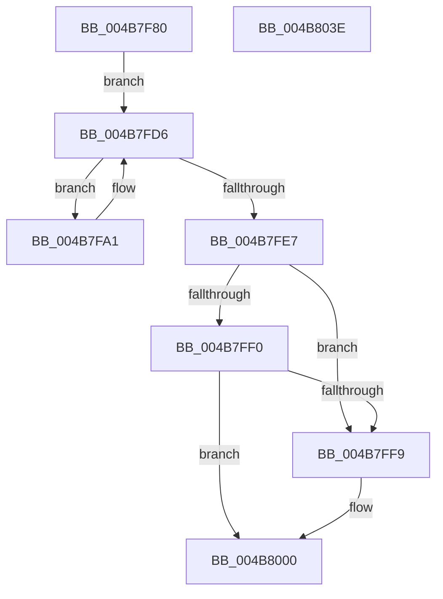

# ExUnregisterCallback

- RVA: `0x004B7F80`–`0x004B803F` (길이 `191` bytes)
- VA: `0x00000001404B7F80`
- 실행 섹션: `.text`
- PDB 이름 있음: `예`; PDB Function 태그: `아니요`
- unwind 정보 RVA: `0x00066400`
- 디코드: `52`개 명령, `191/191` bytes 표시
- 미해석 바이트: `0` (있으면 어셈블리에 `.byte`로 보존)

> 이 문서는 커널 이미지의 기계어와 PDB 기호를 분석해 생성했습니다. 4번과 5번은 함수 원형과 자료형을 바이너리 사용 방식에서 추정한 C 해석이며 원본 소스 복구 결과는 아닙니다.

## 1. Dependencies

- 직접 호출 지점: **7**; 고유 호출 대상: **6**
- 직접 호출자로 확인된 함수: **9**
- RIP 상대 이미지 참조: **1**

### Outgoing calls
- `0x004B7FAC` → [KeResetEvent](../24/KeResetEvent_function_00248350.md) (function, `0x00248350`)
- `0x004B7FB7` → [KeReleaseSpinLock](../39/KeReleaseSpinLock_function_00392BA0.md) (function, `0x00392BA0`)
- `0x004B7FD1` → [KeWaitForSingleObject](../20/KeWaitForSingleObject_function_0020E6B0.md) (function, `0x0020E6B0`)
- `0x004B7FD9` → [KeAcquireSpinLockRaiseToDpc](../20/KeAcquireSpinLockRaiseToDpc_function_00208470.md) (function, `0x00208470`)
- `0x004B800D` → [KeReleaseSpinLock](../39/KeReleaseSpinLock_function_00392BA0.md) (function, `0x00392BA0`)
- `0x004B8017` → [ExFreePoolWithTag](../../poolcode/B8/ExFreePoolWithTag_function_00B82870.md) (function, `0x00B82870`)
- `0x004B8024` → [ObfDereferenceObjectWithTag](../2F/ObfDereferenceObjectWithTag_function_002F78E0.md) (function, `0x002F78E0`)

### Direct callers
- [DifExUnregisterCallbackWrapper](../62/DifExUnregisterCallbackWrapper_function_006236A0.md) at `0x00623766`
- [sub_006FB21E](../6F/Unknown_function_006FB21E.md) at `0x006FB22C`
- [IoRegisterContainerNotification](../../page/71/IoRegisterContainerNotification_function_0071E700.md) at `0x0071E87B`
- [IoUnregisterContainerNotification](../../page/71/IoUnregisterContainerNotification_function_0071E9C0.md) at `0x0071EA50`
- [KeDeregisterProcessorChangeCallback](../../page/74/KeDeregisterProcessorChangeCallback_function_00746500.md) at `0x00746504`
- [KeRegisterProcessorChangeCallback](../../page/74/KeRegisterProcessorChangeCallback_function_00746520.md) at `0x0074668B`
- [SeUnregisterImageVerificationCallback](../../page/79/SeUnregisterImageVerificationCallback_function_0079B9F0.md) at `0x0079B9FB`
- [IoUnregisterBootDriverCallback](../../init/C3/IoUnregisterBootDriverCallback_function_00C32C20.md) at `0x00C32C24`
- [PopUmpoInitializeMonitorChannel](../../init/C4/PopUmpoInitializeMonitorChannel_function_00C42B6C.md) at `0x00C42CDB`

### Static image references
- `0x004B7FA1` → RVA `0x00EFACE0` (`.data`; read)

## 2. Other-region calls and transfers

- 다른 실행 섹션으로 향하는 call: **1**
  - `0x004B8017` → [ExFreePoolWithTag](../../poolcode/B8/ExFreePoolWithTag_function_00B82870.md) (`.text` → `POOLCODE`)
- 별도 외부 분기/꼬리 이동을 확인하지 못했습니다.

## 3. Assembly (complete function range)

```asm
004B7F80  48 89 5C 24 08                  mov qword ptr [rsp + 8], rbx
004B7F85  48 89 6C 24 10                  mov qword ptr [rsp + 0x10], rbp
004B7F8A  48 89 74 24 18                  mov qword ptr [rsp + 0x18], rsi
004B7F8F  57                              push rdi
004B7F90  48 83 EC 30                     sub rsp, 0x30
004B7F94  48 8B 71 10                     mov rsi, qword ptr [rcx + 0x10]
004B7F98  48 8B D9                        mov rbx, rcx
004B7F9B  48 8D 7E 08                     lea rdi, [rsi + 8]
004B7F9F  EB 35                           jmp 0x1404b7fd6
004B7FA1  48 8D 0D 38 2D A4 00            lea rcx, [rip + 0xa42d38]
004B7FA8  C6 43 2C 01                     mov byte ptr [rbx + 0x2c], 1
004B7FAC  E8 9F 03 D9 FF                  call 0x140248350
004B7FB1  40 8A D5                        mov dl, bpl
004B7FB4  48 8B CF                        mov rcx, rdi
004B7FB7  E8 E4 AB ED FF                  call 0x140392ba0
004B7FBC  48 83 64 24 20 00               and qword ptr [rsp + 0x20], 0
004B7FC2  48 8D 0D 17 2D A4 00            lea rcx, [rip + 0xa42d17]
004B7FC9  45 33 C9                        xor r9d, r9d
004B7FCC  45 33 C0                        xor r8d, r8d
004B7FCF  33 D2                           xor edx, edx
004B7FD1  E8 DA 66 D5 FF                  call 0x14020e6b0
004B7FD6  48 8B CF                        mov rcx, rdi
004B7FD9  E8 92 04 D5 FF                  call 0x140208470
004B7FDE  83 7B 28 00                     cmp dword ptr [rbx + 0x28], 0
004B7FE2  40 8A E8                        mov bpl, al
004B7FE5  75 BA                           jne 0x1404b7fa1
004B7FE7  48 8B 13                        mov rdx, qword ptr [rbx]
004B7FEA  48 39 5A 08                     cmp qword ptr [rdx + 8], rbx
004B7FEE  75 09                           jne 0x1404b7ff9
004B7FF0  48 8B 43 08                     mov rax, qword ptr [rbx + 8]
004B7FF4  48 39 18                        cmp qword ptr [rax], rbx
004B7FF7  74 07                           je 0x1404b8000
004B7FF9  B9 03 00 00 00                  mov ecx, 3
004B7FFE  CD 29                           int 0x29
004B8000  48 89 10                        mov qword ptr [rax], rdx
004B8003  48 8B CF                        mov rcx, rdi
004B8006  48 89 42 08                     mov qword ptr [rdx + 8], rax
004B800A  40 8A D5                        mov dl, bpl
004B800D  E8 8E AB ED FF                  call 0x140392ba0
004B8012  33 D2                           xor edx, edx
004B8014  48 8B CB                        mov rcx, rbx
004B8017  E8 54 A8 6C 00                  call 0x140b82870
004B801C  BA 44 66 6C 74                  mov edx, 0x746c6644
004B8021  48 8B CE                        mov rcx, rsi
004B8024  E8 B7 F8 E3 FF                  call 0x1402f78e0
004B8029  48 8B 5C 24 40                  mov rbx, qword ptr [rsp + 0x40]
004B802E  48 8B 6C 24 48                  mov rbp, qword ptr [rsp + 0x48]
004B8033  48 8B 74 24 50                  mov rsi, qword ptr [rsp + 0x50]
004B8038  48 83 C4 30                     add rsp, 0x30
004B803C  5F                              pop rdi
004B803D  C3                              ret
004B803E  CC                              int3
```

## 4. C-style interpretation (structured pseudocode)

```c
__int64 __fastcall ExUnregisterCallback(__int64 a1, __int64 a2, int a3, int a4)
{
    __int64 result;
    __int64 v_rsp;
    unsigned __int64 v_stack_m18;
    unsigned __int64 v_stack_p10;
    unsigned __int64 v_stack_p18;
    unsigned __int64 v_stack_p8;

    v_stack_p8 = v_rbx;
    v_stack_p10 = v_rbp;
    v_stack_p18 = v_rsi;
    v_rsp = (v_rsp) - (48);
    goto loc_004B7FD6;
loc_004B7FA1:
    *(unsigned __int8 *)(a1 + 44) = 1;
    result = KeResetEvent(v_rip + 10759480, a2, a3, a4);
    result = KeReleaseSpinLock(*(unsigned __int64 *)(a1 + 16) + 8, (unsigned __int8)(v_rbp), a3, a4);
    a4 = 0;
    a3 = 0;
    a2 = 0;
    result = KeWaitForSingleObject(v_rip + 10759447, a2, a3, a4);
loc_004B7FD6:
    result = KeAcquireSpinLockRaiseToDpc(*(unsigned __int64 *)(a1 + 16) + 8, a2, a3, a4);
    if ((*(unsigned int *)(a1 + 40)) != 0) goto loc_004B7FA1;
    if ((*(unsigned __int64 *)(*(unsigned __int64 *)(a1) + 8)) != a1) goto loc_004B7FF9;
    if ((*(unsigned __int64 *)(*(unsigned __int64 *)(a1 + 8))) != a1) {
        a1 = 3;
    }
    *(unsigned __int64 *)(*(unsigned __int64 *)(a1 + 8)) = *(unsigned __int64 *)(a1);
    *(unsigned __int64 *)(*(unsigned __int64 *)(a1) + 8) = *(unsigned __int64 *)(a1 + 8);
    result = KeReleaseSpinLock(*(unsigned __int64 *)(a1 + 16) + 8, (unsigned __int8)((unsigned __int8)(result)), a3, a4);
    a2 = 0;
    result = ExFreePoolWithTag(a1, a2, a3, a4);
    result = ObfDereferenceObjectWithTag(*(unsigned __int64 *)(a1 + 16), (unsigned int)(0x746C6644ULL), a3, a4);
    v_rsp = (v_rsp) + (48);
    return result;
}
```

## 5. (Beta) C Style

```c
int64_t ExUnregisterCallback(void *Arg1, int64_t Arg2, int32_t Arg3, int32_t Arg4)
{
    uint8_t *arg1 = (uint8_t *)Arg1;

    int64_t result;
    int64_t local_rsp;
    uint64_t v_stack_m18;
    uint64_t v_stack_p10;
    uint64_t v_stack_p18;
    uint64_t v_stack_p8;

    v_stack_p8 = local_rbx;
    v_stack_p10 = local_rbp;
    v_stack_p18 = local_rsi;
    local_rsp = (local_rsp) - (48);
    goto loc_004B7FD6;
loc_004B7FA1:
    *(uint8_t *)(arg1 + 0x2C) = 1;
    result = KeResetEvent(v_rip + 10759480, Arg2, Arg3, Arg4);
    result = KeReleaseSpinLock(*(uint64_t *)(arg1 + 0x10) + 8, (uint8_t)(local_rbp), Arg3, Arg4);
    Arg4 = 0;
    Arg3 = 0;
    Arg2 = 0;
    result = KeWaitForSingleObject(v_rip + 10759447, Arg2, Arg3, Arg4);
loc_004B7FD6:
    result = KeAcquireSpinLockRaiseToDpc(*(uint64_t *)(arg1 + 0x10) + 8, Arg2, Arg3, Arg4);
    if ((*(uint32_t *)(arg1 + 0x28)) != 0) goto loc_004B7FA1;
    if ((*(uint64_t *)(*(uint64_t *)(arg1) + 0x8)) != Arg1) goto loc_004B7FF9;
    if ((*(uint64_t *)(*(uint64_t *)(arg1 + 0x8))) != Arg1) {
        Arg1 = 3;
    }
    *(uint64_t *)(*(uint64_t *)(arg1 + 0x8)) = *(uint64_t *)(arg1);
    *(uint64_t *)(*(uint64_t *)(arg1) + 0x8) = *(uint64_t *)(arg1 + 0x8);
    result = KeReleaseSpinLock(*(uint64_t *)(arg1 + 0x10) + 8, (uint8_t)((uint8_t)(result)), Arg3, Arg4);
    Arg2 = 0;
    result = ExFreePoolWithTag(Arg1, Arg2, Arg3, Arg4);
    result = ObfDereferenceObjectWithTag(*(uint64_t *)(arg1 + 0x10), (uint32_t)(0x746C6644ULL), Arg3, Arg4);
    local_rsp = (local_rsp) + (48);
    return result;
}
```

### 관측된 메모리 오프셋

구조체 형식이 확인되지 않은 접근은 인자 기준의 오프셋으로만 기록했습니다.

| 기준 인자 | 오프셋 표현 | 폭 (bit) | 접근 |
|---|---:|---:|---|
| `Arg1` | `+ 0x0` | `64` | `R` |
| `Arg1` | `+ 0x8` | `64` | `R` |
| `Arg1` | `+ 0x10` | `64` | `R` |
| `Arg1` | `+ 0x28` | `32` | `R` |
| `Arg1` | `+ 0x2C` | `8` | `W` |

## 6. Execution-region graph

[열기: 2D/3D 그래프와 함수 탐색 컨트롤 패널](../../../control-panel.html?section=text&rva=0x004B7F80&view=graph)

- 2D 그래프는 위에서 아래로 흐르고, 3D 그래프는 빈 공간을 드래그해 회전합니다. Shift+드래그는 이동, 휠은 확대·축소, 함수 노드 선택은 대상 보고서 이동입니다.

### Static fallback


