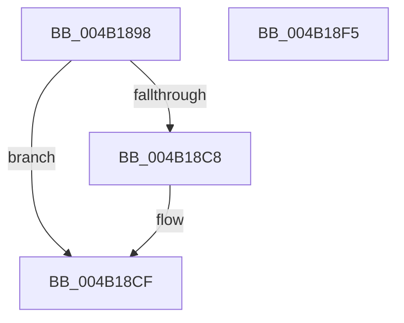

# ExpInsertTimerResolutionEntry

- RVA: `0x004B1898`–`0x004B18F6` (길이 `94` bytes)
- VA: `0x00000001404B1898`
- 실행 섹션: `.text`
- PDB 이름 있음: `예`; PDB Function 태그: `아니요`
- unwind 정보 RVA: `0x0005CF00`
- 디코드: `23`개 명령, `94/94` bytes 표시
- 미해석 바이트: `0` (있으면 어셈블리에 `.byte`로 보존)

> 이 문서는 커널 이미지의 기계어와 PDB 기호를 분석해 생성했습니다. 4번과 5번은 함수 원형과 자료형을 바이너리 사용 방식에서 추정한 C 해석이며 원본 소스 복구 결과는 아닙니다.

## 1. Dependencies

- 직접 호출 지점: **2**; 고유 호출 대상: **2**
- 직접 호출자로 확인된 함수: **1**
- RIP 상대 이미지 참조: **3**

### Outgoing calls
- `0x004B18A8` → [KeAcquireSpinLockRaiseToDpc](../20/KeAcquireSpinLockRaiseToDpc_function_00208470.md) (function, `0x00208470`)
- `0x004B18EA` → [KeReleaseSpinLock](../39/KeReleaseSpinLock_function_00392BA0.md) (function, `0x00392BA0`)

### Direct callers
- [NtSetTimerResolution](../../page/9C/NtSetTimerResolution_function_009C5170.md) at `0x009C534F`

### Static image references
- `0x004B18A1` → RVA `0x00EFEE50` (`.data`; read)
- `0x004B18AD` → RVA `0x00EFEE40` (`.data`; read)
- `0x004B18E3` → RVA `0x00EFEE40` (`.data`; write)

## 2. Other-region calls and transfers

- 다른 실행 섹션으로 향하는 call: **0**
- 별도 외부 분기/꼬리 이동을 확인하지 못했습니다.

## 3. Assembly (complete function range)

```asm
004B1898  40 53                           push rbx
004B189A  48 83 EC 20                     sub rsp, 0x20
004B189E  48 8B D9                        mov rbx, rcx
004B18A1  48 8D 0D A8 D5 A4 00            lea rcx, [rip + 0xa4d5a8]
004B18A8  E8 C3 6B D5 FF                  call 0x140208470
004B18AD  48 8B 0D 8C D5 A4 00            mov rcx, qword ptr [rip + 0xa4d58c]
004B18B4  48 8D 15 85 D5 A4 00            lea rdx, [rip + 0xa4d585]
004B18BB  48 81 C3 A0 05 00 00            add rbx, 0x5a0
004B18C2  48 39 51 08                     cmp qword ptr [rcx + 8], rdx
004B18C6  74 07                           je 0x1404b18cf
004B18C8  B9 03 00 00 00                  mov ecx, 3
004B18CD  CD 29                           int 0x29
004B18CF  48 89 0B                        mov qword ptr [rbx], rcx
004B18D2  48 89 53 08                     mov qword ptr [rbx + 8], rdx
004B18D6  8A D0                           mov dl, al
004B18D8  48 89 59 08                     mov qword ptr [rcx + 8], rbx
004B18DC  48 8D 0D 6D D5 A4 00            lea rcx, [rip + 0xa4d56d]
004B18E3  48 89 1D 56 D5 A4 00            mov qword ptr [rip + 0xa4d556], rbx
004B18EA  E8 B1 12 EE FF                  call 0x140392ba0
004B18EF  48 83 C4 20                     add rsp, 0x20
004B18F3  5B                              pop rbx
004B18F4  C3                              ret
004B18F5  CC                              int3
```

## 4. C-style interpretation (structured pseudocode)

```c
__int64 __fastcall ExpInsertTimerResolutionEntry(__int64 a1)
{
    __int64 result;
    __int64 v_rbx;
    __int64 v_rsp;

    v_rsp = (v_rsp) - (32);
    result = KeAcquireSpinLockRaiseToDpc(v_rip + 10802600, a2, a3, a4);
    v_rbx = (a1) + (0x5A0ULL);
    if ((*(unsigned __int64 *)(*(unsigned __int64 *)(v_rip + 10802572) + 8)) != (v_rip + 10802565)) {
        a1 = 3;
    }
    *(unsigned __int64 *)(v_rbx) = a1;
    *(unsigned __int64 *)(v_rbx + 8) = v_rip + 10802565;
    *(unsigned __int64 *)(a1 + 8) = v_rbx;
    *(unsigned __int64 *)(v_rip + 10802518) = v_rbx;
    result = KeReleaseSpinLock(v_rip + 10802541, (unsigned __int8)(result), a3, a4);
    v_rsp = (v_rsp) + (32);
    return result;
}
```

## 5. (Beta) C Style

```c
int64_t ExpInsertTimerResolutionEntry(void *Arg1)
{
    uint8_t *arg1 = (uint8_t *)Arg1;

    int64_t result;
    int64_t local_rbx;
    int64_t local_rsp;

    local_rsp = (local_rsp) - (32);
    result = KeAcquireSpinLockRaiseToDpc(v_rip + 10802600, a2, a3, a4);
    local_rbx = (Arg1) + (0x5A0ULL);
    if ((*(uint64_t *)(*(uint64_t *)(v_rip + 0xA4D58C) + 0x8)) != (v_rip + 10802565)) {
        Arg1 = 3;
    }
    *(void **)(local_rbx) = Arg1;
    *(uint64_t *)(local_rbx + 0x8) = v_rip + 10802565;
    *(uint64_t *)(arg1 + 0x8) = local_rbx;
    *(uint64_t *)(v_rip + 0xA4D556) = local_rbx;
    result = KeReleaseSpinLock(v_rip + 10802541, (uint8_t)(result), a3, a4);
    local_rsp = (local_rsp) + (32);
    return result;
}
```

### 관측된 메모리 오프셋

구조체 형식이 확인되지 않은 접근은 인자 기준의 오프셋으로만 기록했습니다.

| 기준 인자 | 오프셋 표현 | 폭 (bit) | 접근 |
|---|---:|---:|---|
| `Arg1` | `+ 0x0` | `64` | `W` |
| `Arg1` | `+ 0x8` | `64` | `W` |

## 6. Execution-region graph

[열기: 2D/3D 그래프와 함수 탐색 컨트롤 패널](../../../control-panel.html?section=text&rva=0x004B1898&view=graph)

- 2D 그래프는 위에서 아래로 흐르고, 3D 그래프는 빈 공간을 드래그해 회전합니다. Shift+드래그는 이동, 휠은 확대·축소, 함수 노드 선택은 대상 보고서 이동입니다.

### Static fallback


