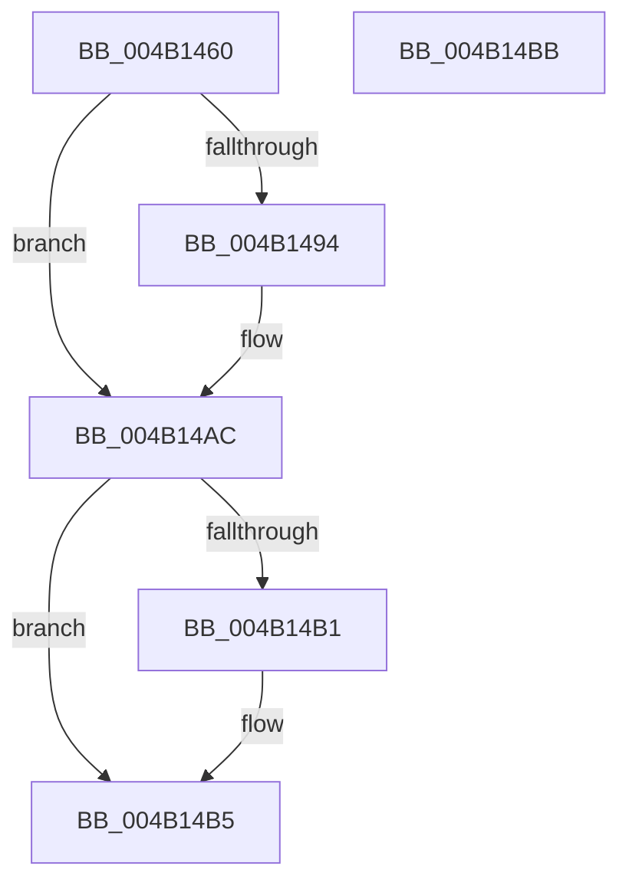

# ExpLockCallbackListShared

- RVA: `0x004B1460`–`0x004B14BC` (길이 `92` bytes)
- VA: `0x00000001404B1460`
- 실행 섹션: `.text`
- PDB 이름 있음: `예`; PDB Function 태그: `아니요`
- unwind 정보 RVA: `0x0005CF00`
- 디코드: `25`개 명령, `92/92` bytes 표시
- 미해석 바이트: `0` (있으면 어셈블리에 `.byte`로 보존)

> 이 문서는 커널 이미지의 기계어와 PDB 기호를 분석해 생성했습니다. 4번과 5번은 함수 원형과 자료형을 바이너리 사용 방식에서 추정한 C 해석이며 원본 소스 복구 결과는 아닙니다.

## 1. Dependencies

- 직접 호출 지점: **2**; 고유 호출 대상: **2**
- 직접 호출자로 확인된 함수: **1**
- RIP 상대 이미지 참조: **1**

### Outgoing calls
- `0x004B147A` → [KeAbPreAcquire](../21/KeAbPreAcquire_function_00210230.md) (function, `0x00210230`)
- `0x004B14A7` → [ExfAcquirePushLockSharedEx](../21/ExfAcquirePushLockSharedEx_function_0021044C.md) (function, `0x0021044C`)

### Direct callers
- [ExpGetNextCallback](../../page/A7/ExpGetNextCallback_function_00A77380.md) at `0x00A773AC`

### Static image references
- `0x004B1470` → RVA `0x00EFACC0` (`.data`; read)

## 2. Other-region calls and transfers

- 다른 실행 섹션으로 향하는 call: **0**
- 별도 외부 분기/꼬리 이동을 확인하지 못했습니다.

## 3. Assembly (complete function range)

```asm
004B1460  40 53                           push rbx
004B1462  48 83 EC 20                     sub rsp, 0x20
004B1466  66 FF 89 E6 01 00 00            dec word ptr [rcx + 0x1e6]
004B146D  45 33 C0                        xor r8d, r8d
004B1470  48 8D 0D 49 98 A4 00            lea rcx, [rip + 0xa49849]
004B1477  33 D2                           xor edx, edx
004B1479  90                              nop
004B147A  E8 B1 ED D5 FF                  call 0x140210230
004B147F  48 8B D8                        mov rbx, rax
004B1482  BA 11 00 00 00                  mov edx, 0x11
004B1487  33 C0                           xor eax, eax
004B1489  F0 48 0F B1 15 2E 98 A4 00      lock cmpxchg qword ptr [rip + 0xa4982e], rdx
004B1492  74 18                           je 0x1404b14ac
004B1494  4C 8D 0D 25 98 A4 00            lea r9, [rip + 0xa49825]
004B149B  4C 8B C3                        mov r8, rbx
004B149E  33 D2                           xor edx, edx
004B14A0  48 8D 0D 19 98 A4 00            lea rcx, [rip + 0xa49819]
004B14A7  E8 A0 EF D5 FF                  call 0x14021044c
004B14AC  48 85 DB                        test rbx, rbx
004B14AF  74 04                           je 0x1404b14b5
004B14B1  C6 43 0A 01                     mov byte ptr [rbx + 0xa], 1
004B14B5  48 83 C4 20                     add rsp, 0x20
004B14B9  5B                              pop rbx
004B14BA  C3                              ret
004B14BB  CC                              int3
```

## 4. C-style interpretation (structured pseudocode)

```c
__int64 __fastcall ExpLockCallbackListShared(__int64 a1, int a2, int a3)
{
    __int64 result;
    __int64 v_rsp;

    v_rsp = (v_rsp) - (32);
    a3 = 0;
    a2 = 0;
    result = KeAbPreAcquire(v_rip + 10786889, a2, a3, a4);
    result = 0;
    if (!(condition_is_equal)) {
        a4 = v_rip + 10786853;
        a3 = 0;
        a2 = 0;
        a1 = v_rip + 10786841;
        result = ExfAcquirePushLockSharedEx(a1, a2, a3, a4);
    }
    if (result != 0) {
        *(unsigned __int8 *)(result + 10) = 1;
    }
    v_rsp = (v_rsp) + (32);
    return result;
}
```

## 5. (Beta) C Style

```c
int64_t ExpLockCallbackListShared(void *Arg1, int32_t Arg2, int32_t Arg3)
{
    uint8_t *arg1 = (uint8_t *)Arg1;

    int64_t result;
    int64_t local_rsp;

    local_rsp = (local_rsp) - (32);
    Arg3 = 0;
    Arg2 = 0;
    result = KeAbPreAcquire(v_rip + 10786889, Arg2, Arg3, a4);
    result = 0;
    if (!(condition_is_equal)) {
        a4 = v_rip + 10786853;
        Arg3 = 0;
        Arg2 = 0;
        Arg1 = v_rip + 10786841;
        result = ExfAcquirePushLockSharedEx(Arg1, Arg2, Arg3, a4);
    }
    if (result != 0) {
        *(uint8_t *)(result + 0xA) = 1;
    }
    local_rsp = (local_rsp) + (32);
    return result;
}
```

### 관측된 메모리 오프셋

구조체 형식이 확인되지 않은 접근은 인자 기준의 오프셋으로만 기록했습니다.

| 기준 인자 | 오프셋 표현 | 폭 (bit) | 접근 |
|---|---:|---:|---|
| `Arg1` | `+ 0x1E6` | `16` | `R/W` |

## 6. Execution-region graph

[열기: 2D/3D 그래프와 함수 탐색 컨트롤 패널](../../../control-panel.html?section=text&rva=0x004B1460&view=graph)

- 2D 그래프는 위에서 아래로 흐르고, 3D 그래프는 빈 공간을 드래그해 회전합니다. Shift+드래그는 이동, 휠은 확대·축소, 함수 노드 선택은 대상 보고서 이동입니다.

### Static fallback


