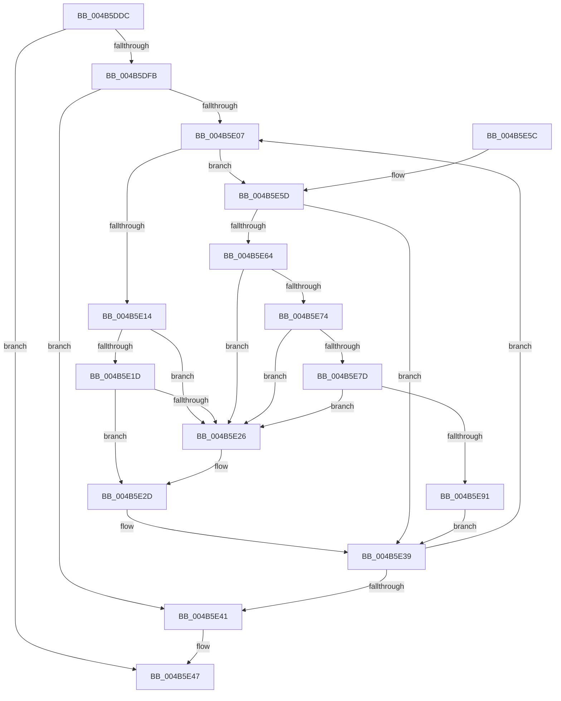

# ExpSaAllocatorOptimizeList

- RVA: `0x004B5DDC`–`0x004B5EA1` (길이 `197` bytes)
- VA: `0x00000001404B5DDC`
- 실행 섹션: `.text`
- PDB 이름 있음: `예`; PDB Function 태그: `아니요`
- unwind 정보 RVA: `0x000BA454`
- 디코드: `61`개 명령, `197/197` bytes 표시
- 미해석 바이트: `0` (있으면 어셈블리에 `.byte`로 보존)

> 이 문서는 커널 이미지의 기계어와 PDB 기호를 분석해 생성했습니다. 4번과 5번은 함수 원형과 자료형을 바이너리 사용 방식에서 추정한 C 해석이며 원본 소스 복구 결과는 아닙니다.

## 1. Dependencies

- 직접 호출 지점: **1**; 고유 호출 대상: **1**
- 직접 호출자로 확인된 함수: **2**
- RIP 상대 이미지 참조: **0**

### Outgoing calls
- `0x004B5E34` → [ExpSaPageGroupDescriptorFree](ExpSaPageGroupDescriptorFree_function_004B5EA8.md) (function, `0x004B5EA8`)

### Direct callers
- [ExpSaAllocatorFree](../2E/ExpSaAllocatorFree_function_002E2E00.md) at `0x002E2EBE`
- [sub_006E7298](../6E/Unknown_function_006E7298.md) at `0x006E72DD`

### Static image references
- 디코드된 RIP-relative 메모리 참조가 없습니다.

## 2. Other-region calls and transfers

- 다른 실행 섹션으로 향하는 call: **0**
- 별도 외부 분기/꼬리 이동을 확인하지 못했습니다.

## 3. Assembly (complete function range)

```asm
004B5DDC  48 89 5C 24 08                  mov qword ptr [rsp + 8], rbx
004B5DE1  48 89 6C 24 10                  mov qword ptr [rsp + 0x10], rbp
004B5DE6  48 89 74 24 18                  mov qword ptr [rsp + 0x18], rsi
004B5DEB  57                              push rdi
004B5DEC  48 83 EC 20                     sub rsp, 0x20
004B5DF0  8B 59 40                        mov ebx, dword ptr [rcx + 0x40]
004B5DF3  48 8B F9                        mov rdi, rcx
004B5DF6  F6 C3 02                        test bl, 2
004B5DF9  74 4C                           je 0x1404b5e47
004B5DFB  48 8D 71 08                     lea rsi, [rcx + 8]
004B5DFF  48 8B 0E                        mov rcx, qword ptr [rsi]
004B5E02  48 3B CE                        cmp rcx, rsi
004B5E05  74 3A                           je 0x1404b5e41
004B5E07  8B 41 24                        mov eax, dword ptr [rcx + 0x24]
004B5E0A  48 8B 29                        mov rbp, qword ptr [rcx]
004B5E0D  3D 00 02 00 00                  cmp eax, 0x200
004B5E12  75 49                           jne 0x1404b5e5d
004B5E14  48 8B 11                        mov rdx, qword ptr [rcx]
004B5E17  48 39 4A 08                     cmp qword ptr [rdx + 8], rcx
004B5E1B  75 09                           jne 0x1404b5e26
004B5E1D  48 8B 41 08                     mov rax, qword ptr [rcx + 8]
004B5E21  48 39 08                        cmp qword ptr [rax], rcx
004B5E24  74 07                           je 0x1404b5e2d
004B5E26  B9 03 00 00 00                  mov ecx, 3
004B5E2B  CD 29                           int 0x29
004B5E2D  48 89 10                        mov qword ptr [rax], rdx
004B5E30  48 89 42 08                     mov qword ptr [rdx + 8], rax
004B5E34  E8 6F 00 00 00                  call 0x1404b5ea8
004B5E39  48 8B CD                        mov rcx, rbp
004B5E3C  48 3B EE                        cmp rbp, rsi
004B5E3F  75 C6                           jne 0x1404b5e07
004B5E41  83 E3 FD                        and ebx, 0xfffffffd
004B5E44  89 5F 40                        mov dword ptr [rdi + 0x40], ebx
004B5E47  48 8B 5C 24 30                  mov rbx, qword ptr [rsp + 0x30]
004B5E4C  48 8B 6C 24 38                  mov rbp, qword ptr [rsp + 0x38]
004B5E51  48 8B 74 24 40                  mov rsi, qword ptr [rsp + 0x40]
004B5E56  48 83 C4 20                     add rsp, 0x20
004B5E5A  5F                              pop rdi
004B5E5B  C3                              ret
004B5E5C  CC                              int3
004B5E5D  8B 41 24                        mov eax, dword ptr [rcx + 0x24]
004B5E60  85 C0                           test eax, eax
004B5E62  75 D5                           jne 0x1404b5e39
004B5E64  48 8B 01                        mov rax, qword ptr [rcx]
004B5E67  C7 41 28 01 00 00 00            mov dword ptr [rcx + 0x28], 1
004B5E6E  48 39 48 08                     cmp qword ptr [rax + 8], rcx
004B5E72  75 B2                           jne 0x1404b5e26
004B5E74  48 8B 51 08                     mov rdx, qword ptr [rcx + 8]
004B5E78  48 39 0A                        cmp qword ptr [rdx], rcx
004B5E7B  75 A9                           jne 0x1404b5e26
004B5E7D  48 89 02                        mov qword ptr [rdx], rax
004B5E80  48 89 50 08                     mov qword ptr [rax + 8], rdx
004B5E84  48 8D 47 18                     lea rax, [rdi + 0x18]
004B5E88  48 8B 50 08                     mov rdx, qword ptr [rax + 8]
004B5E8C  48 39 02                        cmp qword ptr [rdx], rax
004B5E8F  75 95                           jne 0x1404b5e26
004B5E91  48 89 01                        mov qword ptr [rcx], rax
004B5E94  48 89 51 08                     mov qword ptr [rcx + 8], rdx
004B5E98  48 89 0A                        mov qword ptr [rdx], rcx
004B5E9B  48 89 48 08                     mov qword ptr [rax + 8], rcx
004B5E9F  EB 98                           jmp 0x1404b5e39
```

## 4. C-style interpretation (structured pseudocode)

```c
__int64 __fastcall ExpSaAllocatorOptimizeList(__int64 a1)
{
    __int64 result;
    __int64 v_rbx;
    __int64 v_rsp;
    unsigned __int64 v_stack_p10;
    unsigned __int64 v_stack_p18;
    unsigned __int64 v_stack_p8;

    v_stack_p8 = v_rbx;
    v_stack_p10 = v_rbp;
    v_stack_p18 = v_rsi;
    v_rsp = (v_rsp) - (32);
    if ((((unsigned __int8)((unsigned int)(*(unsigned int *)(a1 + 64)))) & (2)) == 0) goto loc_004B5E47;
    if ((*(unsigned __int64 *)(a1 + 8)) == (a1 + 8)) goto loc_004B5E41;
loc_004B5E07:
    if (((unsigned int)((unsigned int)(*(unsigned int *)(*(unsigned __int64 *)(a1 + 8) + 36)))) != 512) goto loc_004B5E5D;
    if ((*(unsigned __int64 *)(*(unsigned __int64 *)(*(unsigned __int64 *)(a1 + 8)) + 8)) != (*(unsigned __int64 *)(a1 + 8))) goto loc_004B5E26;
    if ((*(unsigned __int64 *)(*(unsigned __int64 *)(*(unsigned __int64 *)(a1 + 8) + 8))) != (*(unsigned __int64 *)(a1 + 8))) {
        a1 = 3;
    }
    *(unsigned __int64 *)(*(unsigned __int64 *)(*(unsigned __int64 *)(a1 + 8) + 8)) = *(unsigned __int64 *)(*(unsigned __int64 *)(a1 + 8));
    *(unsigned __int64 *)(*(unsigned __int64 *)(*(unsigned __int64 *)(a1 + 8)) + 8) = *(unsigned __int64 *)(*(unsigned __int64 *)(a1 + 8) + 8);
    result = ExpSaPageGroupDescriptorFree(a1, *(unsigned __int64 *)(*(unsigned __int64 *)(a1 + 8)), a3, a4);
loc_004B5E39:
    if ((*(unsigned __int64 *)(*(unsigned __int64 *)(a1 + 8))) != (a1 + 8)) goto loc_004B5E07;
loc_004B5E41:
    v_rbx = (unsigned int)(((unsigned int)(*(unsigned int *)(a1 + 64))) & (0xFFFFFFFDULL));
    *(unsigned int *)(a1 + 64) = (unsigned int)(v_rbx);
loc_004B5E47:
    v_rsp = (v_rsp) + (32);
    return result;
loc_004B5E5D:
    if ((unsigned int)((unsigned int)(*(unsigned int *)(*(unsigned __int64 *)(*(unsigned __int64 *)(a1 + 8)) + 36))) != 0) goto loc_004B5E39;
    *(unsigned int *)(*(unsigned __int64 *)(*(unsigned __int64 *)(a1 + 8)) + 40) = 1;
    if ((*(unsigned __int64 *)(*(unsigned __int64 *)(*(unsigned __int64 *)(*(unsigned __int64 *)(a1 + 8))) + 8)) != (*(unsigned __int64 *)(*(unsigned __int64 *)(a1 + 8)))) goto loc_004B5E26;
    if ((*(unsigned __int64 *)(*(unsigned __int64 *)(*(unsigned __int64 *)(*(unsigned __int64 *)(a1 + 8)) + 8))) != (*(unsigned __int64 *)(*(unsigned __int64 *)(a1 + 8)))) goto loc_004B5E26;
    *(unsigned __int64 *)(*(unsigned __int64 *)(*(unsigned __int64 *)(*(unsigned __int64 *)(a1 + 8)) + 8)) = *(unsigned __int64 *)(*(unsigned __int64 *)(*(unsigned __int64 *)(a1 + 8)));
    *(unsigned __int64 *)(*(unsigned __int64 *)(*(unsigned __int64 *)(*(unsigned __int64 *)(a1 + 8))) + 8) = *(unsigned __int64 *)(*(unsigned __int64 *)(*(unsigned __int64 *)(a1 + 8)) + 8);
    if ((*(unsigned __int64 *)(*(unsigned __int64 *)(a1 + 24 + 8))) != (a1 + 24)) goto loc_004B5E26;
    *(unsigned __int64 *)(*(unsigned __int64 *)(*(unsigned __int64 *)(a1 + 8))) = a1 + 24;
    *(unsigned __int64 *)(*(unsigned __int64 *)(*(unsigned __int64 *)(a1 + 8)) + 8) = *(unsigned __int64 *)(a1 + 24 + 8);
    *(unsigned __int64 *)(*(unsigned __int64 *)(a1 + 24 + 8)) = *(unsigned __int64 *)(*(unsigned __int64 *)(a1 + 8));
    *(unsigned __int64 *)(a1 + 24 + 8) = *(unsigned __int64 *)(*(unsigned __int64 *)(a1 + 8));
    goto loc_004B5E39;
}
```

## 5. (Beta) C Style

```c
int64_t ExpSaAllocatorOptimizeList(void *Arg1)
{
    uint8_t *arg1 = (uint8_t *)Arg1;

    int64_t result;
    int64_t local_rbx;
    int64_t local_rsp;
    uint64_t v_stack_p10;
    uint64_t v_stack_p18;
    uint64_t v_stack_p8;

    v_stack_p8 = local_rbx;
    v_stack_p10 = local_rbp;
    v_stack_p18 = local_rsi;
    local_rsp = (local_rsp) - (32);
    if ((((uint8_t)((uint32_t)(*(uint32_t *)(arg1 + 0x40)))) & (2)) == 0) goto loc_004B5E47;
    if ((*(uint64_t *)(arg1 + 0x8)) == (Arg1 + 8)) goto loc_004B5E41;
loc_004B5E07:
    if (((uint32_t)((uint32_t)(*(uint32_t *)(*(uint64_t *)(arg1 + 0x8) + 0x24)))) != 512) goto loc_004B5E5D;
    if ((*(uint64_t *)(*(uint64_t *)(*(uint64_t *)(arg1 + 0x8)) + 0x8)) != (*(uint64_t *)(arg1 + 0x8))) goto loc_004B5E26;
    if ((*(uint64_t *)(*(uint64_t *)(*(uint64_t *)(arg1 + 0x8) + 0x8))) != (*(uint64_t *)(arg1 + 0x8))) {
        Arg1 = 3;
    }
    *(uint64_t *)(*(uint64_t *)(*(uint64_t *)(arg1 + 0x8) + 0x8)) = *(uint64_t *)(*(uint64_t *)(arg1 + 0x8));
    *(uint64_t *)(*(uint64_t *)(*(uint64_t *)(arg1 + 0x8)) + 0x8) = *(uint64_t *)(*(uint64_t *)(arg1 + 0x8) + 0x8);
    result = ExpSaPageGroupDescriptorFree(Arg1, *(uint64_t *)(*(uint64_t *)(arg1 + 0x8)), a3, a4);
loc_004B5E39:
    if ((*(uint64_t *)(*(uint64_t *)(arg1 + 0x8))) != (Arg1 + 8)) goto loc_004B5E07;
loc_004B5E41:
    local_rbx = (uint32_t)(((uint32_t)(*(uint32_t *)(arg1 + 0x40))) & (0xFFFFFFFDULL));
    *(uint32_t *)(arg1 + 0x40) = (uint32_t)(local_rbx);
loc_004B5E47:
    local_rsp = (local_rsp) + (32);
    return result;
loc_004B5E5D:
    if ((uint32_t)((uint32_t)(*(uint32_t *)(*(uint64_t *)(*(uint64_t *)(arg1 + 0x8)) + 0x24))) != 0) goto loc_004B5E39;
    *(uint32_t *)(*(uint64_t *)(*(uint64_t *)(arg1 + 0x8)) + 0x28) = 1;
    if ((*(uint64_t *)(*(uint64_t *)(*(uint64_t *)(*(uint64_t *)(arg1 + 0x8))) + 0x8)) != (*(uint64_t *)(*(uint64_t *)(arg1 + 0x8)))) goto loc_004B5E26;
    if ((*(uint64_t *)(*(uint64_t *)(*(uint64_t *)(*(uint64_t *)(arg1 + 0x8)) + 0x8))) != (*(uint64_t *)(*(uint64_t *)(arg1 + 0x8)))) goto loc_004B5E26;
    *(uint64_t *)(*(uint64_t *)(*(uint64_t *)(*(uint64_t *)(arg1 + 0x8)) + 0x8)) = *(uint64_t *)(*(uint64_t *)(*(uint64_t *)(arg1 + 0x8)));
    *(uint64_t *)(*(uint64_t *)(*(uint64_t *)(*(uint64_t *)(arg1 + 0x8))) + 0x8) = *(uint64_t *)(*(uint64_t *)(*(uint64_t *)(arg1 + 0x8)) + 0x8);
    if ((*(uint64_t *)(*(uint64_t *)(arg1 + 0x18 + 0x8))) != (Arg1 + 24)) goto loc_004B5E26;
    *(void **)(*(uint64_t *)(*(uint64_t *)(arg1 + 0x8))) = Arg1 + 24;
    *(uint64_t *)(*(uint64_t *)(*(uint64_t *)(arg1 + 0x8)) + 0x8) = *(uint64_t *)(arg1 + 0x18 + 0x8);
    *(uint64_t *)(*(uint64_t *)(arg1 + 0x18 + 0x8)) = *(uint64_t *)(*(uint64_t *)(arg1 + 0x8));
    *(uint64_t *)(arg1 + 0x18 + 0x8) = *(uint64_t *)(*(uint64_t *)(arg1 + 0x8));
    goto loc_004B5E39;
}
```

### 관측된 메모리 오프셋

구조체 형식이 확인되지 않은 접근은 인자 기준의 오프셋으로만 기록했습니다.

| 기준 인자 | 오프셋 표현 | 폭 (bit) | 접근 |
|---|---:|---:|---|
| `Arg1` | `+ 0x0` | `64` | `R` |
| `Arg1` | `+ 0x8` | `64` | `R` |
| `Arg1` | `+ 0x8` | `64` | `W` |
| `Arg1` | `+ 0x18` | `64` | `R` |
| `Arg1` | `+ 0x40` | `32` | `R` |
| `Arg1` | `+ 0x40` | `32` | `W` |

## 6. Execution-region graph

[열기: 2D/3D 그래프와 함수 탐색 컨트롤 패널](../../../control-panel.html?section=text&rva=0x004B5DDC&view=graph)

- 2D 그래프는 위에서 아래로 흐르고, 3D 그래프는 빈 공간을 드래그해 회전합니다. Shift+드래그는 이동, 휠은 확대·축소, 함수 노드 선택은 대상 보고서 이동입니다.

### Static fallback


