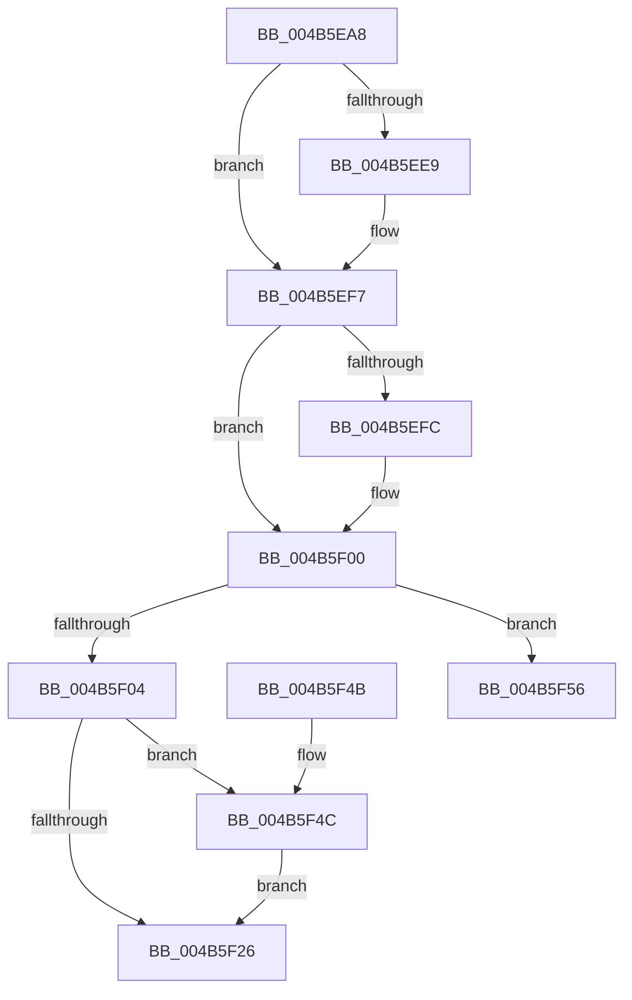

# ExpSaPageGroupDescriptorFree

- RVA: `0x004B5EA8`–`0x004B5F5E` (길이 `182` bytes)
- VA: `0x00000001404B5EA8`
- 실행 섹션: `.text`
- PDB 이름 있음: `예`; PDB Function 태그: `예`
- unwind 정보 RVA: `0x000BA46C`
- 디코드: `53`개 명령, `182/182` bytes 표시
- 미해석 바이트: `0` (있으면 어셈블리에 `.byte`로 보존)

> 이 문서는 커널 이미지의 기계어와 PDB 기호를 분석해 생성했습니다. 4번과 5번은 함수 원형과 자료형을 바이너리 사용 방식에서 추정한 C 해석이며 원본 소스 복구 결과는 아닙니다.

## 1. Dependencies

- 직접 호출 지점: **7**; 고유 호출 대상: **7**
- 직접 호출자로 확인된 함수: **1**
- RIP 상대 이미지 참조: **3**

### Outgoing calls
- `0x004B5EC2` → [KeQueryMaximumProcessorCountEx](../26/KeQueryMaximumProcessorCountEx_function_00264D60.md) (function, `0x00264D60`)
- `0x004B5ED8` → [KeAbPreAcquire](../21/KeAbPreAcquire_function_00210230.md) (function, `0x00210230`)
- `0x004B5EF2` → [ExfAcquirePushLockExclusiveEx](../20/ExfAcquirePushLockExclusiveEx_function_0020FC90.md) (function, `0x0020FC90`)
- `0x004B5F0E` → [ExpSaBinaryArrayRemove](../4F/ExpSaBinaryArrayRemove_function_004F77B4.md) (function, `0x004F77B4`)
- `0x004B5F29` → [KeAbPostRelease](../2E/KeAbPostRelease_function_002E1600.md) (function, `0x002E1600`)
- `0x004B5F33` → [ExFreePoolWithTag](../../poolcode/B8/ExFreePoolWithTag_function_00B82870.md) (function, `0x00B82870`)
- `0x004B5F4F` → [ExfTryToWakePushLock](../26/ExfTryToWakePushLock_function_00265DD0.md) (function, `0x00265DD0`)

### Direct callers
- [ExpSaAllocatorOptimizeList](ExpSaAllocatorOptimizeList_function_004B5DDC.md) at `0x004B5E34`

### Static image references
- `0x004B5EC7` → RVA `0x00EFA288` (`.data`; read)
- `0x004B5F07` → RVA `0x00EFA280` (`.data`; read)
- `0x004B5F17` → RVA `0x00EFA288` (`.data`; read/write)

## 2. Other-region calls and transfers

- 다른 실행 섹션으로 향하는 call: **1**
  - `0x004B5F33` → [ExFreePoolWithTag](../../poolcode/B8/ExFreePoolWithTag_function_00B82870.md) (`.text` → `POOLCODE`)
- call이 아닌 외부 분기/꼬리 이동: **1**
  - `0x004B5F59` → [sub_006FBC2C](../6F/Unknown_function_006FBC2C.md) (`tail-transfer`)

## 3. Assembly (complete function range)

```asm
004B5EA8  48 89 5C 24 08                  mov qword ptr [rsp + 8], rbx
004B5EAD  48 89 6C 24 18                  mov qword ptr [rsp + 0x18], rbp
004B5EB2  56                              push rsi
004B5EB3  57                              push rdi
004B5EB4  41 56                           push r14
004B5EB6  48 83 EC 20                     sub rsp, 0x20
004B5EBA  48 8B F9                        mov rdi, rcx
004B5EBD  B9 FF FF 00 00                  mov ecx, 0xffff
004B5EC2  E8 99 EE DA FF                  call 0x140264d60
004B5EC7  48 8D 2D BA 43 A4 00            lea rbp, [rip + 0xa443ba]
004B5ECE  8B F0                           mov esi, eax
004B5ED0  48 8B CD                        mov rcx, rbp
004B5ED3  45 33 C0                        xor r8d, r8d
004B5ED6  33 D2                           xor edx, edx
004B5ED8  E8 53 A3 D5 FF                  call 0x140210230
004B5EDD  F0 48 0F BA 6D 00 00            lock bts qword ptr [rbp], 0
004B5EE4  48 8B D8                        mov rbx, rax
004B5EE7  73 0E                           jae 0x1404b5ef7
004B5EE9  4C 8B C5                        mov r8, rbp
004B5EEC  48 8B D0                        mov rdx, rax
004B5EEF  48 8B CD                        mov rcx, rbp
004B5EF2  E8 99 9D D5 FF                  call 0x14020fc90
004B5EF7  48 85 DB                        test rbx, rbx
004B5EFA  74 04                           je 0x1404b5f00
004B5EFC  C6 43 0A 01                     mov byte ptr [rbx + 0xa], 1
004B5F00  85 F6                           test esi, esi
004B5F02  75 52                           jne 0x1404b5f56
004B5F04  8B 57 20                        mov edx, dword ptr [rdi + 0x20]
004B5F07  48 8B 0D 72 43 A4 00            mov rcx, qword ptr [rip + 0xa44372]
004B5F0E  E8 A1 18 04 00                  call 0x1404f77b4
004B5F13  48 83 C8 FF                     or rax, 0xffffffffffffffff
004B5F17  F0 48 0F C1 05 68 43 A4 00      lock xadd qword ptr [rip + 0xa44368], rax
004B5F20  24 06                           and al, 6
004B5F22  3C 02                           cmp al, 2
004B5F24  74 26                           je 0x1404b5f4c
004B5F26  48 8B CD                        mov rcx, rbp
004B5F29  E8 D2 B6 E2 FF                  call 0x1402e1600
004B5F2E  33 D2                           xor edx, edx
004B5F30  48 8B CF                        mov rcx, rdi
004B5F33  E8 38 C9 6C 00                  call 0x140b82870
004B5F38  48 8B 5C 24 40                  mov rbx, qword ptr [rsp + 0x40]
004B5F3D  48 8B 6C 24 50                  mov rbp, qword ptr [rsp + 0x50]
004B5F42  48 83 C4 20                     add rsp, 0x20
004B5F46  41 5E                           pop r14
004B5F48  5F                              pop rdi
004B5F49  5E                              pop rsi
004B5F4A  C3                              ret
004B5F4B  CC                              int3
004B5F4C  48 8B CD                        mov rcx, rbp
004B5F4F  E8 7C FE DA FF                  call 0x140265dd0
004B5F54  EB D0                           jmp 0x1404b5f26
004B5F56  45 33 F6                        xor r14d, r14d
004B5F59  E9 CE 5C 24 00                  jmp 0x1406fbc2c
```

## 4. C-style interpretation (structured pseudocode)

```c
__int64 __fastcall ExpSaPageGroupDescriptorFree(__int64 a1, int a2, int a3)
{
    __int64 result;
    __int64 v_r14;
    __int64 v_rsp;
    unsigned __int64 v_stack_p18;
    unsigned __int64 v_stack_p8;

    v_stack_p8 = v_rbx;
    v_stack_p18 = v_rbp;
    v_rsp = (v_rsp) - (32);
    result = KeQueryMaximumProcessorCountEx((unsigned int)(0xFFFFULL), a2, a3, a4);
    a3 = 0;
    a2 = 0;
    result = KeAbPreAcquire(v_rip + 10765242, a2, a3, a4);
    if (!(condition_is_above_or_equal)) {
        a3 = v_rip + 10765242;
        a2 = result;
        a1 = v_rip + 10765242;
        result = ExfAcquirePushLockExclusiveEx(a1, a2, a3, a4);
    }
    if (result != 0) {
        *(unsigned __int8 *)(result + 10) = 1;
    }
    if ((unsigned int)((unsigned int)((unsigned int)(result))) != 0) goto loc_004B5F56;
    result = ExpSaBinaryArrayRemove(*(unsigned __int64 *)(v_rip + 10765170), (unsigned int)(*(unsigned int *)(a1 + 32)), a3, a4);
    result = (result) | (-1);
    result = (unsigned __int8)((result) & (6));
    if (((unsigned __int8)(result)) == 2) goto loc_004B5F4C;
loc_004B5F26:
    result = KeAbPostRelease(v_rip + 10765242, (unsigned int)(*(unsigned int *)(a1 + 32)), a3, a4);
    a2 = 0;
    result = ExFreePoolWithTag(a1, a2, a3, a4);
    v_rsp = (v_rsp) + (32);
    return result;
loc_004B5F4C:
    result = ExfTryToWakePushLock(v_stack_p18, a2, a3, a4);
    goto loc_004B5F26;
loc_004B5F56:
    v_r14 = 0;
}
```

## 5. (Beta) C Style

```c
int64_t ExpSaPageGroupDescriptorFree(void *Arg1, int32_t Arg2, int32_t Arg3)
{
    uint8_t *arg1 = (uint8_t *)Arg1;

    int64_t result;
    int64_t local_r14;
    int64_t local_rsp;
    uint64_t v_stack_p18;
    uint64_t v_stack_p8;

    v_stack_p8 = local_rbx;
    v_stack_p18 = local_rbp;
    local_rsp = (local_rsp) - (32);
    result = KeQueryMaximumProcessorCountEx((uint32_t)(0xFFFFULL), Arg2, Arg3, a4);
    Arg3 = 0;
    Arg2 = 0;
    result = KeAbPreAcquire(v_rip + 10765242, Arg2, Arg3, a4);
    if (!(condition_is_above_or_equal)) {
        Arg3 = v_rip + 10765242;
        Arg2 = result;
        Arg1 = v_rip + 10765242;
        result = ExfAcquirePushLockExclusiveEx(Arg1, Arg2, Arg3, a4);
    }
    if (result != 0) {
        *(uint8_t *)(result + 0xA) = 1;
    }
    if ((uint32_t)((uint32_t)((uint32_t)(result))) != 0) goto loc_004B5F56;
    result = ExpSaBinaryArrayRemove(*(uint64_t *)(v_rip + 0xA44372), (uint32_t)(*(uint32_t *)(arg1 + 0x20)), Arg3, a4);
    result = (result) | (-1);
    result = (uint8_t)((result) & (6));
    if (((uint8_t)(result)) == 2) goto loc_004B5F4C;
loc_004B5F26:
    result = KeAbPostRelease(v_rip + 10765242, (uint32_t)(*(uint32_t *)(arg1 + 0x20)), Arg3, a4);
    Arg2 = 0;
    result = ExFreePoolWithTag(Arg1, Arg2, Arg3, a4);
    local_rsp = (local_rsp) + (32);
    return result;
loc_004B5F4C:
    result = ExfTryToWakePushLock(v_stack_p18, Arg2, Arg3, a4);
    goto loc_004B5F26;
loc_004B5F56:
    local_r14 = 0;
}
```

### 관측된 메모리 오프셋

구조체 형식이 확인되지 않은 접근은 인자 기준의 오프셋으로만 기록했습니다.

| 기준 인자 | 오프셋 표현 | 폭 (bit) | 접근 |
|---|---:|---:|---|
| `Arg1` | `+ 0x20` | `32` | `R` |

## 6. Execution-region graph

[열기: 2D/3D 그래프와 함수 탐색 컨트롤 패널](../../../control-panel.html?section=text&rva=0x004B5EA8&view=graph)

- 2D 그래프는 위에서 아래로 흐르고, 3D 그래프는 빈 공간을 드래그해 회전합니다. Shift+드래그는 이동, 휠은 확대·축소, 함수 노드 선택은 대상 보고서 이동입니다.

### Static fallback


