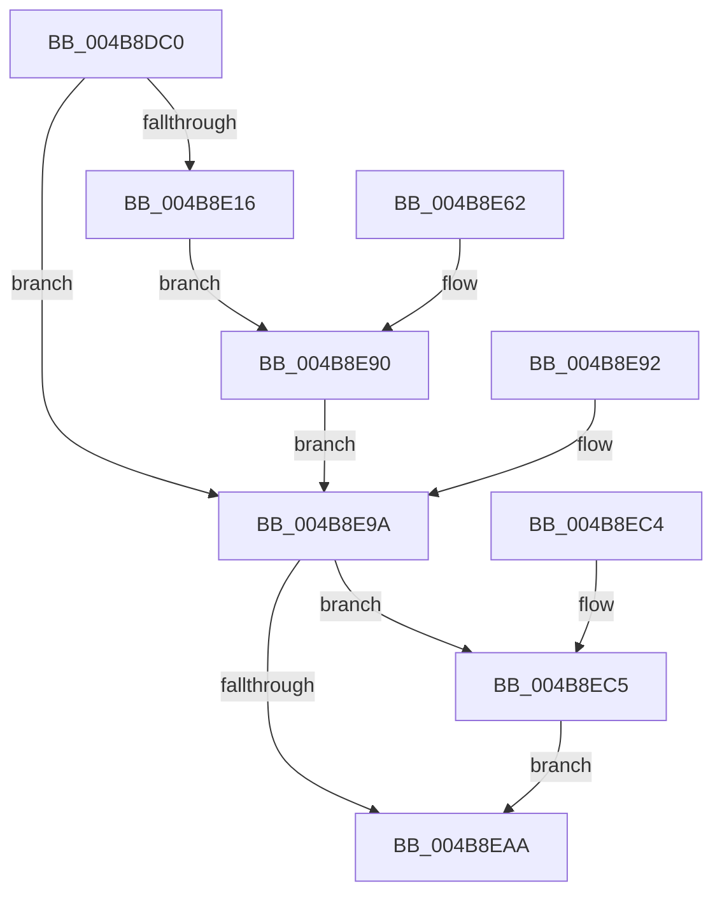

# ExpTimeRefreshDpcRoutine

- RVA: `0x004B8DC0`–`0x004B8ED8` (길이 `280` bytes)
- VA: `0x00000001404B8DC0`
- 실행 섹션: `.text`
- PDB 이름 있음: `예`; PDB Function 태그: `아니요`
- unwind 정보 RVA: `0x000BB0AC`
- 디코드: `66`개 명령, `280/280` bytes 표시
- 미해석 바이트: `0` (있으면 어셈블리에 `.byte`로 보존)

> 이 문서는 커널 이미지의 기계어와 PDB 기호를 분석해 생성했습니다. 4번과 5번은 함수 원형과 자료형을 바이너리 사용 방식에서 추정한 C 해석이며 원본 소스 복구 결과는 아닙니다.

## 1. Dependencies

- 직접 호출 지점: **3**; 고유 호출 대상: **3**
- 직접 호출자로 확인된 함수: **0**
- RIP 상대 이미지 참조: **1**

### Outgoing calls
- `0x004B8DFD` → [memset](../6C/memset_function_006C6C40.md) (function, `0x006C6C40`)
- `0x004B8E5A` → [KiCustomAccessRoutine7](../6B/KiCustomAccessRoutine7_function_006BC340.md) (function, `0x006BC340`)
- `0x004B8ED1` → [ExQueueWorkItem](../2F/ExQueueWorkItem_function_002F9520.md) (function, `0x002F9520`)

### Direct callers
- 이 함수 시작 RVA로 연결되는 직접 call은 확인되지 않았습니다. 간접 호출은 완전히 역산할 수 없습니다.

### Static image references
- `0x004B8ECA` → RVA `0x00EFEFA0` (`.data`; read)

## 2. Other-region calls and transfers

- 다른 실행 섹션으로 향하는 call: **0**
- 별도 외부 분기/꼬리 이동을 확인하지 못했습니다.

## 3. Assembly (complete function range)

```asm
004B8DC0  48 8B C4                        mov rax, rsp
004B8DC3  48 89 58 08                     mov qword ptr [rax + 8], rbx
004B8DC7  48 89 70 18                     mov qword ptr [rax + 0x18], rsi
004B8DCB  48 89 78 20                     mov qword ptr [rax + 0x20], rdi
004B8DCF  48 89 50 10                     mov qword ptr [rax + 0x10], rdx
004B8DD3  41 56                           push r14
004B8DD5  48 81 EC C0 01 00 00            sub rsp, 0x1c0
004B8DDC  48 89 A4 24 A8 01 00 00         mov qword ptr [rsp + 0x1a8], rsp
004B8DE4  4D 8B F1                        mov r14, r9
004B8DE7  49 8B F0                        mov rsi, r8
004B8DEA  48 8B DA                        mov rbx, rdx
004B8DED  48 8B F9                        mov rdi, rcx
004B8DF0  33 D2                           xor edx, edx
004B8DF2  44 8D 42 60                     lea r8d, [rdx + 0x60]
004B8DF6  48 8D 88 78 FF FF FF            lea rcx, [rax - 0x88]
004B8DFD  E8 3E DE 20 00                  call 0x1406c6c40
004B8E02  48 8B C3                        mov rax, rbx
004B8E05  48 C1 F8 2F                     sar rax, 0x2f
004B8E09  48 FF C0                        inc rax
004B8E0C  48 83 F8 01                     cmp rax, 1
004B8E10  0F 86 84 00 00 00               jbe 0x1404b8e9a
004B8E16  83 64 24 30 00                  and dword ptr [rsp + 0x30], 0
004B8E1B  C6 07 00                        mov byte ptr [rdi], 0
004B8E1E  49 8B C6                        mov rax, r14
004B8E21  48 C1 E8 08                     shr rax, 8
004B8E25  48 89 47 20                     mov qword ptr [rdi + 0x20], rax
004B8E29  48 89 B4 24 98 01 00 00         mov qword ptr [rsp + 0x198], rsi
004B8E31  8B CE                           mov ecx, esi
004B8E33  48 8B C3                        mov rax, rbx
004B8E36  48 D3 C0                        rol rax, cl
004B8E39  48 89 84 24 80 01 00 00         mov qword ptr [rsp + 0x180], rax
004B8E41  48 8B C7                        mov rax, rdi
004B8E44  48 D3 C8                        ror rax, cl
004B8E47  48 89 84 24 58 01 00 00         mov qword ptr [rsp + 0x158], rax
004B8E4F  4C 31 77 28                     xor qword ptr [rdi + 0x28], r14
004B8E53  48 31 77 30                     xor qword ptr [rdi + 0x30], rsi
004B8E57  48 8B CB                        mov rcx, rbx
004B8E5A  E8 E1 34 20 00                  call 0x1406bc340
004B8E5F  90                              nop
004B8E60  EB 2E                           jmp 0x1404b8e90
004B8E62  48 83 A4 24 B8 00 00 00 00      and qword ptr [rsp + 0xb8], 0
004B8E6B  48 8B 8C 24 98 01 00 00         mov rcx, qword ptr [rsp + 0x198]
004B8E73  48 89 8C 24 B8 00 00 00         mov qword ptr [rsp + 0xb8], rcx
004B8E7B  48 8B 84 24 80 01 00 00         mov rax, qword ptr [rsp + 0x180]
004B8E83  48 D3 C8                        ror rax, cl
004B8E86  8B 00                           mov eax, dword ptr [rax]
004B8E88  48 8B 9C 24 D8 01 00 00         mov rbx, qword ptr [rsp + 0x1d8]
004B8E90  EB 08                           jmp 0x1404b8e9a
004B8E92  48 8B 9C 24 D8 01 00 00         mov rbx, qword ptr [rsp + 0x1d8]
004B8E9A  B8 01 00 00 00                  mov eax, 1
004B8E9F  F0 0F C1 03                     lock xadd dword ptr [rbx], eax
004B8EA3  FF C0                           inc eax
004B8EA5  83 F8 01                        cmp eax, 1
004B8EA8  74 1B                           je 0x1404b8ec5
004B8EAA  4C 8D 9C 24 C0 01 00 00         lea r11, [rsp + 0x1c0]
004B8EB2  49 8B 5B 10                     mov rbx, qword ptr [r11 + 0x10]
004B8EB6  49 8B 73 20                     mov rsi, qword ptr [r11 + 0x20]
004B8EBA  49 8B 7B 28                     mov rdi, qword ptr [r11 + 0x28]
004B8EBE  49 8B E3                        mov rsp, r11
004B8EC1  41 5E                           pop r14
004B8EC3  C3                              ret
004B8EC4  CC                              int3
004B8EC5  BA 01 00 00 00                  mov edx, 1
004B8ECA  48 8D 0D CF 60 A4 00            lea rcx, [rip + 0xa460cf]
004B8ED1  E8 4A 06 E4 FF                  call 0x1402f9520
004B8ED6  EB D2                           jmp 0x1404b8eaa
```

## 4. C-style interpretation (structured pseudocode)

```c
__int64 __fastcall ExpTimeRefreshDpcRoutine(__int64 a1, __int64 a2, __int64 a3, __int64 a4)
{
    __int64 result;
    __int64 v_rsp;
    unsigned __int64 v_stack_m110;
    unsigned int v_stack_m198;
    unsigned __int64 v_stack_m20;
    unsigned __int64 v_stack_m30;
    unsigned __int64 v_stack_m48;
    unsigned __int64 v_stack_m70;
    unsigned __int64 v_stack_m8;
    unsigned __int64 v_stack_p10;

    *(unsigned __int64 *)(v_rsp + 8) = v_rbx;
    *(unsigned __int64 *)(v_rsp + 24) = v_rsi;
    *(unsigned __int64 *)(v_rsp + 32) = v_rdi;
    *(unsigned __int64 *)(v_rsp + 16) = a2;
    v_rsp = (v_rsp) - (448);
    v_stack_m20 = v_rsp;
    a2 = 0;
    result = memset(v_rsp - 136, a2, a2 + 96, a4);
    result = (0) >> (47);
    result = (result) + 1;
    if (result <= 1) goto loc_004B8E9A;
    *(unsigned __int8 *)(a1) = 0;
    result = (a4) >> (8);
    *(unsigned __int64 *)(a1 + 32) = result;
    v_stack_m30 = a3;
    v_stack_m48 = 0;
    v_stack_m70 = a1;
    result = KiCustomAccessRoutine7(0, a2, a2 + 96, a4);
    goto loc_004B8E90;
loc_004B8E90:
    goto loc_004B8E9A;
loc_004B8E9A:
    result = (unsigned int)((1) + 1);
    if (((unsigned int)(result)) == 1) goto loc_004B8EC5;
loc_004B8EAA:
    return result;
loc_004B8EC5:
    result = ExQueueWorkItem(v_rip + 10772687, 1, a2 + 96, a4);
    goto loc_004B8EAA;
}
```

## 5. (Beta) C Style

```c
int64_t ExpTimeRefreshDpcRoutine(void *Arg1, void *Arg2, int64_t Arg3, int64_t Arg4)
{
    uint8_t *arg1 = (uint8_t *)Arg1;
    uint8_t *arg2 = (uint8_t *)Arg2;

    int64_t result;
    int64_t local_rsp;
    uint64_t v_stack_m110;
    uint32_t v_stack_m198;
    uint64_t v_stack_m20;
    uint64_t v_stack_m30;
    uint64_t v_stack_m48;
    uint64_t v_stack_m70;
    uint64_t v_stack_m8;
    uint64_t v_stack_p10;

    *(uint64_t *)(local_rsp + 0x8) = local_rbx;
    *(uint64_t *)(local_rsp + 0x18) = local_rsi;
    *(uint64_t *)(local_rsp + 0x20) = local_rdi;
    *(void **)(local_rsp + 0x10) = Arg2;
    local_rsp = (local_rsp) - (448);
    v_stack_m20 = local_rsp;
    Arg2 = 0;
    result = memset(local_rsp - 136, Arg2, Arg2 + 96, Arg4);
    result = (0) >> (47);
    result = (result) + 1;
    if (result <= 1) goto loc_004B8E9A;
    *(uint8_t *)(arg1) = 0;
    result = (Arg4) >> (8);
    *(uint64_t *)(arg1 + 0x20) = result;
    v_stack_m30 = Arg3;
    v_stack_m48 = 0;
    v_stack_m70 = Arg1;
    result = KiCustomAccessRoutine7(0, Arg2, Arg2 + 96, Arg4);
    goto loc_004B8E90;
loc_004B8E90:
    goto loc_004B8E9A;
loc_004B8E9A:
    result = (uint32_t)((1) + 1);
    if (((uint32_t)(result)) == 1) goto loc_004B8EC5;
loc_004B8EAA:
    return result;
loc_004B8EC5:
    result = ExQueueWorkItem(v_rip + 10772687, 1, Arg2 + 96, Arg4);
    goto loc_004B8EAA;
}
```

### 관측된 메모리 오프셋

구조체 형식이 확인되지 않은 접근은 인자 기준의 오프셋으로만 기록했습니다.

| 기준 인자 | 오프셋 표현 | 폭 (bit) | 접근 |
|---|---:|---:|---|
| `Arg1` | `+ 0x0` | `8` | `W` |
| `Arg1` | `+ 0x20` | `64` | `W` |
| `Arg1` | `+ 0x28` | `64` | `R/W` |
| `Arg1` | `+ 0x30` | `64` | `R/W` |
| `Arg2` | `+ 0x0` | `32` | `R/W` |

## 6. Execution-region graph

[열기: 2D/3D 그래프와 함수 탐색 컨트롤 패널](../../../control-panel.html?section=text&rva=0x004B8DC0&view=graph)

- 2D 그래프는 위에서 아래로 흐르고, 3D 그래프는 빈 공간을 드래그해 회전합니다. Shift+드래그는 이동, 휠은 확대·축소, 함수 노드 선택은 대상 보고서 이동입니다.

### Static fallback


