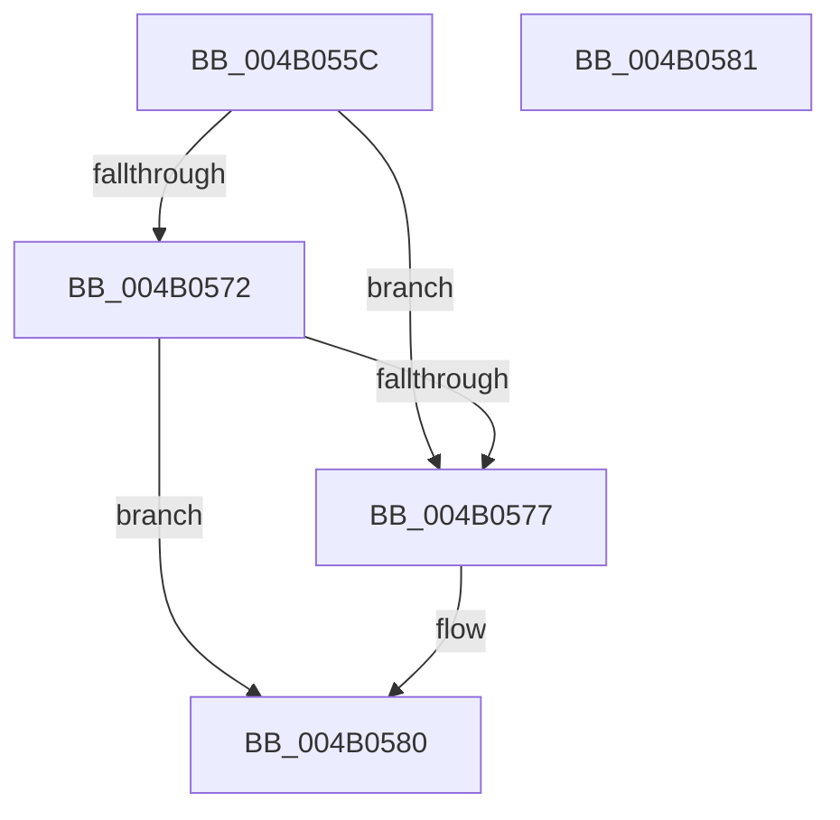

# ExpTrackTableReturnLimit

- RVA: `0x004B055C`–`0x004B0582` (길이 `38` bytes)
- VA: `0x00000001404B055C`
- 실행 섹션: `.text`
- PDB 이름 있음: `예`; PDB Function 태그: `아니요`
- unwind 정보 RVA: `0x000DB714`
- 디코드: `12`개 명령, `38/38` bytes 표시
- 미해석 바이트: `0` (있으면 어셈블리에 `.byte`로 보존)

> 이 문서는 커널 이미지의 기계어와 PDB 기호를 분석해 생성했습니다. 4번과 5번은 함수 원형과 자료형을 바이너리 사용 방식에서 추정한 C 해석이며 원본 소스 복구 결과는 아닙니다.

## 1. Dependencies

- 직접 호출 지점: **0**; 고유 호출 대상: **0**
- 직접 호출자로 확인된 함수: **1**
- RIP 상대 이미지 참조: **0**

### Outgoing calls
- 직접 디코드된 call 명령이 없습니다.

### Direct callers
- [ExAllocateHeapPool](../35/ExAllocateHeapPool_function_0035BA30.md) at `0x0035E8A9`
- [ExAllocateHeapPool](../35/ExAllocateHeapPool_function_0035BA30.md) at `0x0035E8D4`

### Static image references
- 디코드된 RIP-relative 메모리 참조가 없습니다.

## 2. Other-region calls and transfers

- 다른 실행 섹션으로 향하는 call: **0**
- 별도 외부 분기/꼬리 이동을 확인하지 못했습니다.

## 3. Assembly (complete function range)

```asm
004B055C  49 63 C0                        movsxd rax, r8d
004B055F  4C 8D 04 40                     lea r8, [rax + rax*2]
004B0563  4A 8B 44 C1 10                  mov rax, qword ptr [rcx + r8*8 + 0x10]
004B0568  4E 8B 4C C1 18                  mov r9, qword ptr [rcx + r8*8 + 0x18]
004B056D  48 85 C0                        test rax, rax
004B0570  75 05                           jne 0x1404b0577
004B0572  4D 85 C9                        test r9, r9
004B0575  74 09                           je 0x1404b0580
004B0577  48 F7 DA                        neg rdx
004B057A  F0 4A 01 54 C1 20               lock add qword ptr [rcx + r8*8 + 0x20], rdx
004B0580  C3                              ret
004B0581  CC                              int3
```

## 4. C-style interpretation (structured pseudocode)

```c
__int64 __fastcall ExpTrackTableReturnLimit(__int64 a1, __int64 a2, int a3)
{
    if (*(unsigned __int64 *)(a1 + (int)(a3) + (int)(a3) * 2 * 8 + 16) != 0) goto loc_004B0577;
    if (*(unsigned __int64 *)(a1 + (int)(a3) + (int)(a3) * 2 * 8 + 24) != 0) {
        a2 = -(a2);
    }
    return *(unsigned __int64 *)(a1 + (int)(a3) + (int)(a3) * 2 * 8 + 16);
}
```

## 5. (Beta) C Style

```c
int64_t ExpTrackTableReturnLimit(void *Arg1, int64_t Arg2, void *Arg3)
{
    uint8_t *arg1 = (uint8_t *)Arg1;
    uint8_t *arg3 = (uint8_t *)Arg3;

    if (*(uint64_t *)(arg1 + (int32_t)(arg3) + (int32_t)(arg3) * 2 * 8 + 0x10) != 0) goto loc_004B0577;
    if (*(uint64_t *)(arg1 + (int32_t)(arg3) + (int32_t)(arg3) * 2 * 8 + 0x18) != 0) {
        Arg2 = -(Arg2);
    }
    return *(uint64_t *)(arg1 + (int32_t)(arg3) + (int32_t)(arg3) * 2 * 8 + 0x10);
}
```

### 관측된 메모리 오프셋

구조체 형식이 확인되지 않은 접근은 인자 기준의 오프셋으로만 기록했습니다.

| 기준 인자 | 오프셋 표현 | 폭 (bit) | 접근 |
|---|---:|---:|---|
| `Arg1` | `+ 0x10 + r8*8` | `64` | `R` |
| `Arg1` | `+ 0x18 + r8*8` | `64` | `R` |
| `Arg1` | `+ 0x20 + r8*8` | `64` | `R/W` |
| `Arg3` | `+ 0x0 + rax*2` | `64` | `R` |

## 6. Execution-region graph

[열기: 2D/3D 그래프와 함수 탐색 컨트롤 패널](../../../control-panel.html?section=text&rva=0x004B055C&view=graph)

- 2D 그래프는 위에서 아래로 흐르고, 3D 그래프는 빈 공간을 드래그해 회전합니다. Shift+드래그는 이동, 휠은 확대·축소, 함수 노드 선택은 대상 보고서 이동입니다.

### Static fallback


