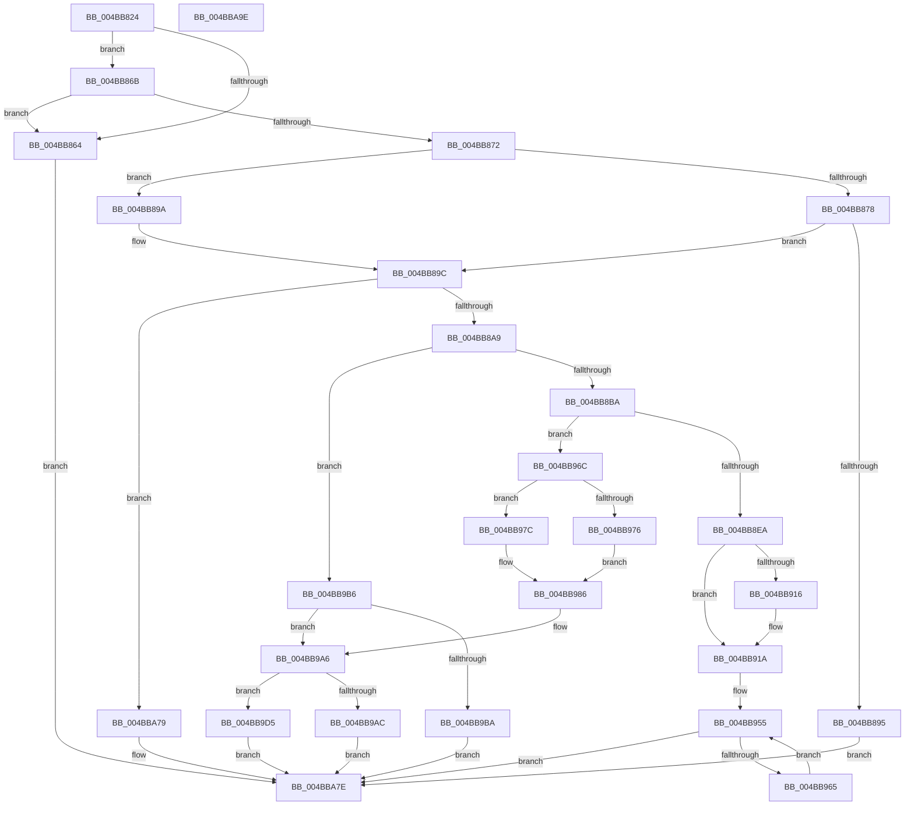

# FsRtlpOplockBreakToII

- RVA: `0x004BB824`–`0x004BBA9F` (길이 `635` bytes)
- VA: `0x00000001404BB824`
- 실행 섹션: `.text`
- PDB 이름 있음: `예`; PDB Function 태그: `아니요`
- unwind 정보 RVA: `0x000BB730`
- 디코드: `157`개 명령, `635/635` bytes 표시
- 미해석 바이트: `0` (있으면 어셈블리에 `.byte`로 보존)

> 이 문서는 커널 이미지의 기계어와 PDB 기호를 분석해 생성했습니다. 4번과 5번은 함수 원형과 자료형을 바이너리 사용 방식에서 추정한 C 해석이며 원본 소스 복구 결과는 아닙니다.

## 1. Dependencies

- 직접 호출 지점: **13**; 고유 호출 대상: **11**
- 직접 호출자로 확인된 함수: **2**
- RIP 상대 이미지 참조: **0**

### Outgoing calls
- `0x004BB883` → [FsRtlpOplockKeysEqual](../3F/FsRtlpOplockKeysEqual_function_003F26B0.md) (function, `0x003F26B0`)
- `0x004BB8C6` → [KeAcquireQueuedSpinLock](../27/KeAcquireQueuedSpinLock_function_00273D80.md) (function, `0x00273D80`)
- `0x004BB8DB` → [KeReleaseQueuedSpinLock](../27/KeReleaseQueuedSpinLock_function_00272540.md) (function, `0x00272540`)
- `0x004BB8FA` → [FsRtlpModifyThreadPriorities](../48/FsRtlpModifyThreadPriorities_function_0048B098.md) (function, `0x0048B098`)
- `0x004BB904` → [FsRtlpClearOwner](../26/FsRtlpClearOwner_function_00265BE8.md) (function, `0x00265BE8`)
- `0x004BB929` → [IofCompleteRequest](../29/IofCompleteRequest_function_0029B5C0.md) (function, `0x0029B5C0`)
- `0x004BB93A` → [ObfDereferenceObjectWithTag](../2F/ObfDereferenceObjectWithTag_function_002F78E0.md) (function, `0x002F78E0`)
- `0x004BB965` → [FsRtlpRemoveAndCompleteWaitingIrp](../42/FsRtlpRemoveAndCompleteWaitingIrp_function_00425FC0.md) (function, `0x00425FC0`)
- `0x004BB99E` → [IofCompleteRequest](../29/IofCompleteRequest_function_0029B5C0.md) (function, `0x0029B5C0`)
- `0x004BB9E3` → [FsRtlpOplockTryStartBreakAckTimeout](../../page/71/FsRtlpOplockTryStartBreakAckTimeout_function_007158B4.md) (function, `0x007158B4`)
- `0x004BB9F0` → [FsRtlpModifyThreadPriorities](../48/FsRtlpModifyThreadPriorities_function_0048B098.md) (function, `0x0048B098`)
- `0x004BB9FA` → [FsRtlpOplockSendModernAppTermination](../49/FsRtlpOplockSendModernAppTermination_function_0049F22C.md) (function, `0x0049F22C`)
- `0x004BBA70` → [FsRtlpWaitOnIrp](../4E/FsRtlpWaitOnIrp_function_004E7998.md) (function, `0x004E7998`)

### Direct callers
- [FsRtlCheckOplockEx2](../3F/FsRtlCheckOplockEx2_function_003F2BC0.md) at `0x003F332A`
- [FsRtlCheckUpperOplock](../../page/71/FsRtlCheckUpperOplock_function_007145F0.md) at `0x0071481D`

### Static image references
- 디코드된 RIP-relative 메모리 참조가 없습니다.

## 2. Other-region calls and transfers

- 다른 실행 섹션으로 향하는 call: **1**
  - `0x004BB9E3` → [FsRtlpOplockTryStartBreakAckTimeout](../../page/71/FsRtlpOplockTryStartBreakAckTimeout_function_007158B4.md) (`.text` → `PAGE`)
- 별도 외부 분기/꼬리 이동을 확인하지 못했습니다.

## 3. Assembly (complete function range)

```asm
004BB824  4C 8B DC                        mov r11, rsp
004BB827  49 89 5B 08                     mov qword ptr [r11 + 8], rbx
004BB82B  49 89 73 10                     mov qword ptr [r11 + 0x10], rsi
004BB82F  49 89 7B 18                     mov qword ptr [r11 + 0x18], rdi
004BB833  41 54                           push r12
004BB835  41 56                           push r14
004BB837  41 57                           push r15
004BB839  48 81 EC 80 00 00 00            sub rsp, 0x80
004BB840  45 8B F9                        mov r15d, r9d
004BB843  4D 8B E0                        mov r12, r8
004BB846  4C 8B CA                        mov r9, rdx
004BB849  48 8B D9                        mov rbx, rcx
004BB84C  0F 57 C0                        xorps xmm0, xmm0
004BB84F  33 C0                           xor eax, eax
004BB851  0F 11 44 24 60                  movups xmmword ptr [rsp + 0x60], xmm0
004BB856  49 89 43 D8                     mov qword ptr [r11 - 0x28], rax
004BB85A  8B 81 90 00 00 00               mov eax, dword ptr [rcx + 0x90]
004BB860  A8 40                           test al, 0x40
004BB862  75 07                           jne 0x1404bb86b
004BB864  33 FF                           xor edi, edi
004BB866  E9 13 02 00 00                  jmp 0x1404bba7e
004BB86B  A9 00 70 00 00                  test eax, 0x7000
004BB870  75 F2                           jne 0x1404bb864
004BB872  41 F6 C7 08                     test r15b, 8
004BB876  75 22                           jne 0x1404bb89a
004BB878  48 8B 51 08                     mov rdx, qword ptr [rcx + 8]
004BB87C  49 8B 49 30                     mov rcx, qword ptr [r9 + 0x30]
004BB880  45 33 C0                        xor r8d, r8d
004BB883  E8 28 6E F3 FF                  call 0x1403f26b0
004BB888  88 84 24 C0 00 00 00            mov byte ptr [rsp + 0xc0], al
004BB88F  33 FF                           xor edi, edi
004BB891  84 C0                           test al, al
004BB893  74 07                           je 0x1404bb89c
004BB895  E9 E4 01 00 00                  jmp 0x1404bba7e
004BB89A  33 FF                           xor edi, edi
004BB89C  41 F7 C7 00 00 01 10            test r15d, 0x10010000
004BB8A3  0F 85 D0 01 00 00               jne 0x1404bba79
004BB8A9  8B 83 90 00 00 00               mov eax, dword ptr [rbx + 0x90]
004BB8AF  A9 80 0F F0 01                  test eax, 0x1f00f80
004BB8B4  0F 85 FC 00 00 00               jne 0x1404bb9b6
004BB8BA  48 8B 33                        mov rsi, qword ptr [rbx]
004BB8BD  41 BE 07 00 00 00               mov r14d, 7
004BB8C3  41 8B CE                        mov ecx, r14d
004BB8C6  E8 B5 84 DB FF                  call 0x140273d80
004BB8CB  88 46 45                        mov byte ptr [rsi + 0x45], al
004BB8CE  48 8B C7                        mov rax, rdi
004BB8D1  48 87 46 68                     xchg qword ptr [rsi + 0x68], rax
004BB8D5  8A 56 45                        mov dl, byte ptr [rsi + 0x45]
004BB8D8  41 8B CE                        mov ecx, r14d
004BB8DB  E8 60 6C DB FF                  call 0x140272540
004BB8E0  40 38 7E 44                     cmp byte ptr [rsi + 0x44], dil
004BB8E4  0F 84 82 00 00 00               je 0x1404bb96c
004BB8EA  48 C7 46 38 08 00 00 00         mov qword ptr [rsi + 0x38], 8
004BB8F2  45 33 C0                        xor r8d, r8d
004BB8F5  33 D2                           xor edx, edx
004BB8F7  48 8B CB                        mov rcx, rbx
004BB8FA  E8 99 F7 FC FF                  call 0x14048b098
004BB8FF  33 D2                           xor edx, edx
004BB901  48 8B CB                        mov rcx, rbx
004BB904  E8 DF A2 DA FF                  call 0x140265be8
004BB909  40 88 7B 20                     mov byte ptr [rbx + 0x20], dil
004BB90D  48 8B 03                        mov rax, qword ptr [rbx]
004BB910  48 39 58 38                     cmp qword ptr [rax + 0x38], rbx
004BB914  75 04                           jne 0x1404bb91a
004BB916  48 89 78 38                     mov qword ptr [rax + 0x38], rdi
004BB91A  48 8B 03                        mov rax, qword ptr [rbx]
004BB91D  C7 40 30 20 01 00 C0            mov dword ptr [rax + 0x30], 0xc0000120
004BB924  B2 01                           mov dl, 1
004BB926  48 8B 0B                        mov rcx, qword ptr [rbx]
004BB929  E8 92 FC DD FF                  call 0x14029b5c0
004BB92E  48 89 3B                        mov qword ptr [rbx], rdi
004BB931  48 8B 4B 08                     mov rcx, qword ptr [rbx + 8]
004BB935  BA 44 66 6C 74                  mov edx, 0x746c6644
004BB93A  E8 A1 BF E3 FF                  call 0x1402f78e0
004BB93F  48 89 7B 08                     mov qword ptr [rbx + 8], rdi
004BB943  8B 83 90 00 00 00               mov eax, dword ptr [rbx + 0x90]
004BB949  83 E0 20                        and eax, 0x20
004BB94C  83 C8 01                        or eax, 1
004BB94F  89 83 90 00 00 00               mov dword ptr [rbx + 0x90], eax
004BB955  48 8D 43 58                     lea rax, [rbx + 0x58]
004BB959  48 8B 08                        mov rcx, qword ptr [rax]
004BB95C  48 3B C8                        cmp rcx, rax
004BB95F  0F 84 19 01 00 00               je 0x1404bba7e
004BB965  E8 56 A6 F6 FF                  call 0x140425fc0
004BB96A  EB E9                           jmp 0x1404bb955
004BB96C  8B 83 90 00 00 00               mov eax, dword ptr [rbx + 0x90]
004BB972  A8 06                           test al, 6
004BB974  74 06                           je 0x1404bb97c
004BB976  0F BA E8 08                     bts eax, 8
004BB97A  EB 0A                           jmp 0x1404bb986
004BB97C  0F BA E8 09                     bts eax, 9
004BB980  41 BE 08 00 00 00               mov r14d, 8
004BB986  89 83 90 00 00 00               mov dword ptr [rbx + 0x90], eax
004BB98C  48 8B 03                        mov rax, qword ptr [rbx]
004BB98F  4C 89 70 38                     mov qword ptr [rax + 0x38], r14
004BB993  48 8B 03                        mov rax, qword ptr [rbx]
004BB996  89 78 30                        mov dword ptr [rax + 0x30], edi
004BB999  B2 01                           mov dl, 1
004BB99B  48 8B 0B                        mov rcx, qword ptr [rbx]
004BB99E  E8 1D FC DD FF                  call 0x14029b5c0
004BB9A3  48 89 3B                        mov qword ptr [rbx], rdi
004BB9A6  41 F6 C7 01                     test r15b, 1
004BB9AA  74 29                           je 0x1404bb9d5
004BB9AC  BF 08 01 00 00                  mov edi, 0x108
004BB9B1  E9 C8 00 00 00                  jmp 0x1404bba7e
004BB9B6  84 C0                           test al, al
004BB9B8  79 EC                           jns 0x1404bb9a6
004BB9BA  8B 83 90 00 00 00               mov eax, dword ptr [rbx + 0x90]
004BB9C0  83 E0 20                        and eax, 0x20
004BB9C3  83 C8 01                        or eax, 1
004BB9C6  89 83 90 00 00 00               mov dword ptr [rbx + 0x90], eax
004BB9CC  48 89 7B 08                     mov qword ptr [rbx + 8], rdi
004BB9D0  E9 A9 00 00 00                  jmp 0x1404bba7e
004BB9D5  48 8D 8B A8 00 00 00            lea rcx, [rbx + 0xa8]
004BB9DC  48 8B 93 B8 00 00 00            mov rdx, qword ptr [rbx + 0xb8]
004BB9E3  E8 CC 9E 25 00                  call 0x1407158b4
004BB9E8  41 B0 01                        mov r8b, 1
004BB9EB  33 D2                           xor edx, edx
004BB9ED  48 8B CB                        mov rcx, rbx
004BB9F0  E8 A3 F6 FC FF                  call 0x14048b098
004BB9F5  33 D2                           xor edx, edx
004BB9F7  48 8B CB                        mov rcx, rbx
004BB9FA  E8 2D 38 FE FF                  call 0x14049f22c
004BB9FF  48 8B 84 24 F8 00 00 00         mov rax, qword ptr [rsp + 0xf8]
004BBA07  40 88 38                        mov byte ptr [rax], dil
004BBA0A  48 8B 84 24 00 01 00 00         mov rax, qword ptr [rsp + 0x100]
004BBA12  48 89 44 24 50                  mov qword ptr [rsp + 0x50], rax
004BBA17  48 8B 84 24 F0 00 00 00         mov rax, qword ptr [rsp + 0xf0]
004BBA1F  48 89 44 24 48                  mov qword ptr [rsp + 0x48], rax
004BBA24  48 8B 84 24 E8 00 00 00         mov rax, qword ptr [rsp + 0xe8]
004BBA2C  48 89 44 24 40                  mov qword ptr [rsp + 0x40], rax
004BBA31  48 8B 84 24 E0 00 00 00         mov rax, qword ptr [rsp + 0xe0]
004BBA39  48 89 44 24 38                  mov qword ptr [rsp + 0x38], rax
004BBA3E  40 88 7C 24 30                  mov byte ptr [rsp + 0x30], dil
004BBA43  48 8D 44 24 60                  lea rax, [rsp + 0x60]
004BBA48  48 89 44 24 28                  mov qword ptr [rsp + 0x28], rax
004BBA4D  48 8B 84 24 D8 00 00 00         mov rax, qword ptr [rsp + 0xd8]
004BBA55  48 89 44 24 20                  mov qword ptr [rsp + 0x20], rax
004BBA5A  4C 8B 8C 24 D0 00 00 00         mov r9, qword ptr [rsp + 0xd0]
004BBA62  4C 8B 84 24 C8 00 00 00         mov r8, qword ptr [rsp + 0xc8]
004BBA6A  49 8B D4                        mov rdx, r12
004BBA6D  48 8B CB                        mov rcx, rbx
004BBA70  E8 23 BF 02 00                  call 0x1404e7998
004BBA75  8B F8                           mov edi, eax
004BBA77  EB 05                           jmp 0x1404bba7e
004BBA79  BF 09 09 00 C0                  mov edi, 0xc0000909
004BBA7E  8B C7                           mov eax, edi
004BBA80  4C 8D 9C 24 80 00 00 00         lea r11, [rsp + 0x80]
004BBA88  49 8B 5B 20                     mov rbx, qword ptr [r11 + 0x20]
004BBA8C  49 8B 73 28                     mov rsi, qword ptr [r11 + 0x28]
004BBA90  49 8B 7B 30                     mov rdi, qword ptr [r11 + 0x30]
004BBA94  49 8B E3                        mov rsp, r11
004BBA97  41 5F                           pop r15
004BBA99  41 5E                           pop r14
004BBA9B  41 5C                           pop r12
004BBA9D  C3                              ret
004BBA9E  CC                              int3
```

## 4. C-style interpretation (structured pseudocode)

```c
__int64 __fastcall FsRtlpOplockBreakToII(__int64 a1, __int64 a2, __int64 a3, int a4, __int64 a5, __int64 a6, __int64 a7, __int64 a8, __int64 a9, __int64 a10, __int64 a11, __int64 a12, __int64 a13)
{
    __int64 result;
    __int64 v_rdi;
    __int64 v_rsp;
    unsigned __int64 v_stack_m18;
    unsigned __int64 v_stack_m38;
    unsigned __int64 v_stack_m48;
    unsigned __int64 v_stack_m50;
    unsigned __int64 v_stack_m58;
    unsigned __int64 v_stack_m60;
    unsigned __int8 v_stack_m68;
    unsigned __int64 v_stack_m70;
    unsigned __int64 v_stack_m78;
    unsigned __int8 v_stack_p28;

    *(unsigned __int64 *)(v_rsp + 8) = v_rbx;
    *(unsigned __int64 *)(v_rsp + 16) = v_rsi;
    *(unsigned __int64 *)(v_rsp + 24) = v_rdi;
    v_rsp = (v_rsp) - (128);
    result = 0;
    v_stack_m38 = v_xmm0;
    *(unsigned __int64 *)(v_rsp - 40) = 0;
    if ((((unsigned __int8)((unsigned int)(*(unsigned int *)(a1 + 144)))) & (64)) != 0) goto loc_004BB86B;
loc_004BB864:
    v_rdi = 0;
    goto loc_004BBA7E;
loc_004BB86B:
    if ((((unsigned int)((unsigned int)(*(unsigned int *)(a1 + 144)))) & (0x7000ULL)) != 0) goto loc_004BB864;
    if ((((unsigned __int8)((unsigned int)(a4))) & (8)) != 0) goto loc_004BB89A;
    a3 = 0;
    result = FsRtlpOplockKeysEqual(*(unsigned __int64 *)(a2 + 48), *(unsigned __int64 *)(a1 + 8), a3, a2);
    v_stack_p28 = (unsigned __int8)(result);
    v_rdi = 0;
    if ((unsigned __int8)(result) == 0) goto loc_004BB89C;
    goto loc_004BBA7E;
loc_004BB89A:
    v_rdi = 0;
loc_004BB89C:
    if ((((unsigned int)((unsigned int)(a4))) & (0x10010000ULL)) != 0) goto loc_004BBA79;
    if ((((unsigned int)((unsigned int)(*(unsigned int *)(a1 + 144)))) & (0x1F00F80ULL)) != 0) goto loc_004BB9B6;
    result = KeAcquireQueuedSpinLock(7, *(unsigned __int64 *)(a1 + 8), a3, a2);
    *(unsigned __int8 *)(*(unsigned __int64 *)(a1) + 69) = (unsigned __int8)(result);
    result = KeReleaseQueuedSpinLock(7, *(unsigned __int8 *)(*(unsigned __int64 *)(a1) + 69), a3, a2);
    if ((*(unsigned __int8 *)(*(unsigned __int64 *)(a1) + 68)) == 0) goto loc_004BB96C;
    *(unsigned __int64 *)(*(unsigned __int64 *)(a1) + 56) = 8;
    a3 = 0;
    a2 = 0;
    result = FsRtlpModifyThreadPriorities(a1, a2, a3, a2);
    a2 = 0;
    result = FsRtlpClearOwner(a1, a2, a3, a2);
    *(unsigned __int8 *)(a1 + 32) = 0;
    if ((*(unsigned __int64 *)(*(unsigned __int64 *)(a1) + 56)) == a1) {
        *(unsigned __int64 *)(*(unsigned __int64 *)(a1) + 56) = 0;
    }
    *(unsigned int *)(*(unsigned __int64 *)(a1) + 48) = 0xC0000120ULL;
    result = IofCompleteRequest(*(unsigned __int64 *)(a1), 1, a3, a2);
    *(unsigned __int64 *)(a1) = 0;
    result = ObfDereferenceObjectWithTag(*(unsigned __int64 *)(a1 + 8), (unsigned int)(0x746C6644ULL), a3, a2);
    *(unsigned __int64 *)(a1 + 8) = 0;
    result = (unsigned int)(((unsigned int)(*(unsigned int *)(a1 + 144))) & (32));
    result = (unsigned int)((result) | (1));
    *(unsigned int *)(a1 + 144) = (unsigned int)(result);
loc_004BB955:
    if ((*(unsigned __int64 *)(a1 + 88)) == (a1 + 88)) goto loc_004BBA7E;
    result = FsRtlpRemoveAndCompleteWaitingIrp(*(unsigned __int64 *)(a1 + 88), (unsigned int)(0x746C6644ULL), a3, a2);
    goto loc_004BB955;
loc_004BB96C:
    if ((((unsigned __int8)((unsigned int)(*(unsigned int *)(a1 + 144)))) & (6)) == 0) goto loc_004BB97C;
    goto loc_004BB986;
loc_004BB97C:
loc_004BB986:
    *(unsigned int *)(a1 + 144) = (unsigned int)((unsigned int)(*(unsigned int *)(a1 + 144)));
    *(unsigned __int64 *)(*(unsigned __int64 *)(a1) + 56) = 8;
    *(unsigned int *)(*(unsigned __int64 *)(a1) + 48) = 0;
    result = IofCompleteRequest(*(unsigned __int64 *)(a1), 1, a3, a2);
    *(unsigned __int64 *)(a1) = 0;
loc_004BB9A6:
    if ((((unsigned __int8)((unsigned int)(a4))) & (1)) == 0) goto loc_004BB9D5;
    goto loc_004BBA7E;
loc_004BB9B6:
    if (!sign_flag) goto loc_004BB9A6;
    result = (unsigned int)(((unsigned int)(*(unsigned int *)(a1 + 144))) & (32));
    result = (unsigned int)((result) | (1));
    *(unsigned int *)(a1 + 144) = (unsigned int)(result);
    *(unsigned __int64 *)(a1 + 8) = 264;
    goto loc_004BBA7E;
loc_004BB9D5:
    result = FsRtlpOplockTryStartBreakAckTimeout(a1 + 168, *(unsigned __int64 *)(a1 + 184), a3, a2);
    a2 = 0;
    result = FsRtlpModifyThreadPriorities(a1, a2, 1, a2);
    a2 = 0;
    result = FsRtlpOplockSendModernAppTermination(a1, a2, 1, a2);
    *(unsigned __int8 *)(a12) = 264;
    v_stack_m48 = a13;
    v_stack_m50 = a11;
    v_stack_m58 = a10;
    v_stack_m60 = a9;
    v_stack_m68 = 264;
    v_stack_m70 = v_stack_m38;
    v_stack_m78 = a8;
    result = FsRtlpWaitOnIrp(a1, 0, a6, a7);
    goto loc_004BBA7E;
loc_004BBA79:
loc_004BBA7E:
    return (unsigned int)((unsigned int)((unsigned int)(0xC0000909ULL)));
}
```

## 5. (Beta) C Style

```c
int64_t FsRtlpOplockBreakToII(void *Arg1, void *Arg2, int64_t Arg3, int32_t Arg4, uint64_t Arg5, int64_t Arg6, int64_t Arg7, int64_t Arg8, int64_t Arg9, int64_t Arg10, int64_t Arg11, void *Arg12, int64_t Arg13)
{
    uint8_t *arg1 = (uint8_t *)Arg1;
    uint8_t *arg2 = (uint8_t *)Arg2;
    uint8_t *arg12 = (uint8_t *)Arg12;

    int64_t result;
    int64_t local_rdi;
    int64_t local_rsp;
    uint64_t v_stack_m18;
    uint64_t v_stack_m38;
    uint64_t v_stack_m48;
    uint64_t v_stack_m50;
    uint64_t v_stack_m58;
    uint64_t v_stack_m60;
    uint8_t v_stack_m68;
    uint64_t v_stack_m70;
    uint64_t v_stack_m78;
    uint8_t v_stack_p28;

    *(uint64_t *)(local_rsp + 0x8) = local_rbx;
    *(uint64_t *)(local_rsp + 0x10) = local_rsi;
    *(uint64_t *)(local_rsp + 0x18) = local_rdi;
    local_rsp = (local_rsp) - (128);
    result = 0;
    v_stack_m38 = v_xmm0;
    *(uint64_t *)(local_rsp - 0x28) = 0;
    if ((((uint8_t)((uint32_t)(*(uint32_t *)(arg1 + 0x90)))) & (64)) != 0) goto loc_004BB86B;
loc_004BB864:
    local_rdi = 0;
    goto loc_004BBA7E;
loc_004BB86B:
    if ((((uint32_t)((uint32_t)(*(uint32_t *)(arg1 + 0x90)))) & (0x7000ULL)) != 0) goto loc_004BB864;
    if ((((uint8_t)((uint32_t)(Arg4))) & (8)) != 0) goto loc_004BB89A;
    Arg3 = 0;
    result = FsRtlpOplockKeysEqual(*(uint64_t *)(arg2 + 0x30), *(uint64_t *)(arg1 + 0x8), Arg3, Arg2);
    v_stack_p28 = (uint8_t)(result);
    local_rdi = 0;
    if ((uint8_t)(result) == 0) goto loc_004BB89C;
    goto loc_004BBA7E;
loc_004BB89A:
    local_rdi = 0;
loc_004BB89C:
    if ((((uint32_t)((uint32_t)(Arg4))) & (0x10010000ULL)) != 0) goto loc_004BBA79;
    if ((((uint32_t)((uint32_t)(*(uint32_t *)(arg1 + 0x90)))) & (0x1F00F80ULL)) != 0) goto loc_004BB9B6;
    result = KeAcquireQueuedSpinLock(7, *(uint64_t *)(arg1 + 0x8), Arg3, Arg2);
    *(uint8_t *)(*(uint64_t *)(arg1) + 0x45) = (uint8_t)(result);
    result = KeReleaseQueuedSpinLock(7, *(uint8_t *)(*(uint64_t *)(arg1) + 0x45), Arg3, Arg2);
    if ((*(uint8_t *)(*(uint64_t *)(arg1) + 0x44)) == 0) goto loc_004BB96C;
    *(uint64_t *)(*(uint64_t *)(arg1) + 0x38) = 8;
    Arg3 = 0;
    Arg2 = 0;
    result = FsRtlpModifyThreadPriorities(Arg1, Arg2, Arg3, Arg2);
    Arg2 = 0;
    result = FsRtlpClearOwner(Arg1, Arg2, Arg3, Arg2);
    *(uint8_t *)(arg1 + 0x20) = 0;
    if ((*(uint64_t *)(*(uint64_t *)(arg1) + 0x38)) == Arg1) {
        *(uint64_t *)(*(uint64_t *)(arg1) + 0x38) = 0;
    }
    *(uint32_t *)(*(uint64_t *)(arg1) + 0x30) = 0xC0000120ULL;
    result = IofCompleteRequest(*(uint64_t *)(arg1), 1, Arg3, Arg2);
    *(uint64_t *)(arg1) = 0;
    result = ObfDereferenceObjectWithTag(*(uint64_t *)(arg1 + 0x8), (uint32_t)(0x746C6644ULL), Arg3, Arg2);
    *(uint64_t *)(arg1 + 0x8) = 0;
    result = (uint32_t)(((uint32_t)(*(uint32_t *)(arg1 + 0x90))) & (32));
    result = (uint32_t)((result) | (1));
    *(uint32_t *)(arg1 + 0x90) = (uint32_t)(result);
loc_004BB955:
    if ((*(uint64_t *)(arg1 + 0x58)) == (Arg1 + 88)) goto loc_004BBA7E;
    result = FsRtlpRemoveAndCompleteWaitingIrp(*(uint64_t *)(arg1 + 0x58), (uint32_t)(0x746C6644ULL), Arg3, Arg2);
    goto loc_004BB955;
loc_004BB96C:
    if ((((uint8_t)((uint32_t)(*(uint32_t *)(arg1 + 0x90)))) & (6)) == 0) goto loc_004BB97C;
    goto loc_004BB986;
loc_004BB97C:
loc_004BB986:
    *(uint32_t *)(arg1 + 0x90) = (uint32_t)((uint32_t)(*(uint32_t *)(arg1 + 0x90)));
    *(uint64_t *)(*(uint64_t *)(arg1) + 0x38) = 8;
    *(uint32_t *)(*(uint64_t *)(arg1) + 0x30) = 0;
    result = IofCompleteRequest(*(uint64_t *)(arg1), 1, Arg3, Arg2);
    *(uint64_t *)(arg1) = 0;
loc_004BB9A6:
    if ((((uint8_t)((uint32_t)(Arg4))) & (1)) == 0) goto loc_004BB9D5;
    goto loc_004BBA7E;
loc_004BB9B6:
    if (!sign_flag) goto loc_004BB9A6;
    result = (uint32_t)(((uint32_t)(*(uint32_t *)(arg1 + 0x90))) & (32));
    result = (uint32_t)((result) | (1));
    *(uint32_t *)(arg1 + 0x90) = (uint32_t)(result);
    *(uint64_t *)(arg1 + 0x8) = 264;
    goto loc_004BBA7E;
loc_004BB9D5:
    result = FsRtlpOplockTryStartBreakAckTimeout(Arg1 + 168, *(uint64_t *)(arg1 + 0xB8), Arg3, Arg2);
    Arg2 = 0;
    result = FsRtlpModifyThreadPriorities(Arg1, Arg2, 1, Arg2);
    Arg2 = 0;
    result = FsRtlpOplockSendModernAppTermination(Arg1, Arg2, 1, Arg2);
    *(uint8_t *)(arg12) = 264;
    v_stack_m48 = Arg13;
    v_stack_m50 = Arg11;
    v_stack_m58 = Arg10;
    v_stack_m60 = Arg9;
    v_stack_m68 = 264;
    v_stack_m70 = v_stack_m38;
    v_stack_m78 = Arg8;
    result = FsRtlpWaitOnIrp(Arg1, 0, Arg6, Arg7);
    goto loc_004BBA7E;
loc_004BBA79:
loc_004BBA7E:
    return (uint32_t)((uint32_t)((uint32_t)(0xC0000909ULL)));
}
```

### 관측된 메모리 오프셋

구조체 형식이 확인되지 않은 접근은 인자 기준의 오프셋으로만 기록했습니다.

| 기준 인자 | 오프셋 표현 | 폭 (bit) | 접근 |
|---|---:|---:|---|
| `Arg1` | `+ 0x0` | `64` | `R` |
| `Arg1` | `+ 0x0` | `64` | `W` |
| `Arg1` | `+ 0x8` | `64` | `R` |
| `Arg1` | `+ 0x8` | `64` | `W` |
| `Arg1` | `+ 0x20` | `8` | `W` |
| `Arg1` | `+ 0x58` | `64` | `R` |
| `Arg1` | `+ 0x90` | `32` | `R` |
| `Arg1` | `+ 0x90` | `32` | `W` |
| `Arg1` | `+ 0xA8` | `64` | `R` |
| `Arg1` | `+ 0xB8` | `64` | `R` |
| `Arg2` | `+ 0x30` | `64` | `R` |
| `Arg12` | `+ 0x0` | `8` | `W` |

## 6. Execution-region graph

[열기: 2D/3D 그래프와 함수 탐색 컨트롤 패널](../../../control-panel.html?section=text&rva=0x004BB824&view=graph)

- 2D 그래프는 위에서 아래로 흐르고, 3D 그래프는 빈 공간을 드래그해 회전합니다. Shift+드래그는 이동, 휠은 확대·축소, 함수 노드 선택은 대상 보고서 이동입니다.

### Static fallback


