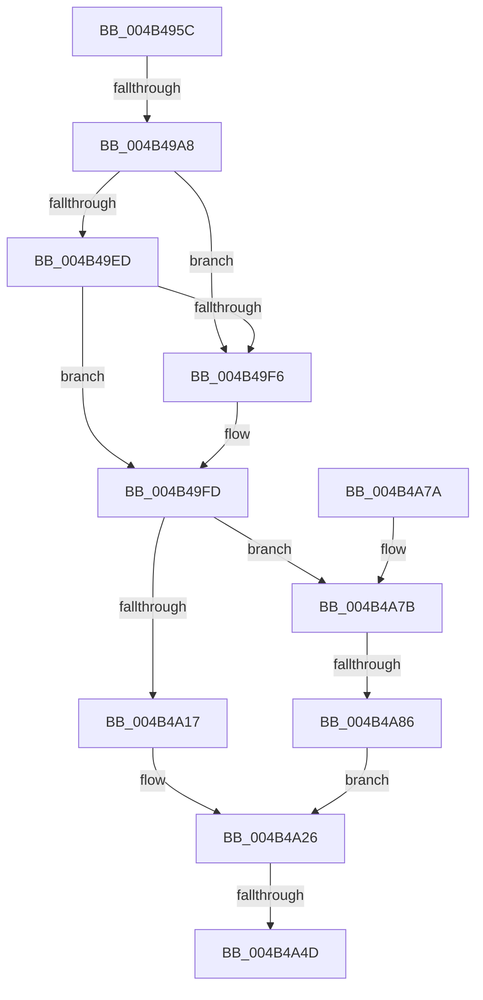

# FsRtlpRemoveAndCompleteReadOnlyIrp

- RVA: `0x004B495C`–`0x004B4AAE` (길이 `338` bytes)
- VA: `0x00000001404B495C`
- 실행 섹션: `.text`
- PDB 이름 있음: `예`; PDB Function 태그: `예`
- unwind 정보 RVA: `0x000B9F88`
- 디코드: `89`개 명령, `338/338` bytes 표시
- 미해석 바이트: `0` (있으면 어셈블리에 `.byte`로 보존)

> 이 문서는 커널 이미지의 기계어와 PDB 기호를 분석해 생성했습니다. 4번과 5번은 함수 원형과 자료형을 바이너리 사용 방식에서 추정한 C 해석이며 원본 소스 복구 결과는 아닙니다.

## 1. Dependencies

- 직접 호출 지점: **5**; 고유 호출 대상: **5**
- 직접 호출자로 확인된 함수: **7**
- RIP 상대 이미지 참조: **2**

### Outgoing calls
- `0x004B49BF` → [ObfDereferenceObjectWithTag](../2F/ObfDereferenceObjectWithTag_function_002F78E0.md) (function, `0x002F78E0`)
- `0x004B49C9` → [KeAcquireQueuedSpinLock](../27/KeAcquireQueuedSpinLock_function_00273D80.md) (function, `0x00273D80`)
- `0x004B49DF` → [KeReleaseQueuedSpinLock](../27/KeReleaseQueuedSpinLock_function_00272540.md) (function, `0x00272540`)
- `0x004B4A3B` → [IofCompleteRequest](../29/IofCompleteRequest_function_0029B5C0.md) (function, `0x0029B5C0`)
- `0x004B4A54` → [_security_check_cookie](../6A/_security_check_cookie_function_006AC640.md) (function, `0x006AC640`)

### Direct callers
- [FsRtlpRequestExclusiveOplock](../3F/FsRtlpRequestExclusiveOplock_function_003F3800.md) at `0x003F3BE2`
- [FsRtlpRequestExclusiveOplock](../3F/FsRtlpRequestExclusiveOplock_function_003F3800.md) at `0x003F3EF2`
- [FsRtlpOplockCleanup](../42/FsRtlpOplockCleanup_function_00425030.md) at `0x00425275`
- [FsRtlpOplockBreakByCacheFlags](../4E/FsRtlpOplockBreakByCacheFlags_function_004E4990.md) at `0x004E5936`
- [FsRtlpRequestShareableOplock](../4E/FsRtlpRequestShareableOplock_function_004E6EC8.md) at `0x004E733C`
- [FsRtlpRequestShareableOplock](../4E/FsRtlpRequestShareableOplock_function_004E6EC8.md) at `0x004E7876`
- [FsRtlpOplockBreakToNone](../4F/FsRtlpOplockBreakToNone_function_004F8354.md) at `0x004F8646`
- [FsRtlpCancelReadOnlyOplockIrp](../58/FsRtlpCancelReadOnlyOplockIrp_function_00582380.md) at `0x005823EF`
- [FsRtlCheckUpperOplock](../../page/71/FsRtlCheckUpperOplock_function_007145F0.md) at `0x0071470C`

### Static image references
- `0x004B497F` → RVA `0x00E0A740` (`.data`; read)
- `0x004B498D` → RVA `0x00E06C50` (`.data`; read)

## 2. Other-region calls and transfers

- 다른 실행 섹션으로 향하는 call: **0**
- call이 아닌 외부 분기/꼬리 이동: **3**
  - `0x004B49A2` → [sub_006FB9B4](../6F/Unknown_function_006FB9B4.md) (`tail-transfer`)
  - `0x004B4A47` → [sub_006FB9B4 + 0x91](../6F/Unknown_function_006FB9B4.md) (`tail-transfer`)
  - `0x004B4A80` → [sub_006FB9B4 + 0x84](../6F/Unknown_function_006FB9B4.md) (`tail-transfer`)

## 3. Assembly (complete function range)

```asm
004B495C  48 8B C4                        mov rax, rsp
004B495F  48 89 58 10                     mov qword ptr [rax + 0x10], rbx
004B4963  48 89 70 18                     mov qword ptr [rax + 0x18], rsi
004B4967  48 89 78 20                     mov qword ptr [rax + 0x20], rdi
004B496B  55                              push rbp
004B496C  41 54                           push r12
004B496E  41 55                           push r13
004B4970  41 56                           push r14
004B4972  41 57                           push r15
004B4974  48 8D 68 A1                     lea rbp, [rax - 0x5f]
004B4978  48 81 EC C0 00 00 00            sub rsp, 0xc0
004B497F  48 8B 05 BA 5D 95 00            mov rax, qword ptr [rip + 0x955dba]
004B4986  48 33 C4                        xor rax, rsp
004B4989  48 89 45 27                     mov qword ptr [rbp + 0x27], rax
004B498D  83 3D BC 22 95 00 05            cmp dword ptr [rip + 0x9522bc], 5
004B4994  4D 8B F9                        mov r15, r9
004B4997  41 8B F0                        mov esi, r8d
004B499A  8B DA                           mov ebx, edx
004B499C  4C 8B F1                        mov r14, rcx
004B499F  44 8B E2                        mov r12d, edx
004B49A2  0F 87 0C 70 24 00               ja 0x1406fb9b4
004B49A8  49 8D BE 58 FF FF FF            lea rdi, [r14 - 0xa8]
004B49AF  BA 44 66 6C 74                  mov edx, 0x746c6644
004B49B4  4C 8B AF B8 00 00 00            mov r13, qword ptr [rdi + 0xb8]
004B49BB  49 8B 4D 30                     mov rcx, qword ptr [r13 + 0x30]
004B49BF  E8 1C 2F E4 FF                  call 0x1402f78e0
004B49C4  B9 07 00 00 00                  mov ecx, 7
004B49C9  E8 B2 F3 DB FF                  call 0x140273d80
004B49CE  88 47 45                        mov byte ptr [rdi + 0x45], al
004B49D1  B9 07 00 00 00                  mov ecx, 7
004B49D6  33 C0                           xor eax, eax
004B49D8  48 87 47 68                     xchg qword ptr [rdi + 0x68], rax
004B49DC  8A 57 45                        mov dl, byte ptr [rdi + 0x45]
004B49DF  E8 5C DB DB FF                  call 0x140272540
004B49E4  49 8B 0E                        mov rcx, qword ptr [r14]
004B49E7  4C 39 71 08                     cmp qword ptr [rcx + 8], r14
004B49EB  75 09                           jne 0x1404b49f6
004B49ED  49 8B 46 08                     mov rax, qword ptr [r14 + 8]
004B49F1  4C 39 30                        cmp qword ptr [rax], r14
004B49F4  74 07                           je 0x1404b49fd
004B49F6  B9 03 00 00 00                  mov ecx, 3
004B49FB  CD 29                           int 0x29
004B49FD  48 89 08                        mov qword ptr [rax], rcx
004B4A00  41 B8 01 00 00 00               mov r8d, 1
004B4A06  48 89 41 08                     mov qword ptr [rcx + 8], rax
004B4A0A  41 81 7D 18 40 02 09 00         cmp dword ptr [r13 + 0x18], 0x90240
004B4A12  8A 47 44                        mov al, byte ptr [rdi + 0x44]
004B4A15  74 64                           je 0x1404b4a7b
004B4A17  84 C0                           test al, al
004B4A19  41 8D 48 07                     lea ecx, [r8 + 7]
004B4A1D  BB 20 01 00 C0                  mov ebx, 0xc0000120
004B4A22  41 0F 44 DC                     cmove ebx, r12d
004B4A26  48 8B D7                        mov rdx, rdi
004B4A29  B8 38 00 00 00                  mov eax, 0x38
004B4A2E  48 89 0C 10                     mov qword ptr [rax + rdx], rcx
004B4A32  41 8A D0                        mov dl, r8b
004B4A35  48 8B CF                        mov rcx, rdi
004B4A38  89 5F 30                        mov dword ptr [rdi + 0x30], ebx
004B4A3B  E8 80 6B DE FF                  call 0x14029b5c0
004B4A40  83 3D 09 22 95 00 05            cmp dword ptr [rip + 0x952209], 5
004B4A47  0F 87 F8 6F 24 00               ja 0x1406fba45
004B4A4D  48 8B 4D 27                     mov rcx, qword ptr [rbp + 0x27]
004B4A51  48 33 CC                        xor rcx, rsp
004B4A54  E8 E7 7B 1F 00                  call 0x1406ac640
004B4A59  4C 8D 9C 24 C0 00 00 00         lea r11, [rsp + 0xc0]
004B4A61  49 8B 5B 38                     mov rbx, qword ptr [r11 + 0x38]
004B4A65  49 8B 73 40                     mov rsi, qword ptr [r11 + 0x40]
004B4A69  49 8B 7B 48                     mov rdi, qword ptr [r11 + 0x48]
004B4A6D  49 8B E3                        mov rsp, r11
004B4A70  41 5F                           pop r15
004B4A72  41 5E                           pop r14
004B4A74  41 5D                           pop r13
004B4A76  41 5C                           pop r12
004B4A78  5D                              pop rbp
004B4A79  C3                              ret
004B4A7A  CC                              int3
004B4A7B  45 33 F6                        xor r14d, r14d
004B4A7E  84 C0                           test al, al
004B4A80  0F 85 B2 6F 24 00               jne 0x1406fba38
004B4A86  48 8B 47 18                     mov rax, qword ptr [rdi + 0x18]
004B4A8A  41 8D 4E 18                     lea ecx, [r14 + 0x18]
004B4A8E  C1 EE 0C                        shr esi, 0xc
004B4A91  83 E6 07                        and esi, 7
004B4A94  4C 89 70 0C                     mov qword ptr [rax + 0xc], r14
004B4A98  44 89 70 14                     mov dword ptr [rax + 0x14], r14d
004B4A9C  C7 00 01 00 18 00               mov dword ptr [rax], 0x180001
004B4AA2  44 89 40 04                     mov dword ptr [rax + 4], r8d
004B4AA6  89 70 08                        mov dword ptr [rax + 8], esi
004B4AA9  E9 78 FF FF FF                  jmp 0x1404b4a26
```

## 4. C-style interpretation (structured pseudocode)

```c
__int64 __fastcall FsRtlpRemoveAndCompleteReadOnlyIrp(__int64 a1, int a2, int a3, __int64 a4)
{
    __int64 result;
    __int64 v_r14;
    __int64 v_rbx;
    __int64 v_rsi;
    __int64 v_rsp;
    unsigned __int64 v_stack_m28;

    *(unsigned __int64 *)(v_rsp + 16) = v_rbx;
    *(unsigned __int64 *)(v_rsp + 24) = v_rsi;
    *(unsigned __int64 *)(v_rsp + 32) = v_rdi;
    v_rsp = (v_rsp) - (192);
    result = (*(unsigned __int64 *)(v_rip + 9788858)) ^ (v_rsp);
    *(unsigned __int64 *)(v_rsp - 95 + 39) = result;
    result = ObfDereferenceObjectWithTag(*(unsigned __int64 *)(*(unsigned __int64 *)(a1 - 168 + 184) + 48), (unsigned int)(0x746C6644ULL), a3, a4);
    result = KeAcquireQueuedSpinLock(7, (unsigned int)(0x746C6644ULL), a3, a4);
    *(unsigned __int8 *)(a1 - 168 + 69) = (unsigned __int8)(result);
    result = 0;
    result = KeReleaseQueuedSpinLock(7, *(unsigned __int8 *)(a1 - 168 + 69), a3, a4);
    if ((*(unsigned __int64 *)(*(unsigned __int64 *)(a1) + 8)) != a1) goto loc_004B49F6;
    if ((*(unsigned __int64 *)(*(unsigned __int64 *)(a1 + 8))) != a1) {
        a1 = 3;
    }
    *(unsigned __int64 *)(*(unsigned __int64 *)(a1 + 8)) = a1;
    *(unsigned __int64 *)(a1 + 8) = *(unsigned __int64 *)(a1 + 8);
    if ((*(unsigned int *)(*(unsigned __int64 *)(a1 - 168 + 184) + 24)) == 0x90240ULL) goto loc_004B4A7B;
    v_rbx = (unsigned int)(0xC0000120ULL);
    if ((unsigned __int8)(*(unsigned __int8 *)(a1 - 168 + 68)) == 0) { v_rbx = (unsigned int)((unsigned int)(a2)); }
loc_004B4A26:
    *(unsigned __int64 *)(56 + a1 - 168 * 1) = 1 + 7;
    *(unsigned int *)(a1 - 168 + 48) = (unsigned int)(v_rbx);
    result = IofCompleteRequest(a1 - 168, 1, 1, a4);
    a1 = (*(unsigned __int64 *)(v_rsp - 95 + 39)) ^ (v_rsp);
    result = _security_check_cookie(a1, 1, 1, a4);
    return result;
loc_004B4A7B:
    v_r14 = 0;
    v_rsi = (unsigned int)((*(unsigned __int64 *)(v_stack_m28 + 64)) >> (12));
    v_rsi = (unsigned int)((v_rsi) & (7));
    *(unsigned __int64 *)(*(unsigned __int64 *)(*(unsigned __int64 *)(v_stack_m28 + 72) + 24) + 12) = 0;
    *(unsigned int *)(*(unsigned __int64 *)(*(unsigned __int64 *)(v_stack_m28 + 72) + 24) + 20) = 0;
    *(unsigned int *)(*(unsigned __int64 *)(*(unsigned __int64 *)(v_stack_m28 + 72) + 24)) = 0x180001ULL;
    *(unsigned int *)(*(unsigned __int64 *)(*(unsigned __int64 *)(v_stack_m28 + 72) + 24) + 4) = 1;
    *(unsigned int *)(*(unsigned __int64 *)(*(unsigned __int64 *)(v_stack_m28 + 72) + 24) + 8) = (unsigned int)(v_rsi);
    goto loc_004B4A26;
}
```

## 5. (Beta) C Style

```c
int64_t FsRtlpRemoveAndCompleteReadOnlyIrp(void *Arg1, int32_t Arg2, int32_t Arg3, int64_t Arg4)
{
    uint8_t *arg1 = (uint8_t *)Arg1;

    int64_t result;
    int64_t local_r14;
    int64_t local_rbx;
    int64_t local_rsi;
    int64_t local_rsp;
    uint64_t v_stack_m28;

    *(uint64_t *)(local_rsp + 0x10) = local_rbx;
    *(uint64_t *)(local_rsp + 0x18) = local_rsi;
    *(uint64_t *)(local_rsp + 0x20) = local_rdi;
    local_rsp = (local_rsp) - (192);
    result = (*(uint64_t *)(v_rip + 0x955DBA)) ^ (local_rsp);
    *(uint64_t *)(local_rsp - 0x5F + 0x27) = result;
    result = ObfDereferenceObjectWithTag(*(uint64_t *)(*(uint64_t *)(arg1 - 0xA8 + 0xB8) + 0x30), (uint32_t)(0x746C6644ULL), Arg3, Arg4);
    result = KeAcquireQueuedSpinLock(7, (uint32_t)(0x746C6644ULL), Arg3, Arg4);
    *(uint8_t *)(arg1 - 0xA8 + 0x45) = (uint8_t)(result);
    result = 0;
    result = KeReleaseQueuedSpinLock(7, *(uint8_t *)(arg1 - 0xA8 + 0x45), Arg3, Arg4);
    if ((*(uint64_t *)(*(uint64_t *)(arg1) + 0x8)) != Arg1) goto loc_004B49F6;
    if ((*(uint64_t *)(*(uint64_t *)(arg1 + 0x8))) != Arg1) {
        Arg1 = 3;
    }
    *(void **)(*(uint64_t *)(arg1 + 0x8)) = Arg1;
    *(uint64_t *)(arg1 + 0x8) = *(uint64_t *)(arg1 + 0x8);
    if ((*(uint32_t *)(*(uint64_t *)(arg1 - 0xA8 + 0xB8) + 0x18)) == 0x90240ULL) goto loc_004B4A7B;
    local_rbx = (uint32_t)(0xC0000120ULL);
    if ((uint8_t)(*(uint8_t *)(arg1 - 0xA8 + 0x44)) == 0) { local_rbx = (uint32_t)((uint32_t)(Arg2)); }
loc_004B4A26:
    *(uint64_t *)(56 + arg1 - 0xA8 * 1) = 1 + 7;
    *(uint32_t *)(arg1 - 0xA8 + 0x30) = (uint32_t)(local_rbx);
    result = IofCompleteRequest(Arg1 - 168, 1, 1, Arg4);
    Arg1 = (*(uint64_t *)(local_rsp - 0x5F + 0x27)) ^ (local_rsp);
    result = _security_check_cookie(Arg1, 1, 1, Arg4);
    return result;
loc_004B4A7B:
    local_r14 = 0;
    local_rsi = (uint32_t)((*(uint64_t *)(v_stack_m28 + 0x40)) >> (12));
    local_rsi = (uint32_t)((local_rsi) & (7));
    *(uint64_t *)(*(uint64_t *)(*(uint64_t *)(v_stack_m28 + 0x48) + 0x18) + 0xC) = 0;
    *(uint32_t *)(*(uint64_t *)(*(uint64_t *)(v_stack_m28 + 0x48) + 0x18) + 0x14) = 0;
    *(uint32_t *)(*(uint64_t *)(*(uint64_t *)(v_stack_m28 + 0x48) + 0x18)) = 0x180001ULL;
    *(uint32_t *)(*(uint64_t *)(*(uint64_t *)(v_stack_m28 + 0x48) + 0x18) + 0x4) = 1;
    *(uint32_t *)(*(uint64_t *)(*(uint64_t *)(v_stack_m28 + 0x48) + 0x18) + 0x8) = (uint32_t)(local_rsi);
    goto loc_004B4A26;
}
```

### 관측된 메모리 오프셋

구조체 형식이 확인되지 않은 접근은 인자 기준의 오프셋으로만 기록했습니다.

| 기준 인자 | 오프셋 표현 | 폭 (bit) | 접근 |
|---|---:|---:|---|
| `Arg1` | `- 0xA8` | `64` | `R` |
| `Arg1` | `+ 0x0` | `64` | `R` |
| `Arg1` | `+ 0x8` | `64` | `R` |
| `Arg1` | `+ 0x18` | `64` | `R` |
| `Arg1` | `+ 0x30` | `32` | `W` |
| `Arg1` | `+ 0x44` | `8` | `R` |
| `Arg1` | `+ 0x45` | `8` | `R` |
| `Arg1` | `+ 0x45` | `8` | `W` |
| `Arg1` | `+ 0x68` | `64` | `R/W` |
| `Arg1` | `+ 0xB8` | `64` | `R` |

## 6. Execution-region graph

[열기: 2D/3D 그래프와 함수 탐색 컨트롤 패널](../../../control-panel.html?section=text&rva=0x004B495C&view=graph)

- 2D 그래프는 위에서 아래로 흐르고, 3D 그래프는 빈 공간을 드래그해 회전합니다. Shift+드래그는 이동, 휠은 확대·축소, 함수 노드 선택은 대상 보고서 이동입니다.

### Static fallback


