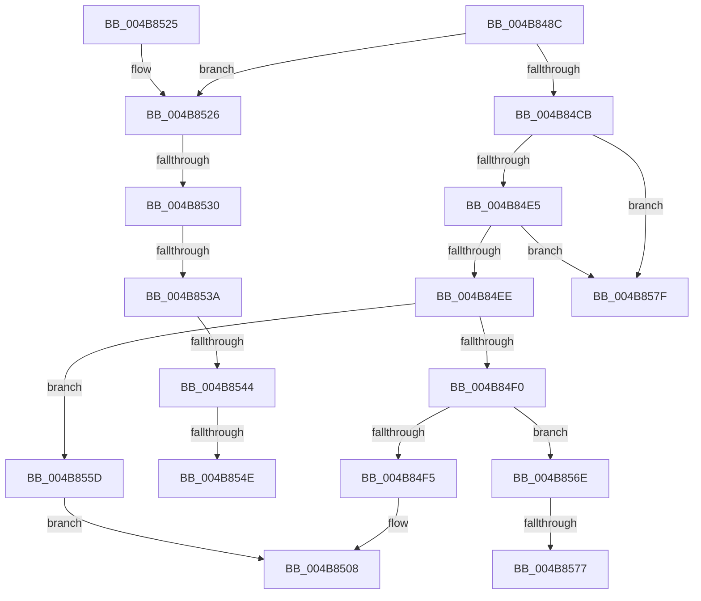

# HalSocRequestApi

- RVA: `0x004B848C`–`0x004B858E` (길이 `258` bytes)
- VA: `0x00000001404B848C`
- 실행 섹션: `.text`
- PDB 이름 있음: `예`; PDB Function 태그: `예`
- unwind 정보 RVA: `0x000BAE10`
- 디코드: `60`개 명령, `258/258` bytes 표시
- 미해석 바이트: `0` (있으면 어셈블리에 `.byte`로 보존)

> 이 문서는 커널 이미지의 기계어와 PDB 기호를 분석해 생성했습니다. 4번과 5번은 함수 원형과 자료형을 바이너리 사용 방식에서 추정한 C 해석이며 원본 소스 복구 결과는 아닙니다.

## 1. Dependencies

- 직접 호출 지점: **1**; 고유 호출 대상: **1**
- 직접 호출자로 확인된 함수: **13**
- RIP 상대 이미지 참조: **2**

### Outgoing calls
- `0x004B8503` → [memcpy](../6C/memcpy_function_006C6840.md) (function, `0x006C6840`)

### Direct callers
- [HalpApicSetupRegisterAccess](../55/HalpApicSetupRegisterAccess_function_005589F8.md) at `0x00558AD8`
- [HalpHvCounterUpdateCallback](../56/HalpHvCounterUpdateCallback_function_00560660.md) at `0x00560680`
- [HalpHvDiscover](../56/HalpHvDiscover_function_005606A0.md) at `0x005606D3`
- [HalpHvTimerInitialize](../56/HalpHvTimerInitialize_function_00560810.md) at `0x0056089B`
- [HalpApicTimerDiscover](../56/HalpApicTimerDiscover_function_005623D0.md) at `0x0056241F`
- [HalpApicTimerIsInvariant](../56/HalpApicTimerIsInvariant_function_005625DC.md) at `0x00562607`
- [HalpTscDiscover](../56/HalpTscDiscover_function_00562728.md) at `0x005627A7`
- [HalpTscGetAttributes](../56/HalpTscGetAttributes_function_00562870.md) at `0x005628BD`
- [HalpApicGetCpuInfo](../56/HalpApicGetCpuInfo_function_00569C54.md) at `0x00569C95`
- [HalpIvtLegacyProcessDrhdEntry](../57/HalpIvtLegacyProcessDrhdEntry_function_00578C58.md) at `0x00578D25`
- [HalpIvtProcessDrhdEntry](../57/HalpIvtProcessDrhdEntry_function_005794B4.md) at `0x0057958F`
- [IvtInitializeIommu](../../pagelk/B6/IvtInitializeIommu_function_00B61FE0.md) at `0x00B6214E`
- [HsaInitializeIommu](../../pagelk/B6/HsaInitializeIommu_function_00B63140.md) at `0x00B631BC`

### Static image references
- `0x004B84CB` → RVA `0x00003A70` (`.rdata`; read)
- `0x004B854E` → RVA `0x00E10358` (`.data`; write)

## 2. Other-region calls and transfers

- 다른 실행 섹션으로 향하는 call: **0**
- call이 아닌 외부 분기/꼬리 이동: **8**
  - `0x004B852A` → [sub_006FC0AA + 0x76](../6F/Unknown_function_006FC0AA.md) (`tail-transfer`)
  - `0x004B8534` → [sub_006FC0AA + 0x5B](../6F/Unknown_function_006FC0AA.md) (`tail-transfer`)
  - `0x004B853E` → [sub_006FC0AA + 0x2F](../6F/Unknown_function_006FC0AA.md) (`tail-transfer`)
  - `0x004B8548` → [sub_006FC0AA](../6F/Unknown_function_006FC0AA.md) (`tail-transfer`)
  - `0x004B8558` → [sub_006FC0AA + 0xF7](../6F/Unknown_function_006FC0AA.md) (`tail-transfer`)
  - `0x004B8571` → [sub_006FC0AA + 0xF7](../6F/Unknown_function_006FC0AA.md) (`tail-transfer`)
  - `0x004B857A` → [sub_006FC0AA + 0xB2](../6F/Unknown_function_006FC0AA.md) (`tail-transfer`)
  - `0x004B8589` → [sub_006FC0AA + 0xF7](../6F/Unknown_function_006FC0AA.md) (`tail-transfer`)

## 3. Assembly (complete function range)

```asm
004B848C  48 8B C4                        mov rax, rsp
004B848F  48 89 58 08                     mov qword ptr [rax + 8], rbx
004B8493  48 89 68 10                     mov qword ptr [rax + 0x10], rbp
004B8497  48 89 70 18                     mov qword ptr [rax + 0x18], rsi
004B849B  48 89 78 20                     mov qword ptr [rax + 0x20], rdi
004B849F  41 56                           push r14
004B84A1  48 83 EC 50                     sub rsp, 0x50
004B84A5  33 DB                           xor ebx, ebx
004B84A7  0F 57 C0                        xorps xmm0, xmm0
004B84AA  48 89 58 C8                     mov qword ptr [rax - 0x38], rbx
004B84AE  0F 57 C9                        xorps xmm1, xmm1
004B84B1  45 8B D9                        mov r11d, r9d
004B84B4  48 8B EA                        mov rbp, rdx
004B84B7  44 8B F3                        mov r14d, ebx
004B84BA  44 8A D3                        mov r10b, bl
004B84BD  0F 11 40 E0                     movups xmmword ptr [rax - 0x20], xmm0
004B84C1  0F 11 48 D0                     movups xmmword ptr [rax - 0x30], xmm1
004B84C5  41 83 E8 02                     sub r8d, 2
004B84C9  75 5B                           jne 0x1404b8526
004B84CB  48 8D 35 9E B5 B4 FF            lea rsi, [rip - 0x4b4a62]
004B84D2  BF 10 00 00 00                  mov edi, 0x10
004B84D7  48 39 9C 24 80 00 00 00         cmp qword ptr [rsp + 0x80], rbx
004B84DF  0F 84 9A 00 00 00               je 0x1404b857f
004B84E5  44 3B DF                        cmp r11d, edi
004B84E8  0F 87 91 00 00 00               ja 0x1404b857f
004B84EE  72 6D                           jb 0x1404b855d
004B84F0  45 84 D2                        test r10b, r10b
004B84F3  75 79                           jne 0x1404b856e
004B84F5  48 8B 8C 24 80 00 00 00         mov rcx, qword ptr [rsp + 0x80]
004B84FD  48 8B D6                        mov rdx, rsi
004B8500  44 8B C7                        mov r8d, edi
004B8503  E8 38 E3 20 00                  call 0x1406c6840
004B8508  48 8B 6C 24 68                  mov rbp, qword ptr [rsp + 0x68]
004B850D  8B C3                           mov eax, ebx
004B850F  48 8B 5C 24 60                  mov rbx, qword ptr [rsp + 0x60]
004B8514  48 8B 74 24 70                  mov rsi, qword ptr [rsp + 0x70]
004B8519  48 8B 7C 24 78                  mov rdi, qword ptr [rsp + 0x78]
004B851E  48 83 C4 50                     add rsp, 0x50
004B8522  41 5E                           pop r14
004B8524  C3                              ret
004B8525  CC                              int3
004B8526  41 83 E8 01                     sub r8d, 1
004B852A  0F 84 F0 3B 24 00               je 0x1406fc120
004B8530  41 83 E8 01                     sub r8d, 1
004B8534  0F 84 CB 3B 24 00               je 0x1406fc105
004B853A  41 83 E8 01                     sub r8d, 1
004B853E  0F 84 95 3B 24 00               je 0x1406fc0d9
004B8544  41 83 F8 01                     cmp r8d, 1
004B8548  0F 84 5C 3B 24 00               je 0x1406fc0aa
004B854E  C7 05 00 7E 95 00 1B 00 00 00   mov dword ptr [rip + 0x957e00], 0x1b
004B8558  E9 44 3C 24 00                  jmp 0x1406fc1a1
004B855D  BB 23 00 00 C0                  mov ebx, 0xc0000023
004B8562  C7 05 EC 7D 95 00 1C 00 00 00   mov dword ptr [rip + 0x957dec], 0x1c
004B856C  EB 9A                           jmp 0x1404b8508
004B856E  48 85 ED                        test rbp, rbp
004B8571  0F 84 2A 3C 24 00               je 0x1406fc1a1
004B8577  49 8B 06                        mov rax, qword ptr [r14]
004B857A  E9 DD 3B 24 00                  jmp 0x1406fc15c
004B857F  C7 05 CF 7D 95 00 1C 00 00 00   mov dword ptr [rip + 0x957dcf], 0x1c
004B8589  E9 13 3C 24 00                  jmp 0x1406fc1a1
```

## 4. C-style interpretation (structured pseudocode)

```c
__int64 __fastcall HalSocRequestApi(__int64 a1, __int64 a2, int a3, int a4, __int64 a5)
{
    __int64 result;
    __int64 v_rbx;
    __int64 v_rsp;
    unsigned __int64 v_stack_p10;
    unsigned __int64 v_stack_p18;
    unsigned __int64 v_stack_p20;
    unsigned __int64 v_stack_p8;

    *(unsigned __int64 *)(v_rsp + 8) = v_rbx;
    *(unsigned __int64 *)(v_rsp + 16) = v_rbp;
    *(unsigned __int64 *)(v_rsp + 24) = v_rsi;
    *(unsigned __int64 *)(v_rsp + 32) = v_rdi;
    v_rsp = (v_rsp) - (80);
    v_rbx = 0;
    *(unsigned __int64 *)(v_rsp - 56) = 0;
    *(unsigned __int64 *)(v_rsp - 32) = v_xmm0;
    *(unsigned __int64 *)(v_rsp - 48) = v_xmm1;
    a3 = (unsigned int)((a3) - (2));
    if (condition_is_not_equal) goto loc_004B8526;
    if (a5 == 0) goto loc_004B857F;
    if (((unsigned int)((unsigned int)(a4))) > 16) goto loc_004B857F;
    if (((unsigned int)((unsigned int)(a4))) < 16) goto loc_004B855D;
    if (0 != 0) goto loc_004B856E;
    result = memcpy(a5, v_rip - 4934242, 16, a4);
loc_004B8508:
    v_rsp = (v_rsp) + (80);
    return 0;
loc_004B8526:
    a3 = (unsigned int)((16) - (1));
    a3 = (unsigned int)((a3) - (1));
    a3 = (unsigned int)((a3) - (1));
    *(unsigned int *)(v_rip + 9797120) = 27;
loc_004B855D:
    *(unsigned int *)(v_rip + 9797100) = 28;
    goto loc_004B8508;
loc_004B856E:
loc_004B857F:
    *(unsigned int *)(v_rip + 9797071) = 28;
}
```

## 5. (Beta) C Style

```c
int64_t HalSocRequestApi(int64_t Arg1, int64_t Arg2, int32_t Arg3, int32_t Arg4, int64_t Arg5)
{
    int64_t result;
    int64_t local_rbx;
    int64_t local_rsp;
    uint64_t v_stack_p10;
    uint64_t v_stack_p18;
    uint64_t v_stack_p20;
    uint64_t v_stack_p8;

    *(uint64_t *)(local_rsp + 0x8) = local_rbx;
    *(uint64_t *)(local_rsp + 0x10) = local_rbp;
    *(uint64_t *)(local_rsp + 0x18) = local_rsi;
    *(uint64_t *)(local_rsp + 0x20) = local_rdi;
    local_rsp = (local_rsp) - (80);
    local_rbx = 0;
    *(uint64_t *)(local_rsp - 0x38) = 0;
    *(uint64_t *)(local_rsp - 0x20) = v_xmm0;
    *(uint64_t *)(local_rsp - 0x30) = v_xmm1;
    Arg3 = (uint32_t)((Arg3) - (2));
    if (condition_is_not_equal) goto loc_004B8526;
    if (Arg5 == 0) goto loc_004B857F;
    if (((uint32_t)((uint32_t)(Arg4))) > 16) goto loc_004B857F;
    if (((uint32_t)((uint32_t)(Arg4))) < 16) goto loc_004B855D;
    if (0 != 0) goto loc_004B856E;
    result = memcpy(Arg5, v_rip - 4934242, 16, Arg4);
loc_004B8508:
    local_rsp = (local_rsp) + (80);
    return 0;
loc_004B8526:
    Arg3 = (uint32_t)((16) - (1));
    Arg3 = (uint32_t)((Arg3) - (1));
    Arg3 = (uint32_t)((Arg3) - (1));
    *(uint32_t *)(v_rip + 0x957E00) = 27;
loc_004B855D:
    *(uint32_t *)(v_rip + 0x957DEC) = 28;
    goto loc_004B8508;
loc_004B856E:
loc_004B857F:
    *(uint32_t *)(v_rip + 0x957DCF) = 28;
}
```

## 6. Execution-region graph

[열기: 2D/3D 그래프와 함수 탐색 컨트롤 패널](../../../control-panel.html?section=text&rva=0x004B848C&view=graph)

- 2D 그래프는 위에서 아래로 흐르고, 3D 그래프는 빈 공간을 드래그해 회전합니다. Shift+드래그는 이동, 휠은 확대·축소, 함수 노드 선택은 대상 보고서 이동입니다.

### Static fallback


