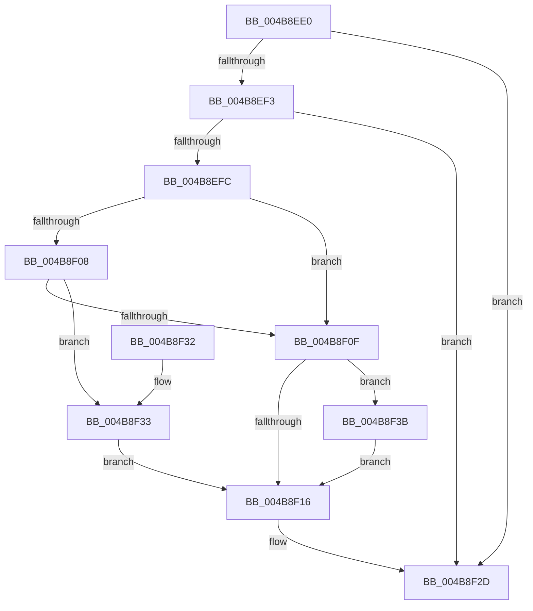

# HalpDmaControllerDpcRoutine

- RVA: `0x004B8EE0`–`0x004B8F4D` (길이 `109` bytes)
- VA: `0x00000001404B8EE0`
- 실행 섹션: `.text`
- PDB 이름 있음: `예`; PDB Function 태그: `아니요`
- unwind 정보 RVA: `0x00069AC4`
- 디코드: `34`개 명령, `109/109` bytes 표시
- 미해석 바이트: `0` (있으면 어셈블리에 `.byte`로 보존)

> 이 문서는 커널 이미지의 기계어와 PDB 기호를 분석해 생성했습니다. 4번과 5번은 함수 원형과 자료형을 바이너리 사용 방식에서 추정한 C 해석이며 원본 소스 복구 결과는 아닙니다.

## 1. Dependencies

- 직접 호출 지점: **1**; 고유 호출 대상: **1**
- 직접 호출자로 확인된 함수: **0**
- RIP 상대 이미지 참조: **0**

### Outgoing calls
- `0x004B8F28` → [guard_dispatch_icall](../6B/guard_dispatch_icall_function_006BAAD0.md) (function, `0x006BAAD0`)

### Direct callers
- 이 함수 시작 RVA로 연결되는 직접 call은 확인되지 않았습니다. 간접 호출은 완전히 역산할 수 없습니다.

### Static image references
- 디코드된 RIP-relative 메모리 참조가 없습니다.

## 2. Other-region calls and transfers

- 다른 실행 섹션으로 향하는 call: **0**
- 별도 외부 분기/꼬리 이동을 확인하지 못했습니다.

## 3. Assembly (complete function range)

```asm
004B8EE0  48 83 EC 38                     sub rsp, 0x38
004B8EE4  48 8B 4A 18                     mov rcx, qword ptr [rdx + 0x18]
004B8EE8  45 33 C9                        xor r9d, r9d
004B8EEB  4C 8B C2                        mov r8, rdx
004B8EEE  48 85 C9                        test rcx, rcx
004B8EF1  74 3A                           je 0x1404b8f2d
004B8EF3  4C 8B 52 08                     mov r10, qword ptr [rdx + 8]
004B8EF7  4D 85 D2                        test r10, r10
004B8EFA  74 31                           je 0x1404b8f2d
004B8EFC  48 8B 81 68 01 00 00            mov rax, qword ptr [rcx + 0x168]
004B8F03  48 85 C0                        test rax, rax
004B8F06  74 07                           je 0x1404b8f0f
004B8F08  8B 40 0C                        mov eax, dword ptr [rax + 0xc]
004B8F0B  A8 01                           test al, 1
004B8F0D  75 24                           jne 0x1404b8f33
004B8F0F  8B 42 20                        mov eax, dword ptr [rdx + 0x20]
004B8F12  85 C0                           test eax, eax
004B8F14  75 25                           jne 0x1404b8f3b
004B8F16  48 8B 91 60 01 00 00            mov rdx, qword ptr [rcx + 0x160]
004B8F1D  49 8B C2                        mov rax, r10
004B8F20  4D 8B 40 10                     mov r8, qword ptr [r8 + 0x10]
004B8F24  48 8B 52 30                     mov rdx, qword ptr [rdx + 0x30]
004B8F28  E8 A3 1B 20 00                  call 0x1406baad0
004B8F2D  48 83 C4 38                     add rsp, 0x38
004B8F31  C3                              ret
004B8F32  CC                              int3
004B8F33  41 B9 03 00 00 00               mov r9d, 3
004B8F39  EB DB                           jmp 0x1404b8f16
004B8F3B  83 E8 02                        sub eax, 2
004B8F3E  41 B9 03 00 00 00               mov r9d, 3
004B8F44  F7 D8                           neg eax
004B8F46  1B C0                           sbb eax, eax
004B8F48  44 03 C8                        add r9d, eax
004B8F4B  EB C9                           jmp 0x1404b8f16
```

## 4. C-style interpretation (structured pseudocode)

```c
__int64 __fastcall HalpDmaControllerDpcRoutine(__int64 a1, __int64 a2, __int64 a3, int a4)
{
    __int64 result;
    __int64 v_rsp;

    v_rsp = (v_rsp) - (56);
    a4 = 0;
    if (*(unsigned __int64 *)(a2 + 24) == 0) goto loc_004B8F2D;
    if (*(unsigned __int64 *)(a2 + 8) == 0) goto loc_004B8F2D;
    if (*(unsigned __int64 *)(*(unsigned __int64 *)(a2 + 24) + 360) == 0) goto loc_004B8F0F;
    if ((((unsigned __int8)((unsigned int)(*(unsigned int *)(*(unsigned __int64 *)(*(unsigned __int64 *)(a2 + 24) + 360) + 12)))) & (1)) != 0) goto loc_004B8F33;
loc_004B8F0F:
    if ((unsigned int)((unsigned int)(*(unsigned int *)(a2 + 32))) != 0) goto loc_004B8F3B;
loc_004B8F16:
    result = guard_dispatch_icall(*(unsigned __int64 *)(a2 + 24), *(unsigned __int64 *)(*(unsigned __int64 *)(*(unsigned __int64 *)(a2 + 24) + 352) + 48), *(unsigned __int64 *)(a2 + 16), a4);
loc_004B8F2D:
    v_rsp = (v_rsp) + (56);
    return result;
loc_004B8F33:
    goto loc_004B8F16;
loc_004B8F3B:
    result = (unsigned int)((result) - (2));
    result = (unsigned int)(-(result));
    a4 = (unsigned int)((3) + ((unsigned int)(result)));
    goto loc_004B8F16;
}
```

## 5. (Beta) C Style

```c
int64_t HalpDmaControllerDpcRoutine(int64_t Arg1, void *Arg2, int64_t Arg3, int32_t Arg4)
{
    uint8_t *arg2 = (uint8_t *)Arg2;

    int64_t result;
    int64_t local_rsp;

    local_rsp = (local_rsp) - (56);
    Arg4 = 0;
    if (*(uint64_t *)(arg2 + 0x18) == 0) goto loc_004B8F2D;
    if (*(uint64_t *)(arg2 + 0x8) == 0) goto loc_004B8F2D;
    if (*(uint64_t *)(*(uint64_t *)(arg2 + 0x18) + 0x168) == 0) goto loc_004B8F0F;
    if ((((uint8_t)((uint32_t)(*(uint32_t *)(*(uint64_t *)(*(uint64_t *)(arg2 + 0x18) + 0x168) + 0xC)))) & (1)) != 0) goto loc_004B8F33;
loc_004B8F0F:
    if ((uint32_t)((uint32_t)(*(uint32_t *)(arg2 + 0x20))) != 0) goto loc_004B8F3B;
loc_004B8F16:
    result = guard_dispatch_icall(*(uint64_t *)(arg2 + 0x18), *(uint64_t *)(*(uint64_t *)(*(uint64_t *)(arg2 + 0x18) + 0x160) + 0x30), *(uint64_t *)(arg2 + 0x10), Arg4);
loc_004B8F2D:
    local_rsp = (local_rsp) + (56);
    return result;
loc_004B8F33:
    goto loc_004B8F16;
loc_004B8F3B:
    result = (uint32_t)((result) - (2));
    result = (uint32_t)(-(result));
    Arg4 = (uint32_t)((3) + ((uint32_t)(result)));
    goto loc_004B8F16;
}
```

### 관측된 메모리 오프셋

구조체 형식이 확인되지 않은 접근은 인자 기준의 오프셋으로만 기록했습니다.

| 기준 인자 | 오프셋 표현 | 폭 (bit) | 접근 |
|---|---:|---:|---|
| `Arg2` | `+ 0x8` | `64` | `R` |
| `Arg2` | `+ 0x10` | `64` | `R` |
| `Arg2` | `+ 0x18` | `64` | `R` |
| `Arg2` | `+ 0x20` | `32` | `R` |

## 6. Execution-region graph

[열기: 2D/3D 그래프와 함수 탐색 컨트롤 패널](../../../control-panel.html?section=text&rva=0x004B8EE0&view=graph)

- 2D 그래프는 위에서 아래로 흐르고, 3D 그래프는 빈 공간을 드래그해 회전합니다. Shift+드래그는 이동, 휠은 확대·축소, 함수 노드 선택은 대상 보고서 이동입니다.

### Static fallback


