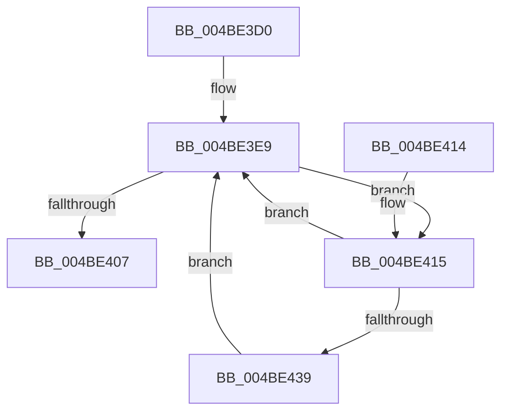

# HalpDmaControllerInterruptRoutine

- RVA: `0x004BE3D0`–`0x004BE449` (길이 `121` bytes)
- VA: `0x00000001404BE3D0`
- 실행 섹션: `.text`
- PDB 이름 있음: `예`; PDB Function 태그: `아니요`
- unwind 정보 RVA: `0x0008E1C0`
- 디코드: `35`개 명령, `121/121` bytes 표시
- 미해석 바이트: `0` (있으면 어셈블리에 `.byte`로 보존)

> 이 문서는 커널 이미지의 기계어와 PDB 기호를 분석해 생성했습니다. 4번과 5번은 함수 원형과 자료형을 바이너리 사용 방식에서 추정한 C 해석이며 원본 소스 복구 결과는 아닙니다.

## 1. Dependencies

- 직접 호출 지점: **2**; 고유 호출 대상: **2**
- 직접 호출자로 확인된 함수: **0**
- RIP 상대 이미지 참조: **0**

### Outgoing calls
- `0x004BE3FE` → [guard_dispatch_icall](../6B/guard_dispatch_icall_function_006BAAD0.md) (function, `0x006BAAD0`)
- `0x004BE442` → [KeInsertQueueDpc](../20/KeInsertQueueDpc_function_00207C50.md) (function, `0x00207C50`)

### Direct callers
- 이 함수 시작 RVA로 연결되는 직접 call은 확인되지 않았습니다. 간접 호출은 완전히 역산할 수 없습니다.

### Static image references
- 디코드된 RIP-relative 메모리 참조가 없습니다.

## 2. Other-region calls and transfers

- 다른 실행 섹션으로 향하는 call: **0**
- 별도 외부 분기/꼬리 이동을 확인하지 못했습니다.

## 3. Assembly (complete function range)

```asm
004BE3D0  48 89 5C 24 08                  mov qword ptr [rsp + 8], rbx
004BE3D5  57                              push rdi
004BE3D6  48 83 EC 20                     sub rsp, 0x20
004BE3DA  83 64 24 38 00                  and dword ptr [rsp + 0x38], 0
004BE3DF  48 8B FA                        mov rdi, rdx
004BE3E2  83 64 24 40 00                  and dword ptr [rsp + 0x40], 0
004BE3E7  32 DB                           xor bl, bl
004BE3E9  48 8B 87 80 00 00 00            mov rax, qword ptr [rdi + 0x80]
004BE3F0  4C 8D 44 24 40                  lea r8, [rsp + 0x40]
004BE3F5  48 8B 4F 40                     mov rcx, qword ptr [rdi + 0x40]
004BE3F9  48 8D 54 24 38                  lea rdx, [rsp + 0x38]
004BE3FE  E8 CD C6 1F 00                  call 0x1406baad0
004BE403  84 C0                           test al, al
004BE405  75 0E                           jne 0x1404be415
004BE407  8A C3                           mov al, bl
004BE409  48 8B 5C 24 30                  mov rbx, qword ptr [rsp + 0x30]
004BE40E  48 83 C4 20                     add rsp, 0x20
004BE412  5F                              pop rdi
004BE413  C3                              ret
004BE414  CC                              int3
004BE415  8B 44 24 38                     mov eax, dword ptr [rsp + 0x38]
004BE419  B3 01                           mov bl, 1
004BE41B  48 8D 0C 80                     lea rcx, [rax + rax*4]
004BE41F  8B 44 24 40                     mov eax, dword ptr [rsp + 0x40]
004BE423  48 C1 E1 05                     shl rcx, 5
004BE427  48 03 4F 38                     add rcx, qword ptr [rdi + 0x38]
004BE42B  48 83 79 08 00                  cmp qword ptr [rcx + 8], 0
004BE430  89 41 20                        mov dword ptr [rcx + 0x20], eax
004BE433  C6 41 06 01                     mov byte ptr [rcx + 6], 1
004BE437  74 B0                           je 0x1404be3e9
004BE439  48 83 C1 28                     add rcx, 0x28
004BE43D  45 33 C0                        xor r8d, r8d
004BE440  33 D2                           xor edx, edx
004BE442  E8 09 98 D4 FF                  call 0x140207c50
004BE447  EB A0                           jmp 0x1404be3e9
```

## 4. C-style interpretation (structured pseudocode)

```c
__int64 __fastcall HalpDmaControllerInterruptRoutine(__int64 a1, __int64 a2)
{
    __int64 result;
    __int64 v_rbx;
    __int64 v_rsp;
    unsigned int v_stack_p10;
    unsigned int v_stack_p18;
    unsigned int v_stack_p38;
    unsigned int v_stack_p40;
    unsigned __int64 v_stack_p8;

    v_stack_p8 = v_rbx;
    v_rsp = (v_rsp) - (32);
    v_rbx = 0;
loc_004BE3E9:
    result = guard_dispatch_icall(*(unsigned __int64 *)(a2 + 64), v_stack_p10, v_stack_p18, a4);
    if ((unsigned __int8)(result) != 0) goto loc_004BE415;
    v_rsp = (v_rsp) + (32);
    return 0;
loc_004BE415:
    a1 = ((unsigned int)(v_stack_p38) + (unsigned int)(v_stack_p38) * 4) << (5);
    a1 = (a1) + (*(unsigned __int64 *)(a2 + 56));
    *(unsigned int *)(a1 + 32) = (unsigned int)((unsigned int)(v_stack_p40));
    *(unsigned __int8 *)(a1 + 6) = 1;
    if ((*(unsigned __int64 *)(a1 + 8)) == 0) goto loc_004BE3E9;
    a1 = (a1) + (40);
    a3 = 0;
    a2 = 0;
    result = KeInsertQueueDpc(a1, a2, a3, a4);
    goto loc_004BE3E9;
}
```

## 5. (Beta) C Style

```c
int64_t HalpDmaControllerInterruptRoutine(int64_t Arg1, void *Arg2)
{
    uint8_t *arg2 = (uint8_t *)Arg2;

    int64_t result;
    int64_t local_rbx;
    int64_t local_rsp;
    uint32_t v_stack_p10;
    uint32_t v_stack_p18;
    uint32_t v_stack_p38;
    uint32_t v_stack_p40;
    uint64_t v_stack_p8;

    v_stack_p8 = local_rbx;
    local_rsp = (local_rsp) - (32);
    local_rbx = 0;
loc_004BE3E9:
    result = guard_dispatch_icall(*(uint64_t *)(arg2 + 0x40), v_stack_p10, v_stack_p18, a4);
    if ((uint8_t)(result) != 0) goto loc_004BE415;
    local_rsp = (local_rsp) + (32);
    return 0;
loc_004BE415:
    Arg1 = ((uint32_t)(v_stack_p38) + (uint32_t)(v_stack_p38) * 4) << (5);
    Arg1 = (Arg1) + (*(uint64_t *)(arg2 + 0x38));
    *(uint32_t *)(Arg1 + 0x20) = (uint32_t)((uint32_t)(v_stack_p40));
    *(uint8_t *)(Arg1 + 0x6) = 1;
    if ((*(uint64_t *)(Arg1 + 0x8)) == 0) goto loc_004BE3E9;
    Arg1 = (Arg1) + (40);
    a3 = 0;
    Arg2 = 0;
    result = KeInsertQueueDpc(Arg1, Arg2, a3, a4);
    goto loc_004BE3E9;
}
```

### 관측된 메모리 오프셋

구조체 형식이 확인되지 않은 접근은 인자 기준의 오프셋으로만 기록했습니다.

| 기준 인자 | 오프셋 표현 | 폭 (bit) | 접근 |
|---|---:|---:|---|
| `Arg2` | `+ 0x38` | `64` | `R` |
| `Arg2` | `+ 0x40` | `64` | `R` |
| `Arg2` | `+ 0x80` | `64` | `R` |

## 6. Execution-region graph

[열기: 2D/3D 그래프와 함수 탐색 컨트롤 패널](../../../control-panel.html?section=text&rva=0x004BE3D0&view=graph)

- 2D 그래프는 위에서 아래로 흐르고, 3D 그래프는 빈 공간을 드래그해 회전합니다. Shift+드래그는 이동, 휠은 확대·축소, 함수 노드 선택은 대상 보고서 이동입니다.

### Static fallback


