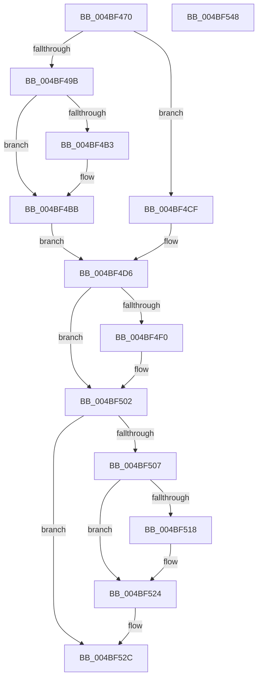

# HalpDmaControllerReadDmaCounter

- RVA: `0x004BF470`–`0x004BF549` (길이 `217` bytes)
- VA: `0x00000001404BF470`
- 실행 섹션: `.text`
- PDB 이름 있음: `예`; PDB Function 태그: `아니요`
- unwind 정보 RVA: `0x00060300`
- 디코드: `58`개 명령, `217/217` bytes 표시
- 미해석 바이트: `0` (있으면 어셈블리에 `.byte`로 보존)

> 이 문서는 커널 이미지의 기계어와 PDB 기호를 분석해 생성했습니다. 4번과 5번은 함수 원형과 자료형을 바이너리 사용 방식에서 추정한 C 해석이며 원본 소스 복구 결과는 아닙니다.

## 1. Dependencies

- 직접 호출 지점: **5**; 고유 호출 대상: **5**
- 직접 호출자로 확인된 함수: **1**
- RIP 상대 이미지 참조: **1**

### Outgoing calls
- `0x004BF4B6` → [KiRaiseIrqlProcessIrqlFlags](../4F/KiRaiseIrqlProcessIrqlFlags_function_004F56FC.md) (function, `0x004F56FC`)
- `0x004BF4C5` → [KeAcquireSpinLockAtDpcLevel](../20/KeAcquireSpinLockAtDpcLevel_function_00208430.md) (function, `0x00208430`)
- `0x004BF4E4` → [guard_dispatch_icall](../6B/guard_dispatch_icall_function_006BAAD0.md) (function, `0x006BAAD0`)
- `0x004BF50A` → [KxReleaseSpinLock](../20/KxReleaseSpinLock_function_00206670.md) (function, `0x00206670`)
- `0x004BF51F` → [KiLowerIrqlProcessIrqlFlags](../4F/KiLowerIrqlProcessIrqlFlags_function_004F5698.md) (function, `0x004F5698`)

### Direct callers
- [HalReadDmaCounterV3](HalReadDmaCounterV3_function_004BF440.md) at `0x004BF463`

### Static image references
- `0x004BF4AA` → RVA `0x00FC6D20` (`ALMOSTRO`; read)

## 2. Other-region calls and transfers

- 다른 실행 섹션으로 향하는 call: **0**
- 별도 외부 분기/꼬리 이동을 확인하지 못했습니다.

## 3. Assembly (complete function range)

```asm
004BF470  48 89 5C 24 08                  mov qword ptr [rsp + 8], rbx
004BF475  48 89 6C 24 10                  mov qword ptr [rsp + 0x10], rbp
004BF47A  48 89 74 24 18                  mov qword ptr [rsp + 0x18], rsi
004BF47F  57                              push rdi
004BF480  41 56                           push r14
004BF482  41 57                           push r15
004BF484  48 83 EC 20                     sub rsp, 0x20
004BF488  44 8B FA                        mov r15d, edx
004BF48B  48 8B D9                        mov rbx, rcx
004BF48E  44 0F 20 C7                     mov rdi, cr8
004BF492  40 32 ED                        xor bpl, bpl
004BF495  40 80 FF 0F                     cmp dil, 0xf
004BF499  74 34                           je 0x1404bf4cf
004BF49B  0F B6 91 B0 00 00 00            movzx edx, byte ptr [rcx + 0xb0]
004BF4A2  44 0F 20 C7                     mov rdi, cr8
004BF4A6  44 0F 22 C2                     mov cr8, rdx
004BF4AA  83 3D 6F 78 B0 00 00            cmp dword ptr [rip + 0xb0786f], 0
004BF4B1  74 08                           je 0x1404bf4bb
004BF4B3  40 8A CF                        mov cl, dil
004BF4B6  E8 41 62 03 00                  call 0x1404f56fc
004BF4BB  48 8D B3 A8 00 00 00            lea rsi, [rbx + 0xa8]
004BF4C2  48 8B CE                        mov rcx, rsi
004BF4C5  E8 66 8F D4 FF                  call 0x140208430
004BF4CA  40 B5 01                        mov bpl, 1
004BF4CD  EB 07                           jmp 0x1404bf4d6
004BF4CF  48 8D B1 A8 00 00 00            lea rsi, [rcx + 0xa8]
004BF4D6  48 8B 83 88 00 00 00            mov rax, qword ptr [rbx + 0x88]
004BF4DD  41 8B D7                        mov edx, r15d
004BF4E0  48 8B 4B 40                     mov rcx, qword ptr [rbx + 0x40]
004BF4E4  E8 E7 B5 1F 00                  call 0x1406baad0
004BF4E9  44 8B F0                        mov r14d, eax
004BF4EC  85 C0                           test eax, eax
004BF4EE  75 12                           jne 0x1404bf502
004BF4F0  48 8B 53 38                     mov rdx, qword ptr [rbx + 0x38]
004BF4F4  4F 8D 04 BF                     lea r8, [r15 + r15*4]
004BF4F8  49 C1 E0 05                     shl r8, 5
004BF4FC  41 C6 44 10 06 01               mov byte ptr [r8 + rdx + 6], 1
004BF502  40 84 ED                        test bpl, bpl
004BF505  74 25                           je 0x1404bf52c
004BF507  48 8B CE                        mov rcx, rsi
004BF50A  E8 61 71 D4 FF                  call 0x140206670
004BF50F  83 3D 0A 78 B0 00 00            cmp dword ptr [rip + 0xb0780a], 0
004BF516  74 0C                           je 0x1404bf524
004BF518  44 0F 20 C1                     mov rcx, cr8
004BF51C  40 8A D7                        mov dl, dil
004BF51F  E8 74 61 03 00                  call 0x1404f5698
004BF524  40 0F B6 C7                     movzx eax, dil
004BF528  44 0F 22 C0                     mov cr8, rax
004BF52C  48 8B 5C 24 40                  mov rbx, qword ptr [rsp + 0x40]
004BF531  41 8B C6                        mov eax, r14d
004BF534  48 8B 6C 24 48                  mov rbp, qword ptr [rsp + 0x48]
004BF539  48 8B 74 24 50                  mov rsi, qword ptr [rsp + 0x50]
004BF53E  48 83 C4 20                     add rsp, 0x20
004BF542  41 5F                           pop r15
004BF544  41 5E                           pop r14
004BF546  5F                              pop rdi
004BF547  C3                              ret
004BF548  CC                              int3
```

## 4. C-style interpretation (structured pseudocode)

```c
__int64 __fastcall HalpDmaControllerReadDmaCounter(__int64 a1, int a2)
{
    __int64 result;
    __int64 v_rbp;
    __int64 v_rsp;
    unsigned __int64 v_stack_p10;
    unsigned __int64 v_stack_p18;
    unsigned __int64 v_stack_p8;

    v_stack_p8 = v_rbx;
    v_stack_p10 = v_rbp;
    v_stack_p18 = v_rsi;
    v_rsp = (v_rsp) - (32);
    v_rbp = 0;
    if (((unsigned __int8)(v_cr8)) == 15) goto loc_004BF4CF;
    if ((*(unsigned int *)(v_rip + 11565167)) != 0) {
        a1 = (unsigned __int8)(v_cr8);
        result = KiRaiseIrqlProcessIrqlFlags(a1, *(unsigned __int8 *)(a1 + 176), a3, a4);
    }
    result = KeAcquireSpinLockAtDpcLevel(a1 + 168, *(unsigned __int8 *)(a1 + 176), a3, a4);
    goto loc_004BF4D6;
loc_004BF4CF:
loc_004BF4D6:
    result = guard_dispatch_icall(*(unsigned __int64 *)(a1 + 64), (unsigned int)((unsigned int)((unsigned int)(a2))), a3, a4);
    if ((unsigned int)(result) == 0) {
        a2 = *(unsigned __int64 *)(a1 + 56);
        a3 = (unsigned int)(a2) + (unsigned int)(a2) * 4;
        a3 = (a3) << (5);
        *(unsigned __int8 *)(a3 + a2 * 1 + 6) = 1;
    }
    if (1 == 0) goto loc_004BF52C;
    result = KxReleaseSpinLock(a1 + 168 + 168, a2, a3, a4);
    if ((*(unsigned int *)(v_rip + 11565066)) != 0) {
        a1 = *(unsigned __int8 *)(a1 + 176);
        a2 = (unsigned __int8)(v_cr8);
        result = KiLowerIrqlProcessIrqlFlags(a1, a2, a3, a4);
    }
loc_004BF52C:
    v_rsp = (v_rsp) + (32);
    return (unsigned int)((unsigned int)((unsigned int)((unsigned int)(result))));
}
```

## 5. (Beta) C Style

```c
int64_t HalpDmaControllerReadDmaCounter(void *Arg1, void *Arg2)
{
    uint8_t *arg1 = (uint8_t *)Arg1;
    uint8_t *arg2 = (uint8_t *)Arg2;

    int64_t result;
    int64_t local_rbp;
    int64_t local_rsp;
    uint64_t v_stack_p10;
    uint64_t v_stack_p18;
    uint64_t v_stack_p8;

    v_stack_p8 = local_rbx;
    v_stack_p10 = local_rbp;
    v_stack_p18 = local_rsi;
    local_rsp = (local_rsp) - (32);
    local_rbp = 0;
    if (((uint8_t)(v_cr8)) == 15) goto loc_004BF4CF;
    if ((*(uint32_t *)(v_rip + 0xB0786F)) != 0) {
        Arg1 = (uint8_t)(v_cr8);
        result = KiRaiseIrqlProcessIrqlFlags(Arg1, *(uint8_t *)(arg1 + 0xB0), a3, a4);
    }
    result = KeAcquireSpinLockAtDpcLevel(Arg1 + 168, *(uint8_t *)(arg1 + 0xB0), a3, a4);
    goto loc_004BF4D6;
loc_004BF4CF:
loc_004BF4D6:
    result = guard_dispatch_icall(*(uint64_t *)(arg1 + 0x40), (uint32_t)((uint32_t)((uint32_t)(Arg2))), a3, a4);
    if ((uint32_t)(result) == 0) {
        Arg2 = *(uint64_t *)(arg1 + 0x38);
        a3 = (uint32_t)(Arg2) + (uint32_t)(Arg2) * 4;
        a3 = (a3) << (5);
        *(uint8_t *)(a3 + arg2 * 1 + 0x6) = 1;
    }
    if (1 == 0) goto loc_004BF52C;
    result = KxReleaseSpinLock(Arg1 + 168 + 168, Arg2, a3, a4);
    if ((*(uint32_t *)(v_rip + 0xB0780A)) != 0) {
        Arg1 = *(uint8_t *)(arg1 + 0xB0);
        Arg2 = (uint8_t)(v_cr8);
        result = KiLowerIrqlProcessIrqlFlags(Arg1, Arg2, a3, a4);
    }
loc_004BF52C:
    local_rsp = (local_rsp) + (32);
    return (uint32_t)((uint32_t)((uint32_t)((uint32_t)(result))));
}
```

### 관측된 메모리 오프셋

구조체 형식이 확인되지 않은 접근은 인자 기준의 오프셋으로만 기록했습니다.

| 기준 인자 | 오프셋 표현 | 폭 (bit) | 접근 |
|---|---:|---:|---|
| `Arg1` | `+ 0x38` | `64` | `R` |
| `Arg1` | `+ 0x40` | `64` | `R` |
| `Arg1` | `+ 0x88` | `64` | `R` |
| `Arg1` | `+ 0xA8` | `64` | `R` |
| `Arg1` | `+ 0xB0` | `8` | `R` |
| `Arg2` | `+ 0x0 + r15*4` | `64` | `R` |

## 6. Execution-region graph

[열기: 2D/3D 그래프와 함수 탐색 컨트롤 패널](../../../control-panel.html?section=text&rva=0x004BF470&view=graph)

- 2D 그래프는 위에서 아래로 흐르고, 3D 그래프는 빈 공간을 드래그해 회전합니다. Shift+드래그는 이동, 휠은 확대·축소, 함수 노드 선택은 대상 보고서 이동입니다.

### Static fallback


