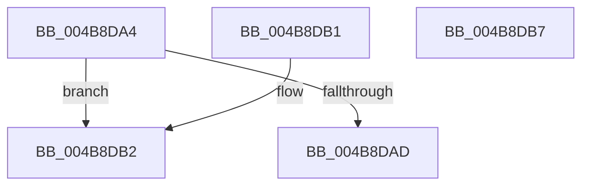

# HalpDmaExtractFromVerifierShadowAdapter

- RVA: `0x004B8DA4`–`0x004B8DB8` (길이 `20` bytes)
- VA: `0x00000001404B8DA4`
- 실행 섹션: `.text`
- PDB 이름 있음: `예`; PDB Function 태그: `아니요`
- unwind 정보 RVA: `0x000DB714`
- 디코드: `8`개 명령, `20/20` bytes 표시
- 미해석 바이트: `0` (있으면 어셈블리에 `.byte`로 보존)

> 이 문서는 커널 이미지의 기계어와 PDB 기호를 분석해 생성했습니다. 4번과 5번은 함수 원형과 자료형을 바이너리 사용 방식에서 추정한 C 해석이며 원본 소스 복구 결과는 아닙니다.

## 1. Dependencies

- 직접 호출 지점: **0**; 고유 호출 대상: **0**
- 직접 호출자로 확인된 함수: **5**
- RIP 상대 이미지 참조: **0**

### Outgoing calls
- 직접 디코드된 call 명령이 없습니다.

### Direct callers
- [HalDmaFreeCrashDumpRegistersEx](HalDmaFreeCrashDumpRegistersEx_function_004B8CE0.md) at `0x004B8CE4`
- [HalAllocateAdapterChannel](../53/HalAllocateAdapterChannel_function_0053F310.md) at `0x0053F31C`
- [HalAllocateCrashDumpRegisters](../53/HalAllocateCrashDumpRegisters_function_0053F5D0.md) at `0x0053F5E2`
- [HalDmaAllocateCrashDumpRegistersEx](../53/HalDmaAllocateCrashDumpRegistersEx_function_0053F6D0.md) at `0x0053F719`
- [HalpAllocateMapRegisters](../../page/70/HalpAllocateMapRegisters_function_00707640.md) at `0x00707665`

### Static image references
- 디코드된 RIP-relative 메모리 참조가 없습니다.

## 2. Other-region calls and transfers

- 다른 실행 섹션으로 향하는 call: **0**
- 별도 외부 분기/꼬리 이동을 확인하지 못했습니다.

## 3. Assembly (complete function range)

```asm
004B8DA4  81 79 10 56 44 6D 61            cmp dword ptr [rcx + 0x10], 0x616d4456
004B8DAB  74 05                           je 0x1404b8db2
004B8DAD  48 8B C1                        mov rax, rcx
004B8DB0  C3                              ret
004B8DB1  CC                              int3
004B8DB2  48 8B 41 18                     mov rax, qword ptr [rcx + 0x18]
004B8DB6  C3                              ret
004B8DB7  CC                              int3
```

## 4. C-style interpretation (structured pseudocode)

```c
__int64 __fastcall HalpDmaExtractFromVerifierShadowAdapter(__int64 a1)
{
    if ((*(unsigned int *)(a1 + 16)) == 0x616D4456ULL) goto loc_004B8DB2;
    return a1;
loc_004B8DB2:
    return *(unsigned __int64 *)(a1 + 24);
}
```

## 5. (Beta) C Style

```c
void *HalpDmaExtractFromVerifierShadowAdapter(void *Arg1)
{
    uint8_t *arg1 = (uint8_t *)Arg1;

    if ((*(uint32_t *)(arg1 + 0x10)) == 0x616D4456ULL) goto loc_004B8DB2;
    return Arg1;
loc_004B8DB2:
    return *(uint64_t *)(arg1 + 0x18);
}
```

### 관측된 메모리 오프셋

구조체 형식이 확인되지 않은 접근은 인자 기준의 오프셋으로만 기록했습니다.

| 기준 인자 | 오프셋 표현 | 폭 (bit) | 접근 |
|---|---:|---:|---|
| `Arg1` | `+ 0x10` | `32` | `R` |
| `Arg1` | `+ 0x18` | `64` | `R` |

## 6. Execution-region graph

[열기: 2D/3D 그래프와 함수 탐색 컨트롤 패널](../../../control-panel.html?section=text&rva=0x004B8DA4&view=graph)

- 2D 그래프는 위에서 아래로 흐르고, 3D 그래프는 빈 공간을 드래그해 회전합니다. Shift+드래그는 이동, 휠은 확대·축소, 함수 노드 선택은 대상 보고서 이동입니다.

### Static fallback


