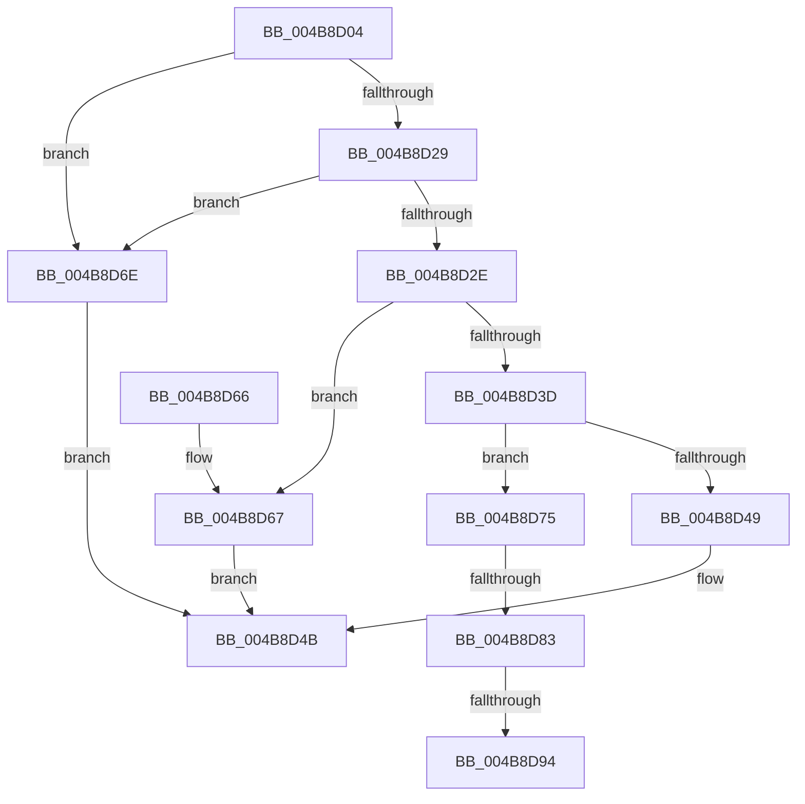

# HalpDmaFreeCrashdumpRegistersInternal

- RVA: `0x004B8D04`–`0x004B8D9D` (길이 `153` bytes)
- VA: `0x00000001404B8D04`
- 실행 섹션: `.text`
- PDB 이름 있음: `예`; PDB Function 태그: `예`
- unwind 정보 RVA: `0x00065004`
- 디코드: `40`개 명령, `153/153` bytes 표시
- 미해석 바이트: `0` (있으면 어셈블리에 `.byte`로 보존)

> 이 문서는 커널 이미지의 기계어와 PDB 기호를 분석해 생성했습니다. 4번과 5번은 함수 원형과 자료형을 바이너리 사용 방식에서 추정한 C 해석이며 원본 소스 복구 결과는 아닙니다.

## 1. Dependencies

- 직접 호출 지점: **0**; 고유 호출 대상: **0**
- 직접 호출자로 확인된 함수: **2**
- RIP 상대 이미지 참조: **0**

### Outgoing calls
- 직접 디코드된 call 명령이 없습니다.

### Direct callers
- [HalDmaFreeCrashDumpRegistersEx](HalDmaFreeCrashDumpRegistersEx_function_004B8CE0.md) at `0x004B8CF2`
- [HalpDmaFreeChildAdapter](../55/HalpDmaFreeChildAdapter_function_00550E30.md) at `0x00550EBE`

### Static image references
- 디코드된 RIP-relative 메모리 참조가 없습니다.

## 2. Other-region calls and transfers

- 다른 실행 섹션으로 향하는 call: **0**
- call이 아닌 외부 분기/꼬리 이동: **3**
  - `0x004B8D7D` → [sub_006FC1F6 + 0x6F](../6F/Unknown_function_006FC1F6.md) (`tail-transfer`)
  - `0x004B8D8E` → [sub_006FC1F6](../6F/Unknown_function_006FC1F6.md) (`tail-transfer`)
  - `0x004B8D98` → [sub_006FC1F6](../6F/Unknown_function_006FC1F6.md) (`tail-transfer`)

## 3. Assembly (complete function range)

```asm
004B8D04  48 8B C4                        mov rax, rsp
004B8D07  48 89 58 08                     mov qword ptr [rax + 8], rbx
004B8D0B  48 89 68 10                     mov qword ptr [rax + 0x10], rbp
004B8D0F  48 89 70 18                     mov qword ptr [rax + 0x18], rsi
004B8D13  48 89 78 20                     mov qword ptr [rax + 0x20], rdi
004B8D17  41 56                           push r14
004B8D19  48 83 EC 20                     sub rsp, 0x20
004B8D1D  48 8B F1                        mov rsi, rcx
004B8D20  45 0F 20 C6                     mov r14, cr8
004B8D24  48 85 C9                        test rcx, rcx
004B8D27  74 45                           je 0x1404b8d6e
004B8D29  83 FA 01                        cmp edx, 1
004B8D2C  77 40                           ja 0x1404b8d6e
004B8D2E  48 63 EA                        movsxd rbp, edx
004B8D31  8B 84 A9 18 01 00 00            mov eax, dword ptr [rcx + rbp*4 + 0x118]
004B8D38  41 3B C0                        cmp eax, r8d
004B8D3B  72 2A                           jb 0x1404b8d67
004B8D3D  41 2B C0                        sub eax, r8d
004B8D40  89 84 A9 18 01 00 00            mov dword ptr [rcx + rbp*4 + 0x118], eax
004B8D47  74 2C                           je 0x1404b8d75
004B8D49  33 C0                           xor eax, eax
004B8D4B  48 8B 5C 24 30                  mov rbx, qword ptr [rsp + 0x30]
004B8D50  48 8B 6C 24 38                  mov rbp, qword ptr [rsp + 0x38]
004B8D55  48 8B 74 24 40                  mov rsi, qword ptr [rsp + 0x40]
004B8D5A  48 8B 7C 24 48                  mov rdi, qword ptr [rsp + 0x48]
004B8D5F  48 83 C4 20                     add rsp, 0x20
004B8D63  41 5E                           pop r14
004B8D65  C3                              ret
004B8D66  CC                              int3
004B8D67  B8 01 00 00 C0                  mov eax, 0xc0000001
004B8D6C  EB DD                           jmp 0x1404b8d4b
004B8D6E  B8 0D 00 00 C0                  mov eax, 0xc000000d
004B8D73  EB D6                           jmp 0x1404b8d4b
004B8D75  83 BC A9 10 01 00 00 00         cmp dword ptr [rcx + rbp*4 + 0x110], 0
004B8D7D  0F 84 E2 34 24 00               je 0x1406fc265
004B8D83  48 8B 84 E9 00 01 00 00         mov rax, qword ptr [rcx + rbp*8 + 0x100]
004B8D8B  48 85 C0                        test rax, rax
004B8D8E  0F 84 62 34 24 00               je 0x1406fc1f6
004B8D94  48 89 40 38                     mov qword ptr [rax + 0x38], rax
004B8D98  E9 59 34 24 00                  jmp 0x1406fc1f6
```

## 4. C-style interpretation (structured pseudocode)

```c
__int64 __fastcall HalpDmaFreeCrashdumpRegistersInternal(__int64 a1, int a2, int a3)
{
    __int64 result;
    __int64 v_rsp;
    unsigned __int64 v_stack_p10;
    unsigned __int64 v_stack_p18;
    unsigned __int64 v_stack_p20;
    unsigned __int64 v_stack_p8;

    *(unsigned __int64 *)(v_rsp + 8) = v_rbx;
    *(unsigned __int64 *)(v_rsp + 16) = v_rbp;
    *(unsigned __int64 *)(v_rsp + 24) = v_rsi;
    *(unsigned __int64 *)(v_rsp + 32) = v_rdi;
    v_rsp = (v_rsp) - (32);
    if (a1 == 0) goto loc_004B8D6E;
    if (a2 > 1) goto loc_004B8D6E;
    if (((unsigned int)((unsigned int)(*(unsigned int *)(a1 + (int)(a2) * 4 + 280)))) < a3) goto loc_004B8D67;
    result = (unsigned int)(((unsigned int)(*(unsigned int *)(a1 + (int)(a2) * 4 + 280))) - (a3));
    *(unsigned int *)(a1 + (int)(a2) * 4 + 280) = (unsigned int)(result);
    if (condition_is_equal) goto loc_004B8D75;
    result = 0;
loc_004B8D4B:
    v_rsp = (v_rsp) + (32);
    return result;
loc_004B8D67:
    goto loc_004B8D4B;
loc_004B8D6E:
    goto loc_004B8D4B;
loc_004B8D75:
    *(unsigned __int64 *)(*(unsigned __int64 *)(a1 + v_stack_p10 * 8 + 256) + 56) = *(unsigned __int64 *)(a1 + v_stack_p10 * 8 + 256);
}
```

## 5. (Beta) C Style

```c
int64_t HalpDmaFreeCrashdumpRegistersInternal(int64_t Arg1, int32_t Arg2, int32_t Arg3)
{
    int64_t result;
    int64_t local_rsp;
    uint64_t v_stack_p10;
    uint64_t v_stack_p18;
    uint64_t v_stack_p20;
    uint64_t v_stack_p8;

    *(uint64_t *)(local_rsp + 0x8) = local_rbx;
    *(uint64_t *)(local_rsp + 0x10) = local_rbp;
    *(uint64_t *)(local_rsp + 0x18) = local_rsi;
    *(uint64_t *)(local_rsp + 0x20) = local_rdi;
    local_rsp = (local_rsp) - (32);
    if (Arg1 == 0) goto loc_004B8D6E;
    if (Arg2 > 1) goto loc_004B8D6E;
    if (((uint32_t)((uint32_t)(*(uint32_t *)(Arg1 + (int32_t)(Arg2) * 4 + 0x118)))) < Arg3) goto loc_004B8D67;
    result = (uint32_t)(((uint32_t)(*(uint32_t *)(Arg1 + (int32_t)(Arg2) * 4 + 0x118))) - (Arg3));
    *(uint32_t *)(Arg1 + (int32_t)(Arg2) * 4 + 0x118) = (uint32_t)(result);
    if (condition_is_equal) goto loc_004B8D75;
    result = 0;
loc_004B8D4B:
    local_rsp = (local_rsp) + (32);
    return result;
loc_004B8D67:
    goto loc_004B8D4B;
loc_004B8D6E:
    goto loc_004B8D4B;
loc_004B8D75:
    *(uint64_t *)(*(uint64_t *)(Arg1 + v_stack_p10 * 8 + 0x100) + 0x38) = *(uint64_t *)(Arg1 + v_stack_p10 * 8 + 0x100);
}
```

## 6. Execution-region graph

[열기: 2D/3D 그래프와 함수 탐색 컨트롤 패널](../../../control-panel.html?section=text&rva=0x004B8D04&view=graph)

- 2D 그래프는 위에서 아래로 흐르고, 3D 그래프는 빈 공간을 드래그해 회전합니다. Shift+드래그는 이동, 휠은 확대·축소, 함수 노드 선택은 대상 보고서 이동입니다.

### Static fallback


