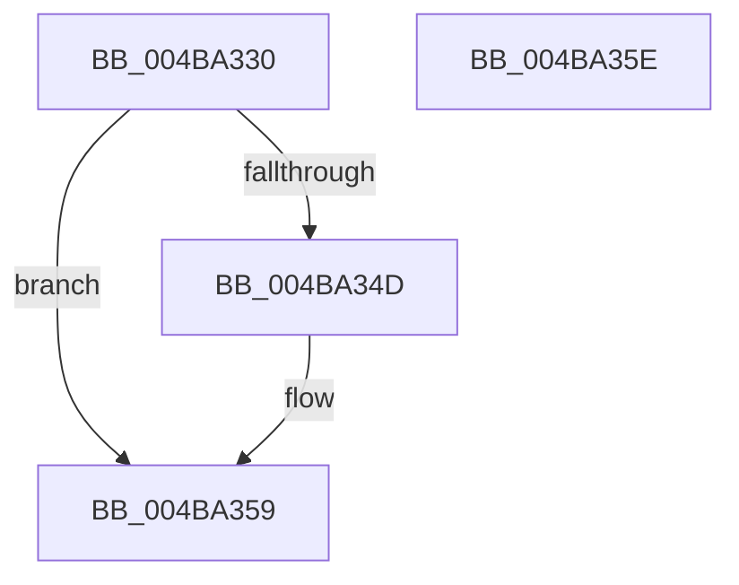

# HalpGenericPolledDpcRoutine

- RVA: `0x004BA330`–`0x004BA35F` (길이 `47` bytes)
- VA: `0x00000001404BA330`
- 실행 섹션: `.text`
- PDB 이름 있음: `예`; PDB Function 태그: `아니요`
- unwind 정보 RVA: `0x0005C788`
- 디코드: `13`개 명령, `47/47` bytes 표시
- 미해석 바이트: `0` (있으면 어셈블리에 `.byte`로 보존)

> 이 문서는 커널 이미지의 기계어와 PDB 기호를 분석해 생성했습니다. 4번과 5번은 함수 원형과 자료형을 바이너리 사용 방식에서 추정한 C 해석이며 원본 소스 복구 결과는 아닙니다.

## 1. Dependencies

- 직접 호출 지점: **1**; 고유 호출 대상: **1**
- 직접 호출자로 확인된 함수: **0**
- RIP 상대 이미지 참조: **0**

### Outgoing calls
- `0x004BA354` → [ExQueueWorkItem](../2F/ExQueueWorkItem_function_002F9520.md) (function, `0x002F9520`)

### Direct callers
- 이 함수 시작 RVA로 연결되는 직접 call은 확인되지 않았습니다. 간접 호출은 완전히 역산할 수 없습니다.

### Static image references
- 디코드된 RIP-relative 메모리 참조가 없습니다.

## 2. Other-region calls and transfers

- 다른 실행 섹션으로 향하는 call: **0**
- 별도 외부 분기/꼬리 이동을 확인하지 못했습니다.

## 3. Assembly (complete function range)

```asm
004BA330  48 83 EC 28                     sub rsp, 0x28
004BA334  41 B8 01 00 00 00               mov r8d, 1
004BA33A  41 8B C0                        mov eax, r8d
004BA33D  F0 0F C1 82 F0 00 00 00         lock xadd dword ptr [rdx + 0xf0], eax
004BA345  41 03 C0                        add eax, r8d
004BA348  41 3B C0                        cmp eax, r8d
004BA34B  75 0C                           jne 0x1404ba359
004BA34D  48 8D 4A 50                     lea rcx, [rdx + 0x50]
004BA351  41 8B D0                        mov edx, r8d
004BA354  E8 C7 F1 E3 FF                  call 0x1402f9520
004BA359  48 83 C4 28                     add rsp, 0x28
004BA35D  C3                              ret
004BA35E  CC                              int3
```

## 4. C-style interpretation (structured pseudocode)

```c
__int64 __fastcall HalpGenericPolledDpcRoutine(__int64 a1, __int64 a2)
{
    __int64 result;
    __int64 v_rsp;

    v_rsp = (v_rsp) - (40);
    result = (unsigned int)((1) + (1));
    if (((unsigned int)(result)) == 1) {
        a1 = a2 + 80;
        a2 = 1;
        result = ExQueueWorkItem(a1, a2, 1, a4);
    }
    v_rsp = (v_rsp) + (40);
    return result;
}
```

## 5. (Beta) C Style

```c
int64_t HalpGenericPolledDpcRoutine(int64_t Arg1, void *Arg2)
{
    uint8_t *arg2 = (uint8_t *)Arg2;

    int64_t result;
    int64_t local_rsp;

    local_rsp = (local_rsp) - (40);
    result = (uint32_t)((1) + (1));
    if (((uint32_t)(result)) == 1) {
        Arg1 = Arg2 + 80;
        Arg2 = 1;
        result = ExQueueWorkItem(Arg1, Arg2, 1, a4);
    }
    local_rsp = (local_rsp) + (40);
    return result;
}
```

### 관측된 메모리 오프셋

구조체 형식이 확인되지 않은 접근은 인자 기준의 오프셋으로만 기록했습니다.

| 기준 인자 | 오프셋 표현 | 폭 (bit) | 접근 |
|---|---:|---:|---|
| `Arg2` | `+ 0x50` | `64` | `R` |
| `Arg2` | `+ 0xF0` | `32` | `R/W` |

## 6. Execution-region graph

[열기: 2D/3D 그래프와 함수 탐색 컨트롤 패널](../../../control-panel.html?section=text&rva=0x004BA330&view=graph)

- 2D 그래프는 위에서 아래로 흐르고, 3D 그래프는 빈 공간을 드래그해 회전합니다. Shift+드래그는 이동, 휠은 확대·축소, 함수 노드 선택은 대상 보고서 이동입니다.

### Static fallback


