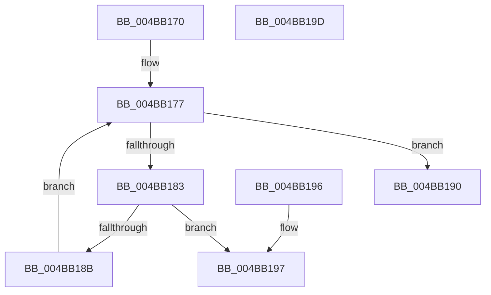

# HalpGetProfileDescriptor

- RVA: `0x004BB170`–`0x004BB19E` (길이 `46` bytes)
- VA: `0x00000001404BB170`
- 실행 섹션: `.text`
- PDB 이름 있음: `예`; PDB Function 태그: `아니요`
- unwind 정보 RVA: `0x000DB714`
- 디코드: `16`개 명령, `46/46` bytes 표시
- 미해석 바이트: `0` (있으면 어셈블리에 `.byte`로 보존)

> 이 문서는 커널 이미지의 기계어와 PDB 기호를 분석해 생성했습니다. 4번과 5번은 함수 원형과 자료형을 바이너리 사용 방식에서 추정한 C 해석이며 원본 소스 복구 결과는 아닙니다.

## 1. Dependencies

- 직접 호출 지점: **0**; 고유 호출 대상: **0**
- 직접 호출자로 확인된 함수: **8**
- RIP 상대 이미지 참조: **1**

### Outgoing calls
- 직접 디코드된 call 명령이 없습니다.

### Direct callers
- [HalpQueryProfileSource](../4C/HalpQueryProfileSource_function_004C6DBC.md) at `0x004C6E01`
- [HalpRemoveProfileSourceFromList](../54/HalpRemoveProfileSourceFromList_function_005477B8.md) at `0x005477D9`
- [EmonEnableMonitoringEnhanced](../55/EmonEnableMonitoringEnhanced_function_0055C8E0.md) at `0x0055C92A`
- [EmonEnableMonitoringEnhanced](../55/EmonEnableMonitoringEnhanced_function_0055C8E0.md) at `0x0055C954`
- [EmonEnableMonitoringOriginal](../55/EmonEnableMonitoringOriginal_function_0055CA40.md) at `0x0055CA8A`
- [EmonEnableMonitoringOriginal](../55/EmonEnableMonitoringOriginal_function_0055CA40.md) at `0x0055CAB4`
- [EmonSetIntervalEnhanced](../55/EmonSetIntervalEnhanced_function_0055FDB0.md) at `0x0055FDE0`
- [EmonSetIntervalOriginal](../55/EmonSetIntervalOriginal_function_0055FFB0.md) at `0x0055FFE0`
- [Amd64EnableMonitoring](../56/Amd64EnableMonitoring_function_0056C360.md) at `0x0056C3AA`
- [Amd64SetInterval](../56/Amd64SetInterval_function_0056DB50.md) at `0x0056DB80`

### Static image references
- `0x004BB170` → RVA `0x00FC2C40` (`.data`; read)

## 2. Other-region calls and transfers

- 다른 실행 섹션으로 향하는 call: **0**
- 별도 외부 분기/꼬리 이동을 확인하지 못했습니다.

## 3. Assembly (complete function range)

```asm
004BB170  48 8B 05 C9 7A B0 00            mov rax, qword ptr [rip + 0xb07ac9]
004BB177  48 8D 15 C2 7A B0 00            lea rdx, [rip + 0xb07ac2]
004BB17E  48 3B C2                        cmp rax, rdx
004BB181  74 0D                           je 0x1404bb190
004BB183  48 8D 50 F8                     lea rdx, [rax - 8]
004BB187  39 0A                           cmp dword ptr [rdx], ecx
004BB189  74 0C                           je 0x1404bb197
004BB18B  48 8B 00                        mov rax, qword ptr [rax]
004BB18E  EB E7                           jmp 0x1404bb177
004BB190  B8 BB 00 00 C0                  mov eax, 0xc00000bb
004BB195  C3                              ret
004BB196  CC                              int3
004BB197  49 89 10                        mov qword ptr [r8], rdx
004BB19A  33 C0                           xor eax, eax
004BB19C  C3                              ret
004BB19D  CC                              int3
```

## 4. C-style interpretation (structured pseudocode)

```c
__int64 __fastcall HalpGetProfileDescriptor(int a1, __int64 a2, __int64 a3)
{
    __int64 result;

loc_004BB177:
    if ((*(unsigned __int64 *)(v_rip + 11565769)) == (v_rip + 11565762)) goto loc_004BB190;
    if ((*(unsigned int *)(*(unsigned __int64 *)(v_rip + 11565769) - 8)) == a1) goto loc_004BB197;
    goto loc_004BB177;
loc_004BB190:
    return (unsigned int)(0xC00000BBULL);
loc_004BB197:
    *(unsigned __int64 *)(a3) = *(unsigned __int64 *)(v_rip + 11565769) - 8;
    result = 0;
    return result;
}
```

## 5. (Beta) C Style

```c
int64_t HalpGetProfileDescriptor(int32_t Arg1, int64_t Arg2, void *Arg3)
{
    uint8_t *arg3 = (uint8_t *)Arg3;

    int64_t result;

loc_004BB177:
    if ((*(uint64_t *)(v_rip + 0xB07AC9)) == (v_rip + 11565762)) goto loc_004BB190;
    if ((*(uint32_t *)(*(uint64_t *)(v_rip + 0xB07AC9) - 0x8)) == Arg1) goto loc_004BB197;
    goto loc_004BB177;
loc_004BB190:
    return (uint32_t)(0xC00000BBULL);
loc_004BB197:
    *(uint64_t *)(arg3) = *(uint64_t *)(v_rip + 0xB07AC9) - 8;
    result = 0;
    return result;
}
```

### 관측된 메모리 오프셋

구조체 형식이 확인되지 않은 접근은 인자 기준의 오프셋으로만 기록했습니다.

| 기준 인자 | 오프셋 표현 | 폭 (bit) | 접근 |
|---|---:|---:|---|
| `Arg3` | `+ 0x0` | `64` | `W` |

## 6. Execution-region graph

[열기: 2D/3D 그래프와 함수 탐색 컨트롤 패널](../../../control-panel.html?section=text&rva=0x004BB170&view=graph)

- 2D 그래프는 위에서 아래로 흐르고, 3D 그래프는 빈 공간을 드래그해 회전합니다. Shift+드래그는 이동, 휠은 확대·축소, 함수 노드 선택은 대상 보고서 이동입니다.

### Static fallback


