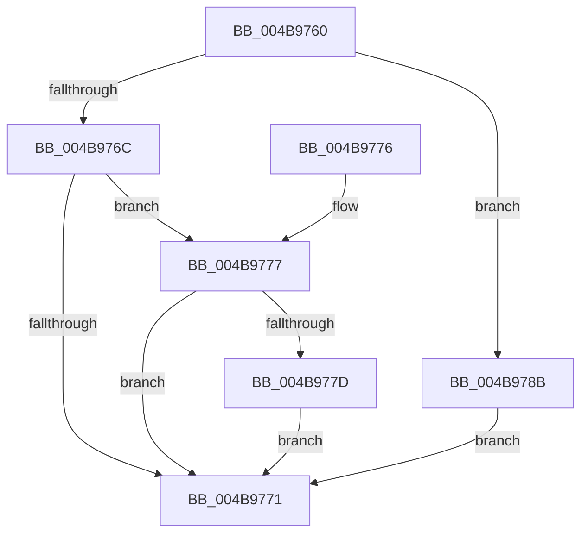

# HalpHpetAcknowledgeInterrupt

- RVA: `0x004B9760`–`0x004B9798` (길이 `56` bytes)
- VA: `0x00000001404B9760`
- 실행 섹션: `.text`
- PDB 이름 있음: `예`; PDB Function 태그: `아니요`
- unwind 정보 RVA: `0x00073864`
- 디코드: `19`개 명령, `56/56` bytes 표시
- 미해석 바이트: `0` (있으면 어셈블리에 `.byte`로 보존)

> 이 문서는 커널 이미지의 기계어와 PDB 기호를 분석해 생성했습니다. 4번과 5번은 함수 원형과 자료형을 바이너리 사용 방식에서 추정한 C 해석이며 원본 소스 복구 결과는 아닙니다.

## 1. Dependencies

- 직접 호출 지점: **2**; 고유 호출 대상: **2**
- 직접 호출자로 확인된 함수: **0**
- RIP 상대 이미지 참조: **0**

### Outgoing calls
- `0x004B9784` → [HalSetTimerProblem](../4F/HalSetTimerProblem_function_004FC9A0.md) (function, `0x004FC9A0`)
- `0x004B9791` → [HalpHpetSetMatchValue](../4A/HalpHpetSetMatchValue_function_004AC60C.md) (function, `0x004AC60C`)

### Direct callers
- 이 함수 시작 RVA로 연결되는 직접 call은 확인되지 않았습니다. 간접 호출은 완전히 역산할 수 없습니다.

### Static image references
- 디코드된 RIP-relative 메모리 참조가 없습니다.

## 2. Other-region calls and transfers

- 다른 실행 섹션으로 향하는 call: **0**
- 별도 외부 분기/꼬리 이동을 확인하지 못했습니다.

## 3. Assembly (complete function range)

```asm
004B9760  48 83 EC 28                     sub rsp, 0x28
004B9764  8B 51 08                        mov edx, dword ptr [rcx + 8]
004B9767  83 EA 01                        sub edx, 1
004B976A  74 1F                           je 0x1404b978b
004B976C  83 FA 01                        cmp edx, 1
004B976F  74 06                           je 0x1404b9777
004B9771  48 83 C4 28                     add rsp, 0x28
004B9775  C3                              ret
004B9776  CC                              int3
004B9777  80 79 0C 00                     cmp byte ptr [rcx + 0xc], 0
004B977B  75 F4                           jne 0x1404b9771
004B977D  45 33 C0                        xor r8d, r8d
004B9780  41 8D 50 02                     lea edx, [r8 + 2]
004B9784  E8 17 32 04 00                  call 0x1404fc9a0
004B9789  EB E6                           jmp 0x1404b9771
004B978B  8B 51 14                        mov edx, dword ptr [rcx + 0x14]
004B978E  41 B0 01                        mov r8b, 1
004B9791  E8 76 2E FF FF                  call 0x1404ac60c
004B9796  EB D9                           jmp 0x1404b9771
```

## 4. C-style interpretation (structured pseudocode)

```c
__int64 __fastcall HalpHpetAcknowledgeInterrupt(__int64 a1, __int64 a2, int a3)
{
    __int64 result;
    __int64 v_rsp;

    v_rsp = (v_rsp) - (40);
    a2 = (unsigned int)(((unsigned int)(*(unsigned int *)(a1 + 8))) - (1));
    if (condition_is_equal) goto loc_004B978B;
    if (((unsigned int)(a2)) == 1) goto loc_004B9777;
loc_004B9771:
    v_rsp = (v_rsp) + (40);
    return result;
loc_004B9777:
    if ((*(unsigned __int8 *)(a1 + 12)) != 0) goto loc_004B9771;
    a3 = 0;
    result = HalSetTimerProblem(a1, a3 + 2, a3, a4);
    goto loc_004B9771;
loc_004B978B:
    result = HalpHpetSetMatchValue(a1, (unsigned int)(*(unsigned int *)(a1 + 20)), 1, a4);
    goto loc_004B9771;
}
```

## 5. (Beta) C Style

```c
int64_t HalpHpetAcknowledgeInterrupt(void *Arg1, int64_t Arg2, int32_t Arg3)
{
    uint8_t *arg1 = (uint8_t *)Arg1;

    int64_t result;
    int64_t local_rsp;

    local_rsp = (local_rsp) - (40);
    Arg2 = (uint32_t)(((uint32_t)(*(uint32_t *)(arg1 + 0x8))) - (1));
    if (condition_is_equal) goto loc_004B978B;
    if (((uint32_t)(Arg2)) == 1) goto loc_004B9777;
loc_004B9771:
    local_rsp = (local_rsp) + (40);
    return result;
loc_004B9777:
    if ((*(uint8_t *)(arg1 + 0xC)) != 0) goto loc_004B9771;
    Arg3 = 0;
    result = HalSetTimerProblem(Arg1, Arg3 + 2, Arg3, a4);
    goto loc_004B9771;
loc_004B978B:
    result = HalpHpetSetMatchValue(Arg1, (uint32_t)(*(uint32_t *)(arg1 + 0x14)), 1, a4);
    goto loc_004B9771;
}
```

### 관측된 메모리 오프셋

구조체 형식이 확인되지 않은 접근은 인자 기준의 오프셋으로만 기록했습니다.

| 기준 인자 | 오프셋 표현 | 폭 (bit) | 접근 |
|---|---:|---:|---|
| `Arg1` | `+ 0x8` | `32` | `R` |
| `Arg1` | `+ 0xC` | `8` | `R` |
| `Arg1` | `+ 0x14` | `32` | `R` |

## 6. Execution-region graph

[열기: 2D/3D 그래프와 함수 탐색 컨트롤 패널](../../../control-panel.html?section=text&rva=0x004B9760&view=graph)

- 2D 그래프는 위에서 아래로 흐르고, 3D 그래프는 빈 공간을 드래그해 회전합니다. Shift+드래그는 이동, 휠은 확대·축소, 함수 노드 선택은 대상 보고서 이동입니다.

### Static fallback


