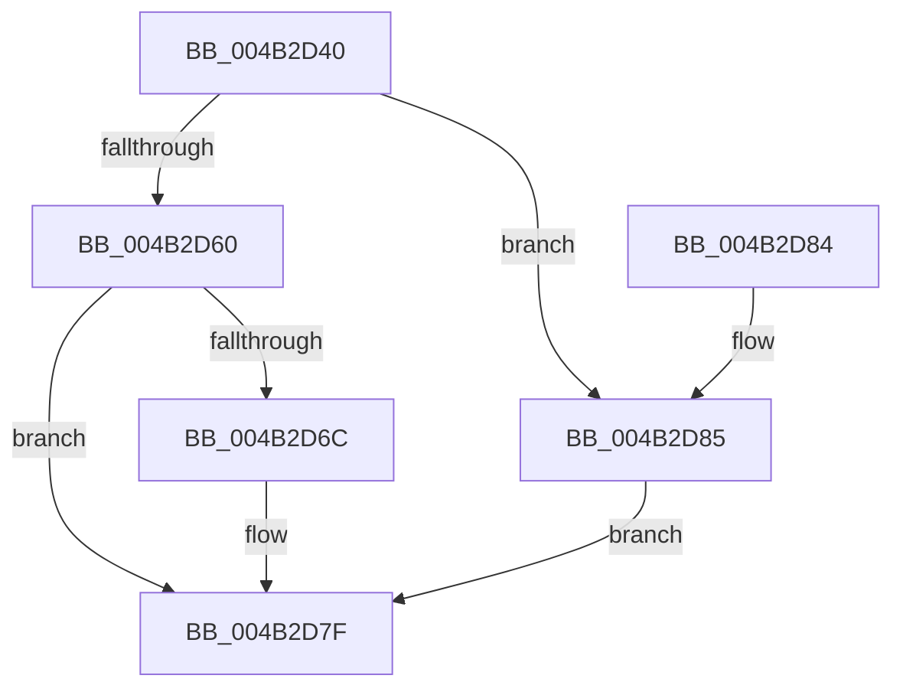

# HalpHvEpWriteMsr

- RVA: `0x004B2D40`–`0x004B2D96` (길이 `86` bytes)
- VA: `0x00000001404B2D40`
- 실행 섹션: `.text`
- PDB 이름 있음: `예`; PDB Function 태그: `아니요`
- unwind 정보 RVA: `0x000B96A8`
- 디코드: `25`개 명령, `86/86` bytes 표시
- 미해석 바이트: `0` (있으면 어셈블리에 `.byte`로 보존)

> 이 문서는 커널 이미지의 기계어와 PDB 기호를 분석해 생성했습니다. 4번과 5번은 함수 원형과 자료형을 바이너리 사용 방식에서 추정한 C 해석이며 원본 소스 복구 결과는 아닙니다.

## 1. Dependencies

- 직접 호출 지점: **1**; 고유 호출 대상: **1**
- 직접 호출자로 확인된 함수: **0**
- RIP 상대 이미지 참조: **1**

### Outgoing calls
- `0x004B2D7A` → [guard_dispatch_icall](../6B/guard_dispatch_icall_function_006BAAD0.md) (function, `0x006BAAD0`)

### Direct callers
- 이 함수 시작 RVA로 연결되는 직접 call은 확인되지 않았습니다. 간접 호출은 완전히 역산할 수 없습니다.

### Static image references
- `0x004B2D60` → RVA `0x00FC1CE0` (`.data`; read)

## 2. Other-region calls and transfers

- 다른 실행 섹션으로 향하는 call: **0**
- 별도 외부 분기/꼬리 이동을 확인하지 못했습니다.

## 3. Assembly (complete function range)

```asm
004B2D40  4C 89 44 24 18                  mov qword ptr [rsp + 0x18], r8
004B2D45  89 54 24 10                     mov dword ptr [rsp + 0x10], edx
004B2D49  48 83 EC 38                     sub rsp, 0x38
004B2D4D  48 8B C1                        mov rax, rcx
004B2D50  44 8B CA                        mov r9d, edx
004B2D53  48 C1 E8 20                     shr rax, 0x20
004B2D57  BA 01 00 00 00                  mov edx, 1
004B2D5C  84 C2                           test dl, al
004B2D5E  75 25                           jne 0x1404b2d85
004B2D60  48 8B 05 79 EF B0 00            mov rax, qword ptr [rip + 0xb0ef79]
004B2D67  48 85 C0                        test rax, rax
004B2D6A  74 13                           je 0x1404b2d7f
004B2D6C  0F BA F1 1F                     btr ecx, 0x1f
004B2D70  4C 8D 4C 24 50                  lea r9, [rsp + 0x50]
004B2D75  4C 8D 44 24 48                  lea r8, [rsp + 0x48]
004B2D7A  E8 51 7D 20 00                  call 0x1406baad0
004B2D7F  48 83 C4 38                     add rsp, 0x38
004B2D83  C3                              ret
004B2D84  CC                              int3
004B2D85  49 8B D0                        mov rdx, r8
004B2D88  49 8B C0                        mov rax, r8
004B2D8B  48 C1 EA 20                     shr rdx, 0x20
004B2D8F  41 8B C9                        mov ecx, r9d
004B2D92  0F 30                           wrmsr
004B2D94  EB E9                           jmp 0x1404b2d7f
```

## 4. C-style interpretation (structured pseudocode)

```c
__int64 __fastcall HalpHvEpWriteMsr(__int64 a1, int a2, __int64 a3)
{
    __int64 result;
    __int64 v_rsp;
    unsigned int v_stack_p10;
    unsigned __int64 v_stack_p18;

    v_stack_p18 = a3;
    v_stack_p10 = a2;
    v_rsp = (v_rsp) - (56);
    result = (a1) >> (32);
    if (((1) & ((unsigned __int8)(result))) != 0) goto loc_004B2D85;
    result = *(unsigned __int64 *)(v_rip + 11595641);
    if (*(unsigned __int64 *)(v_rip + 11595641) != 0) {
        a4 = v_stack_p18;
        a3 = v_stack_p10;
        result = guard_dispatch_icall(a1, 1, a3, a4);
    }
    v_rsp = (v_rsp) + (56);
    return result;
loc_004B2D85:
    a2 = (a3) >> (32);
    goto loc_004B2D7F;
}
```

## 5. (Beta) C Style

```c
int64_t HalpHvEpWriteMsr(int64_t Arg1, int32_t Arg2, int64_t Arg3)
{
    int64_t result;
    int64_t local_rsp;
    uint32_t v_stack_p10;
    uint64_t v_stack_p18;

    v_stack_p18 = Arg3;
    v_stack_p10 = Arg2;
    local_rsp = (local_rsp) - (56);
    result = (Arg1) >> (32);
    if (((1) & ((uint8_t)(result))) != 0) goto loc_004B2D85;
    result = *(uint64_t *)(v_rip + 0xB0EF79);
    if (*(uint64_t *)(v_rip + 0xB0EF79) != 0) {
        a4 = v_stack_p18;
        Arg3 = v_stack_p10;
        result = guard_dispatch_icall(Arg1, 1, Arg3, a4);
    }
    local_rsp = (local_rsp) + (56);
    return result;
loc_004B2D85:
    Arg2 = (Arg3) >> (32);
    goto loc_004B2D7F;
}
```

## 6. Execution-region graph

[열기: 2D/3D 그래프와 함수 탐색 컨트롤 패널](../../../control-panel.html?section=text&rva=0x004B2D40&view=graph)

- 2D 그래프는 위에서 아래로 흐르고, 3D 그래프는 빈 공간을 드래그해 회전합니다. Shift+드래그는 이동, 휠은 확대·축소, 함수 노드 선택은 대상 보고서 이동입니다.

### Static fallback


