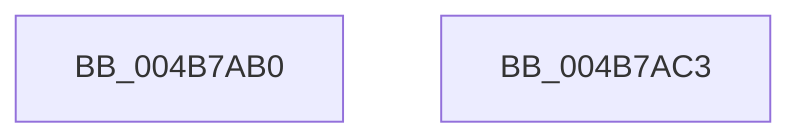

# HalpInterruptIsRemappingRequired

- RVA: `0x004B7AB0`–`0x004B7AC4` (길이 `20` bytes)
- VA: `0x00000001404B7AB0`
- 실행 섹션: `.text`
- PDB 이름 있음: `예`; PDB Function 태그: `아니요`
- unwind 정보 RVA: `0x000DB714`
- 디코드: `6`개 명령, `20/20` bytes 표시
- 미해석 바이트: `0` (있으면 어셈블리에 `.byte`로 보존)

> 이 문서는 커널 이미지의 기계어와 PDB 기호를 분석해 생성했습니다. 4번과 5번은 함수 원형과 자료형을 바이너리 사용 방식에서 추정한 C 해석이며 원본 소스 복구 결과는 아닙니다.

## 1. Dependencies

- 직접 호출 지점: **0**; 고유 호출 대상: **0**
- 직접 호출자로 확인된 함수: **5**
- RIP 상대 이미지 참조: **1**

### Outgoing calls
- 직접 디코드된 call 명령이 없습니다.

### Direct callers
- [HalpInterruptQueryControllerInfo](../../page/70/HalpInterruptQueryControllerInfo_function_00707310.md) at `0x0070734F`
- [HalpInterruptUnmap](../../page/70/HalpInterruptUnmap_function_00707408.md) at `0x007074A4`
- [HalpInterruptUnmap](../../page/70/HalpInterruptUnmap_function_00707408.md) at `0x007075C8`
- [HalpIommuInitSystem](../../pagelk/B5/HalpIommuInitSystem_function_00B5D7E0.md) at `0x00B5D95A`
- [HalpInterruptSwapProcessorIdentifiers](../../pagelk/B6/HalpInterruptSwapProcessorIdentifiers_function_00B60510.md) at `0x00B6058D`
- [HalpIommuInitializeAll](../../pagelk/B7/HalpIommuInitializeAll_function_00B7A684.md) at `0x00B7A8A1`

### Static image references
- `0x004B7AB0` → RVA `0x00E101F0` (`.data`; read)

## 2. Other-region calls and transfers

- 다른 실행 섹션으로 향하는 call: **0**
- 별도 외부 분기/꼬리 이동을 확인하지 못했습니다.

## 3. Assembly (complete function range)

```asm
004B7AB0  48 8B 05 39 87 95 00            mov rax, qword ptr [rip + 0x958739]
004B7AB7  8B 80 F4 00 00 00               mov eax, dword ptr [rax + 0xf4]
004B7ABD  C1 E8 08                        shr eax, 8
004B7AC0  24 01                           and al, 1
004B7AC2  C3                              ret
004B7AC3  CC                              int3
```

## 4. C-style interpretation (structured pseudocode)

```c
__int64 __fastcall HalpInterruptIsRemappingRequired(void)
{
    __int64 result;

    result = (unsigned int)(((unsigned int)(*(unsigned int *)(*(unsigned __int64 *)(v_rip + 9799481) + 244))) >> (8));
    result = (unsigned __int8)((result) & (1));
    return result;
}
```

## 5. (Beta) C Style

```c
void HalpInterruptIsRemappingRequired(void)
{
    int64_t result;

    result = (uint32_t)(((uint32_t)(*(uint32_t *)(*(uint64_t *)(v_rip + 0x958739) + 0xF4))) >> (8));
    result = (uint8_t)((result) & (1));
    return result;
}
```

## 6. Execution-region graph

[열기: 2D/3D 그래프와 함수 탐색 컨트롤 패널](../../../control-panel.html?section=text&rva=0x004B7AB0&view=graph)

- 2D 그래프는 위에서 아래로 흐르고, 3D 그래프는 빈 공간을 드래그해 회전합니다. Shift+드래그는 이동, 휠은 확대·축소, 함수 노드 선택은 대상 보고서 이동입니다.

### Static fallback


