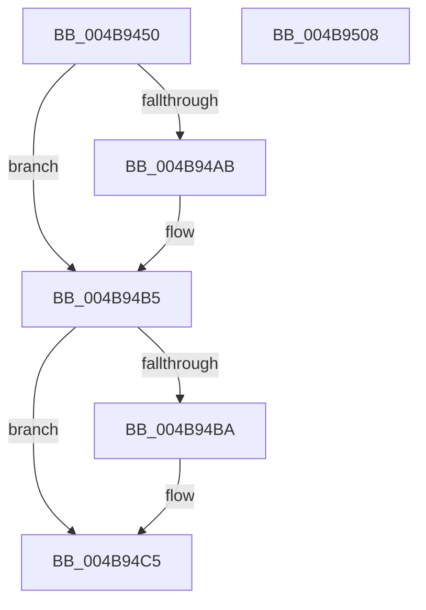

# HalpInterruptLocalErrorService

- RVA: `0x004B9450`–`0x004B9509` (길이 `185` bytes)
- VA: `0x00000001404B9450`
- 실행 섹션: `.text`
- PDB 이름 있음: `예`; PDB Function 태그: `아니요`
- unwind 정보 RVA: `0x00060300`
- 디코드: `47`개 명령, `185/185` bytes 표시
- 미해석 바이트: `0` (있으면 어셈블리에 `.byte`로 보존)

> 이 문서는 커널 이미지의 기계어와 PDB 기호를 분석해 생성했습니다. 4번과 5번은 함수 원형과 자료형을 바이너리 사용 방식에서 추정한 C 해석이며 원본 소스 복구 결과는 아닙니다.

## 1. Dependencies

- 직접 호출 지점: **4**; 고유 호출 대상: **3**
- 직접 호출자로 확인된 함수: **0**
- RIP 상대 이미지 참조: **5**

### Outgoing calls
- `0x004B946F` → [HalpAcquireHighLevelLock](../2D/HalpAcquireHighLevelLock_function_002D2390.md) (function, `0x002D2390`)
- `0x004B94AE` → [guard_dispatch_icall](../6B/guard_dispatch_icall_function_006BAAD0.md) (function, `0x006BAAD0`)
- `0x004B94C0` → [guard_dispatch_icall](../6B/guard_dispatch_icall_function_006BAAD0.md) (function, `0x006BAAD0`)
- `0x004B94E8` → [HalpReleaseHighLevelLock](../2D/HalpReleaseHighLevelLock_function_002D1C58.md) (function, `0x002D1C58`)

### Direct callers
- 이 함수 시작 RVA로 연결되는 직접 call은 확인되지 않았습니다. 간접 호출은 완전히 역산할 수 없습니다.

### Static image references
- `0x004B9468` → RVA `0x00F90528` (`.data`; read)
- `0x004B9474` → RVA `0x00E10530` (`.data`; read)
- `0x004B947A` → RVA `0x00000000` (`image boundary/outside`; read)
- `0x004B948B` → RVA `0x00E10530` (`.data`; write)
- `0x004B9493` → RVA `0x00E101F0` (`.data`; read)

## 2. Other-region calls and transfers

- 다른 실행 섹션으로 향하는 call: **0**
- 별도 외부 분기/꼬리 이동을 확인하지 못했습니다.

## 3. Assembly (complete function range)

```asm
004B9450  48 89 5C 24 08                  mov qword ptr [rsp + 8], rbx
004B9455  48 89 6C 24 10                  mov qword ptr [rsp + 0x10], rbp
004B945A  48 89 74 24 18                  mov qword ptr [rsp + 0x18], rsi
004B945F  57                              push rdi
004B9460  41 56                           push r14
004B9462  41 57                           push r15
004B9464  48 83 EC 20                     sub rsp, 0x20
004B9468  48 8D 0D B9 70 AD 00            lea rcx, [rip + 0xad70b9]
004B946F  E8 1C 8F E1 FF                  call 0x1402d2390
004B9474  8B 0D B6 70 95 00               mov ecx, dword ptr [rip + 0x9570b6]
004B947A  4C 8D 3D 7F 6B B4 FF            lea r15, [rip - 0x4b9481]
004B9481  8B D9                           mov ebx, ecx
004B9483  44 8A F0                        mov r14b, al
004B9486  FF C1                           inc ecx
004B9488  83 E3 7F                        and ebx, 0x7f
004B948B  89 0D 9F 70 95 00               mov dword ptr [rip + 0x95709f], ecx
004B9491  33 F6                           xor esi, esi
004B9493  48 8B 0D 56 6D 95 00            mov rcx, qword ptr [rip + 0x956d56]
004B949A  48 8B 41 38                     mov rax, qword ptr [rcx + 0x38]
004B949E  48 8B 79 40                     mov rdi, qword ptr [rcx + 0x40]
004B94A2  48 8B 69 10                     mov rbp, qword ptr [rcx + 0x10]
004B94A6  48 85 C0                        test rax, rax
004B94A9  74 0A                           je 0x1404b94b5
004B94AB  48 8B CD                        mov rcx, rbp
004B94AE  E8 1D 16 20 00                  call 0x1406baad0
004B94B3  8B F0                           mov esi, eax
004B94B5  48 85 FF                        test rdi, rdi
004B94B8  74 0B                           je 0x1404b94c5
004B94BA  48 8B CD                        mov rcx, rbp
004B94BD  48 8B C7                        mov rax, rdi
004B94C0  E8 0B 16 20 00                  call 0x1406baad0
004B94C5  41 89 B4 9F 20 03 F9 00         mov dword ptr [r15 + rbx*4 + 0xf90320], esi
004B94CD  48 8D 0D 54 70 AD 00            lea rcx, [rip + 0xad7054]
004B94D4  65 8B 14 25 A4 01 00 00         mov edx, dword ptr gs:[0x1a4]
004B94DC  66 41 89 94 5F 20 02 F9 00      mov word ptr [r15 + rbx*2 + 0xf90220], dx
004B94E5  41 8A D6                        mov dl, r14b
004B94E8  E8 6B 87 E1 FF                  call 0x1402d1c58
004B94ED  48 8B 5C 24 40                  mov rbx, qword ptr [rsp + 0x40]
004B94F2  B0 01                           mov al, 1
004B94F4  48 8B 6C 24 48                  mov rbp, qword ptr [rsp + 0x48]
004B94F9  48 8B 74 24 50                  mov rsi, qword ptr [rsp + 0x50]
004B94FE  48 83 C4 20                     add rsp, 0x20
004B9502  41 5F                           pop r15
004B9504  41 5E                           pop r14
004B9506  5F                              pop rdi
004B9507  C3                              ret
004B9508  CC                              int3
```

## 4. C-style interpretation (structured pseudocode)

```c
__int64 __fastcall HalpInterruptLocalErrorService(void)
{
    __int64 result;
    __int64 v_rbx;
    __int64 v_rsi;
    __int64 v_rsp;
    unsigned __int64 v_stack_p10;
    unsigned __int64 v_stack_p18;
    unsigned __int64 v_stack_p8;

    v_stack_p8 = v_rbx;
    v_stack_p10 = v_rbp;
    v_stack_p18 = v_rsi;
    v_rsp = (v_rsp) - (32);
    result = HalpAcquireHighLevelLock(v_rip + 11366585, a2, a3, a4);
    a1 = (unsigned int)(((unsigned int)(*(unsigned int *)(v_rip + 9793718))) + 1);
    v_rbx = (unsigned int)(((unsigned int)((unsigned int)((unsigned int)(*(unsigned int *)(v_rip + 9793718))))) & (127));
    *(unsigned int *)(v_rip + 9793695) = (unsigned int)(a1);
    v_rsi = 0;
    result = *(unsigned __int64 *)(*(unsigned __int64 *)(v_rip + 9792854) + 56);
    if (*(unsigned __int64 *)(*(unsigned __int64 *)(v_rip + 9792854) + 56) != 0) {
        a1 = *(unsigned __int64 *)(*(unsigned __int64 *)(v_rip + 9792854) + 16);
        result = guard_dispatch_icall(a1, a2, a3, a4);
        v_rsi = (unsigned int)(result);
    }
    if (*(unsigned __int64 *)(*(unsigned __int64 *)(v_rip + 9792854) + 64) != 0) {
        a1 = *(unsigned __int64 *)(*(unsigned __int64 *)(v_rip + 9792854) + 16);
        result = *(unsigned __int64 *)(*(unsigned __int64 *)(v_rip + 9792854) + 64);
        result = guard_dispatch_icall(a1, a2, a3, a4);
    }
    *(unsigned int *)(v_rip - 4953217 + v_rbx * 4 + 16319264) = (unsigned int)(v_rsi);
    *(unsigned __int16 *)(v_rip - 4953217 + v_rbx * 2 + 16319008) = (unsigned __int16)((unsigned int)(*(unsigned int *)(gs_base + (0 + 420))));
    result = HalpReleaseHighLevelLock(v_rip + 11366484, (unsigned __int8)((unsigned __int8)(result)), a3, a4);
    v_rsp = (v_rsp) + (32);
    return 1;
}
```

## 5. (Beta) C Style

```c
void HalpInterruptLocalErrorService(void)
{
    int64_t result;
    int64_t local_rbx;
    int64_t local_rsi;
    int64_t local_rsp;
    uint64_t v_stack_p10;
    uint64_t v_stack_p18;
    uint64_t v_stack_p8;

    v_stack_p8 = local_rbx;
    v_stack_p10 = local_rbp;
    v_stack_p18 = local_rsi;
    local_rsp = (local_rsp) - (32);
    result = HalpAcquireHighLevelLock(v_rip + 11366585, a2, a3, a4);
    a1 = (uint32_t)(((uint32_t)(*(uint32_t *)(v_rip + 0x9570B6))) + 1);
    local_rbx = (uint32_t)(((uint32_t)((uint32_t)((uint32_t)(*(uint32_t *)(v_rip + 0x9570B6))))) & (127));
    *(uint32_t *)(v_rip + 0x95709F) = (uint32_t)(a1);
    local_rsi = 0;
    result = *(uint64_t *)(*(uint64_t *)(v_rip + 0x956D56) + 0x38);
    if (*(uint64_t *)(*(uint64_t *)(v_rip + 0x956D56) + 0x38) != 0) {
        a1 = *(uint64_t *)(*(uint64_t *)(v_rip + 0x956D56) + 0x10);
        result = guard_dispatch_icall(a1, a2, a3, a4);
        local_rsi = (uint32_t)(result);
    }
    if (*(uint64_t *)(*(uint64_t *)(v_rip + 0x956D56) + 0x40) != 0) {
        a1 = *(uint64_t *)(*(uint64_t *)(v_rip + 0x956D56) + 0x10);
        result = *(uint64_t *)(*(uint64_t *)(v_rip + 0x956D56) + 0x40);
        result = guard_dispatch_icall(a1, a2, a3, a4);
    }
    *(uint32_t *)(v_rip - 0x4B9481 + local_rbx * 4 + 0xF90320) = (uint32_t)(local_rsi);
    *(uint16_t *)(v_rip - 0x4B9481 + local_rbx * 2 + 0xF90220) = (uint16_t)((uint32_t)(*(uint32_t *)(gs_base + (0 + 0x1A4))));
    result = HalpReleaseHighLevelLock(v_rip + 11366484, (uint8_t)((uint8_t)(result)), a3, a4);
    local_rsp = (local_rsp) + (32);
    return 1;
}
```

## 6. Execution-region graph

[열기: 2D/3D 그래프와 함수 탐색 컨트롤 패널](../../../control-panel.html?section=text&rva=0x004B9450&view=graph)

- 2D 그래프는 위에서 아래로 흐르고, 3D 그래프는 빈 공간을 드래그해 회전합니다. Shift+드래그는 이동, 휠은 확대·축소, 함수 노드 선택은 대상 보고서 이동입니다.

### Static fallback


