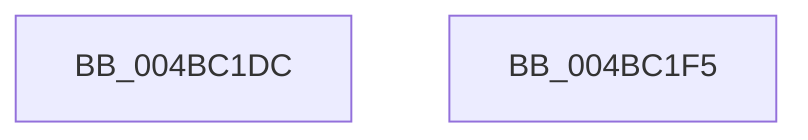

# HalpInterruptPicLine

- RVA: `0x004BC1DC`–`0x004BC1F6` (길이 `26` bytes)
- VA: `0x00000001404BC1DC`
- 실행 섹션: `.text`
- PDB 이름 있음: `예`; PDB Function 태그: `아니요`
- unwind 정보 RVA: `0x000DB714`
- 디코드: `10`개 명령, `26/26` bytes 표시
- 미해석 바이트: `0` (있으면 어셈블리에 `.byte`로 보존)

> 이 문서는 커널 이미지의 기계어와 PDB 기호를 분석해 생성했습니다. 4번과 5번은 함수 원형과 자료형을 바이너리 사용 방식에서 추정한 C 해석이며 원본 소스 복구 결과는 아닙니다.

## 1. Dependencies

- 직접 호출 지점: **0**; 고유 호출 대상: **0**
- 직접 호출자로 확인된 함수: **1**
- RIP 상대 이미지 참조: **0**

### Outgoing calls
- 직접 디코드된 call 명령이 없습니다.

### Direct callers
- [HalpInterruptMaskAcpi](../../pagelk/B7/HalpInterruptMaskAcpi_function_00B7C128.md) at `0x00B7C147`

### Static image references
- 디코드된 RIP-relative 메모리 참조가 없습니다.

## 2. Other-region calls and transfers

- 다른 실행 섹션으로 향하는 call: **0**
- 별도 외부 분기/꼬리 이동을 확인하지 못했습니다.

## 3. Assembly (complete function range)

```asm
004BC1DC  83 FA 08                        cmp edx, 8
004BC1DF  1B C0                           sbb eax, eax
004BC1E1  05 01 B0 00 00                  add eax, 0xb001
004BC1E6  89 01                           mov dword ptr [rcx], eax
004BC1E8  83 FA 08                        cmp edx, 8
004BC1EB  8D 42 F8                        lea eax, [rdx - 8]
004BC1EE  0F 43 D0                        cmovae edx, eax
004BC1F1  89 51 04                        mov dword ptr [rcx + 4], edx
004BC1F4  C3                              ret
004BC1F5  CC                              int3
```

## 4. C-style interpretation (structured pseudocode)

```c
__int64 __fastcall HalpInterruptPicLine(__int64 a1, __int64 a2)
{
    __int64 result;

    result = (unsigned int)((result) + (0xB001ULL));
    *(unsigned int *)(a1) = (unsigned int)(result);
    if (((unsigned int)(a2)) >= 8) { a2 = (unsigned int)(a2 - 8); }
    *(unsigned int *)(a1 + 4) = (unsigned int)(a2);
    return a2 - 8;
}
```

## 5. (Beta) C Style

```c
int64_t HalpInterruptPicLine(void *Arg1, int64_t Arg2)
{
    uint8_t *arg1 = (uint8_t *)Arg1;

    int64_t result;

    result = (uint32_t)((result) + (0xB001ULL));
    *(uint32_t *)(arg1) = (uint32_t)(result);
    if (((uint32_t)(Arg2)) >= 8) { Arg2 = (uint32_t)(Arg2 - 8); }
    *(uint32_t *)(arg1 + 0x4) = (uint32_t)(Arg2);
    return Arg2 - 8;
}
```

### 관측된 메모리 오프셋

구조체 형식이 확인되지 않은 접근은 인자 기준의 오프셋으로만 기록했습니다.

| 기준 인자 | 오프셋 표현 | 폭 (bit) | 접근 |
|---|---:|---:|---|
| `Arg1` | `+ 0x0` | `32` | `W` |
| `Arg1` | `+ 0x4` | `32` | `W` |

## 6. Execution-region graph

[열기: 2D/3D 그래프와 함수 탐색 컨트롤 패널](../../../control-panel.html?section=text&rva=0x004BC1DC&view=graph)

- 2D 그래프는 위에서 아래로 흐르고, 3D 그래프는 빈 공간을 드래그해 회전합니다. Shift+드래그는 이동, 휠은 확대·축소, 함수 노드 선택은 대상 보고서 이동입니다.

### Static fallback


