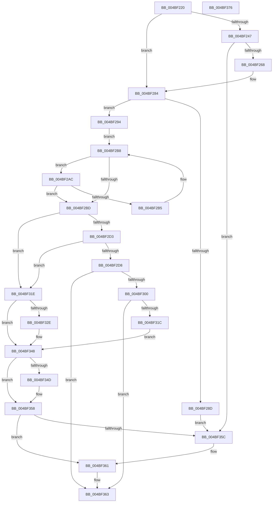

# HalpIommuLeaveDmaDomain

- RVA: `0x004BF220`–`0x004BF377` (길이 `343` bytes)
- VA: `0x00000001404BF220`
- 실행 섹션: `.text`
- PDB 이름 있음: `예`; PDB Function 태그: `아니요`
- unwind 정보 RVA: `0x000B4164`
- 디코드: `98`개 명령, `343/343` bytes 표시
- 미해석 바이트: `0` (있으면 어셈블리에 `.byte`로 보존)

> 이 문서는 커널 이미지의 기계어와 PDB 기호를 분석해 생성했습니다. 4번과 5번은 함수 원형과 자료형을 바이너리 사용 방식에서 추정한 C 해석이며 원본 소스 복구 결과는 아닙니다.

## 1. Dependencies

- 직접 호출 지점: **9**; 고유 호출 대상: **8**
- 직접 호출자로 확인된 함수: **4**
- RIP 상대 이미지 참조: **4**

### Outgoing calls
- `0x004BF252` → [guard_dispatch_icall](../6B/guard_dispatch_icall_function_006BAAD0.md) (function, `0x006BAAD0`)
- `0x004BF27E` → [KeBugCheckEx](../4F/KeBugCheckEx_function_004FD660.md) (function, `0x004FD660`)
- `0x004BF284` → [HalpIommuIsInPermanentPassthrough](../4F/HalpIommuIsInPermanentPassthrough_function_004FC31C.md) (function, `0x004FC31C`)
- `0x004BF29E` → [KeAcquireSpinLockRaiseToDpc](../20/KeAcquireSpinLockRaiseToDpc_function_00208470.md) (function, `0x00208470`)
- `0x004BF2C3` → [KeReleaseSpinLock](../39/KeReleaseSpinLock_function_00392BA0.md) (function, `0x00392BA0`)
- `0x004BF2F7` → [HalpIommuGetHardwareDomain](../4D/HalpIommuGetHardwareDomain_function_004D7BCC.md) (function, `0x004D7BCC`)
- `0x004BF311` → [HalpIommuAttachDeviceDomain](../55/HalpIommuAttachDeviceDomain_function_00553418.md) (function, `0x00553418`)
- `0x004BF33F` → [guard_dispatch_icall](../6B/guard_dispatch_icall_function_006BAAD0.md) (function, `0x006BAAD0`)
- `0x004BF353` → [HalpIommuDereferenceHardwareDomain](../55/HalpIommuDereferenceHardwareDomain_function_00554E58.md) (function, `0x00554E58`)

### Direct callers
- [HalpIommuBlockDevice](../4C/HalpIommuBlockDevice_function_004CA150.md) at `0x004CA21F`
- [IommuDomainAttachDeviceEx](../56/IommuDomainAttachDeviceEx_function_00567B60.md) at `0x00567C5E`
- [IommuDomainDetachDevice](../56/IommuDomainDetachDevice_function_00567D40.md) at `0x00567E2A`
- [IommuDomainDetachDeviceEx](../56/IommuDomainDetachDeviceEx_function_00567E80.md) at `0x00567EC5`

### Static image references
- `0x004BF23B` → RVA `0x00FC1710` (`.data`; read)
- `0x004BF247` → RVA `0x00FC1E18` (`.data`; read)
- `0x004BF2CA` → RVA `0x00FC1758` (`.data`; read)
- `0x004BF2E1` → RVA `0x00FC16B0` (`.data`; read)

## 2. Other-region calls and transfers

- 다른 실행 섹션으로 향하는 call: **0**
- 별도 외부 분기/꼬리 이동을 확인하지 못했습니다.

## 3. Assembly (complete function range)

```asm
004BF220  48 89 5C 24 08                  mov qword ptr [rsp + 8], rbx
004BF225  48 89 6C 24 10                  mov qword ptr [rsp + 0x10], rbp
004BF22A  56                              push rsi
004BF22B  57                              push rdi
004BF22C  41 56                           push r14
004BF22E  48 83 EC 30                     sub rsp, 0x30
004BF232  48 83 64 24 60 00               and qword ptr [rsp + 0x60], 0
004BF238  48 8B F2                        mov rsi, rdx
004BF23B  80 3D CE 24 B0 00 00            cmp byte ptr [rip + 0xb024ce], 0
004BF242  48 8B F9                        mov rdi, rcx
004BF245  74 3D                           je 0x1404bf284
004BF247  48 8B 05 CA 2B B0 00            mov rax, qword ptr [rip + 0xb02bca]
004BF24E  48 8B 49 20                     mov rcx, qword ptr [rcx + 0x20]
004BF252  E8 79 B8 1F 00                  call 0x1406baad0
004BF257  33 DB                           xor ebx, ebx
004BF259  66 83 F8 76                     cmp ax, 0x76
004BF25D  0F 45 D8                        cmovne ebx, eax
004BF260  85 DB                           test ebx, ebx
004BF262  0F 89 F4 00 00 00               jns 0x1404bf35c
004BF268  48 83 64 24 20 00               and qword ptr [rsp + 0x20], 0
004BF26E  4C 8B CE                        mov r9, rsi
004BF271  4C 63 C3                        movsxd r8, ebx
004BF274  BA 02 00 00 00                  mov edx, 2
004BF279  B9 D9 01 00 00                  mov ecx, 0x1d9
004BF27E  E8 DD E3 03 00                  call 0x1404fd660
004BF283  CC                              int3
004BF284  E8 93 D0 03 00                  call 0x1404fc31c
004BF289  84 C0                           test al, al
004BF28B  74 07                           je 0x1404bf294
004BF28D  33 DB                           xor ebx, ebx
004BF28F  E9 C8 00 00 00                  jmp 0x1404bf35c
004BF294  4C 8B 71 20                     mov r14, qword ptr [rcx + 0x20]
004BF298  33 ED                           xor ebp, ebp
004BF29A  48 8D 4A 20                     lea rcx, [rdx + 0x20]
004BF29E  E8 CD 91 D4 FF                  call 0x140208470
004BF2A3  4C 8D 46 10                     lea r8, [rsi + 0x10]
004BF2A7  49 8B 10                        mov rdx, qword ptr [r8]
004BF2AA  EB 0C                           jmp 0x1404bf2b8
004BF2AC  48 8B EA                        mov rbp, rdx
004BF2AF  4C 39 72 18                     cmp qword ptr [rdx + 0x18], r14
004BF2B3  74 08                           je 0x1404bf2bd
004BF2B5  48 8B 12                        mov rdx, qword ptr [rdx]
004BF2B8  49 3B D0                        cmp rdx, r8
004BF2BB  75 EF                           jne 0x1404bf2ac
004BF2BD  8A D0                           mov dl, al
004BF2BF  48 8D 4E 20                     lea rcx, [rsi + 0x20]
004BF2C3  E8 D8 38 ED FF                  call 0x140392ba0
004BF2C8  33 DB                           xor ebx, ebx
004BF2CA  83 3D 87 24 B0 00 01            cmp dword ptr [rip + 0xb02487], 1
004BF2D1  75 4B                           jne 0x1404bf31e
004BF2D3  38 5F 58                        cmp byte ptr [rdi + 0x58], bl
004BF2D6  74 46                           je 0x1404bf31e
004BF2D8  48 8B 57 20                     mov rdx, qword ptr [rdi + 0x20]
004BF2DC  48 8D 44 24 60                  lea rax, [rsp + 0x60]
004BF2E1  48 8B 0D C8 23 B0 00            mov rcx, qword ptr [rip + 0xb023c8]
004BF2E8  45 33 C9                        xor r9d, r9d
004BF2EB  48 89 44 24 28                  mov qword ptr [rsp + 0x28], rax
004BF2F0  45 33 C0                        xor r8d, r8d
004BF2F3  88 5C 24 20                     mov byte ptr [rsp + 0x20], bl
004BF2F7  E8 D0 88 01 00                  call 0x1404d7bcc
004BF2FC  85 C0                           test eax, eax
004BF2FE  78 63                           js 0x1404bf363
004BF300  4C 8B 44 24 60                  mov r8, qword ptr [rsp + 0x60]
004BF305  48 8B 57 28                     mov rdx, qword ptr [rdi + 0x28]
004BF309  49 83 C0 20                     add r8, 0x20
004BF30D  48 8B 4F 20                     mov rcx, qword ptr [rdi + 0x20]
004BF311  E8 02 41 09 00                  call 0x140553418
004BF316  8B D8                           mov ebx, eax
004BF318  85 C0                           test eax, eax
004BF31A  78 47                           js 0x1404bf363
004BF31C  EB 2A                           jmp 0x1404bf348
004BF31E  38 1D EC 23 B0 00               cmp byte ptr [rip + 0xb023ec], bl
004BF324  4C 8B 77 28                     mov r14, qword ptr [rdi + 0x28]
004BF328  48 8B 4F 20                     mov rcx, qword ptr [rdi + 0x20]
004BF32C  75 1A                           jne 0x1404bf348
004BF32E  48 8B 81 80 00 00 00            mov rax, qword ptr [rcx + 0x80]
004BF335  45 33 C0                        xor r8d, r8d
004BF338  48 8B 49 10                     mov rcx, qword ptr [rcx + 0x10]
004BF33C  49 8B D6                        mov rdx, r14
004BF33F  E8 8C B7 1F 00                  call 0x1406baad0
004BF344  49 21 5E 10                     and qword ptr [r14 + 0x10], rbx
004BF348  48 85 ED                        test rbp, rbp
004BF34B  74 0B                           je 0x1404bf358
004BF34D  48 8B D5                        mov rdx, rbp
004BF350  48 8B CE                        mov rcx, rsi
004BF353  E8 00 5B 09 00                  call 0x140554e58
004BF358  85 DB                           test ebx, ebx
004BF35A  78 05                           js 0x1404bf361
004BF35C  48 83 67 18 00                  and qword ptr [rdi + 0x18], 0
004BF361  8B C3                           mov eax, ebx
004BF363  48 8B 5C 24 50                  mov rbx, qword ptr [rsp + 0x50]
004BF368  48 8B 6C 24 58                  mov rbp, qword ptr [rsp + 0x58]
004BF36D  48 83 C4 30                     add rsp, 0x30
004BF371  41 5E                           pop r14
004BF373  5F                              pop rdi
004BF374  5E                              pop rsi
004BF375  C3                              ret
004BF376  CC                              int3
```

## 4. C-style interpretation (structured pseudocode)

```c
__int64 __fastcall HalpIommuLeaveDmaDomain(__int64 a1, __int64 a2)
{
    __int64 result;
    __int64 v_rbp;
    __int64 v_rbx;
    __int64 v_rsp;
    unsigned __int64 v_stack_m20;
    unsigned __int64 v_stack_m28;
    unsigned __int64 v_stack_p10;
    unsigned __int64 v_stack_p18;
    unsigned __int64 v_stack_p8;

    v_stack_p8 = v_rbx;
    v_stack_p10 = v_rbp;
    v_rsp = (v_rsp) - (48);
    if ((*(unsigned __int8 *)(v_rip + 11543758)) == 0) goto loc_004BF284;
    result = guard_dispatch_icall(*(unsigned __int64 *)(a1 + 32), a2, a3, a4);
    v_rbx = 0;
    if (((unsigned __int16)(result)) != 118) { v_rbx = (unsigned int)(result); }
    if (!sign_flag) goto loc_004BF35C;
    result = KeBugCheckEx(473, 2, (int)((unsigned int)(v_rbx)), a2);
loc_004BF284:
    result = HalpIommuIsInPermanentPassthrough(473, 2, (int)((unsigned int)(v_rbx)), a2);
    if ((unsigned __int8)(result) == 0) goto loc_004BF294;
    v_rbx = 0;
    goto loc_004BF35C;
loc_004BF294:
    v_rbp = 0;
    result = KeAcquireSpinLockRaiseToDpc(2 + 32, 2, (int)((unsigned int)(v_rbx)), a2);
    goto loc_004BF2B8;
loc_004BF2AC:
    if ((*(unsigned __int64 *)(*(unsigned __int64 *)(a2 + 16) + 24)) == (*(unsigned __int64 *)(473 + 32))) goto loc_004BF2BD;
loc_004BF2B8:
    if ((*(unsigned __int64 *)(*(unsigned __int64 *)(a2 + 16))) != (a2 + 16)) goto loc_004BF2AC;
loc_004BF2BD:
    result = KeReleaseSpinLock(a2 + 32, (unsigned __int8)(result), a2 + 16, a2);
    v_rbx = 0;
    if ((*(unsigned int *)(v_rip + 11543687)) != 1) goto loc_004BF31E;
    if ((*(unsigned __int8 *)(a1 + 88)) == 0) goto loc_004BF31E;
    a4 = 0;
    v_stack_m20 = v_stack_p18;
    a3 = 0;
    v_stack_m28 = 0;
    result = HalpIommuGetHardwareDomain(*(unsigned __int64 *)(v_rip + 11543496), *(unsigned __int64 *)(a1 + 32), a3, a4);
    if (sign_flag) goto loc_004BF363;
    a3 = (v_stack_p18) + (32);
    result = HalpIommuAttachDeviceDomain(*(unsigned __int64 *)(a1 + 32), *(unsigned __int64 *)(a1 + 40), a3, a4);
    if (sign_flag) goto loc_004BF363;
    goto loc_004BF348;
loc_004BF31E:
    if ((*(unsigned __int8 *)(v_rip + 11543532)) == ((unsigned __int8)((unsigned int)((unsigned int)(result))))) {
        result = *(unsigned __int64 *)(*(unsigned __int64 *)(a1 + 32) + 128);
        a3 = 0;
        a1 = *(unsigned __int64 *)(*(unsigned __int64 *)(a1 + 32) + 16);
        a2 = *(unsigned __int64 *)(a1 + 40);
        result = guard_dispatch_icall(a1, a2, a3, a4);
    }
    if (*(unsigned __int64 *)(a2 + 16) != 0) {
        a2 = *(unsigned __int64 *)(a2 + 16);
        a1 = a2;
        result = HalpIommuDereferenceHardwareDomain(a1, a2, a3, a4);
    }
    if (!(sign_flag)) {
    }
loc_004BF363:
    v_rsp = (v_rsp) + (48);
    return (unsigned int)((unsigned int)((unsigned int)((unsigned int)(result))));
}
```

## 5. (Beta) C Style

```c
int64_t HalpIommuLeaveDmaDomain(void *Arg1, void *Arg2)
{
    uint8_t *arg1 = (uint8_t *)Arg1;
    uint8_t *arg2 = (uint8_t *)Arg2;

    int64_t result;
    int64_t local_rbp;
    int64_t local_rbx;
    int64_t local_rsp;
    uint64_t v_stack_m20;
    uint64_t v_stack_m28;
    uint64_t v_stack_p10;
    uint64_t v_stack_p18;
    uint64_t v_stack_p8;

    v_stack_p8 = local_rbx;
    v_stack_p10 = local_rbp;
    local_rsp = (local_rsp) - (48);
    if ((*(uint8_t *)(v_rip + 0xB024CE)) == 0) goto loc_004BF284;
    result = guard_dispatch_icall(*(uint64_t *)(arg1 + 0x20), Arg2, a3, a4);
    local_rbx = 0;
    if (((uint16_t)(result)) != 118) { local_rbx = (uint32_t)(result); }
    if (!sign_flag) goto loc_004BF35C;
    result = KeBugCheckEx(473, 2, (int32_t)((uint32_t)(local_rbx)), Arg2);
loc_004BF284:
    result = HalpIommuIsInPermanentPassthrough(473, 2, (int32_t)((uint32_t)(local_rbx)), Arg2);
    if ((uint8_t)(result) == 0) goto loc_004BF294;
    local_rbx = 0;
    goto loc_004BF35C;
loc_004BF294:
    local_rbp = 0;
    result = KeAcquireSpinLockRaiseToDpc(2 + 32, 2, (int32_t)((uint32_t)(local_rbx)), Arg2);
    goto loc_004BF2B8;
loc_004BF2AC:
    if ((*(uint64_t *)(*(uint64_t *)(arg2 + 0x10) + 0x18)) == (*(uint64_t *)(473 + 0x20))) goto loc_004BF2BD;
loc_004BF2B8:
    if ((*(uint64_t *)(*(uint64_t *)(arg2 + 0x10))) != (Arg2 + 16)) goto loc_004BF2AC;
loc_004BF2BD:
    result = KeReleaseSpinLock(Arg2 + 32, (uint8_t)(result), Arg2 + 16, Arg2);
    local_rbx = 0;
    if ((*(uint32_t *)(v_rip + 0xB02487)) != 1) goto loc_004BF31E;
    if ((*(uint8_t *)(arg1 + 0x58)) == 0) goto loc_004BF31E;
    a4 = 0;
    v_stack_m20 = v_stack_p18;
    a3 = 0;
    v_stack_m28 = 0;
    result = HalpIommuGetHardwareDomain(*(uint64_t *)(v_rip + 0xB023C8), *(uint64_t *)(arg1 + 0x20), a3, a4);
    if (sign_flag) goto loc_004BF363;
    a3 = (v_stack_p18) + (32);
    result = HalpIommuAttachDeviceDomain(*(uint64_t *)(arg1 + 0x20), *(uint64_t *)(arg1 + 0x28), a3, a4);
    if (sign_flag) goto loc_004BF363;
    goto loc_004BF348;
loc_004BF31E:
    if ((*(uint8_t *)(v_rip + 0xB023EC)) == ((uint8_t)((uint32_t)((uint32_t)(result))))) {
        result = *(uint64_t *)(*(uint64_t *)(arg1 + 0x20) + 0x80);
        a3 = 0;
        Arg1 = *(uint64_t *)(*(uint64_t *)(arg1 + 0x20) + 0x10);
        Arg2 = *(uint64_t *)(arg1 + 0x28);
        result = guard_dispatch_icall(Arg1, Arg2, a3, a4);
    }
    if (*(uint64_t *)(arg2 + 0x10) != 0) {
        Arg2 = *(uint64_t *)(arg2 + 0x10);
        Arg1 = Arg2;
        result = HalpIommuDereferenceHardwareDomain(Arg1, Arg2, a3, a4);
    }
    if (!(sign_flag)) {
    }
loc_004BF363:
    local_rsp = (local_rsp) + (48);
    return (uint32_t)((uint32_t)((uint32_t)((uint32_t)(result))));
}
```

### 관측된 메모리 오프셋

구조체 형식이 확인되지 않은 접근은 인자 기준의 오프셋으로만 기록했습니다.

| 기준 인자 | 오프셋 표현 | 폭 (bit) | 접근 |
|---|---:|---:|---|
| `Arg1` | `+ 0x18` | `64` | `R/W` |
| `Arg1` | `+ 0x20` | `64` | `R` |
| `Arg1` | `+ 0x28` | `64` | `R` |
| `Arg1` | `+ 0x58` | `8` | `R` |
| `Arg2` | `+ 0x0` | `64` | `R` |
| `Arg2` | `+ 0x10` | `64` | `R` |
| `Arg2` | `+ 0x20` | `64` | `R` |

## 6. Execution-region graph

[열기: 2D/3D 그래프와 함수 탐색 컨트롤 패널](../../../control-panel.html?section=text&rva=0x004BF220&view=graph)

- 2D 그래프는 위에서 아래로 흐르고, 3D 그래프는 빈 공간을 드래그해 회전합니다. Shift+드래그는 이동, 휠은 확대·축소, 함수 노드 선택은 대상 보고서 이동입니다.

### Static fallback


