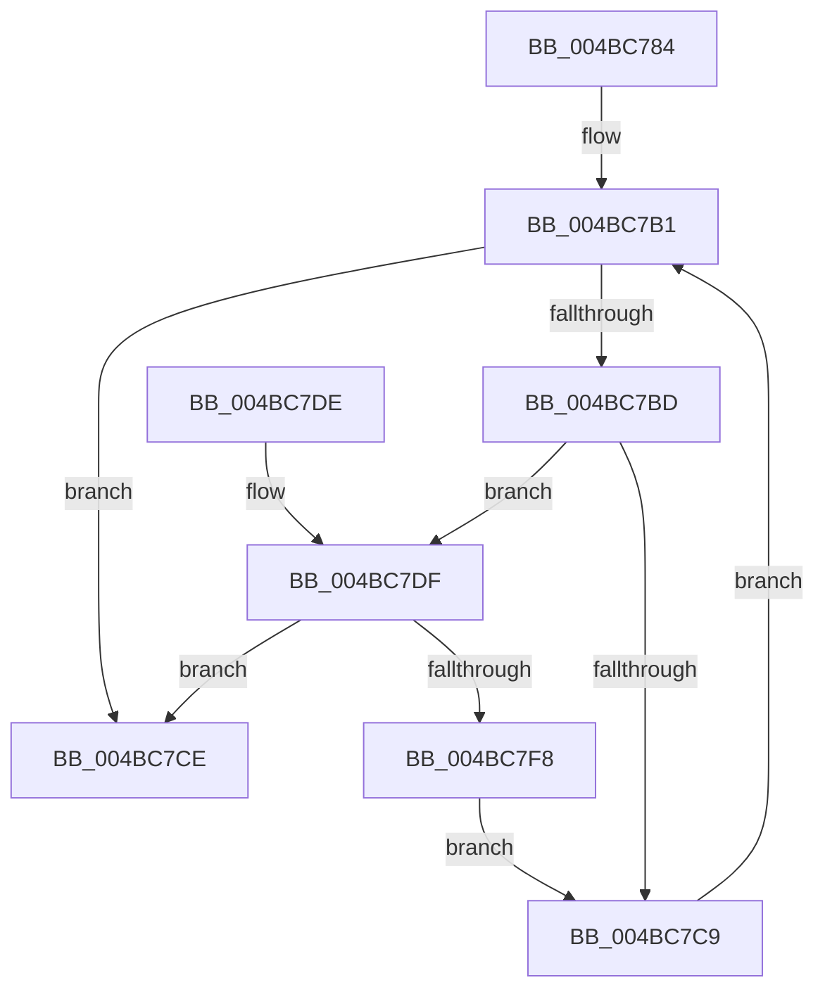

# HalpIommuQueryAcpiDeviceMapping

- RVA: `0x004BC784`–`0x004BC7FA` (길이 `118` bytes)
- VA: `0x00000001404BC784`
- 실행 섹션: `.text`
- PDB 이름 있음: `예`; PDB Function 태그: `아니요`
- unwind 정보 RVA: `0x00063C10`
- 디코드: `34`개 명령, `118/118` bytes 표시
- 미해석 바이트: `0` (있으면 어셈블리에 `.byte`로 보존)

> 이 문서는 커널 이미지의 기계어와 PDB 기호를 분석해 생성했습니다. 4번과 5번은 함수 원형과 자료형을 바이너리 사용 방식에서 추정한 C 해석이며 원본 소스 복구 결과는 아닙니다.

## 1. Dependencies

- 직접 호출 지점: **1**; 고유 호출 대상: **1**
- 직접 호출자로 확인된 함수: **4**
- RIP 상대 이미지 참조: **1**

### Outgoing calls
- `0x004BC7EC` → [guard_dispatch_icall](../6B/guard_dispatch_icall_function_006BAAD0.md) (function, `0x006BAAD0`)

### Direct callers
- [HalpIommuUnblockDevice](../4C/HalpIommuUnblockDevice_function_004C6250.md) at `0x004C62D6`
- [HalpIommuBlockDevice](../4C/HalpIommuBlockDevice_function_004CA150.md) at `0x004CA194`
- [HalpIommuCreateDevice](../54/HalpIommuCreateDevice_function_0054ED60.md) at `0x0054F0D4`
- [HalpIommuDmaRemappingCapable](../55/HalpIommuDmaRemappingCapable_function_00555000.md) at `0x00555030`

### Static image references
- `0x004BC7AA` → RVA `0x00FC1740` (`.data`; read)

## 2. Other-region calls and transfers

- 다른 실행 섹션으로 향하는 call: **0**
- 별도 외부 분기/꼬리 이동을 확인하지 못했습니다.

## 3. Assembly (complete function range)

```asm
004BC784  48 89 5C 24 08                  mov qword ptr [rsp + 8], rbx
004BC789  48 89 74 24 10                  mov qword ptr [rsp + 0x10], rsi
004BC78E  57                              push rdi
004BC78F  48 83 EC 20                     sub rsp, 0x20
004BC793  48 8B F1                        mov rsi, rcx
004BC796  0F 57 C0                        xorps xmm0, xmm0
004BC799  0F 11 02                        movups xmmword ptr [rdx], xmm0
004BC79C  33 C9                           xor ecx, ecx
004BC79E  48 8B FA                        mov rdi, rdx
004BC7A1  48 89 4A 10                     mov qword ptr [rdx + 0x10], rcx
004BC7A5  B8 25 02 00 C0                  mov eax, 0xc0000225
004BC7AA  48 8B 1D 8F 4F B0 00            mov rbx, qword ptr [rip + 0xb04f8f]
004BC7B1  48 8D 0D 88 4F B0 00            lea rcx, [rip + 0xb04f88]
004BC7B8  48 3B D9                        cmp rbx, rcx
004BC7BB  74 11                           je 0x1404bc7ce
004BC7BD  4C 8B 8B 68 01 00 00            mov r9, qword ptr [rbx + 0x168]
004BC7C4  4D 85 C9                        test r9, r9
004BC7C7  75 16                           jne 0x1404bc7df
004BC7C9  48 8B 1B                        mov rbx, qword ptr [rbx]
004BC7CC  EB E3                           jmp 0x1404bc7b1
004BC7CE  48 8B 5C 24 30                  mov rbx, qword ptr [rsp + 0x30]
004BC7D3  48 8B 74 24 38                  mov rsi, qword ptr [rsp + 0x38]
004BC7D8  48 83 C4 20                     add rsp, 0x20
004BC7DC  5F                              pop rdi
004BC7DD  C3                              ret
004BC7DE  CC                              int3
004BC7DF  48 8B 4B 10                     mov rcx, qword ptr [rbx + 0x10]
004BC7E3  4C 8B C7                        mov r8, rdi
004BC7E6  48 8B D6                        mov rdx, rsi
004BC7E9  49 8B C1                        mov rax, r9
004BC7EC  E8 DF E2 1F 00                  call 0x1406baad0
004BC7F1  3D 25 02 00 C0                  cmp eax, 0xc0000225
004BC7F6  75 D6                           jne 0x1404bc7ce
004BC7F8  EB CF                           jmp 0x1404bc7c9
```

## 4. C-style interpretation (structured pseudocode)

```c
__int64 __fastcall HalpIommuQueryAcpiDeviceMapping(__int64 a1, __int64 a2)
{
    __int64 result;
    __int64 v_rsp;
    unsigned __int64 v_stack_p10;
    unsigned __int64 v_stack_p8;

    v_stack_p8 = v_rbx;
    v_stack_p10 = v_rsi;
    v_rsp = (v_rsp) - (32);
    *(unsigned __int64 *)(a2) = v_xmm0;
    a1 = 0;
    *(unsigned __int64 *)(a2 + 16) = 0;
loc_004BC7B1:
    if ((*(unsigned __int64 *)(v_rip + 11554703)) == (v_rip + 11554696)) goto loc_004BC7CE;
    if (*(unsigned __int64 *)(*(unsigned __int64 *)(v_rip + 11554703) + 360) != 0) goto loc_004BC7DF;
loc_004BC7C9:
    goto loc_004BC7B1;
loc_004BC7CE:
    v_rsp = (v_rsp) + (32);
    return (unsigned int)(0xC0000225ULL);
loc_004BC7DF:
    result = guard_dispatch_icall(*(unsigned __int64 *)(v_stack_p8 + 16), v_stack_p10, a2, *(unsigned __int64 *)(*(unsigned __int64 *)(v_rip + 11554703) + 360));
    if (((unsigned int)(result)) != 0xC0000225ULL) goto loc_004BC7CE;
    goto loc_004BC7C9;
}
```

## 5. (Beta) C Style

```c
int64_t HalpIommuQueryAcpiDeviceMapping(int64_t Arg1, void *Arg2)
{
    uint8_t *arg2 = (uint8_t *)Arg2;

    int64_t result;
    int64_t local_rsp;
    uint64_t v_stack_p10;
    uint64_t v_stack_p8;

    v_stack_p8 = local_rbx;
    v_stack_p10 = local_rsi;
    local_rsp = (local_rsp) - (32);
    *(uint64_t *)(arg2) = v_xmm0;
    Arg1 = 0;
    *(uint64_t *)(arg2 + 0x10) = 0;
loc_004BC7B1:
    if ((*(uint64_t *)(v_rip + 0xB04F8F)) == (v_rip + 11554696)) goto loc_004BC7CE;
    if (*(uint64_t *)(*(uint64_t *)(v_rip + 0xB04F8F) + 0x168) != 0) goto loc_004BC7DF;
loc_004BC7C9:
    goto loc_004BC7B1;
loc_004BC7CE:
    local_rsp = (local_rsp) + (32);
    return (uint32_t)(0xC0000225ULL);
loc_004BC7DF:
    result = guard_dispatch_icall(*(uint64_t *)(v_stack_p8 + 0x10), v_stack_p10, Arg2, *(uint64_t *)(*(uint64_t *)(v_rip + 0xB04F8F) + 0x168));
    if (((uint32_t)(result)) != 0xC0000225ULL) goto loc_004BC7CE;
    goto loc_004BC7C9;
}
```

### 관측된 메모리 오프셋

구조체 형식이 확인되지 않은 접근은 인자 기준의 오프셋으로만 기록했습니다.

| 기준 인자 | 오프셋 표현 | 폭 (bit) | 접근 |
|---|---:|---:|---|
| `Arg2` | `+ 0x0` | `128` | `R` |
| `Arg2` | `+ 0x10` | `64` | `W` |

## 6. Execution-region graph

[열기: 2D/3D 그래프와 함수 탐색 컨트롤 패널](../../../control-panel.html?section=text&rva=0x004BC784&view=graph)

- 2D 그래프는 위에서 아래로 흐르고, 3D 그래프는 빈 공간을 드래그해 회전합니다. Shift+드래그는 이동, 휠은 확대·축소, 함수 노드 선택은 대상 보고서 이동입니다.

### Static fallback


