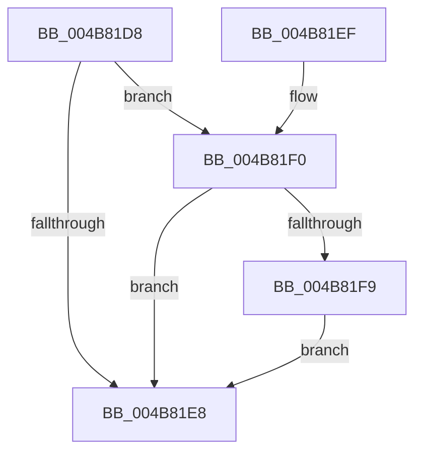

# HalpMcUpdateUnlock

- RVA: `0x004B81D8`–`0x004B8206` (길이 `46` bytes)
- VA: `0x00000001404B81D8`
- 실행 섹션: `.text`
- PDB 이름 있음: `예`; PDB Function 태그: `아니요`
- unwind 정보 RVA: `0x00068370`
- 디코드: `13`개 명령, `46/46` bytes 표시
- 미해석 바이트: `0` (있으면 어셈블리에 `.byte`로 보존)

> 이 문서는 커널 이미지의 기계어와 PDB 기호를 분석해 생성했습니다. 4번과 5번은 함수 원형과 자료형을 바이너리 사용 방식에서 추정한 C 해석이며 원본 소스 복구 결과는 아닙니다.

## 1. Dependencies

- 직접 호출 지점: **1**; 고유 호출 대상: **1**
- 직접 호출자로 확인된 함수: **3**
- RIP 상대 이미지 참조: **3**

### Outgoing calls
- `0x004B81FF` → [MmUnlockPreChargedPagedPool](../../page/AC/MmUnlockPreChargedPagedPool_function_00AC5940.md) (function, `0x00AC5940`)

### Direct callers
- [HalpPowerStateCallback](HalpPowerStateCallback_function_004B8150.md) at `0x004B8178`
- [HalStartDynamicProcessor](../54/HalStartDynamicProcessor_function_00543300.md) at `0x00543410`
- [HalpLoadMicrocode](../../page/70/HalpLoadMicrocode_function_0070B200.md) at `0x0070B402`

### Static image references
- `0x004B81DC` → RVA `0x00FC19F8` (`.data`; read)
- `0x004B81F0` → RVA `0x00F90532` (`.data`; read)
- `0x004B81F9` → RVA `0x00FC19F0` (`.data`; read)

## 2. Other-region calls and transfers

- 다른 실행 섹션으로 향하는 call: **1**
  - `0x004B81FF` → [MmUnlockPreChargedPagedPool](../../page/AC/MmUnlockPreChargedPagedPool_function_00AC5940.md) (`.text` → `PAGE`)
- 별도 외부 분기/꼬리 이동을 확인하지 못했습니다.

## 3. Assembly (complete function range)

```asm
004B81D8  48 83 EC 28                     sub rsp, 0x28
004B81DC  48 8B 0D 15 98 B0 00            mov rcx, qword ptr [rip + 0xb09815]
004B81E3  48 85 C9                        test rcx, rcx
004B81E6  75 08                           jne 0x1404b81f0
004B81E8  33 C0                           xor eax, eax
004B81EA  48 83 C4 28                     add rsp, 0x28
004B81EE  C3                              ret
004B81EF  CC                              int3
004B81F0  80 3D 3B 83 AD 00 00            cmp byte ptr [rip + 0xad833b], 0
004B81F7  74 EF                           je 0x1404b81e8
004B81F9  8B 15 F1 97 B0 00               mov edx, dword ptr [rip + 0xb097f1]
004B81FF  E8 3C D7 60 00                  call 0x140ac5940
004B8204  EB E2                           jmp 0x1404b81e8
```

## 4. C-style interpretation (structured pseudocode)

```c
__int64 __fastcall HalpMcUpdateUnlock(void)
{
    __int64 result;
    __int64 v_rsp;

    v_rsp = (v_rsp) - (40);
    if (*(unsigned __int64 *)(v_rip + 11573269) != 0) goto loc_004B81F0;
loc_004B81E8:
    result = 0;
    v_rsp = (v_rsp) + (40);
    return result;
loc_004B81F0:
    if ((*(unsigned __int8 *)(v_rip + 11371323)) == 0) goto loc_004B81E8;
    result = MmUnlockPreChargedPagedPool(*(unsigned __int64 *)(v_rip + 11573269), (unsigned int)(*(unsigned int *)(v_rip + 11573233)), a3, a4);
    goto loc_004B81E8;
}
```

## 5. (Beta) C Style

```c
void HalpMcUpdateUnlock(void)
{
    int64_t result;
    int64_t local_rsp;

    local_rsp = (local_rsp) - (40);
    if (*(uint64_t *)(v_rip + 0xB09815) != 0) goto loc_004B81F0;
loc_004B81E8:
    result = 0;
    local_rsp = (local_rsp) + (40);
    return result;
loc_004B81F0:
    if ((*(uint8_t *)(v_rip + 0xAD833B)) == 0) goto loc_004B81E8;
    result = MmUnlockPreChargedPagedPool(*(uint64_t *)(v_rip + 0xB09815), (uint32_t)(*(uint32_t *)(v_rip + 0xB097F1)), a3, a4);
    goto loc_004B81E8;
}
```

## 6. Execution-region graph

[열기: 2D/3D 그래프와 함수 탐색 컨트롤 패널](../../../control-panel.html?section=text&rva=0x004B81D8&view=graph)

- 2D 그래프는 위에서 아래로 흐르고, 3D 그래프는 빈 공간을 드래그해 회전합니다. Shift+드래그는 이동, 휠은 확대·축소, 함수 노드 선택은 대상 보고서 이동입니다.

### Static fallback


