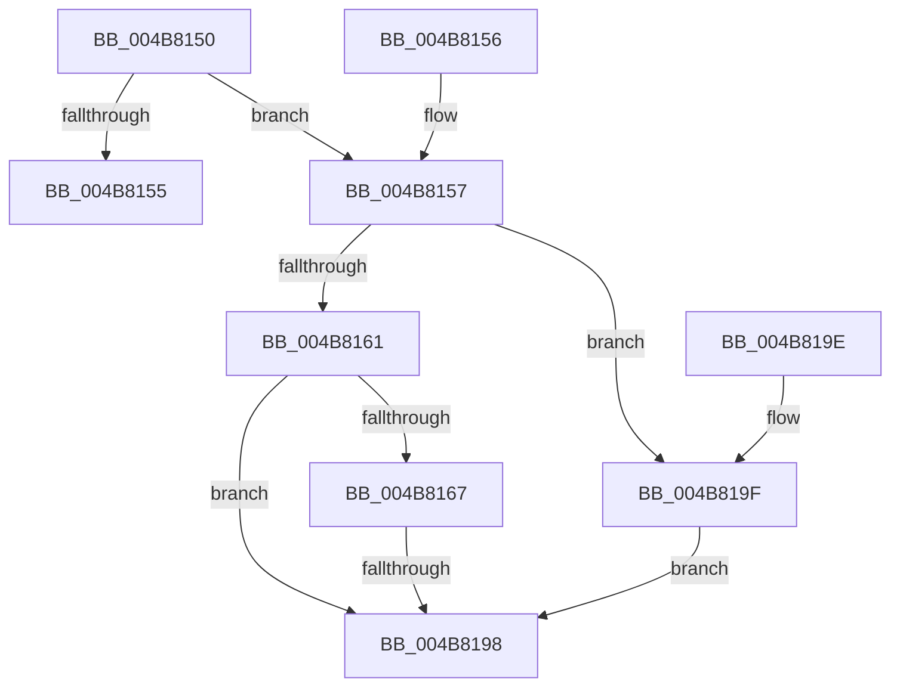

# HalpPowerStateCallback

- RVA: `0x004B8150`–`0x004B81D1` (길이 `129` bytes)
- VA: `0x00000001404B8150`
- 실행 섹션: `.text`
- PDB 이름 있음: `예`; PDB Function 태그: `예`
- unwind 정보 RVA: `0x000BAD28`
- 디코드: `32`개 명령, `129/129` bytes 표시
- 미해석 바이트: `0` (있으면 어셈블리에 `.byte`로 보존)

> 이 문서는 커널 이미지의 기계어와 PDB 기호를 분석해 생성했습니다. 4번과 5번은 함수 원형과 자료형을 바이너리 사용 방식에서 추정한 C 해석이며 원본 소스 복구 결과는 아닙니다.

## 1. Dependencies

- 직접 호출 지점: **7**; 고유 호출 대상: **7**
- 직접 호출자로 확인된 함수: **0**
- RIP 상대 이미지 참조: **5**

### Outgoing calls
- `0x004B816E` → [MmUnlockPagableImageSection](../2A/MmUnlockPagableImageSection_function_002A39F0.md) (function, `0x002A39F0`)
- `0x004B8173` → [HalpFreeNvsBuffers](../../pagelk/B7/HalpFreeNvsBuffers_function_00B7BD18.md) (function, `0x00B7BD18`)
- `0x004B8178` → [HalpMcUpdateUnlock](HalpMcUpdateUnlock_function_004B81D8.md) (function, `0x004B81D8`)
- `0x004B81B4` → [guard_dispatch_icall](../6B/guard_dispatch_icall_function_006BAAD0.md) (function, `0x006BAAD0`)
- `0x004B81C0` → [MmLockPagableSectionByHandle](../../page/A4/MmLockPagableSectionByHandle_function_00A4D1E0.md) (function, `0x00A4D1E0`)
- `0x004B81C5` → [HalpMapNvsArea](../../pagelk/B7/HalpMapNvsArea_function_00B7D180.md) (function, `0x00B7D180`)
- `0x004B81CA` → [HalpMcUpdateLock](../4C/HalpMcUpdateLock_function_004C6214.md) (function, `0x004C6214`)

### Direct callers
- 이 함수 시작 RVA로 연결되는 직접 call은 확인되지 않았습니다. 간접 호출은 완전히 역산할 수 없습니다.

### Static image references
- `0x004B8167` → RVA `0x00FC2158` (`.data`; read)
- `0x004B817D` → RVA `0x00FC3FD0` (`.data`; read)
- `0x004B8184` → RVA `0x00FC1A98` (`.data`; read/write)
- `0x004B819F` → RVA `0x00E00BA8` (`.data`; read)
- `0x004B81AA` → RVA `0x00FC1A98` (`.data`; write)

## 2. Other-region calls and transfers

- 다른 실행 섹션으로 향하는 call: **3**
  - `0x004B8173` → [HalpFreeNvsBuffers](../../pagelk/B7/HalpFreeNvsBuffers_function_00B7BD18.md) (`.text` → `PAGELK`)
  - `0x004B81C0` → [MmLockPagableSectionByHandle](../../page/A4/MmLockPagableSectionByHandle_function_00A4D1E0.md) (`.text` → `PAGE`)
  - `0x004B81C5` → [HalpMapNvsArea](../../pagelk/B7/HalpMapNvsArea_function_00B7D180.md) (`.text` → `PAGELK`)
- call이 아닌 외부 분기/꼬리 이동: **1**
  - `0x004B8192` → [sub_006FBE7C](../6F/Unknown_function_006FBE7C.md) (`tail-transfer`)

## 3. Assembly (complete function range)

```asm
004B8150  83 FA 03                        cmp edx, 3
004B8153  74 02                           je 0x1404b8157
004B8155  C3                              ret
004B8156  CC                              int3
004B8157  53                              push rbx
004B8158  48 83 EC 30                     sub rsp, 0x30
004B815C  45 85 C0                        test r8d, r8d
004B815F  74 3E                           je 0x1404b819f
004B8161  41 83 F8 01                     cmp r8d, 1
004B8165  75 31                           jne 0x1404b8198
004B8167  48 8B 0D EA 9F B0 00            mov rcx, qword ptr [rip + 0xb09fea]
004B816E  E8 7D B8 DE FF                  call 0x1402a39f0
004B8173  E8 A0 3B 6C 00                  call 0x140b7bd18
004B8178  E8 5B 00 00 00                  call 0x1404b81d8
004B817D  48 8B 1D 4C BE B0 00            mov rbx, qword ptr [rip + 0xb0be4c]
004B8184  83 25 0D 99 B0 00 00            and dword ptr [rip + 0xb0990d], 0
004B818B  83 BB E4 00 00 00 05            cmp dword ptr [rbx + 0xe4], 5
004B8192  0F 84 E4 3C 24 00               je 0x1406fbe7c
004B8198  48 83 C4 30                     add rsp, 0x30
004B819C  5B                              pop rbx
004B819D  C3                              ret
004B819E  CC                              int3
004B819F  48 8B 05 02 8A 94 00            mov rax, qword ptr [rip + 0x948a02]
004B81A6  33 D2                           xor edx, edx
004B81A8  33 C9                           xor ecx, ecx
004B81AA  C7 05 E4 98 B0 00 01 00 00 00   mov dword ptr [rip + 0xb098e4], 1
004B81B4  E8 17 29 20 00                  call 0x1406baad0
004B81B9  48 8B 0D 98 9F B0 00            mov rcx, qword ptr [rip + 0xb09f98]
004B81C0  E8 1B 50 59 00                  call 0x140a4d1e0
004B81C5  E8 B6 4F 6C 00                  call 0x140b7d180
004B81CA  E8 45 E0 00 00                  call 0x1404c6214
004B81CF  EB C7                           jmp 0x1404b8198
```

## 4. C-style interpretation (structured pseudocode)

```c
__int64 __fastcall HalpPowerStateCallback(__int64 a1, int a2, int a3)
{
    __int64 result;
    __int64 v_rsp;

    if (a2 == 3) goto loc_004B8157;
    return result;
loc_004B8157:
    v_rsp = (v_rsp) - (48);
    if (a3 == 0) goto loc_004B819F;
    if (a3 != 1) goto loc_004B8198;
    result = MmUnlockPagableImageSection(*(unsigned __int64 *)(v_rip + 11575274), a2, a3, a4);
    result = HalpFreeNvsBuffers(*(unsigned __int64 *)(v_rip + 11575274), a2, a3, a4);
    result = HalpMcUpdateUnlock(*(unsigned __int64 *)(v_rip + 11575274), a2, a3, a4);
loc_004B8198:
    v_rsp = (v_rsp) + (48);
    return result;
loc_004B819F:
    a2 = 0;
    a1 = 0;
    *(unsigned int *)(v_rip + 11573476) = 1;
    result = guard_dispatch_icall(a1, a2, a3, a4);
    result = MmLockPagableSectionByHandle(*(unsigned __int64 *)(v_rip + 11575192), a2, a3, a4);
    result = HalpMapNvsArea(*(unsigned __int64 *)(v_rip + 11575192), a2, a3, a4);
    result = HalpMcUpdateLock(*(unsigned __int64 *)(v_rip + 11575192), a2, a3, a4);
    goto loc_004B8198;
}
```

## 5. (Beta) C Style

```c
int64_t HalpPowerStateCallback(int64_t Arg1, int32_t Arg2, int32_t Arg3)
{
    int64_t result;
    int64_t local_rsp;

    if (Arg2 == 3) goto loc_004B8157;
    return result;
loc_004B8157:
    local_rsp = (local_rsp) - (48);
    if (Arg3 == 0) goto loc_004B819F;
    if (Arg3 != 1) goto loc_004B8198;
    result = MmUnlockPagableImageSection(*(uint64_t *)(v_rip + 0xB09FEA), Arg2, Arg3, a4);
    result = HalpFreeNvsBuffers(*(uint64_t *)(v_rip + 0xB09FEA), Arg2, Arg3, a4);
    result = HalpMcUpdateUnlock(*(uint64_t *)(v_rip + 0xB09FEA), Arg2, Arg3, a4);
loc_004B8198:
    local_rsp = (local_rsp) + (48);
    return result;
loc_004B819F:
    Arg2 = 0;
    Arg1 = 0;
    *(uint32_t *)(v_rip + 0xB098E4) = 1;
    result = guard_dispatch_icall(Arg1, Arg2, Arg3, a4);
    result = MmLockPagableSectionByHandle(*(uint64_t *)(v_rip + 0xB09F98), Arg2, Arg3, a4);
    result = HalpMapNvsArea(*(uint64_t *)(v_rip + 0xB09F98), Arg2, Arg3, a4);
    result = HalpMcUpdateLock(*(uint64_t *)(v_rip + 0xB09F98), Arg2, Arg3, a4);
    goto loc_004B8198;
}
```

## 6. Execution-region graph

[열기: 2D/3D 그래프와 함수 탐색 컨트롤 패널](../../../control-panel.html?section=text&rva=0x004B8150&view=graph)

- 2D 그래프는 위에서 아래로 흐르고, 3D 그래프는 빈 공간을 드래그해 회전합니다. Shift+드래그는 이동, 휠은 확대·축소, 함수 노드 선택은 대상 보고서 이동입니다.

### Static fallback


