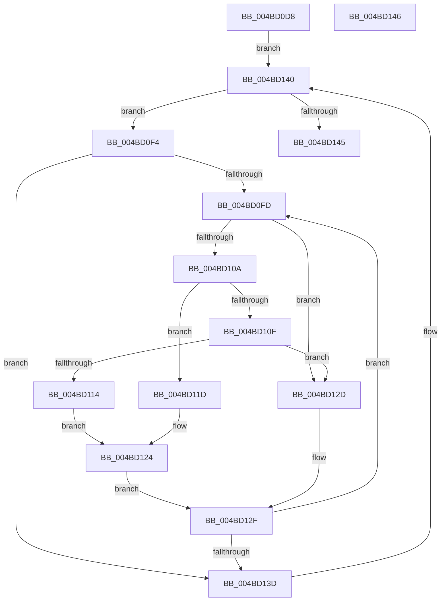

# HalpRestartPmcCounterSet

- RVA: `0x004BD0D8`–`0x004BD147` (길이 `111` bytes)
- VA: `0x00000001404BD0D8`
- 실행 섹션: `.text`
- PDB 이름 있음: `예`; PDB Function 태그: `아니요`
- unwind 정보 RVA: `0x000DB714`
- 디코드: `35`개 명령, `111/111` bytes 표시
- 미해석 바이트: `0` (있으면 어셈블리에 `.byte`로 보존)

> 이 문서는 커널 이미지의 기계어와 PDB 기호를 분석해 생성했습니다. 4번과 5번은 함수 원형과 자료형을 바이너리 사용 방식에서 추정한 C 해석이며 원본 소스 복구 결과는 아닙니다.

## 1. Dependencies

- 직접 호출 지점: **0**; 고유 호출 대상: **0**
- 직접 호출자로 확인된 함수: **1**
- RIP 상대 이미지 참조: **1**

### Outgoing calls
- 직접 디코드된 call 명령이 없습니다.

### Direct callers
- [HalpRestartProfiling](HalpRestartProfiling_function_004BD0A4.md) at `0x004BD0B8`

### Static image references
- `0x004BD0E4` → RVA `0x00FC2C30` (`.data`; read)

## 2. Other-region calls and transfers

- 다른 실행 섹션으로 향하는 call: **0**
- 별도 외부 분기/꼬리 이동을 확인하지 못했습니다.

## 3. Assembly (complete function range)

```asm
004BD0D8  65 8B 04 25 A4 01 00 00         mov eax, dword ptr gs:[0x1a4]
004BD0E0  48 8D 14 40                     lea rdx, [rax + rax*2]
004BD0E4  48 8B 05 45 5B B0 00            mov rax, qword ptr [rip + 0xb05b45]
004BD0EB  4C 8D 1C D0                     lea r11, [rax + rdx*8]
004BD0EF  4D 8B 03                        mov r8, qword ptr [r11]
004BD0F2  EB 4C                           jmp 0x1404bd140
004BD0F4  45 33 C9                        xor r9d, r9d
004BD0F7  45 39 48 14                     cmp dword ptr [r8 + 0x14], r9d
004BD0FB  76 40                           jbe 0x1404bd13d
004BD0FD  4F 8D 14 89                     lea r10, [r9 + r9*4]
004BD101  43 8B 4C D0 2C                  mov ecx, dword ptr [r8 + r10*8 + 0x2c]
004BD106  85 C9                           test ecx, ecx
004BD108  74 23                           je 0x1404bd12d
004BD10A  83 E9 01                        sub ecx, 1
004BD10D  74 0E                           je 0x1404bd11d
004BD10F  83 F9 01                        cmp ecx, 1
004BD112  75 19                           jne 0x1404bd12d
004BD114  43 8B 4C D0 30                  mov ecx, dword ptr [r8 + r10*8 + 0x30]
004BD119  0F 32                           rdmsr
004BD11B  EB 07                           jmp 0x1404bd124
004BD11D  43 8B 4C D0 30                  mov ecx, dword ptr [r8 + r10*8 + 0x30]
004BD122  0F 33                           rdpmc
004BD124  48 C1 E2 20                     shl rdx, 0x20
004BD128  48 0B C2                        or rax, rdx
004BD12B  EB 02                           jmp 0x1404bd12f
004BD12D  33 C0                           xor eax, eax
004BD12F  41 FF C1                        inc r9d
004BD132  4B 89 44 D0 18                  mov qword ptr [r8 + r10*8 + 0x18], rax
004BD137  45 3B 48 14                     cmp r9d, dword ptr [r8 + 0x14]
004BD13B  72 C0                           jb 0x1404bd0fd
004BD13D  4D 8B 00                        mov r8, qword ptr [r8]
004BD140  4D 3B C3                        cmp r8, r11
004BD143  75 AF                           jne 0x1404bd0f4
004BD145  C3                              ret
004BD146  CC                              int3
```

## 4. C-style interpretation (structured pseudocode)

```c
__int64 __fastcall HalpRestartPmcCounterSet(__int64 a1, __int64 a2, __int64 a3, int a4)
{
    __int64 result;

    goto loc_004BD140;
loc_004BD0F4:
    a4 = 0;
    if ((*(unsigned int *)(*(unsigned __int64 *)(*(unsigned __int64 *)(v_rip + 11557701) + (unsigned int)(*(unsigned int *)(gs_base + (0 + 420))) + (unsigned int)(*(unsigned int *)(gs_base + (0 + 420))) * 2 * 8) + 20)) <= 0) goto loc_004BD13D;
loc_004BD0FD:
    if ((unsigned int)((unsigned int)(*(unsigned int *)(*(unsigned __int64 *)(*(unsigned __int64 *)(v_rip + 11557701) + (unsigned int)(*(unsigned int *)(gs_base + (0 + 420))) + (unsigned int)(*(unsigned int *)(gs_base + (0 + 420))) * 2 * 8) + a4 + a4 * 4 * 8 + 44))) == 0) goto loc_004BD12D;
    a1 = (unsigned int)(((unsigned int)(*(unsigned int *)(*(unsigned __int64 *)(*(unsigned __int64 *)(v_rip + 11557701) + (unsigned int)(*(unsigned int *)(gs_base + (0 + 420))) + (unsigned int)(*(unsigned int *)(gs_base + (0 + 420))) * 2 * 8) + a4 + a4 * 4 * 8 + 44))) - (1));
    if (condition_is_equal) goto loc_004BD11D;
    if (((unsigned int)(a1)) != 1) goto loc_004BD12D;
    goto loc_004BD124;
loc_004BD11D:
loc_004BD124:
    a2 = ((unsigned int)(*(unsigned int *)(gs_base + (0 + 420))) + (unsigned int)(*(unsigned int *)(gs_base + (0 + 420))) * 2) << (32);
    result = (*(unsigned __int64 *)(v_rip + 11557701)) | (a2);
    goto loc_004BD12F;
loc_004BD12D:
    result = 0;
loc_004BD12F:
    a4 = (unsigned int)((a4) + 1);
    *(unsigned __int64 *)(*(unsigned __int64 *)(*(unsigned __int64 *)(v_rip + 11557701) + (unsigned int)(*(unsigned int *)(gs_base + (0 + 420))) + (unsigned int)(*(unsigned int *)(gs_base + (0 + 420))) * 2 * 8) + a4 + a4 * 4 * 8 + 24) = 0;
    if (a4 < (*(unsigned int *)(*(unsigned __int64 *)(*(unsigned __int64 *)(v_rip + 11557701) + (unsigned int)(*(unsigned int *)(gs_base + (0 + 420))) + (unsigned int)(*(unsigned int *)(gs_base + (0 + 420))) * 2 * 8) + 20))) goto loc_004BD0FD;
loc_004BD13D:
loc_004BD140:
    if ((*(unsigned __int64 *)(*(unsigned __int64 *)(*(unsigned __int64 *)(v_rip + 11557701) + (unsigned int)(*(unsigned int *)(gs_base + (0 + 420))) + (unsigned int)(*(unsigned int *)(gs_base + (0 + 420))) * 2 * 8))) != (*(unsigned __int64 *)(v_rip + 11557701) + (unsigned int)(*(unsigned int *)(gs_base + (0 + 420))) + (unsigned int)(*(unsigned int *)(gs_base + (0 + 420))) * 2 * 8)) goto loc_004BD0F4;
    return result;
}
```

## 5. (Beta) C Style

```c
int64_t HalpRestartPmcCounterSet(int64_t Arg1, int64_t Arg2, int64_t Arg3, int32_t Arg4)
{
    int64_t result;

    goto loc_004BD140;
loc_004BD0F4:
    Arg4 = 0;
    if ((*(uint32_t *)(*(uint64_t *)(*(uint64_t *)(v_rip + 0xB05B45) + (uint32_t)(*(uint32_t *)(gs_base + (0 + 0x1A4))) + (uint32_t)(*(uint32_t *)(gs_base + (0 + 0x1A4))) * 2 * 8) + 0x14)) <= 0) goto loc_004BD13D;
loc_004BD0FD:
    if ((uint32_t)((uint32_t)(*(uint32_t *)(*(uint64_t *)(*(uint64_t *)(v_rip + 0xB05B45) + (uint32_t)(*(uint32_t *)(gs_base + (0 + 0x1A4))) + (uint32_t)(*(uint32_t *)(gs_base + (0 + 0x1A4))) * 2 * 8) + Arg4 + Arg4 * 4 * 8 + 0x2C))) == 0) goto loc_004BD12D;
    Arg1 = (uint32_t)(((uint32_t)(*(uint32_t *)(*(uint64_t *)(*(uint64_t *)(v_rip + 0xB05B45) + (uint32_t)(*(uint32_t *)(gs_base + (0 + 0x1A4))) + (uint32_t)(*(uint32_t *)(gs_base + (0 + 0x1A4))) * 2 * 8) + Arg4 + Arg4 * 4 * 8 + 0x2C))) - (1));
    if (condition_is_equal) goto loc_004BD11D;
    if (((uint32_t)(Arg1)) != 1) goto loc_004BD12D;
    goto loc_004BD124;
loc_004BD11D:
loc_004BD124:
    Arg2 = ((uint32_t)(*(uint32_t *)(gs_base + (0 + 0x1A4))) + (uint32_t)(*(uint32_t *)(gs_base + (0 + 0x1A4))) * 2) << (32);
    result = (*(uint64_t *)(v_rip + 0xB05B45)) | (Arg2);
    goto loc_004BD12F;
loc_004BD12D:
    result = 0;
loc_004BD12F:
    Arg4 = (uint32_t)((Arg4) + 1);
    *(uint64_t *)(*(uint64_t *)(*(uint64_t *)(v_rip + 0xB05B45) + (uint32_t)(*(uint32_t *)(gs_base + (0 + 0x1A4))) + (uint32_t)(*(uint32_t *)(gs_base + (0 + 0x1A4))) * 2 * 8) + Arg4 + Arg4 * 4 * 8 + 0x18) = 0;
    if (Arg4 < (*(uint32_t *)(*(uint64_t *)(*(uint64_t *)(v_rip + 0xB05B45) + (uint32_t)(*(uint32_t *)(gs_base + (0 + 0x1A4))) + (uint32_t)(*(uint32_t *)(gs_base + (0 + 0x1A4))) * 2 * 8) + 0x14))) goto loc_004BD0FD;
loc_004BD13D:
loc_004BD140:
    if ((*(uint64_t *)(*(uint64_t *)(*(uint64_t *)(v_rip + 0xB05B45) + (uint32_t)(*(uint32_t *)(gs_base + (0 + 0x1A4))) + (uint32_t)(*(uint32_t *)(gs_base + (0 + 0x1A4))) * 2 * 8))) != (*(uint64_t *)(v_rip + 0xB05B45) + (uint32_t)(*(uint32_t *)(gs_base + (0 + 0x1A4))) + (uint32_t)(*(uint32_t *)(gs_base + (0 + 0x1A4))) * 2 * 8)) goto loc_004BD0F4;
    return result;
}
```

## 6. Execution-region graph

[열기: 2D/3D 그래프와 함수 탐색 컨트롤 패널](../../../control-panel.html?section=text&rva=0x004BD0D8&view=graph)

- 2D 그래프는 위에서 아래로 흐르고, 3D 그래프는 빈 공간을 드래그해 회전합니다. Shift+드래그는 이동, 휠은 확대·축소, 함수 노드 선택은 대상 보고서 이동입니다.

### Static fallback


