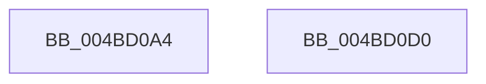

# HalpRestartProfiling

- RVA: `0x004BD0A4`–`0x004BD0D1` (길이 `45` bytes)
- VA: `0x00000001404BD0A4`
- 실행 섹션: `.text`
- PDB 이름 있음: `예`; PDB Function 태그: `아니요`
- unwind 정보 RVA: `0x0005C788`
- 디코드: `11`개 명령, `45/45` bytes 표시
- 미해석 바이트: `0` (있으면 어셈블리에 `.byte`로 보존)

> 이 문서는 커널 이미지의 기계어와 PDB 기호를 분석해 생성했습니다. 4번과 5번은 함수 원형과 자료형을 바이너리 사용 방식에서 추정한 C 해석이며 원본 소스 복구 결과는 아닙니다.

## 1. Dependencies

- 직접 호출 지점: **3**; 고유 호출 대상: **2**
- 직접 호출자로 확인된 함수: **2**
- RIP 상대 이미지 참조: **2**

### Outgoing calls
- `0x004BD0B3` → [guard_dispatch_icall](../6B/guard_dispatch_icall_function_006BAAD0.md) (function, `0x006BAAD0`)
- `0x004BD0B8` → [HalpRestartPmcCounterSet](HalpRestartPmcCounterSet_function_004BD0D8.md) (function, `0x004BD0D8`)
- `0x004BD0C6` → [guard_dispatch_icall](../6B/guard_dispatch_icall_function_006BAAD0.md) (function, `0x006BAAD0`)

### Direct callers
- [HalpPostSleepMP](../../pagelk/B5/HalpPostSleepMP_function_00B5ECC4.md) at `0x00B5EE3E`
- [HalpDpPostReplaceInitialization](../../pagelk/B5/HalpDpPostReplaceInitialization_function_00B5FE3C.md) at `0x00B5FF65`

### Static image references
- `0x004BD0A8` → RVA `0x00E03B20` (`.data`; read)
- `0x004BD0BD` → RVA `0x00E00C08` (`.data`; read)

## 2. Other-region calls and transfers

- 다른 실행 섹션으로 향하는 call: **0**
- 별도 외부 분기/꼬리 이동을 확인하지 못했습니다.

## 3. Assembly (complete function range)

```asm
004BD0A4  48 83 EC 28                     sub rsp, 0x28
004BD0A8  48 8B 05 71 6A 94 00            mov rax, qword ptr [rip + 0x946a71]
004BD0AF  48 8B 40 38                     mov rax, qword ptr [rax + 0x38]
004BD0B3  E8 18 DA 1F 00                  call 0x1406baad0
004BD0B8  E8 1B 00 00 00                  call 0x1404bd0d8
004BD0BD  48 8B 05 44 3B 94 00            mov rax, qword ptr [rip + 0x943b44]
004BD0C4  B1 01                           mov cl, 1
004BD0C6  E8 05 DA 1F 00                  call 0x1406baad0
004BD0CB  48 83 C4 28                     add rsp, 0x28
004BD0CF  C3                              ret
004BD0D0  CC                              int3
```

## 4. C-style interpretation (structured pseudocode)

```c
__int64 __fastcall HalpRestartProfiling(void)
{
    __int64 result;
    __int64 v_rsp;

    v_rsp = (v_rsp) - (40);
    result = guard_dispatch_icall(a1, a2, a3, a4);
    result = HalpRestartPmcCounterSet(a1, a2, a3, a4);
    result = guard_dispatch_icall(1, a2, a3, a4);
    v_rsp = (v_rsp) + (40);
    return result;
}
```

## 5. (Beta) C Style

```c
void HalpRestartProfiling(void)
{
    int64_t result;
    int64_t local_rsp;

    local_rsp = (local_rsp) - (40);
    result = guard_dispatch_icall(a1, a2, a3, a4);
    result = HalpRestartPmcCounterSet(a1, a2, a3, a4);
    result = guard_dispatch_icall(1, a2, a3, a4);
    local_rsp = (local_rsp) + (40);
    return result;
}
```

## 6. Execution-region graph

[열기: 2D/3D 그래프와 함수 탐색 컨트롤 패널](../../../control-panel.html?section=text&rva=0x004BD0A4&view=graph)

- 2D 그래프는 위에서 아래로 흐르고, 3D 그래프는 빈 공간을 드래그해 회전합니다. Shift+드래그는 이동, 휠은 확대·축소, 함수 노드 선택은 대상 보고서 이동입니다.

### Static fallback


