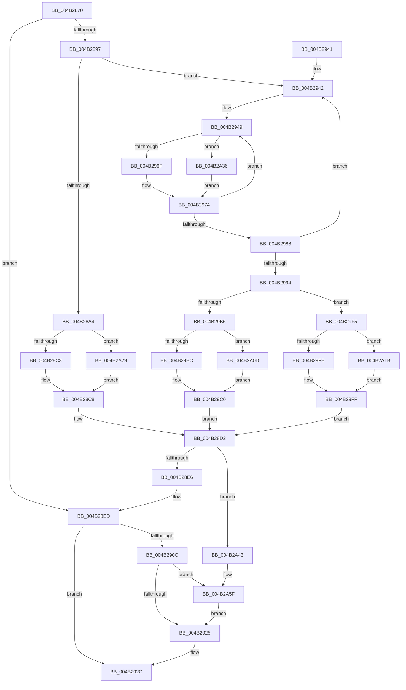

# HalpTimerDpcRoutine

- RVA: `0x004B2870`–`0x004B2A72` (길이 `514` bytes)
- VA: `0x00000001404B2870`
- 실행 섹션: `.text`
- PDB 이름 있음: `예`; PDB Function 태그: `아니요`
- unwind 정보 RVA: `0x000B95E4`
- 디코드: `125`개 명령, `514/514` bytes 표시
- 미해석 바이트: `0` (있으면 어셈블리에 `.byte`로 보존)

> 이 문서는 커널 이미지의 기계어와 PDB 기호를 분석해 생성했습니다. 4번과 5번은 함수 원형과 자료형을 바이너리 사용 방식에서 추정한 C 해석이며 원본 소스 복구 결과는 아닙니다.

## 1. Dependencies

- 직접 호출 지점: **9**; 고유 호출 대상: **7**
- 직접 호출자로 확인된 함수: **0**
- RIP 상대 이미지 참조: **8**

### Outgoing calls
- `0x004B2886` → [KeQueryPerformanceCounter](../37/KeQueryPerformanceCounter_function_0037E7E0.md) (function, `0x0037E7E0`)
- `0x004B28A7` → [HalpTimerGetInternalData](../20/HalpTimerGetInternalData_function_00209500.md) (function, `0x00209500`)
- `0x004B28C3` → [HalpHvCounterQueryCounter](../37/HalpHvCounterQueryCounter_function_00378F50.md) (function, `0x00378F50`)
- `0x004B2953` → [HalpTimerGetInternalData](../20/HalpTimerGetInternalData_function_00209500.md) (function, `0x00209500`)
- `0x004B296F` → [HalpHpetQueryCounter](../37/HalpHpetQueryCounter_function_00379660.md) (function, `0x00379660`)
- `0x004B2A2C` → [guard_dispatch_icall](../6B/guard_dispatch_icall_function_006BAAD0.md) (function, `0x006BAAD0`)
- `0x004B2A39` → [guard_dispatch_icall](../6B/guard_dispatch_icall_function_006BAAD0.md) (function, `0x006BAAD0`)
- `0x004B2A59` → [KeBugCheckEx](../4F/KeBugCheckEx_function_004FD660.md) (function, `0x004FD660`)
- `0x004B2A68` → [KeInsertQueueDpc](../20/KeInsertQueueDpc_function_00207C50.md) (function, `0x00207C50`)

### Direct callers
- 이 함수 시작 RVA로 연결되는 직접 call은 확인되지 않았습니다. 간접 호출은 완전히 역산할 수 없습니다.

### Static image references
- `0x004B288B` → RVA `0x00FC4140` (`.data`; read)
- `0x004B28B0` → RVA `0x00378F50` (`HalpHvCounterQueryCounter`; read)
- `0x004B28D2` → RVA `0x00FC22A8` (`.data`; read)
- `0x004B28E6` → RVA `0x00FC22A8` (`.data`; write)
- `0x004B28FD` → RVA `0x00FC22A0` (`.data`; read)
- `0x004B290C` → RVA `0x00FC8C40` (`ALMOSTRO`; read)
- `0x004B2925` → RVA `0x00FC22A0` (`.data`; write)
- `0x004B295C` → RVA `0x00379660` (`HalpHpetQueryCounter`; read)

## 2. Other-region calls and transfers

- 다른 실행 섹션으로 향하는 call: **0**
- 별도 외부 분기/꼬리 이동을 확인하지 못했습니다.

## 3. Assembly (complete function range)

```asm
004B2870  48 89 5C 24 08                  mov qword ptr [rsp + 8], rbx
004B2875  48 89 6C 24 10                  mov qword ptr [rsp + 0x10], rbp
004B287A  48 89 74 24 18                  mov qword ptr [rsp + 0x18], rsi
004B287F  57                              push rdi
004B2880  48 83 EC 30                     sub rsp, 0x30
004B2884  33 C9                           xor ecx, ecx
004B2886  E8 55 BF EC FF                  call 0x14037e7e0
004B288B  48 8B 3D AE 18 B1 00            mov rdi, qword ptr [rip + 0xb118ae]
004B2892  48 85 FF                        test rdi, rdi
004B2895  74 56                           je 0x1404b28ed
004B2897  83 BF DC 00 00 00 40            cmp dword ptr [rdi + 0xdc], 0x40
004B289E  0F 85 9E 00 00 00               jne 0x1404b2942
004B28A4  48 8B CF                        mov rcx, rdi
004B28A7  E8 54 6C D5 FF                  call 0x140209500
004B28AC  48 8B 57 70                     mov rdx, qword ptr [rdi + 0x70]
004B28B0  48 8D 0D 99 66 EC FF            lea rcx, [rip - 0x139967]
004B28B7  48 3B D1                        cmp rdx, rcx
004B28BA  48 8B C8                        mov rcx, rax
004B28BD  0F 85 66 01 00 00               jne 0x1404b2a29
004B28C3  E8 88 66 EC FF                  call 0x140378f50
004B28C8  48 8B B7 D0 00 00 00            mov rsi, qword ptr [rdi + 0xd0]
004B28CF  4C 8B C0                        mov r8, rax
004B28D2  48 8B 0D CF F9 B0 00            mov rcx, qword ptr [rip + 0xb0f9cf]
004B28D9  4A 8D 04 06                     lea rax, [rsi + r8]
004B28DD  48 3B C1                        cmp rax, rcx
004B28E0  0F 82 5D 01 00 00               jb 0x1404b2a43
004B28E6  48 89 05 BB F9 B0 00            mov qword ptr [rip + 0xb0f9bb], rax
004B28ED  48 BB 14 00 00 00 80 F7 FF FF   movabs rbx, 0xfffff78000000014
004B28F7  48 8B 1B                        mov rbx, qword ptr [rbx]
004B28FA  48 8B C3                        mov rax, rbx
004B28FD  48 2B 05 9C F9 B0 00            sub rax, qword ptr [rip + 0xb0f99c]
004B2904  48 3D 00 8C 86 47               cmp rax, 0x47868c00
004B290A  72 20                           jb 0x1404b292c
004B290C  48 8B 05 2D 63 B1 00            mov rax, qword ptr [rip + 0xb1632d]
004B2913  33 C9                           xor ecx, ecx
004B2915  48 87 88 E0 00 00 00            xchg qword ptr [rax + 0xe0], rcx
004B291C  48 85 C9                        test rcx, rcx
004B291F  0F 85 3A 01 00 00               jne 0x1404b2a5f
004B2925  48 89 1D 74 F9 B0 00            mov qword ptr [rip + 0xb0f974], rbx
004B292C  48 8B 5C 24 40                  mov rbx, qword ptr [rsp + 0x40]
004B2931  48 8B 6C 24 48                  mov rbp, qword ptr [rsp + 0x48]
004B2936  48 8B 74 24 50                  mov rsi, qword ptr [rsp + 0x50]
004B293B  48 83 C4 30                     add rsp, 0x30
004B293F  5F                              pop rdi
004B2940  C3                              ret
004B2941  CC                              int3
004B2942  48 8B B7 D0 00 00 00            mov rsi, qword ptr [rdi + 0xd0]
004B2949  48 8B 9F C8 00 00 00            mov rbx, qword ptr [rdi + 0xc8]
004B2950  48 8B CF                        mov rcx, rdi
004B2953  E8 A8 6B D5 FF                  call 0x140209500
004B2958  48 8B 57 70                     mov rdx, qword ptr [rdi + 0x70]
004B295C  48 8D 0D FD 6C EC FF            lea rcx, [rip - 0x139303]
004B2963  48 3B D1                        cmp rdx, rcx
004B2966  48 8B C8                        mov rcx, rax
004B2969  0F 85 C7 00 00 00               jne 0x1404b2a36
004B296F  E8 EC 6C EC FF                  call 0x140379660
004B2974  48 8B E8                        mov rbp, rax
004B2977  F0 83 0C 24 00                  lock or dword ptr [rsp], 0
004B297C  48 8B 87 C8 00 00 00            mov rax, qword ptr [rdi + 0xc8]
004B2983  48 3B D8                        cmp rbx, rax
004B2986  75 C1                           jne 0x1404b2949
004B2988  48 8B 8F D0 00 00 00            mov rcx, qword ptr [rdi + 0xd0]
004B298F  48 3B F1                        cmp rsi, rcx
004B2992  75 AE                           jne 0x1404b2942
004B2994  44 8B 97 DC 00 00 00            mov r10d, dword ptr [rdi + 0xdc]
004B299B  41 BB 01 00 00 00               mov r11d, 1
004B29A1  41 8B D3                        mov edx, r11d
004B29A4  41 8D 4A FF                     lea ecx, [r10 - 1]
004B29A8  48 D3 E2                        shl rdx, cl
004B29AB  48 8B CD                        mov rcx, rbp
004B29AE  48 33 CB                        xor rcx, rbx
004B29B1  48 85 CA                        test rdx, rcx
004B29B4  74 3F                           je 0x1404b29f5
004B29B6  41 83 FA 40                     cmp r10d, 0x40
004B29BA  75 51                           jne 0x1404b2a0d
004B29BC  49 83 C9 FF                     or r9, 0xffffffffffffffff
004B29C0  45 33 C0                        xor r8d, r8d
004B29C3  4C 23 CB                        and r9, rbx
004B29C6  49 8B D1                        mov rdx, r9
004B29C9  41 8B CA                        mov ecx, r10d
004B29CC  48 33 D3                        xor rdx, rbx
004B29CF  49 D3 E3                        shl r11, cl
004B29D2  48 0B D5                        or rdx, rbp
004B29D5  41 83 FA 40                     cmp r10d, 0x40
004B29D9  4D 0F 45 C3                     cmovne r8, r11
004B29DD  4C 03 C2                        add r8, rdx
004B29E0  49 3B E9                        cmp rbp, r9
004B29E3  4C 0F 43 C2                     cmovae r8, rdx
004B29E7  F0 4C 0F B1 87 C8 00 00 00      lock cmpxchg qword ptr [rdi + 0xc8], r8
004B29F0  E9 DD FE FF FF                  jmp 0x1404b28d2
004B29F5  41 83 FA 40                     cmp r10d, 0x40
004B29F9  75 20                           jne 0x1404b2a1b
004B29FB  49 83 C8 FF                     or r8, 0xffffffffffffffff
004B29FF  49 F7 D0                        not r8
004B2A02  4C 23 C3                        and r8, rbx
004B2A05  4C 0B C5                        or r8, rbp
004B2A08  E9 C5 FE FF FF                  jmp 0x1404b28d2
004B2A0D  41 8B CA                        mov ecx, r10d
004B2A10  4D 8B CB                        mov r9, r11
004B2A13  49 D3 E1                        shl r9, cl
004B2A16  4D 2B CB                        sub r9, r11
004B2A19  EB A5                           jmp 0x1404b29c0
004B2A1B  41 8B CA                        mov ecx, r10d
004B2A1E  4D 8B C3                        mov r8, r11
004B2A21  49 D3 E0                        shl r8, cl
004B2A24  4D 2B C3                        sub r8, r11
004B2A27  EB D6                           jmp 0x1404b29ff
004B2A29  48 8B C2                        mov rax, rdx
004B2A2C  E8 9F 80 20 00                  call 0x1406baad0
004B2A31  E9 92 FE FF FF                  jmp 0x1404b28c8
004B2A36  48 8B C2                        mov rax, rdx
004B2A39  E8 92 80 20 00                  call 0x1406baad0
004B2A3E  E9 31 FF FF FF                  jmp 0x1404b2974
004B2A43  48 89 4C 24 20                  mov qword ptr [rsp + 0x20], rcx
004B2A48  4C 8B C8                        mov r9, rax
004B2A4B  B9 5C 00 00 00                  mov ecx, 0x5c
004B2A50  BA 13 01 00 00                  mov edx, 0x113
004B2A55  44 8D 41 CB                     lea r8d, [rcx - 0x35]
004B2A59  E8 02 AC 04 00                  call 0x1404fd660
004B2A5E  CC                              int3
004B2A5F  4C 8B C3                        mov r8, rbx
004B2A62  8B D3                           mov edx, ebx
004B2A64  49 C1 E8 20                     shr r8, 0x20
004B2A68  E8 E3 51 D5 FF                  call 0x140207c50
004B2A6D  E9 B3 FE FF FF                  jmp 0x1404b2925
```

## 4. C-style interpretation (structured pseudocode)

```c
__int64 __fastcall HalpTimerDpcRoutine(int a1, __int64 a2, __int64 a3, __int64 a4)
{
    __int64 result;
    __int64 v_r11;
    __int64 v_rsp;
    unsigned int v_stack_p0;
    unsigned __int64 v_stack_p10;
    unsigned __int64 v_stack_p18;
    unsigned __int64 v_stack_p20;
    unsigned __int64 v_stack_p8;

    v_stack_p8 = v_rbx;
    v_stack_p10 = v_rbp;
    v_stack_p18 = v_rsi;
    v_rsp = (v_rsp) - (48);
    a1 = 0;
    result = KeQueryPerformanceCounter(a1, a2, a3, a4);
    if (*(unsigned __int64 *)(v_rip + 11606190) == 0) goto loc_004B28ED;
    if ((*(unsigned int *)(*(unsigned __int64 *)(v_rip + 11606190) + 220)) != 64) goto loc_004B2942;
    result = HalpTimerGetInternalData(*(unsigned __int64 *)(v_rip + 11606190), a2, a3, a4);
    if ((*(unsigned __int64 *)(*(unsigned __int64 *)(v_rip + 11606190) + 112)) != (v_rip - 1284455)) goto loc_004B2A29;
    result = HalpHvCounterQueryCounter(result, *(unsigned __int64 *)(*(unsigned __int64 *)(v_rip + 11606190) + 112), a3, a4);
loc_004B28C8:
loc_004B28D2:
    if ((*(unsigned __int64 *)(*(unsigned __int64 *)(v_rip + 11606190) + 208) + result * 1) < (*(unsigned __int64 *)(v_rip + 11598287))) goto loc_004B2A43;
    *(unsigned __int64 *)(v_rip + 11598267) = *(unsigned __int64 *)(*(unsigned __int64 *)(v_rip + 11606190) + 208) + result * 1;
loc_004B28ED:
    result = (*(unsigned __int64 *)(v_rbx)) - (*(unsigned __int64 *)(v_rip + 11598236));
    if (result < 0x47868C00ULL) goto loc_004B292C;
    a1 = 0;
    if (0 != 0) goto loc_004B2A5F;
loc_004B2925:
    *(unsigned __int64 *)(v_rip + 11598196) = *(unsigned __int64 *)(v_rbx);
loc_004B292C:
    v_rsp = (v_rsp) + (48);
    return *(unsigned __int64 *)(v_rip + 11625261);
loc_004B2942:
loc_004B2949:
    result = HalpTimerGetInternalData(*(unsigned __int64 *)(v_rip + 11606190), *(unsigned __int64 *)(*(unsigned __int64 *)(v_rip + 11606190) + 112), result, a4);
    if ((*(unsigned __int64 *)(*(unsigned __int64 *)(v_rip + 11606190) + 112)) != (v_rip - 1282819)) goto loc_004B2A36;
    result = HalpHpetQueryCounter(result, *(unsigned __int64 *)(*(unsigned __int64 *)(v_rip + 11606190) + 112), result, a4);
loc_004B2974:
    if ((*(unsigned __int64 *)(*(unsigned __int64 *)(v_rip + 11606190) + 200)) != (*(unsigned __int64 *)(*(unsigned __int64 *)(v_rip + 11606190) + 200))) goto loc_004B2949;
    if ((*(unsigned __int64 *)(*(unsigned __int64 *)(v_rip + 11606190) + 208)) != (*(unsigned __int64 *)(*(unsigned __int64 *)(v_rip + 11606190) + 208))) goto loc_004B2942;
    a2 = (1) << ((unsigned __int8)((unsigned int)(*(unsigned int *)(*(unsigned __int64 *)(v_rip + 11606190) + 220)) - 1));
    a1 = (result) ^ (*(unsigned __int64 *)(*(unsigned __int64 *)(v_rip + 11606190) + 200));
    if (((a2) & (a1)) == 0) goto loc_004B29F5;
    if (((unsigned int)((unsigned int)(*(unsigned int *)(*(unsigned __int64 *)(v_rip + 11606190) + 220)))) != 64) goto loc_004B2A0D;
    a4 = (a4) | (-1);
loc_004B29C0:
    a3 = 0;
    a4 = (a4) & (*(unsigned __int64 *)(*(unsigned __int64 *)(v_rip + 11606190) + 200));
    a2 = (a4) ^ (*(unsigned __int64 *)(*(unsigned __int64 *)(v_rip + 11606190) + 200));
    v_r11 = (1) << ((unsigned __int8)((unsigned int)((unsigned int)((unsigned int)(*(unsigned int *)(*(unsigned __int64 *)(v_rip + 11606190) + 220))))));
    a2 = (a2) | (result);
    if (((unsigned int)((unsigned int)(*(unsigned int *)(*(unsigned __int64 *)(v_rip + 11606190) + 220)))) != 64) { a3 = v_r11; }
    a3 = (a3) + (a2);
    if (result >= a4) { a3 = a2; }
    goto loc_004B28D2;
loc_004B29F5:
    if (((unsigned int)((unsigned int)(*(unsigned int *)(*(unsigned __int64 *)(v_rip + 11606190) + 220)))) != 64) goto loc_004B2A1B;
    a3 = (a3) | (-1);
loc_004B29FF:
    a3 = ~(a3);
    a3 = (a3) & (*(unsigned __int64 *)(*(unsigned __int64 *)(v_rip + 11606190) + 200));
    a3 = (a3) | (result);
    goto loc_004B28D2;
loc_004B2A0D:
    a4 = (v_r11) << ((unsigned __int8)((unsigned int)((unsigned int)((unsigned int)(*(unsigned int *)(*(unsigned __int64 *)(v_rip + 11606190) + 220))))));
    a4 = (a4) - (v_r11);
    goto loc_004B29C0;
loc_004B2A1B:
    a3 = (v_r11) << ((unsigned __int8)((unsigned int)((unsigned int)((unsigned int)(*(unsigned int *)(*(unsigned __int64 *)(v_rip + 11606190) + 220))))));
    a3 = (a3) - (v_r11);
    goto loc_004B29FF;
loc_004B2A29:
    result = guard_dispatch_icall((unsigned int)((unsigned int)((unsigned int)(*(unsigned int *)(*(unsigned __int64 *)(v_rip + 11606190) + 220)))), a2, a3, a4);
    goto loc_004B28C8;
loc_004B2A36:
    result = guard_dispatch_icall((unsigned int)((unsigned int)((unsigned int)(*(unsigned int *)(*(unsigned __int64 *)(v_rip + 11606190) + 220)))), a2, a3, a4);
    goto loc_004B2974;
loc_004B2A43:
    v_stack_p20 = (unsigned int)((unsigned int)((unsigned int)(*(unsigned int *)(*(unsigned __int64 *)(v_rip + 11606190) + 220))));
    result = KeBugCheckEx(92, 275, 92 - 53, result);
loc_004B2A5F:
    a3 = (*(unsigned __int64 *)(*(unsigned __int64 *)(v_rip + 11606190) + 200)) >> (32);
    result = KeInsertQueueDpc(92, (unsigned int)((unsigned int)(*(unsigned __int64 *)(*(unsigned __int64 *)(v_rip + 11606190) + 200))), a3, result);
    goto loc_004B2925;
}
```

## 5. (Beta) C Style

```c
int64_t HalpTimerDpcRoutine(int32_t Arg1, int64_t Arg2, int64_t Arg3, int64_t Arg4)
{
    int64_t result;
    int64_t local_r11;
    int64_t local_rsp;
    uint32_t v_stack_p0;
    uint64_t v_stack_p10;
    uint64_t v_stack_p18;
    uint64_t v_stack_p20;
    uint64_t v_stack_p8;

    v_stack_p8 = local_rbx;
    v_stack_p10 = local_rbp;
    v_stack_p18 = local_rsi;
    local_rsp = (local_rsp) - (48);
    Arg1 = 0;
    result = KeQueryPerformanceCounter(Arg1, Arg2, Arg3, Arg4);
    if (*(uint64_t *)(v_rip + 0xB118AE) == 0) goto loc_004B28ED;
    if ((*(uint32_t *)(*(uint64_t *)(v_rip + 0xB118AE) + 0xDC)) != 64) goto loc_004B2942;
    result = HalpTimerGetInternalData(*(uint64_t *)(v_rip + 0xB118AE), Arg2, Arg3, Arg4);
    if ((*(uint64_t *)(*(uint64_t *)(v_rip + 0xB118AE) + 0x70)) != (v_rip - 1284455)) goto loc_004B2A29;
    result = HalpHvCounterQueryCounter(result, *(uint64_t *)(*(uint64_t *)(v_rip + 0xB118AE) + 0x70), Arg3, Arg4);
loc_004B28C8:
loc_004B28D2:
    if ((*(uint64_t *)(*(uint64_t *)(v_rip + 0xB118AE) + 0xD0) + result * 1) < (*(uint64_t *)(v_rip + 0xB0F9CF))) goto loc_004B2A43;
    *(uint64_t *)(v_rip + 0xB0F9BB) = *(uint64_t *)(*(uint64_t *)(v_rip + 0xB118AE) + 0xD0) + result * 1;
loc_004B28ED:
    result = (*(uint64_t *)(local_rbx)) - (*(uint64_t *)(v_rip + 0xB0F99C));
    if (result < 0x47868C00ULL) goto loc_004B292C;
    Arg1 = 0;
    if (0 != 0) goto loc_004B2A5F;
loc_004B2925:
    *(uint64_t *)(v_rip + 0xB0F974) = *(uint64_t *)(local_rbx);
loc_004B292C:
    local_rsp = (local_rsp) + (48);
    return *(uint64_t *)(v_rip + 0xB1632D);
loc_004B2942:
loc_004B2949:
    result = HalpTimerGetInternalData(*(uint64_t *)(v_rip + 0xB118AE), *(uint64_t *)(*(uint64_t *)(v_rip + 0xB118AE) + 0x70), result, Arg4);
    if ((*(uint64_t *)(*(uint64_t *)(v_rip + 0xB118AE) + 0x70)) != (v_rip - 1282819)) goto loc_004B2A36;
    result = HalpHpetQueryCounter(result, *(uint64_t *)(*(uint64_t *)(v_rip + 0xB118AE) + 0x70), result, Arg4);
loc_004B2974:
    if ((*(uint64_t *)(*(uint64_t *)(v_rip + 0xB118AE) + 0xC8)) != (*(uint64_t *)(*(uint64_t *)(v_rip + 0xB118AE) + 0xC8))) goto loc_004B2949;
    if ((*(uint64_t *)(*(uint64_t *)(v_rip + 0xB118AE) + 0xD0)) != (*(uint64_t *)(*(uint64_t *)(v_rip + 0xB118AE) + 0xD0))) goto loc_004B2942;
    Arg2 = (1) << ((uint8_t)((uint32_t)(*(uint32_t *)(*(uint64_t *)(v_rip + 0xB118AE) + 0xDC)) - 1));
    Arg1 = (result) ^ (*(uint64_t *)(*(uint64_t *)(v_rip + 0xB118AE) + 0xC8));
    if (((Arg2) & (Arg1)) == 0) goto loc_004B29F5;
    if (((uint32_t)((uint32_t)(*(uint32_t *)(*(uint64_t *)(v_rip + 0xB118AE) + 0xDC)))) != 64) goto loc_004B2A0D;
    Arg4 = (Arg4) | (-1);
loc_004B29C0:
    Arg3 = 0;
    Arg4 = (Arg4) & (*(uint64_t *)(*(uint64_t *)(v_rip + 0xB118AE) + 0xC8));
    Arg2 = (Arg4) ^ (*(uint64_t *)(*(uint64_t *)(v_rip + 0xB118AE) + 0xC8));
    local_r11 = (1) << ((uint8_t)((uint32_t)((uint32_t)((uint32_t)(*(uint32_t *)(*(uint64_t *)(v_rip + 0xB118AE) + 0xDC))))));
    Arg2 = (Arg2) | (result);
    if (((uint32_t)((uint32_t)(*(uint32_t *)(*(uint64_t *)(v_rip + 0xB118AE) + 0xDC)))) != 64) { Arg3 = local_r11; }
    Arg3 = (Arg3) + (Arg2);
    if (result >= Arg4) { Arg3 = Arg2; }
    goto loc_004B28D2;
loc_004B29F5:
    if (((uint32_t)((uint32_t)(*(uint32_t *)(*(uint64_t *)(v_rip + 0xB118AE) + 0xDC)))) != 64) goto loc_004B2A1B;
    Arg3 = (Arg3) | (-1);
loc_004B29FF:
    Arg3 = ~(Arg3);
    Arg3 = (Arg3) & (*(uint64_t *)(*(uint64_t *)(v_rip + 0xB118AE) + 0xC8));
    Arg3 = (Arg3) | (result);
    goto loc_004B28D2;
loc_004B2A0D:
    Arg4 = (local_r11) << ((uint8_t)((uint32_t)((uint32_t)((uint32_t)(*(uint32_t *)(*(uint64_t *)(v_rip + 0xB118AE) + 0xDC))))));
    Arg4 = (Arg4) - (local_r11);
    goto loc_004B29C0;
loc_004B2A1B:
    Arg3 = (local_r11) << ((uint8_t)((uint32_t)((uint32_t)((uint32_t)(*(uint32_t *)(*(uint64_t *)(v_rip + 0xB118AE) + 0xDC))))));
    Arg3 = (Arg3) - (local_r11);
    goto loc_004B29FF;
loc_004B2A29:
    result = guard_dispatch_icall((uint32_t)((uint32_t)((uint32_t)(*(uint32_t *)(*(uint64_t *)(v_rip + 0xB118AE) + 0xDC)))), Arg2, Arg3, Arg4);
    goto loc_004B28C8;
loc_004B2A36:
    result = guard_dispatch_icall((uint32_t)((uint32_t)((uint32_t)(*(uint32_t *)(*(uint64_t *)(v_rip + 0xB118AE) + 0xDC)))), Arg2, Arg3, Arg4);
    goto loc_004B2974;
loc_004B2A43:
    v_stack_p20 = (uint32_t)((uint32_t)((uint32_t)(*(uint32_t *)(*(uint64_t *)(v_rip + 0xB118AE) + 0xDC))));
    result = KeBugCheckEx(92, 275, 92 - 53, result);
loc_004B2A5F:
    Arg3 = (*(uint64_t *)(*(uint64_t *)(v_rip + 0xB118AE) + 0xC8)) >> (32);
    result = KeInsertQueueDpc(92, (uint32_t)((uint32_t)(*(uint64_t *)(*(uint64_t *)(v_rip + 0xB118AE) + 0xC8))), Arg3, result);
    goto loc_004B2925;
}
```

## 6. Execution-region graph

[열기: 2D/3D 그래프와 함수 탐색 컨트롤 패널](../../../control-panel.html?section=text&rva=0x004B2870&view=graph)

- 2D 그래프는 위에서 아래로 흐르고, 3D 그래프는 빈 공간을 드래그해 회전합니다. Shift+드래그는 이동, 휠은 확대·축소, 함수 노드 선택은 대상 보고서 이동입니다.

### Static fallback


