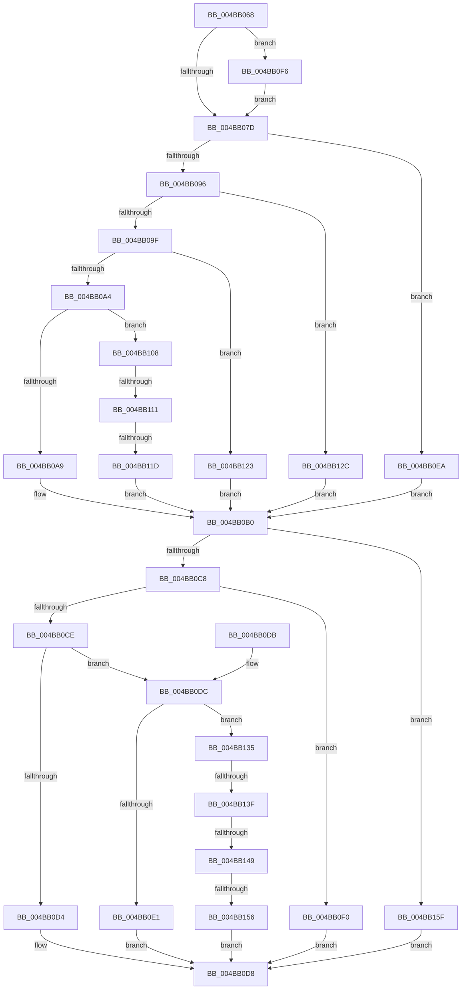

# HalpTimerQueryClockSourceType

- RVA: `0x004BB068`–`0x004BB168` (길이 `256` bytes)
- VA: `0x00000001404BB068`
- 실행 섹션: `.text`
- PDB 이름 있음: `예`; PDB Function 태그: `예`
- unwind 정보 RVA: `0x000DB714`
- 디코드: `61`개 명령, `256/256` bytes 표시
- 미해석 바이트: `0` (있으면 어셈블리에 `.byte`로 보존)

> 이 문서는 커널 이미지의 기계어와 PDB 기호를 분석해 생성했습니다. 4번과 5번은 함수 원형과 자료형을 바이너리 사용 방식에서 추정한 C 해석이며 원본 소스 복구 결과는 아닙니다.

## 1. Dependencies

- 직접 호출 지점: **0**; 고유 호출 대상: **0**
- 직접 호출자로 확인된 함수: **1**
- RIP 상대 이미지 참조: **3**

### Outgoing calls
- 직접 디코드된 call 명령이 없습니다.

### Direct callers
- [HaliQuerySystemInformation](../../pagelk/B7/HaliQuerySystemInformation_function_00B7A990.md) at `0x00B7AA1E`

### Static image references
- `0x004BB068` → RVA `0x00FC40F0` (`.data`; read)
- `0x004BB0B0` → RVA `0x00FC3FD0` (`.data`; read)
- `0x004BB0F6` → RVA `0x00FC2248` (`.data`; read)

## 2. Other-region calls and transfers

- 다른 실행 섹션으로 향하는 call: **0**
- call이 아닌 외부 분기/꼬리 이동: **5**
  - `0x004BB10B` → `0x006FC63A` (`tail-transfer`)
  - `0x004BB117` → `0x006FC62E` (`tail-transfer`)
  - `0x004BB139` → `0x006FC65E` (`tail-transfer`)
  - `0x004BB143` → `0x006FC652` (`tail-transfer`)
  - `0x004BB150` → `0x006FC646` (`tail-transfer`)

## 3. Assembly (complete function range)

```asm
004BB068  48 8B 05 81 90 B0 00            mov rax, qword ptr [rip + 0xb09081]
004BB06F  48 8B D1                        mov rdx, rcx
004BB072  8B 88 E4 00 00 00               mov ecx, dword ptr [rax + 0xe4]
004BB078  83 F9 0C                        cmp ecx, 0xc
004BB07B  74 79                           je 0x1404bb0f6
004BB07D  41 BA 05 00 00 00               mov r10d, 5
004BB083  C7 02 01 00 00 00               mov dword ptr [rdx], 1
004BB089  45 8D 4A FE                     lea r9d, [r10 - 2]
004BB08D  45 8D 5A 01                     lea r11d, [r10 + 1]
004BB091  41 2B C9                        sub ecx, r9d
004BB094  74 54                           je 0x1404bb0ea
004BB096  83 E9 02                        sub ecx, 2
004BB099  0F 84 8D 00 00 00               je 0x1404bb12c
004BB09F  83 E9 02                        sub ecx, 2
004BB0A2  74 7F                           je 0x1404bb123
004BB0A4  83 E9 01                        sub ecx, 1
004BB0A7  75 5F                           jne 0x1404bb108
004BB0A9  C7 42 04 0A 00 00 00            mov dword ptr [rdx + 4], 0xa
004BB0B0  48 8B 0D 19 8F B0 00            mov rcx, qword ptr [rip + 0xb08f19]
004BB0B7  44 8B 81 E4 00 00 00            mov r8d, dword ptr [rcx + 0xe4]
004BB0BE  41 83 E8 01                     sub r8d, 1
004BB0C2  0F 84 97 00 00 00               je 0x1404bb15f
004BB0C8  41 83 E8 02                     sub r8d, 2
004BB0CC  74 22                           je 0x1404bb0f0
004BB0CE  41 83 E8 02                     sub r8d, 2
004BB0D2  75 08                           jne 0x1404bb0dc
004BB0D4  44 89 5A 08                     mov dword ptr [rdx + 8], r11d
004BB0D8  33 C0                           xor eax, eax
004BB0DA  C3                              ret
004BB0DB  CC                              int3
004BB0DC  45 2B C1                        sub r8d, r9d
004BB0DF  75 54                           jne 0x1404bb135
004BB0E1  C7 42 08 07 00 00 00            mov dword ptr [rdx + 8], 7
004BB0E8  EB EE                           jmp 0x1404bb0d8
004BB0EA  44 89 52 04                     mov dword ptr [rdx + 4], r10d
004BB0EE  EB C0                           jmp 0x1404bb0b0
004BB0F0  44 89 52 08                     mov dword ptr [rdx + 8], r10d
004BB0F4  EB E2                           jmp 0x1404bb0d8
004BB0F6  48 8B 05 4B 71 B0 00            mov rax, qword ptr [rip + 0xb0714b]
004BB0FD  8B 88 E4 00 00 00               mov ecx, dword ptr [rax + 0xe4]
004BB103  E9 75 FF FF FF                  jmp 0x1404bb07d
004BB108  41 2B C9                        sub ecx, r9d
004BB10B  0F 84 29 15 24 00               je 0x1406fc63a
004BB111  81 F9 F5 0F 00 00               cmp ecx, 0xff5
004BB117  0F 84 11 15 24 00               je 0x1406fc62e
004BB11D  83 62 04 00                     and dword ptr [rdx + 4], 0
004BB121  EB 8D                           jmp 0x1404bb0b0
004BB123  C7 42 04 09 00 00 00            mov dword ptr [rdx + 4], 9
004BB12A  EB 84                           jmp 0x1404bb0b0
004BB12C  44 89 5A 04                     mov dword ptr [rdx + 4], r11d
004BB130  E9 7B FF FF FF                  jmp 0x1404bb0b0
004BB135  41 83 E8 02                     sub r8d, 2
004BB139  0F 84 1F 15 24 00               je 0x1406fc65e
004BB13F  41 83 E8 01                     sub r8d, 1
004BB143  0F 84 09 15 24 00               je 0x1406fc652
004BB149  41 81 F8 F5 0F 00 00            cmp r8d, 0xff5
004BB150  0F 84 F0 14 24 00               je 0x1406fc646
004BB156  83 62 08 00                     and dword ptr [rdx + 8], 0
004BB15A  E9 79 FF FF FF                  jmp 0x1404bb0d8
004BB15F  44 89 4A 08                     mov dword ptr [rdx + 8], r9d
004BB163  E9 70 FF FF FF                  jmp 0x1404bb0d8
```

## 4. C-style interpretation (structured pseudocode)

```c
__int64 __fastcall HalpTimerQueryClockSourceType(__int64 a1)
{
    __int64 result;

    if (((unsigned int)((unsigned int)(*(unsigned int *)(*(unsigned __int64 *)(v_rip + 11571329) + 228)))) == 12) goto loc_004BB0F6;
loc_004BB07D:
    *(unsigned int *)(a1) = 1;
    a1 = (unsigned int)(((unsigned int)(*(unsigned int *)(*(unsigned __int64 *)(v_rip + 11571329) + 228))) - ((unsigned int)(5 - 2)));
    if (condition_is_equal) goto loc_004BB0EA;
    a1 = (unsigned int)((a1) - (2));
    if (condition_is_equal) goto loc_004BB12C;
    a1 = (unsigned int)((a1) - (2));
    if (condition_is_equal) goto loc_004BB123;
    a1 = (unsigned int)((a1) - (1));
    if (condition_is_not_equal) goto loc_004BB108;
    *(unsigned int *)(a1 + 4) = 10;
loc_004BB0B0:
    a3 = (unsigned int)(((unsigned int)(*(unsigned int *)(*(unsigned __int64 *)(v_rip + 11570969) + 228))) - (1));
    if (condition_is_equal) goto loc_004BB15F;
    a3 = (unsigned int)((a3) - (2));
    if (condition_is_equal) goto loc_004BB0F0;
    a3 = (unsigned int)((a3) - (2));
    if (condition_is_not_equal) goto loc_004BB0DC;
    *(unsigned int *)(a1 + 8) = (unsigned int)(5 + 1);
loc_004BB0D8:
    result = 0;
    return result;
loc_004BB0DC:
    a3 = (unsigned int)((a3) - ((unsigned int)(5 - 2)));
    if (condition_is_not_equal) goto loc_004BB135;
    *(unsigned int *)(a1 + 8) = 7;
    goto loc_004BB0D8;
loc_004BB0EA:
    *(unsigned int *)(a1 + 4) = 5;
    goto loc_004BB0B0;
loc_004BB0F0:
    *(unsigned int *)(a1 + 8) = 5;
    goto loc_004BB0D8;
loc_004BB0F6:
    goto loc_004BB07D;
loc_004BB108:
    a1 = (unsigned int)(((unsigned int)(*(unsigned int *)(*(unsigned __int64 *)(v_rip + 11563339) + 228))) - ((unsigned int)(5 - 2)));
    goto loc_004BB0B0;
loc_004BB123:
    *(unsigned int *)(a1 + 4) = 9;
    goto loc_004BB0B0;
loc_004BB12C:
    *(unsigned int *)(a1 + 4) = (unsigned int)(5 + 1);
    goto loc_004BB0B0;
loc_004BB135:
    a3 = (unsigned int)((a3) - (2));
    a3 = (unsigned int)((a3) - (1));
    goto loc_004BB0D8;
loc_004BB15F:
    *(unsigned int *)(a1 + 8) = (unsigned int)(5 - 2);
    goto loc_004BB0D8;
}
```

## 5. (Beta) C Style

```c
int64_t HalpTimerQueryClockSourceType(void *Arg1)
{
    uint8_t *arg1 = (uint8_t *)Arg1;

    int64_t result;

    if (((uint32_t)((uint32_t)(*(uint32_t *)(*(uint64_t *)(v_rip + 0xB09081) + 0xE4)))) == 12) goto loc_004BB0F6;
loc_004BB07D:
    *(uint32_t *)(arg1) = 1;
    Arg1 = (uint32_t)(((uint32_t)(*(uint32_t *)(*(uint64_t *)(v_rip + 0xB09081) + 0xE4))) - ((uint32_t)(5 - 2)));
    if (condition_is_equal) goto loc_004BB0EA;
    Arg1 = (uint32_t)((Arg1) - (2));
    if (condition_is_equal) goto loc_004BB12C;
    Arg1 = (uint32_t)((Arg1) - (2));
    if (condition_is_equal) goto loc_004BB123;
    Arg1 = (uint32_t)((Arg1) - (1));
    if (condition_is_not_equal) goto loc_004BB108;
    *(uint32_t *)(arg1 + 0x4) = 10;
loc_004BB0B0:
    a3 = (uint32_t)(((uint32_t)(*(uint32_t *)(*(uint64_t *)(v_rip + 0xB08F19) + 0xE4))) - (1));
    if (condition_is_equal) goto loc_004BB15F;
    a3 = (uint32_t)((a3) - (2));
    if (condition_is_equal) goto loc_004BB0F0;
    a3 = (uint32_t)((a3) - (2));
    if (condition_is_not_equal) goto loc_004BB0DC;
    *(uint32_t *)(arg1 + 0x8) = (uint32_t)(5 + 1);
loc_004BB0D8:
    result = 0;
    return result;
loc_004BB0DC:
    a3 = (uint32_t)((a3) - ((uint32_t)(5 - 2)));
    if (condition_is_not_equal) goto loc_004BB135;
    *(uint32_t *)(arg1 + 0x8) = 7;
    goto loc_004BB0D8;
loc_004BB0EA:
    *(uint32_t *)(arg1 + 0x4) = 5;
    goto loc_004BB0B0;
loc_004BB0F0:
    *(uint32_t *)(arg1 + 0x8) = 5;
    goto loc_004BB0D8;
loc_004BB0F6:
    goto loc_004BB07D;
loc_004BB108:
    Arg1 = (uint32_t)(((uint32_t)(*(uint32_t *)(*(uint64_t *)(v_rip + 0xB0714B) + 0xE4))) - ((uint32_t)(5 - 2)));
    goto loc_004BB0B0;
loc_004BB123:
    *(uint32_t *)(arg1 + 0x4) = 9;
    goto loc_004BB0B0;
loc_004BB12C:
    *(uint32_t *)(arg1 + 0x4) = (uint32_t)(5 + 1);
    goto loc_004BB0B0;
loc_004BB135:
    a3 = (uint32_t)((a3) - (2));
    a3 = (uint32_t)((a3) - (1));
    goto loc_004BB0D8;
loc_004BB15F:
    *(uint32_t *)(arg1 + 0x8) = (uint32_t)(5 - 2);
    goto loc_004BB0D8;
}
```

### 관측된 메모리 오프셋

구조체 형식이 확인되지 않은 접근은 인자 기준의 오프셋으로만 기록했습니다.

| 기준 인자 | 오프셋 표현 | 폭 (bit) | 접근 |
|---|---:|---:|---|
| `Arg1` | `+ 0x0` | `32` | `W` |
| `Arg1` | `+ 0x4` | `32` | `R/W` |
| `Arg1` | `+ 0x4` | `32` | `W` |
| `Arg1` | `+ 0x8` | `32` | `R/W` |
| `Arg1` | `+ 0x8` | `32` | `W` |

## 6. Execution-region graph

[열기: 2D/3D 그래프와 함수 탐색 컨트롤 패널](../../../control-panel.html?section=text&rva=0x004BB068&view=graph)

- 2D 그래프는 위에서 아래로 흐르고, 3D 그래프는 빈 공간을 드래그해 회전합니다. Shift+드래그는 이동, 휠은 확대·축소, 함수 노드 선택은 대상 보고서 이동입니다.

### Static fallback


