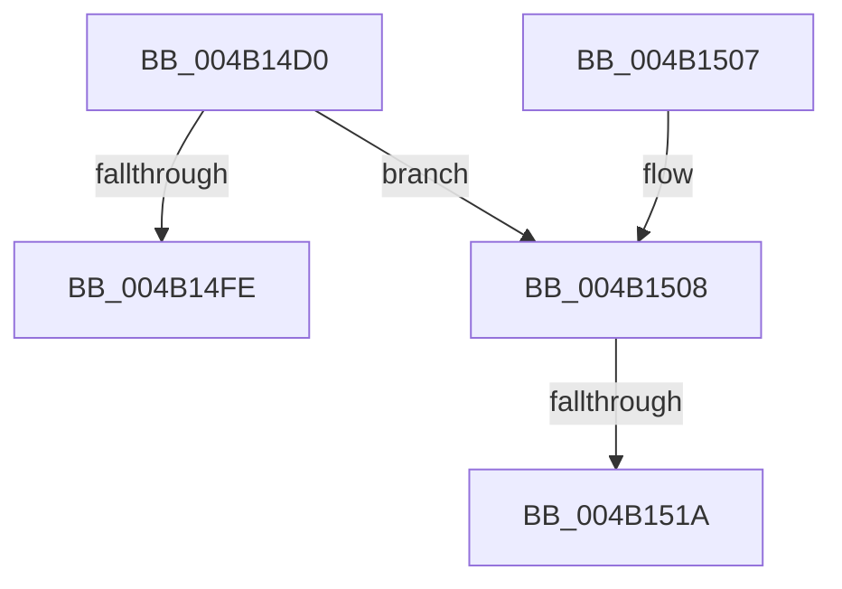

# HalpTimerQueryWakeTime

- RVA: `0x004B14D0`–`0x004B1525` (길이 `85` bytes)
- VA: `0x00000001404B14D0`
- 실행 섹션: `.text`
- PDB 이름 있음: `예`; PDB Function 태그: `예`
- unwind 정보 RVA: `0x000A73FC`
- 디코드: `23`개 명령, `85/85` bytes 표시
- 미해석 바이트: `0` (있으면 어셈블리에 `.byte`로 보존)

> 이 문서는 커널 이미지의 기계어와 PDB 기호를 분석해 생성했습니다. 4번과 5번은 함수 원형과 자료형을 바이너리 사용 방식에서 추정한 C 해석이며 원본 소스 복구 결과는 아닙니다.

## 1. Dependencies

- 직접 호출 지점: **0**; 고유 호출 대상: **0**
- 직접 호출자로 확인된 함수: **0**
- RIP 상대 이미지 참조: **3**

### Outgoing calls
- 직접 디코드된 call 명령이 없습니다.

### Direct callers
- 이 함수 시작 RVA로 연결되는 직접 call은 확인되지 않았습니다. 간접 호출은 완전히 역산할 수 없습니다.

### Static image references
- `0x004B14D5` → RVA `0x00FC3F98` (`.data`; read)
- `0x004B14DE` → RVA `0x00FC4048` (`.data`; read)
- `0x004B151A` → RVA `0x00FC404C` (`.data`; write)

## 2. Other-region calls and transfers

- 다른 실행 섹션으로 향하는 call: **0**
- call이 아닌 외부 분기/꼬리 이동: **2**
  - `0x004B1514` → [sub_006FB32E](../6F/Unknown_function_006FB32E.md) (`tail-transfer`)
  - `0x004B1520` → [sub_006FB32E](../6F/Unknown_function_006FB32E.md) (`tail-transfer`)

## 3. Assembly (complete function range)

```asm
004B14D0  48 89 5C 24 08                  mov qword ptr [rsp + 8], rbx
004B14D5  4C 8B 0D BC 2A B1 00            mov r9, qword ptr [rip + 0xb12abc]
004B14DC  33 DB                           xor ebx, ebx
004B14DE  4C 8B 1D 63 2B B1 00            mov r11, qword ptr [rip + 0xb12b63]
004B14E5  4C 8B D2                        mov r10, rdx
004B14E8  4D 3B CB                        cmp r9, r11
004B14EB  44 0F B6 C3                     movzx r8d, bl
004B14EF  4C 89 09                        mov qword ptr [rcx], r9
004B14F2  8D 43 01                        lea eax, [rbx + 1]
004B14F5  44 0F 42 C0                     cmovb r8d, eax
004B14F9  48 85 D2                        test rdx, rdx
004B14FC  75 0A                           jne 0x1404b1508
004B14FE  48 8B 5C 24 08                  mov rbx, qword ptr [rsp + 8]
004B1503  41 8A C0                        mov al, r8b
004B1506  C3                              ret
004B1507  CC                              int3
004B1508  0F 31                           rdtsc
004B150A  48 C1 E2 20                     shl rdx, 0x20
004B150E  48 0B C2                        or rax, rdx
004B1511  4C 3B D8                        cmp r11, rax
004B1514  0F 86 14 9E 24 00               jbe 0x1406fb32e
004B151A  89 1D 2C 2B B1 00               mov dword ptr [rip + 0xb12b2c], ebx
004B1520  E9 09 9E 24 00                  jmp 0x1406fb32e
```

## 4. C-style interpretation (structured pseudocode)

```c
__int64 __fastcall HalpTimerQueryWakeTime(__int64 a1, __int64 a2)
{
    __int64 result;
    __int64 v_rbx;
    unsigned __int64 v_stack_p8;

    v_stack_p8 = v_rbx;
    v_rbx = 0;
    *(unsigned __int64 *)(a1) = *(unsigned __int64 *)(v_rip + 11610812);
    a3 = 0;
    if ((*(unsigned __int64 *)(v_rip + 11610812)) < (*(unsigned __int64 *)(v_rip + 11610979))) { a3 = (unsigned int)(v_rbx + 1); }
    if (a2 != 0) goto loc_004B1508;
    return (unsigned __int8)(a3);
loc_004B1508:
    a2 = (a2) << (32);
    result = ((unsigned __int8)(a3)) | (a2);
    *(unsigned int *)(v_rip + 11610924) = (unsigned int)(v_stack_p8);
}
```

## 5. (Beta) C Style

```c
int64_t HalpTimerQueryWakeTime(void *Arg1, int64_t Arg2)
{
    uint8_t *arg1 = (uint8_t *)Arg1;

    int64_t result;
    int64_t local_rbx;
    uint64_t v_stack_p8;

    v_stack_p8 = local_rbx;
    local_rbx = 0;
    *(uint64_t *)(arg1) = *(uint64_t *)(v_rip + 0xB12ABC);
    a3 = 0;
    if ((*(uint64_t *)(v_rip + 0xB12ABC)) < (*(uint64_t *)(v_rip + 0xB12B63))) { a3 = (uint32_t)(local_rbx + 1); }
    if (Arg2 != 0) goto loc_004B1508;
    return (uint8_t)(a3);
loc_004B1508:
    Arg2 = (Arg2) << (32);
    result = ((uint8_t)(a3)) | (Arg2);
    *(uint32_t *)(v_rip + 0xB12B2C) = (uint32_t)(v_stack_p8);
}
```

### 관측된 메모리 오프셋

구조체 형식이 확인되지 않은 접근은 인자 기준의 오프셋으로만 기록했습니다.

| 기준 인자 | 오프셋 표현 | 폭 (bit) | 접근 |
|---|---:|---:|---|
| `Arg1` | `+ 0x0` | `64` | `W` |

## 6. Execution-region graph

[열기: 2D/3D 그래프와 함수 탐색 컨트롤 패널](../../../control-panel.html?section=text&rva=0x004B14D0&view=graph)

- 2D 그래프는 위에서 아래로 흐르고, 3D 그래프는 빈 공간을 드래그해 회전합니다. Shift+드래그는 이동, 휠은 확대·축소, 함수 노드 선택은 대상 보고서 이동입니다.

### Static fallback


