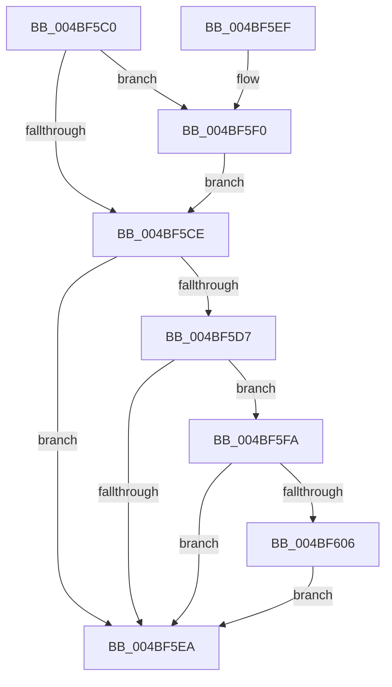

# HalpTimerReportIdleStateUsage

- RVA: `0x004BF5C0`–`0x004BF614` (길이 `84` bytes)
- VA: `0x00000001404BF5C0`
- 실행 섹션: `.text`
- PDB 이름 있음: `예`; PDB Function 태그: `아니요`
- unwind 정보 RVA: `0x00076838`
- 디코드: `22`개 명령, `84/84` bytes 표시
- 미해석 바이트: `0` (있으면 어셈블리에 `.byte`로 보존)

> 이 문서는 커널 이미지의 기계어와 PDB 기호를 분석해 생성했습니다. 4번과 5번은 함수 원형과 자료형을 바이너리 사용 방식에서 추정한 C 해석이며 원본 소스 복구 결과는 아닙니다.

## 1. Dependencies

- 직접 호출 지점: **1**; 고유 호출 대상: **1**
- 직접 호출자로 확인된 함수: **0**
- RIP 상대 이미지 참조: **5**

### Outgoing calls
- `0x004BF60D` → [HalpTscFallbackToPlatformSource](../54/HalpTscFallbackToPlatformSource_function_0054AD14.md) (function, `0x0054AD14`)

### Direct callers
- 이 함수 시작 RVA로 연결되는 직접 call은 확인되지 않았습니다. 간접 호출은 완전히 역산할 수 없습니다.

### Static image references
- `0x004BF5C4` → RVA `0x00FC3FA4` (`.data`; read)
- `0x004BF5D7` → RVA `0x00FC3FD0` (`.data`; read)
- `0x004BF5F2` → RVA `0x00FC3FA4` (`.data`; write)
- `0x004BF5FC` → RVA `0x00FC2240` (`.data`; read)
- `0x004BF606` → RVA `0x00022AF8` (`.rdata`; read)

## 2. Other-region calls and transfers

- 다른 실행 섹션으로 향하는 call: **0**
- 별도 외부 분기/꼬리 이동을 확인하지 못했습니다.

## 3. Assembly (complete function range)

```asm
004BF5C0  48 83 EC 28                     sub rsp, 0x28
004BF5C4  8A 05 DA 49 B0 00               mov al, byte ptr [rip + 0xb049da]
004BF5CA  3A C8                           cmp cl, al
004BF5CC  77 22                           ja 0x1404bf5f0
004BF5CE  BA 01 00 00 00                  mov edx, 1
004BF5D3  3A C2                           cmp al, dl
004BF5D5  76 13                           jbe 0x1404bf5ea
004BF5D7  48 8B 05 F2 49 B0 00            mov rax, qword ptr [rip + 0xb049f2]
004BF5DE  F7 80 E0 00 00 00 00 40 00 00   test dword ptr [rax + 0xe0], 0x4000
004BF5E8  75 10                           jne 0x1404bf5fa
004BF5EA  48 83 C4 28                     add rsp, 0x28
004BF5EE  C3                              ret
004BF5EF  CC                              int3
004BF5F0  8A C1                           mov al, cl
004BF5F2  88 0D AC 49 B0 00               mov byte ptr [rip + 0xb049ac], cl
004BF5F8  EB D4                           jmp 0x1404bf5ce
004BF5FA  33 C0                           xor eax, eax
004BF5FC  F0 0F B1 15 3C 2C B0 00         lock cmpxchg dword ptr [rip + 0xb02c3c], edx
004BF604  75 E4                           jne 0x1404bf5ea
004BF606  48 8D 0D EB 34 B6 FF            lea rcx, [rip - 0x49cb15]
004BF60D  E8 02 B7 08 00                  call 0x14054ad14
004BF612  EB D6                           jmp 0x1404bf5ea
```

## 4. C-style interpretation (structured pseudocode)

```c
__int64 __fastcall HalpTimerReportIdleStateUsage(unsigned __int8 a1)
{
    __int64 result;
    __int64 v_rsp;

    v_rsp = (v_rsp) - (40);
    if (a1 > ((unsigned __int8)(*(unsigned __int8 *)(v_rip + 11553242)))) goto loc_004BF5F0;
loc_004BF5CE:
    if (((unsigned __int8)(*(unsigned __int8 *)(v_rip + 11553242))) <= 1) goto loc_004BF5EA;
    if (((*(unsigned int *)(*(unsigned __int64 *)(v_rip + 11553266) + 224)) & (0x4000ULL)) != 0) goto loc_004BF5FA;
loc_004BF5EA:
    v_rsp = (v_rsp) + (40);
    return *(unsigned __int64 *)(v_rip + 11553266);
loc_004BF5F0:
    *(unsigned __int8 *)(v_rip + 11553196) = a1;
    goto loc_004BF5CE;
loc_004BF5FA:
    result = 0;
    if (condition_is_not_equal) goto loc_004BF5EA;
    result = HalpTscFallbackToPlatformSource(v_rip - 4836117, 1, a3, a4);
    goto loc_004BF5EA;
}
```

## 5. (Beta) C Style

```c
int64_t HalpTimerReportIdleStateUsage(uint8_t Arg1)
{
    int64_t result;
    int64_t local_rsp;

    local_rsp = (local_rsp) - (40);
    if (Arg1 > ((uint8_t)(*(uint8_t *)(v_rip + 0xB049DA)))) goto loc_004BF5F0;
loc_004BF5CE:
    if (((uint8_t)(*(uint8_t *)(v_rip + 0xB049DA))) <= 1) goto loc_004BF5EA;
    if (((*(uint32_t *)(*(uint64_t *)(v_rip + 0xB049F2) + 0xE0)) & (0x4000ULL)) != 0) goto loc_004BF5FA;
loc_004BF5EA:
    local_rsp = (local_rsp) + (40);
    return *(uint64_t *)(v_rip + 0xB049F2);
loc_004BF5F0:
    *(uint8_t *)(v_rip + 0xB049AC) = Arg1;
    goto loc_004BF5CE;
loc_004BF5FA:
    result = 0;
    if (condition_is_not_equal) goto loc_004BF5EA;
    result = HalpTscFallbackToPlatformSource(v_rip - 4836117, 1, a3, a4);
    goto loc_004BF5EA;
}
```

## 6. Execution-region graph

[열기: 2D/3D 그래프와 함수 탐색 컨트롤 패널](../../../control-panel.html?section=text&rva=0x004BF5C0&view=graph)

- 2D 그래프는 위에서 아래로 흐르고, 3D 그래프는 빈 공간을 드래그해 회전합니다. Shift+드래그는 이동, 휠은 확대·축소, 함수 노드 선택은 대상 보고서 이동입니다.

### Static fallback


